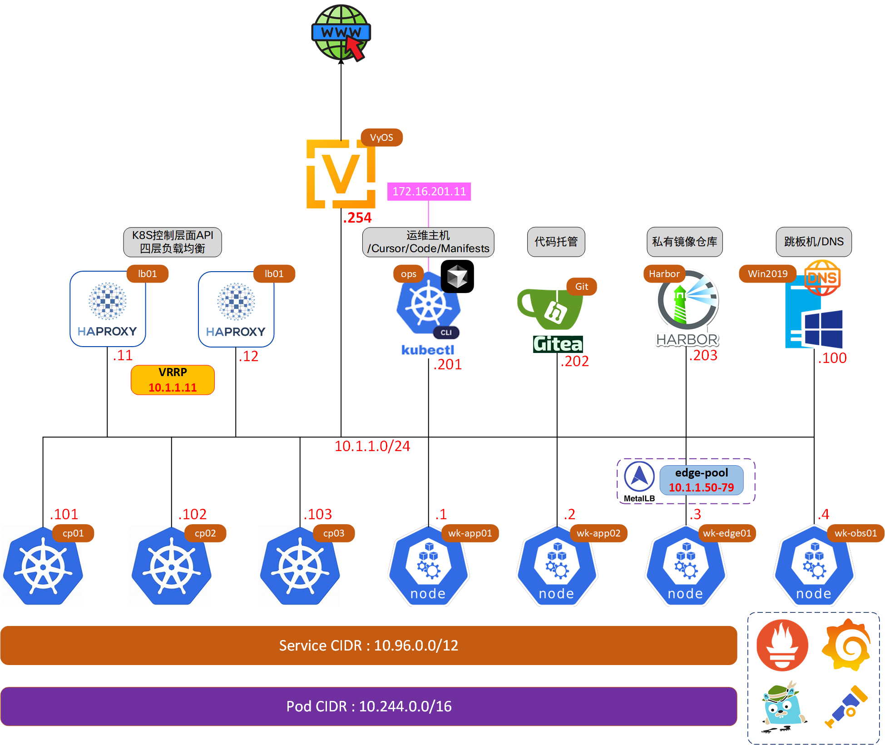
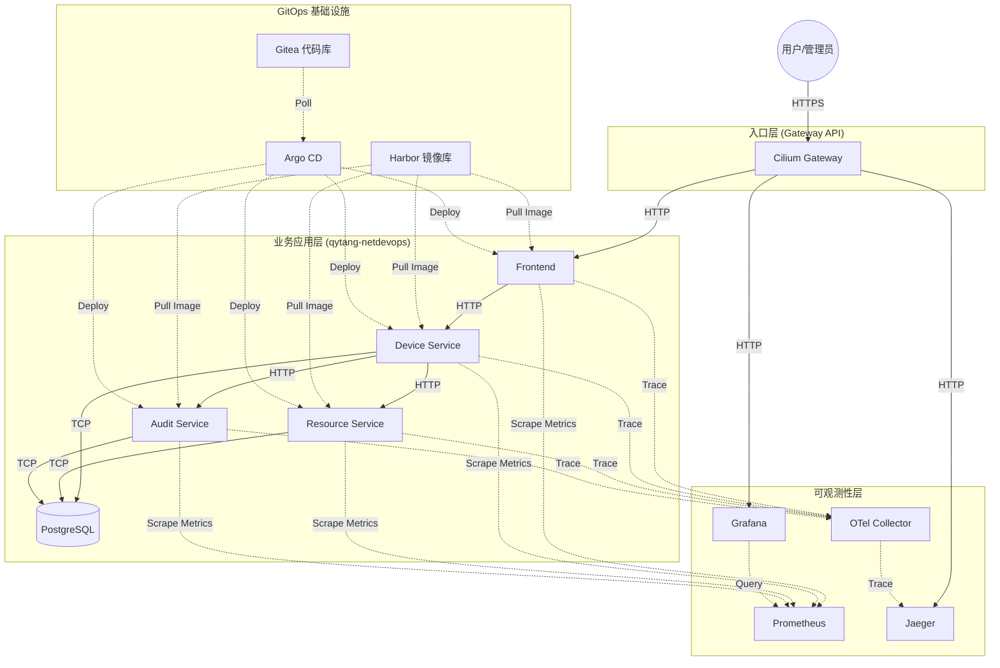
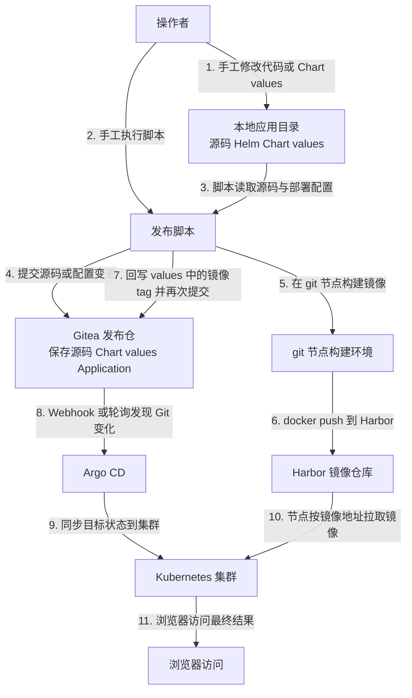

# 🏆 课程最终交付成果总览 (Docker & Kubernetes 2026)

恭喜！经过前面 7 个章节的构建，我们已经从零打造了一个具备**高可用、持久化存储、GitOps 自动化发布以及完整可观测性**的现代化 Kubernetes 生产级集群。

本文档用于综合展示本项目的最终交付成果，方便在课程最后进行全景回顾与验收。

---

## 集群拓扑

下图展示集群的物理拓扑与网络：控制面 HAProxy/VRRP、三控制节点、四工作节点（应用/边缘/可观测）、运维/Gitea/Harbor/DNS 等基础设施与 MetalLB、Service/Pod CIDR 的关系。



---

## 一、 核心 Web 平台访问清单 (GUI)

整个集群暴露了多个核心 Web 界面，全部通过 HTTPS 提供服务，并由 `Cilium Gateway API` 或 `Istio Ingress Gateway` 对外发布。

| 平台名称 | 访问地址 | 默认账号 | 默认密码 | 核心作用说明 |
| :--- | :--- | :--- | :--- | :--- |
| **Harbor** | `https://harbor.qytk8s.com` | `admin` | `Harbor12345` | **企业级镜像仓库**。存储了我们构建的 QYT NetDevOps 业务镜像。 |
| **Gitea** | `https://git.qytk8s.com` | `gitadmin` | `Gitea12345` | **私有 Git 仓库**。GitOps 的事实源，存放发布用应用目录、Helm Chart、values 与 Application。 |
| **Argo CD** | `https://argocd.qytk8s.com` | `admin` | `Cisc0123` | **持续交付平台**。监听 Gitea 变更，自动将最新状态同步到 K8s 集群。 |
| **Longhorn** | `https://longhorn.qytk8s.com` | 无 | 无 | **分布式块存储 UI**。管理集群的持久化卷 (PV/PVC)，查看数据副本与节点分布。 |
| **QYT NetDevOps** | `https://netdevops.qytk8s.com` | 无 | 无 | **核心业务系统**。包含前端页面与后端微服务，演示业务流量入口。 |
| **Hubble UI** | `https://hubble.qytk8s.com` | 无 | 无 | **云原生网络可视化界面**。观察第三章北向发布链路和集群内流量记录。 |
| **Grafana** | `https://grafana.qytk8s.com` | `admin` | `Cisc0123` | **监控可视化大盘**。查看 Kubernetes 平台总览与 QYT NetDevOps 业务指标。 |
| **Jaeger** | `https://jaeger.qytk8s.com` | 无 | 无 | **分布式链路追踪**。查看微服务之间的 API 调用瀑布图与耗时分析。 |

---

## 二、 集群健康状态验收 (CLI)

一个健康的集群，其底层资源必须各司其职。请在 `ops` 节点执行以下命令进行最终验收。

### 1. 节点状态 (Nodes)

**执行命令：**
```bash
kubectl get nodes -o wide
```

**真实输出：**
```text
NAME        STATUS   ROLES           AGE   VERSION   INTERNAL-IP   EXTERNAL-IP   OS-IMAGE             KERNEL-VERSION      CONTAINER-RUNTIME
cp01        Ready    control-plane   43h   v1.33.9   10.1.1.101    <none>        Ubuntu 24.04.4 LTS   6.8.0-100-generic   containerd://1.7.28
cp02        Ready    control-plane   43h   v1.33.9   10.1.1.102    <none>        Ubuntu 24.04.4 LTS   6.8.0-100-generic   containerd://1.7.28
cp03        Ready    control-plane   43h   v1.33.9   10.1.1.103    <none>        Ubuntu 24.04.4 LTS   6.8.0-100-generic   containerd://1.7.28
wk-app01    Ready    <none>          43h   v1.33.9   10.1.1.1      <none>        Ubuntu 24.04.4 LTS   6.8.0-100-generic   containerd://1.7.28
wk-app02    Ready    <none>          43h   v1.33.9   10.1.1.2      <none>        Ubuntu 24.04.4 LTS   6.8.0-100-generic   containerd://1.7.28
wk-edge01   Ready    <none>          43h   v1.33.9   10.1.1.3      <none>        Ubuntu 24.04.4 LTS   6.8.0-100-generic   containerd://1.7.28
wk-obs01    Ready    <none>          43h   v1.33.9   10.1.1.4      <none>        Ubuntu 24.04.4 LTS   6.8.0-100-generic   containerd://1.7.28
```

**关键看点：**
- `STATUS` 全为 `Ready`，证明底层网络和 Kubelet 运行正常。
- `ROLES` 清晰划分了 3 个控制节点和 4 个工作节点。
- `VERSION` 统一为 `v1.33.9`。

### 2. 命名空间分布 (Namespaces)

**执行命令：**
```bash
kubectl get ns
```

**真实输出：**
```text
NAME                  STATUS   AGE
argocd                Active   13h
cilium-secrets        Active   40h
default               Active   43h
gateway-demo          Active   36h
istio-ingress         Active   19h
istio-system          Active   19h
kube-node-lease       Active   43h
kube-public           Active   43h
kube-system           Active   43h
longhorn-system       Active   23h
mesh-demo             Active   19h
metallb-system        Active   36h
monitoring            Active   12m
net-demo              Active   39h
observability         Active   12m
qytang-mongodb-demo   Active   23h
qytang-netdevops      Active   13h
qytang-stateful-demo  Active   23h
```

**关键看点：**
除了系统默认的 NS 外，重点关注我们按架构规划的专属命名空间是否 `Active`：
- `cilium-secrets` / `metallb-system` (网络底层)
- `longhorn-system` (分布式存储)
- `qytang-stateful-demo` / `qytang-mongodb-demo` (第四章有状态实验)
- `argocd` (CI/CD 基础设施)
- `gateway-demo` (网关路由)
- `qytang-netdevops` (业务应用)
- `monitoring` / `observability` (第七章加入的可观测性栈)

### 3. 基础设施与 GitOps 状态

**执行命令：**
```bash
ssh 10.1.1.203 "docker ps --format 'table {{.Names}}\t{{.Status}}'"
ssh 10.1.1.202 "docker ps --format 'table {{.Names}}\t{{.Status}}'"
kubectl get pods -n argocd
```

**真实输出：**
```text
# Harbor 节点容器状态 (10.1.1.203)
NAMES               STATUS
harbor-jobservice   Up 58 minutes (healthy)
nginx               Up 58 minutes (healthy)
harbor-core         Up 58 minutes (healthy)
trivy-adapter       Up 58 minutes (healthy)
harbor-portal       Up 58 minutes (healthy)
redis               Up 58 minutes (healthy)
harbor-db           Up 58 minutes (healthy)
registryctl         Up 58 minutes (healthy)
registry            Up 58 minutes (healthy)
harbor-log          Up About an hour (healthy)

# Gitea 节点容器状态 (10.1.1.202)
NAMES            STATUS
gitea            Up 17 minutes
gitea-postgres   Up 17 minutes (healthy)

# Argo CD Pod 状态
NAME                                                READY   STATUS    RESTARTS      AGE
argocd-application-controller-0                     1/1     Running   1 (61m ago)   13h
argocd-applicationset-controller-65988fd5c8-gh9g8   1/1     Running   1 (61m ago)   13h
argocd-dex-server-c96476d9-d4t2r                    1/1     Running   1 (61m ago)   13h
argocd-notifications-controller-78fbd8d565-j27hb    1/1     Running   1 (61m ago)   13h
argocd-redis-69db954b8-pzk8k                        1/1     Running   1 (61m ago)   13h
argocd-repo-server-6594588498-p7f7g                 1/1     Running   0             59m
argocd-server-5f4f665d44-68qx4                      1/1     Running   1 (61m ago)   12h
```

**关键看点：**
- Harbor 的核心组件（`harbor-core`, `registry`, `nginx` 等）全部处于 `healthy` 状态。
- Gitea 本体和它的 PostgreSQL 都已正常运行，GitOps 的代码事实源可用。
- Argo CD 的 7 个核心组件全部处于 `Running` 状态，且 `READY` 为 `1/1`。
- 这证明了 GitOps 的基础设施底座非常稳固，代码推送和镜像拉取不会出现断层。

### 4. 业务微服务状态 (QYT NetDevOps)

**执行命令：**
```bash
kubectl get pods -n qytang-netdevops -o wide
```

**真实输出：**
```text
NAME                               READY   STATUS    RESTARTS   AGE     IP             NODE        NOMINATED NODE   READINESS GATES
audit-service-6bdffb9648-v89jc     1/1     Running   0          8m41s   10.244.2.240   wk-app02    <none>           <none>
device-service-65c8968458-pt4rz    1/1     Running   0          8m41s   10.244.2.180   wk-app02    <none>           <none>
frontend-5fc89c755d-vdnmc          1/1     Running   0          8m41s   10.244.2.189   wk-app02    <none>           <none>
postgres-768454dc9d-wqxj7          1/1     Running   0          59m     10.244.1.177   wk-edge01   <none>           <none>
resource-service-998c97f75-mm5vt   1/1     Running   0          8m41s   10.244.4.10    wk-app01    <none>           <none>
```

**关键看点：**
- 包含 `frontend`, `device-service`, `resource-service`, `audit-service`, `postgres` 五个核心组件。
- 状态全部为 `Running`，且 `READY` 为 `1/1`，证明应用已经成功启动并连接到了数据库，通过了存活探针检查。
- `NODE` 列显示 Pod 被合理调度到了 `wk-app01`, `wk-app02`, `wk-edge01` 等不同的工作节点上。

### 5. 可观测性栈状态 (Observability)

**执行命令：**
```bash
kubectl get pods -n monitoring
kubectl get pods -n observability
```

**真实输出：**
```text
# monitoring 命名空间 (Prometheus 栈)
NAME                                                  READY   STATUS    RESTARTS   AGE
kps-grafana-5d6c96f844-4hptr                          3/3     Running   0          12m
kps-kube-prometheus-stack-operator-544cfdbcc9-d6twh   1/1     Running   0          12m
kps-kube-state-metrics-7c788d7976-kc2g9               1/1     Running   0          12m
kps-prometheus-node-exporter-6qtrb                    1/1     Running   0          12m
kps-prometheus-node-exporter-7dzht                    1/1     Running   0          12m
kps-prometheus-node-exporter-f4x2p                    1/1     Running   0          12m
kps-prometheus-node-exporter-gbl2j                    1/1     Running   0          12m
kps-prometheus-node-exporter-lnxt8                    1/1     Running   0          12m
kps-prometheus-node-exporter-lr2l4                    1/1     Running   0          12m
kps-prometheus-node-exporter-rf8gf                    1/1     Running   0          12m
prometheus-kps-kube-prometheus-stack-prometheus-0     2/2     Running   0          11m

# observability 命名空间 (Trace 栈)
NAME                                            READY   STATUS    RESTARTS   AGE
jaeger-69b77bb4cf-7kvt5                         1/1     Running   0          9m55s
otel-opentelemetry-collector-787d57c785-g8br6   1/1     Running   0          9m32s
```

**关键看点：**
- `monitoring` 中成功部署了 `prometheus`, `grafana`, `kube-state-metrics`。注意 `node-exporter` 以 DaemonSet 形式运行在每一个节点上。
- `observability` 中成功部署了单机版的 `jaeger` 和负责接收业务 Trace 数据的 `otel-opentelemetry-collector`。
- 这是第七章的最终成果，所有可观测性组件均处于 `Running` 状态。

---

## 三、 最终架构数据流回顾

### 3.1 逻辑架构与数据流



### 3.2 GitOps 交付链路

从改代码/改配置到浏览器看到结果，整条链路如下。课堂演示时可重点观察步骤 8（Argo CD 发现 Git 变化）、9（同步到集群）、11（浏览器结果）。



## 四、 结语

至此，一个符合 2026 年技术栈演进方向的 Kubernetes 生产级集群已经完整落地。它不仅能跑通业务，更具备了企业级的运维能力（自动化发布、数据持久化、全链路观测）。

你可以随时通过快照回到任何一个章节的终点，反复练习和验证其中的技术细节。
