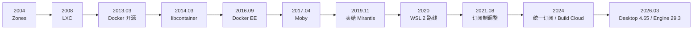

# 本步目标

- 了解容器技术的演进脉络，从早期的 Solaris Zones 到 Docker 的出现。
- 掌握 Docker 自 2013 年开源以来的关键里程碑，以及公司路线和商业模式的变化。
- 建立一个当前判断：Docker 仍在持续演进，但它今天的重心已经是开发者工具平台，而不是企业编排平台。

# 问题背景

Docker 是目前最常见的容器工具，但它并不是容器技术的起点。  
在 Docker 之前，操作系统级隔离已经积累了二十多年，Docker 的成功建立在前几代方案之上。

另一方面，Docker 自 2013 年开源以来，公司本身也经历了多次明显转向：核心代码重组、企业业务出售、订阅模式调整、产品线重新聚焦。  
如果不了解这些背景，就很容易停留在“Docker 还是当年的 Docker CE / EE”这类过时认识上。

# 官方资料

以下时间点主要参考 Docker 官方博客、官方文档与官方新闻稿：

- Docker 九周年回顾  
  <https://www.docker.com/blog/docker-nine-years-young/>
- Docker 0.9 与 libcontainer  
  <https://www.docker.com/blog/docker-0-9-introducing-execution-drivers-and-libcontainer/>
- Moby Project 官方介绍  
  <https://www.docker.com/blog/introducing-the-moby-project/>
- Docker 企业业务重组与出售  
  <https://www.docker.com/press-release/docker-new-direction/>
- Docker Desktop WSL 2 Backport Update  
  <https://www.docker.com/blog/docker-desktop-wsl-2-backport-update/>
- Docker Desktop 订阅调整  
  <https://www.docker.com/press-release/docker-updates-product-subscriptions/>
- Docker Build Cloud  
  <https://docs.docker.com/build-cloud/>
- 2024 统一订阅方案  
  <https://www.docker.com/blog/november-2024-updated-plans-announcement/>
- Docker Desktop Release Notes  
  <https://docs.docker.com/desktop/release-notes/>
- Docker Engine v29 Release Notes  
  <https://docs.docker.com/engine/release-notes/29/>

# 关键时间线图

这张图先回答两个问题：

- Docker 不是容器技术的起点，而是建立在更早的隔离技术之上。
- Docker 也不是一成不变的单一产品，它已经从开源容器工具逐步演化为一套开发者工具平台。

# 容器技术前史

## Solaris Containers / Zones（2004）

Sun Microsystems（后被 Oracle 收购）在 Solaris 10 中引入了 Zones 技术。  
这是操作系统级虚拟化的早期代表之一，可以在同一个 Solaris 内核上运行多个彼此隔离的用户空间环境。

核心特点：

- 共享宿主内核，不需要单独的 OS 镜像
- 每个 Zone 具备独立的进程空间、网络栈和文件系统视图
- 资源控制通过 Solaris Resource Management 实现

Zones 证明了“共享内核 + 隔离用户空间”这条路线可行，但它绑定在 Solaris 平台上，没有形成跨平台的通用生态。

## Linux Containers / LXC（2008）

LXC 是 Linux 平台上第一个成熟的容器方案，建立在两类关键内核能力之上：

| 特性 | 作用 |
|---|---|
| **Namespace** | 隔离进程可见范围，如 PID、网络、挂载点、用户等 |
| **Cgroup** | 限制进程可使用的资源，如 CPU、内存、IO 等 |

LXC 提供了用户态工具来创建和管理 Linux 容器。  
但它的使用门槛偏高，缺乏镜像分发、标准化构建和统一开发体验，因此主要停留在系统工程师和基础设施领域。

# Docker 发展历程

## 2013：Docker 诞生与开源

Docker 最初由 Solomon Hykes 在 PaaS 公司 dotCloud 内部启动。  
2013 年 3 月，Docker 在 PyCon 大会上首次公开演示并开源。

Docker 早期基于 LXC 作为底层运行时，但在产品层做了几个关键决策：

- 引入 **Image** 概念，把构建产物标准化打包
- 引入 **Dockerfile**，让构建过程可描述、可复现
- 引入 **Registry / Docker Hub**，让镜像可以集中分发
- 提供统一 CLI，显著降低容器上手门槛

这些设计使 Docker 不再只是“Linux 容器工具”，而更像“开发者友好的容器平台”。

> Docker 在 0.9 版本（2014 年）中用自研的 `libcontainer` 替换了 LXC，进一步摆脱了对 LXC 用户态工具的依赖。`libcontainer` 后来演变为 `runc`，并成为 OCI 生态中的关键运行时实现。

## 2016：Docker Enterprise Edition 推出

2016 年 9 月，Docker 与 Microsoft 一起推出 Docker Enterprise Edition（EE）。  
同一时期，Docker 也开始在企业场景中力推 Docker Swarm 作为编排方案。

当时的产品线大致分为两条：

| 产品 | 定位 |
|---|---|
| Docker CE（Community Edition） | 社区免费版，面向开发者 |
| Docker EE（Enterprise Edition） | 企业付费版，包含安全扫描、RBAC、认证支持等能力 |

这一阶段的 Docker，试图同时覆盖开发者工作流与企业级容器平台。

## 2017：Moby Project 与版本号重构

2017 年是 Docker 生态的一次重要重组：

- Docker 将核心引擎代码从 `docker/docker` 仓库迁移到 **`moby/moby`**，成立 **Moby Project** 作为上游开源项目
- 版本号从 `1.13.x` 改为 **YY.MM 格式**，如 `17.03`、`17.06`
- Docker CE / EE 开始更加明确地分离发布

Moby Project 的定位可以理解为：

> 用来组装容器系统的开放框架与组件集合。

Docker 产品本身则是基于 Moby 构建的下游发行版，关系上有点类似于 Fedora 与 RHEL。

## 2019：Docker Enterprise 出售给 Mirantis

2019 年 11 月，Docker 将整个企业业务（Docker EE）出售给 **Mirantis**，其中包括：

- Docker Engine Enterprise
- Docker Trusted Registry
- Docker Universal Control Plane
- 约 750 个企业客户
- 相关员工与合作伙伴关系

出售后的变化可以概括为：

| 事项 | 结果 |
|---|---|
| Docker EE | 更名并并入 Mirantis 产品体系 |
| Docker Swarm | Mirantis 承诺继续支持，但整体行业重心已明显转向 Kubernetes |
| Docker Inc. | 管理层与融资结构调整，公司方向重新聚焦 |
| 公司重心 | 转向 **Docker Desktop**、**Docker Hub** 及开发者体验 |

这次出售是 Docker 商业路线上的分水岭。  
从这一刻起，外界熟悉的“Docker CE / EE”叙事就不再适用于今天的 Docker。

## 2020：Docker Desktop 转向 WSL 2 路线

Docker Desktop 在 2019 年引入 WSL 2 技术预览后，于 2020 年进一步推进 WSL 2 路线，并扩展到更多 Windows 版本。

与早期 Hyper-V 方案相比：

| 对比项 | Hyper-V 方案 | WSL 2 方案 |
|---|---|---|
| 虚拟化形态 | 传统 Hyper-V 虚拟机 | 轻量级虚拟化（Virtual Machine Platform） |
| 资源占用 | 较高 | 更低 |
| 启动速度 | 较慢 | 更快 |
| Windows 版本要求 | Pro / Enterprise | **Home / Pro / Enterprise 均可** |

> 严格来说，WSL 2 底层仍然使用了轻量级虚拟化技术，但它已经不再是传统意义上“手工维护一个独立 VM”的使用体验。  
> 因此，旧说法“Docker 在 Windows 下必须依赖一个传统虚拟机”已经不够准确。

## 2021：Docker Desktop 订阅制改革

2021 年 8 月，Docker 对 Docker Desktop 的许可证模式做了重大调整。

当时的主要订阅层级如下：

| 层级 | 价格 | 适用对象 |
|---|---|---|
| Personal | 免费 | 个人、教育、小企业（< 250 人且年收入 < $10M） |
| Pro | $5/月 | 个人开发者 |
| Team | $7/月/人 | 团队协作 |
| Business | $21+/月/人 | 大型企业 |

关键规则：

- 员工超过 250 人，或年收入超过 1000 万美元的企业，使用 Docker Desktop 需要付费订阅
- Docker Engine（CLI、`dockerd`、`containerd` 等开源部分）本身仍然免费
- 过渡期截止到 2022 年 1 月 31 日

这次调整是 Docker 转型后最关键的商业动作之一，也直接影响了不少企业对容器工具链的选择。  
部分用户因此转向 Podman、`nerdctl` 等替代路线。

## 2024：统一订阅与开发者工具平台化

Docker 在 2024 年继续强化开发者工具路线。  
其中最明显的变化不是单独某个产品，而是把多个能力统一进同一套订阅体系。

Docker 在 2024 年 9 月宣布升级订阅方案，并在 2024 年 12 月起逐步生效。新方案把 **Docker Desktop、Docker Hub、Build Cloud、Scout、Testcontainers Cloud** 纳入统一订阅体系。  
这说明 Docker 的业务重点已经是“开发入口 + 镜像分发 + 云端构建 + 安全分析 + 集成测试”，而不再是当年的企业编排平台。

### 2024 年前后主要产品线与作用

| 产品 | 作用概要 |
|---|---|
| **Docker Desktop** | 本机开发入口，集成引擎、Compose、Kubernetes 等能力 |
| **Docker Hub** | 镜像仓库、组织协作、拉取策略与分发入口 |
| **Docker Build Cloud** | 把构建放到云端执行，强调共享缓存与多架构构建 |
| **Docker Scout** | 面向镜像与依赖的漏洞、SBOM、策略检查 |
| **Testcontainers Cloud** | 为集成测试提供云端容器依赖环境 |

### Build Cloud、Scout、Testcontainers Cloud 的区分

- **Build Cloud**：重点是把 `docker build` 的算力与缓存放到云上，解决构建速度、多架构和团队共享缓存问题
- **Scout**：重点是供应链安全、漏洞分析、SBOM 与策略检查
- **Testcontainers Cloud**：重点是让应用测试过程可以连接真实容器依赖，而容器由 Docker 托管在云端运行

## 2025-2026：当前状态

截至 **2026 年 3 月 18 日**，根据 Docker 官方 release notes 可确认的状态如下：

| 指标 | 数值 |
|---|---|
| Docker Desktop 最新版本 | 4.65.0 |
| Docker Desktop 发布时间 | 2026-03-16 |
| Docker Engine 最新版本 | 29.3.0 |
| Docker Engine 发布时间 | 2026-03-05 |

可以看到，Docker 仍在持续发布版本。  
当前版本迭代的重点，更多落在以下方向：

- Docker Desktop 的开发者桌面体验
- Build、AI、安全相关能力与 Desktop 的持续整合
- 围绕开发工作流的产品协同，而不是重新回到企业编排平台路线

需要特别说明的是，很多人感受到的“Docker 存在感下降”，并不等于“Docker 停止维护”。  
更准确的说法是：**Docker 的维护重点已经从企业容器平台，转向开发者工具平台。**

### Docker 与 Docker Compose 是否仍在维护

| 项目 | 当前情况 |
|---|---|
| **Docker Engine / Docker CLI** | 仍在持续维护和发布版本，是整个产品体系的基础能力 |
| **Docker Compose** | 仍在持续维护，官方主线是集成到 Docker CLI 中的 **Compose V2**，命令形态为 `docker compose` |
| **`docker-compose`** | 这是早期独立的 Python 工具形态，已不再是官方推荐主线 |
| **Docker Swarm** | 仍可用，但已不再是 Docker 公司当前最核心的战略重点 |

之所以容易产生“Compose 可能没人维护了”这类误解，通常有三个原因：

- Docker 在 2019 年出售企业业务后，不再主打企业编排路线
- Kubernetes 成为容器编排领域的主流中心，转移了外界注意力
- Compose 的官方命令形态从 `docker-compose` 转为 `docker compose`，让很多人误以为它只是“换了个写法”，而忽略了其维护形态已经变化

# 关键时间线总结

| 年份 | 事件 | 性质 |
|---|---|---|
| 2004 | Solaris Containers / Zones 发布 | 前史 |
| 2008 | Linux Containers（LXC）发布 | 前史 |
| 2013.03 | Docker 开源发布 | **里程碑** |
| 2014 | libcontainer 替换 LXC，后来演变为 `runc` | 技术演进 |
| 2016.09 | Docker Enterprise Edition 推出 | 商业化 |
| 2017.04 | 核心代码重组为 Moby Project，版本号改为 YY.MM | **里程碑** |
| 2019.11 | Docker EE 出售给 Mirantis，公司转型 | **商业转折** |
| 2020 | Docker Desktop 转向 WSL 2 后端 | 技术演进 |
| 2021.08 | Docker Desktop 订阅制调整 | **商业转折** |
| 2024 | 统一订阅、Build Cloud、Scout、Testcontainers Cloud | 产品扩展 |
| 2026.03 | Desktop 4.65.0 / Engine 29.3.0 | 当前状态 |

# 当前认识

| 主题 | 当前结论 |
|---|---|
| Docker 产品形态 | Docker EE 已在 2019 年出售给 Mirantis；今天常见的 Docker 更接近“Desktop + Hub + Build + 安全 + 测试”的组合 |
| Windows 后端 | Docker Desktop 已长期以 WSL 2 路线为主，不再是早期 Hyper-V 心智模型 |
| Compose 状态 | Docker Compose 仍在维护，当前官方主线是 `docker compose`（Compose V2） |
| 生态结构 | Docker、Moby、containerd、BuildKit、Compose 等项目已经形成更清晰的分层 |
| 容器方案选择 | Docker 仍是最主流的路线之一，但 Podman、containerd + `nerdctl` 等替代方案也很常见 |
