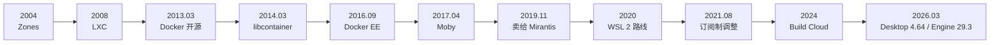

# 本步目标

- 了解容器技术的演进脉络，从早期 Solaris Zones 到 Docker 的诞生。
- 掌握 Docker 自 2013 年至今的关键里程碑及商业模式变迁。
- 理解 Docker 当前在容器生态中的位置和最新状态。

# 问题背景

Docker 是目前最主流的容器工具，但它不是凭空出现的。
容器技术有超过 20 年的技术积累，Docker 的成功建立在前几代容器方案之上。

同时，Docker 自 2013 年开源以来，公司本身也经历了多次重大变化：核心代码重组、企业业务出售、商业模式转型。
如果不了解这些背景，容易停留在过时的认知上。

# 官方资料

以下时间点主要参考 Docker 官方博客、官方文档和官方新闻稿：

- Docker 九周年回顾  
  <https://www.docker.com/blog/docker-nine-years-young/>
- Docker 0.9 与 libcontainer  
  <https://www.docker.com/blog/docker-0-9-introducing-execution-drivers-and-libcontainer/>
- Moby Project 官方介绍  
  <https://www.docker.com/blog/introducing-the-moby-project/>
- Docker 企业业务重组与出售  
  <https://www.docker.com/press-release/docker-new-direction/>
- Docker Desktop WSL 2 Backport Update  
  <https://www.docker.com/blog/docker-desktop-wsl-2-backport-update/>
- Docker Desktop 订阅调整  
  <https://www.docker.com/press-release/docker-updates-product-subscriptions/>
- Docker Build Cloud  
  <https://docs.docker.com/build-cloud/>
- 2024 统一订阅方案  
  <https://www.docker.com/blog/november-2024-updated-plans-announcement/>
- Docker Desktop Release Notes  
  <https://docs.docker.com/desktop/release-notes/>
- Docker Engine v29 Release Notes  
  <https://docs.docker.com/engine/release-notes/29/>

# 关键时间线图

这张图先回答两个问题：

- Docker 并不是容器技术的起点，它建立在更早的隔离技术之上。
- Docker 本身也不是一成不变的产品，它从开源项目逐步演化成了开发者工具平台。

# 容器技术前史

## Solaris Containers / Zones（2004）

Sun Microsystems（后被 Oracle 收购）在 Solaris 10 中引入了 Zones 技术。
这是操作系统级虚拟化的早期代表之一，可以在同一个 Solaris 内核上运行多个隔离的用户空间环境。

核心特点：

- 共享宿主内核，不需要独立的 OS 镜像
- 每个 Zone 有独立的进程空间、网络栈、文件系统视图
- 资源控制通过 Solaris Resource Management 实现

Zones 证明了"共享内核 + 隔离用户空间"这条路线是可行的，但它绑定在 Solaris 平台上，没有形成通用生态。

## Linux Containers / LXC（2008）

LXC 是 Linux 平台上第一个成熟的容器方案，基于两项关键内核特性：

| 特性 | 作用 |
|---|---|
| **Namespace** | 隔离进程的可见范围（PID、网络、挂载点、用户等） |
| **Cgroup** | 限制进程可使用的资源（CPU、内存、IO 等） |

LXC 提供了用户态工具，可以创建和管理 Linux 容器。
但 LXC 的使用门槛较高，缺乏镜像分发、标准化构建等能力，主要在系统工程师群体中使用。

# Docker 发展历程

## 2013 — Docker 诞生与开源

Docker 最初由 Solomon Hykes 在 PaaS 公司 dotCloud 内部启动。
2013 年 3 月，Docker 在 PyCon 大会上首次公开演示并开源。

Docker 最初基于 LXC 作为底层运行时，但在架构上做了几个关键决策：

- 引入**镜像（Image）** 概念，实现构建产物的标准化打包
- 引入 **Dockerfile**，实现构建过程的可描述、可复现
- 引入 **Registry**（Docker Hub），实现镜像的集中分发
- 提供统一 CLI，大幅降低容器使用门槛

这些设计让 Docker 从一个"Linux 容器工具"变成了"开发者友好的容器平台"。

> Docker 后来在 0.9 版本（2014 年）用自研的 `libcontainer` 替换了 LXC，进一步摆脱了对 LXC 用户态工具的依赖。`libcontainer` 后来演变为 `runc`，成为 OCI 标准运行时。

## 2016 — Docker Enterprise Edition 推出

2016 年 9 月，Docker 与 Microsoft 一起推出 Docker Enterprise Edition (EE)。
同期开始在企业场景推广 Docker Swarm 作为容器编排方案。

此时 Docker 的产品线分为两条：

| 产品 | 定位 |
|---|---|
| Docker CE（Community Edition） | 社区免费版，面向开发者 |
| Docker EE（Enterprise Edition） | 企业付费版，包含安全扫描、RBAC、认证支持等 |

## 2017 — Moby Project 与版本号重构

2017 年是 Docker 生态的一次重要重组：

- Docker 将核心引擎代码从 `docker/docker` 仓库迁移到 **`moby/moby`**，成立 **Moby Project** 作为上游开源项目
- 版本号从原来的 `1.13.x` 改为 **YY.MM 格式**（如 `17.03`、`17.06`）
- Docker CE / EE 正式分离发布

Moby Project 的定位是：

> 一个组装容器系统的开放框架和组件库。

Docker 产品本身是基于 Moby 构建的下游发行版，类似 Red Hat Enterprise Linux 之于 Fedora 的关系。

## 2019 — Docker Enterprise 出售给 Mirantis

2019 年 11 月，Docker 将整个企业业务（Docker EE）出售给 **Mirantis**，包括：

- Docker Engine Enterprise
- Docker Trusted Registry
- Docker Universal Control Plane
- 约 750 个企业客户
- 相关员工和合作伙伴关系

出售后的变化：

| 事项 | 结果 |
|---|---|
| Docker EE | 更名为 Mirantis Kubernetes Engine (MKE) |
| Docker Swarm | Mirantis 承诺支持两年后转向 Kubernetes |
| Docker Inc | CEO 更换为 Scott Johnston，获得 3500 万美元新融资 |
| 公司方向 | 转型聚焦 **Docker Desktop** 和 **Docker Hub** |

这次出售标志着 Docker 的企业编排路线结束，公司重心转向开发者工具。

**从这一刻起，"Docker CE / EE"这个分类不再存在。**

## 2020 — Docker Desktop 支持 WSL 2

Docker Desktop 在 2019 年引入 WSL 2 技术预览后，于 2020 年进一步推进 WSL 2 路线，并扩展到更多 Windows 版本。

与之前的 Hyper-V 方案相比：

| 对比项 | Hyper-V 方案 | WSL 2 方案 |
|---|---|---|
| 虚拟化类型 | 传统 Hyper-V 虚拟机 | 轻量级虚拟化（Virtual Machine Platform） |
| 资源占用 | 较高 | 明显更低 |
| 启动速度 | 较慢 | 快 |
| Windows 版本要求 | Pro / Enterprise | **Home / Pro / Enterprise 均可** |

> 严格来说 WSL 2 底层仍使用了轻量级虚拟化技术，但不再是传统意义上的"开一个虚拟机"。
> 因此，旧说法"Docker 在 Windows 下需要借助一个 VM 来实现"已经不够准确。

## 2021 — Docker Desktop 订阅制改革

2021 年 8 月，Docker 对 Docker Desktop 的许可证模式做了重大调整：

**新的订阅层级：**

| 层级 | 价格 | 适用对象 |
|---|---|---|
| Personal | 免费 | 个人、教育、小企业（< 250 人且年收入 < $10M） |
| Pro | $5/月 | 个人开发者（需要更多功能） |
| Team | $7/月/人 | 团队协作 |
| Business | $21+/月/人 | 大型企业 |

关键规则：

- 员工 250 人以上 **或** 年收入超过 1000 万美元的企业，**必须购买付费订阅**才能使用 Docker Desktop
- Docker Engine（CLI、dockerd、containerd）本身仍然开源免费，不受此限制
- 过渡期截止到 2022 年 1 月 31 日

这次变更是 Docker 转型后最重要的商业模式调整，直接影响了企业用户对容器工具链的选择。
部分企业因此转向 Podman、nerdctl 等替代方案。

## 2024 — Docker Build Cloud 与统一订阅

Docker 在 2024 年继续强化开发者工具路线，其中最典型的是 Build Cloud 与统一订阅方案。

Docker 在 2024 年 9 月宣布升级订阅方案，并在 2024 年 12 月起逐步生效。新方案把 **Docker Desktop、Docker Hub、Build Cloud、Scout、Testcontainers Cloud** 放进统一订阅体系；业务重心是「开发入口 + 镜像分发 + 云端构建 + 安全分析 + 集成测试中的容器」，而非单一的云端构建。

### 2024 年前后主要产品线与作用

| 产品 | 作用概要 |
|---|---|
| **Docker Desktop** | 本机开发入口：引擎、Compose、Kubernetes 等 |
| **Docker Hub** | 镜像仓库与团队协作、拉取策略等 |
| **Docker Build Cloud** | 构建在云端执行，本机传构建上下文并接收镜像；团队共享构建缓存，多架构构建更省事 |
| **Docker Scout** | 镜像与依赖的漏洞、SBOM、策略门禁，常与 Registry / CI 联动 |
| **Testcontainers Cloud** | 集成测试所需容器在云端创建与销毁；测试代码仍在本机或 CI 执行，依赖服务以真实容器形式提供 |

### Build Cloud、Scout、Testcontainers Cloud 的区分

- **Build Cloud**：将 `docker build` 的算力放到云上，突出 **共享缓存** 与 **原生多架构构建**；不等同于 Docker 的全部业务。
- **Scout**：面向 **供应链安全与镜像分析**（漏洞、SBOM、策略），不替代业务逻辑开发。
- **Testcontainers Cloud**：**Testcontainers** 在代码里声明「测试期间启动某镜像容器」（如 Postgres、Redis）。云端方案把「起容器、暴露端口」放到 Docker 托管环境，用于 **应用连真实依赖的集成测试**，而非测试 Docker 自身。

## 2025–2026 — 当前状态

截至 2026 年 3 月 18 日，按照官方 release notes 可确认的状态如下：

| 指标 | 数值 |
|---|---|
| Docker Desktop 最新版本 | 4.64.0 |
| Docker Desktop 发布时间 | 2026-03-11 |
| Docker Engine 最新版本 | 29.3.0 |
| Docker Engine 发布时间 | 2026-03-05 |

最新版本的重点方向包括：

- 开发者桌面体验持续增强
- Build / AI / 安全相关能力持续整合到 Docker Desktop
- Docker 继续把重点放在开发者工作流，而不是重新回到企业编排平台路线

需要特别说明的是，当前 Docker 给人的“存在感下降”并不等同于“停止维护”。
更准确的变化是：**维护重点已经从早期的企业容器平台，转向开发者工具平台**。

### Docker 与 Docker Compose 是否仍在维护

| 项目 | 当前情况 |
|---|---|
| **Docker Engine / Docker CLI** | 仍在持续维护和发布版本，是 Docker 当前产品体系的核心基础能力 |
| **Docker Compose** | 仍在持续维护，但官方主线已经是集成到 Docker CLI 中的 **Compose V2**，命令形态为 `docker compose` |
| **`docker-compose`** | 这是早期独立的 Python 工具形态，已不再是官方推荐主线，因此容易让人误以为 Compose 已经“没人管” |
| **Docker Swarm** | Mirantis 承诺支持两年后转向 Kubernetes |

造成误解的主要原因有三点：

- Docker 在 2019 年出售 Docker Enterprise 后，不再主打企业编排平台路线
- Kubernetes 成为容器编排领域的主流话语中心，分散了外界对 Docker 的关注
- Compose 的官方使用方式从 `docker-compose` 转为 `docker compose`，维护形态发生了变化

# 关键时间线总结

| 年份 | 事件 | 性质 |
|---|---|---|
| 2004 | Solaris Containers / Zones 发布 | 前史 |
| 2008 | Linux Containers (LXC) 发布 | 前史 |
| 2013.03 | Docker 开源发布 | **里程碑** |
| 2014 | libcontainer 替换 LXC，后来演变为 runc | 技术演进 |
| 2016.09 | Docker Enterprise Edition 推出 | 商业化 |
| 2017.04 | 核心代码重组为 Moby Project，版本号改为 YY.MM | **里程碑** |
| 2019.11 | Docker EE 出售给 Mirantis，公司转型 | **商业转折** |
| 2020 | Docker Desktop 支持 WSL 2 后端 | 技术演进 |
| 2021.08 | Docker Desktop 改为订阅制 | **商业转折** |
| 2024 | Build Cloud / Scout / 统一订阅 | 产品扩展 |
| 2026.03 | Desktop 4.64.0 / Engine 29.3.0 | 当前状态 |

# 当前认识

| 主题 | 当前结论 |
|---|---|
| Docker 产品形态 | Docker EE 已于 2019 年卖给 Mirantis；当前常见订阅层级为 Personal / Pro / Team / Business；2024 年起 Build Cloud、Scout、Testcontainers Cloud 等与 Desktop、Hub 同属统一订阅下的产品组合 |
| Windows 后端 | Docker Desktop 已长期以 WSL 2 路线为主，不再依赖传统 Hyper-V 虚拟机思路 |
| Compose 状态 | Docker Compose 仍在维护，当前官方主线是 `docker compose`（Compose V2）；旧的 `docker-compose` 已不再是推荐形态 |
| 生态结构 | 当前生态中，Docker、Moby、containerd、BuildKit、Compose 等已经形成更清晰的分层 |
| 容器方案选择 | Docker 仍是最主流的方案之一，但 Podman、containerd + nerdctl 等替代路线也被广泛使用 |
