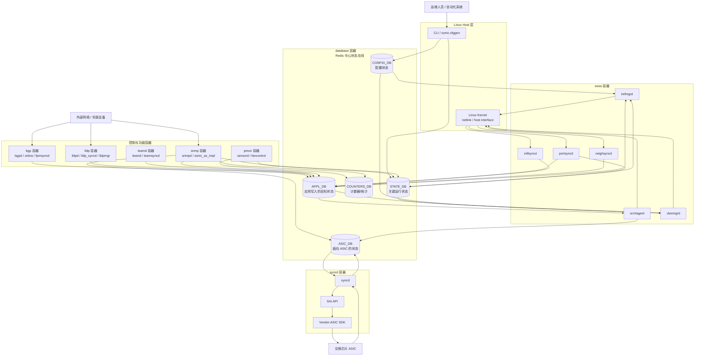
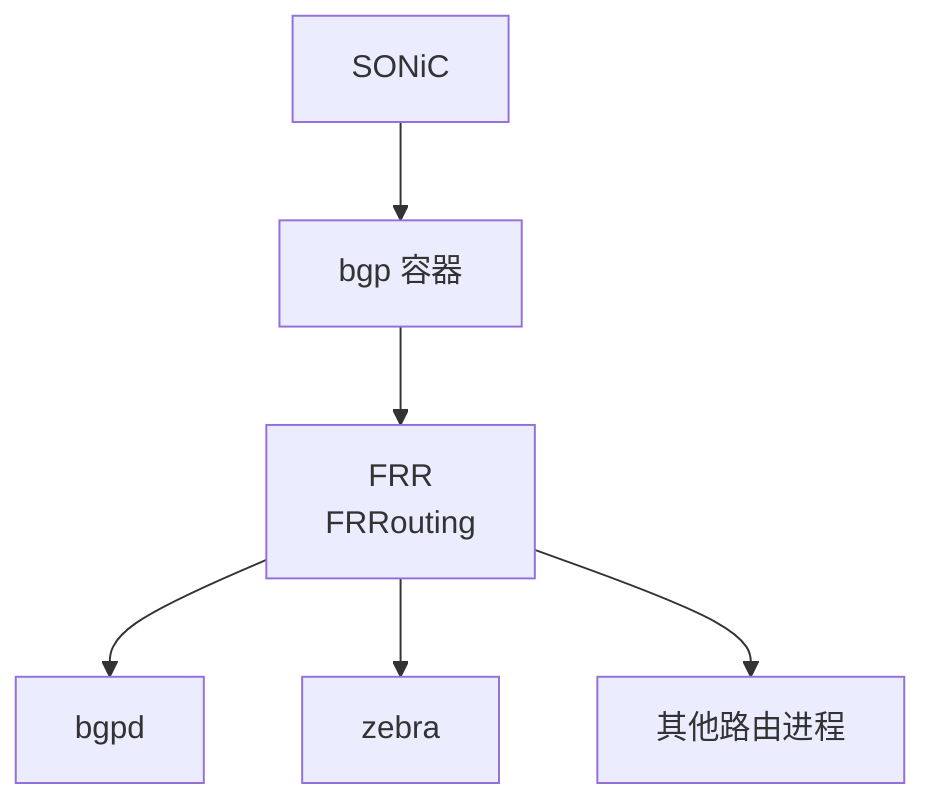
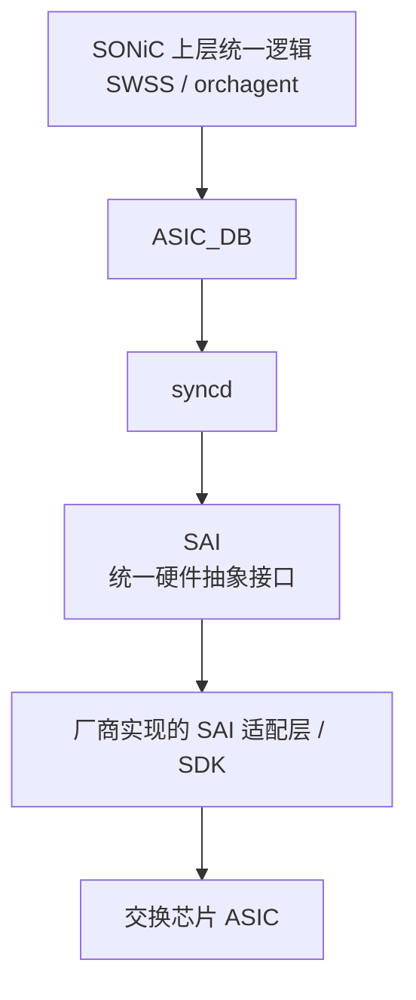
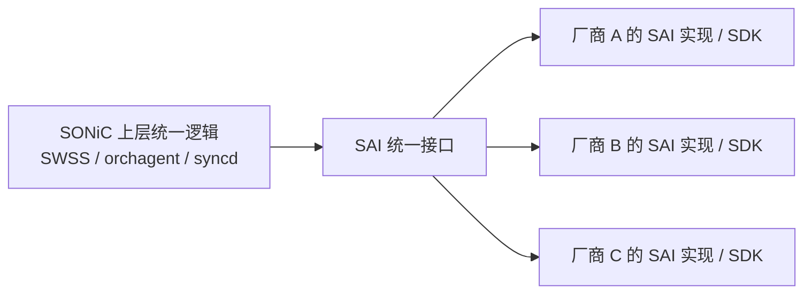

# 本步目标

- 认识 SONiC 是一个典型的容器化网络操作系统。
- 理解 SONiC 不是把整台交换机系统塞进一个大容器，而是把不同网络功能拆进多个容器。
- 理解 SONiC 的主干结构：Linux Host、Docker 容器、Redis、SWSS、Syncd、SAI、ASIC。
- 建立一个认识：容器化不仅适用于 Web 应用，也适用于网络设备系统。

# 问题背景

Docker 初学阶段最常见的例子通常是：

- Web 服务
- 数据库
- 缓存
- 反向代理

这些场景足以说明容器的基本用法，但不足以说明容器化在大型系统中的价值。  
SONiC 正好提供了一个更典型的系统级案例。

SONiC 是运行在交换机上的网络操作系统。  
它把路由、链路聚合、LLDP、SNMP、平台监控、交换芯片适配等能力拆分到多个容器中协同工作，因此很适合放在 Docker 导论中用来说明“容器化是一种系统架构方法”。

# 官方资料

以下资料来自 SONiC 官方项目或官方引用资料：

- SONiC 官方仓库  
  <https://github.com/sonic-net/SONiC>
- SONiC 官方 Wiki  
  <https://github.com/sonic-net/SONiC/wiki>
- SONiC Architecture  
  <https://github.com/sonic-net/SONiC/wiki/Architecture>
- SONiC Supported Platforms  
  <https://sonic-net.github.io/SONiC/Supported-Devices-and-Platforms.html>
- SAI（Switch Abstraction Interface）官方仓库  
  <https://github.com/opencomputeproject/SAI>

## 配套视频

以下视频可作为本节的配套学习资料：

- 教主技术进化论 2026-6 英伟达交换机刷 SONiC 系统实战  
  <https://www.bilibili.com/video/BV1MpPazaEDd>
- 教主技术进化论 2026-7 SONiC 命令行配置 EVPN_VXLAN 实战  
  <https://www.bilibili.com/video/BV1zGcQzFEmZ>

官方 README 对 SONiC 的概括是：

> SONiC ... is a free and open-source network operating system based on Linux that runs on switches from multiple vendors and ASICs.

可译为：

> SONiC 是一个基于 Linux 的开源网络操作系统，可以运行在多家厂商、多种 ASIC 的交换机上。

官方 README 还明确写到：

> Container-based architecture - Modular design with Docker containers

可译为：

> SONiC 采用基于容器的架构，通过 Docker 容器实现模块化设计。

官方 Architecture 文档也写道：

> SONiC places each module in independent docker containers ...

可译为：

> SONiC 把各个模块放进彼此独立的 Docker 容器中。

从官方支持列表可以看到一些典型平台，例如：

- Nvidia `SN2700`
- Nvidia `SN4700`
- Dell `S5232F-ON`
- Arista `DCS-7060CX-32S`

# 理论说明

## 1. SONiC 在本章中的意义

引入 SONiC 的目的，不是展开网络操作系统本身，而是借助一个真实的大系统说明容器化的三个价值：

- 模块拆分
- 故障隔离
- 标准接口协作

相较于普通 Web 场景，SONiC 更能说明容器化如何进入系统软件和硬件控制领域。

## 2. SONiC 的核心思路

可以把 SONiC 压缩成一句话：

> SONiC 用 Linux 作为宿主系统，用 Docker 拆分网络功能，用 Redis 作为中心状态总线，再通过 SWSS、Syncd、SAI 把状态一路下发到 ASIC。

这里有 5 个关键词：

1. Linux Host
2. Docker 容器
3. Redis
4. SWSS
5. Syncd / SAI / ASIC

## 3. SONiC 内部结构大图

## 4. 读图方法

### 4.1 Host 层

Host 层主要包括：

- CLI
- `sonic-cfggen`
- Linux Kernel

官方文档明确提到，SONiC 并不是把所有东西都放进容器。  
像 CLI 和配置生成这类模块，仍然留在 Linux host 上。

### 4.2 Redis：中心状态总线

这是理解 SONiC 的关键。

在 SONiC 中，Redis 不是普通缓存，而是系统的状态中枢。  
官方文档强调它承担：

- 语言无关接口
- 数据持久化
- 多进程通信
- 发布/订阅消息机制

几个最关键的数据库如下：

- `CONFIG_DB`
  - 保存配置状态
- `APPL_DB`
  - 保存应用层生成的目标状态
- `STATE_DB`
  - 保存关键运行状态
- `ASIC_DB`
  - 保存面向 ASIC 的状态
- `COUNTERS_DB`
  - 保存计数器和统计信息

很多模块并不是彼此直接调用，而是通过 Redis 这条状态总线解耦。

### 4.3 功能容器

常见功能容器包括：

- `bgp`
- `lldp`
- `teamd`
- `snmp`
- `pmon`

这些容器各自负责一类网络功能，并把产生的状态写入 Redis。

其中 `bgp` 容器中最典型的是 `FRR`（`FRRouting`）这一套路由软件栈。  
它不是单个协议，而是一套路由功能集合。  
常见进程包括：

- `bgpd`
  - 负责 BGP 协议本身
- `zebra`
  - 负责路由状态与内核、转发表的衔接

结构上可以简单理解为：

### 4.4 SWSS：内部编排层

SWSS 是 SONiC 中最关键的中间层之一。  
官方文档特别强调 `orchagent` 是 SwSS 子系统里的关键组件。

可以把 SWSS 的工作概括为两步：

1. 收集上层网络功能产生的状态
2. 把这些状态整理成统一的交换机对象模型，再写入 `ASIC_DB`

SWSS 中常见进程包括：

- `portsyncd`
- `intfsyncd`
- `neighsyncd`
- `orchagent`
- `intfmgrd`
- `vlanmgrd`

这里可以抓住两个关键词：

- `*syncd`
  - 负责把 Linux 内核或其他模块中的状态同步进 Redis
- `orchagent`
  - 负责做编排、仲裁、状态转换，再把结果推向 `ASIC_DB`

因此，SWSS 解决的是“系统内部状态如何统一整理和编排”，而不是“直接适配不同厂商硬件”。

### 4.5 Syncd、SAI、SDK、ASIC

这一层是 SONiC 最关键的南向路径。

官方文档说明：

- `syncd` 订阅 `ASIC_DB`
- `syncd` 调用 SAI
- 厂商提供符合 SAI 的 SDK 或适配层
- 最终把状态写进 ASIC

其中最关键的标准化接口是 **SAI**。  
SAI 的全称是 **Switch Abstraction Interface**，它的作用是在 SONiC 上层逻辑与不同厂商硬件之间建立统一抽象。

官方资料：

- SAI 官方仓库  
  <https://github.com/opencomputeproject/SAI>

这一层的分层关系如下：

如果要进一步理解“为什么 SONiC 能适配多厂商”，还要看下面这张图：

这两张图分别说明：

- 第一张图回答“状态怎样一路下发到硬件”
- 第二张图回答“为什么同一套上层逻辑可以扩展到不同厂商”

可以用一句话区分 `SWSS` 和 `SAI`：

- `SWSS`：解决“系统内部状态如何整理和编排”
- `SAI`：解决“这些状态如何以统一方式下发到不同厂商硬件”

## 5. SONiC 为什么要拆成多个容器

从工程角度看，这样拆分至少有 4 个好处：

- 故障隔离
- 升级维护更清晰
- 职责边界更明确
- 更适合团队协作

例如：

- 路由功能归 `bgp`
- 状态编排归 `swss`
- 硬件同步归 `syncd`
- 中心状态总线归 `database`

这种结构比单体式网络操作系统更易维护。

## 6. SONiC 的产业落地与学习价值

这里需要先纠正一个常见误解：

- SONiC 不是通用互联网业务系统框架
- SONiC 的主战场是数据中心网络设备层，尤其是交换机网络操作系统（NOS）

因此，更准确的说法不是“很多大厂都拿 SONiC 开发自己的业务系统”，而是：

> 截至 2026-03-18，很多云厂商、超大规模数据中心团队、网络设备厂商，确实会把 SONiC 作为底座，在交换机系统、平台适配、自动化运维体系上做二次开发。

这件事的重要性在于：  
SONiC 已经不是一个“实验性质的开源项目”，而是进入了真实生产网络的开源 NOS 底座。

### 6.1 公开可见的典型案例

#### Microsoft

SONiC 最初就是 Microsoft 为 Azure 数据中心网络开发并开源的。  
SONiC Foundation 的治理页面还明确提到，Microsoft Azure Networking 团队负责开发并运营：

- 控制其在线服务和 Azure 公有云的网络设备
- 以及运行在许多物理交换机上的 SONiC firmware

参考资料：

- SONiC Foundation About  
  <https://sonicfoundation.dev/about/>
- SONiC Foundation Governance  
  <https://sonicfoundation.dev/about/governance/>
- Demystifying SONiC: Its Importance in Modern Data Centers  
  <https://sonicfoundation.dev/demystifying-sonic-its-importance-in-modern-data-centers/>

这说明 SONiC 的起点就不是“教学项目”，而是面向超大规模云网络的生产系统。

#### Alibaba Cloud

Alibaba Cloud 是公开资料里非常典型的 SONiC 大规模落地案例。  
SONiC Foundation 的用户案例与治理资料都提到：

- Alibaba 自 2017 年开始推进 SONiC
- 已在超过 `100,000` 台白盒网络设备上部署 SONiC
- 这些设备覆盖交换机、网关、路由器等场景

参考资料：

- Alibaba Data Center Network Use Case  
  <https://sonicfoundation.dev/wp-content/uploads/sites/21/2024/01/sonic-usecase-alibaba-data-center-network_011824a.pdf>
- Revolutionizing Data Center Networks: Alibaba’s SONiC Journey  
  <https://sonicfoundation.dev/revolutionizing-data-center-networks-alibabas-sonic-journey/>
- SONiC Foundation Governance  
  <https://sonicfoundation.dev/about/governance/>

这表明 SONiC 不只是“能跑”，而是已经能支撑超大规模云厂商的真实数据中心网络。

#### Tencent

腾讯公开文章也明确提到，其自研交换机路线采用：

- 白盒硬件
- 自研 NOS
- 并且是基于开源 SONiC 深度自研

腾讯文档中出现过：

- `Tencent NOS`
- `TCSOS (Tencent Cloud Switch Operating System)`

并说明其已经在数据中心和基础网络重要场景中落地。

参考资料：

- 腾讯自研交换机系统优化之路  
  <https://cloud.tencent.com/developer/article/1700246>
- 腾讯自研交换机标准化之路：S³IP 实践  
  <https://cloud.tencent.com/developer/article/2210422>
- 自研交换机全自动化运营之路  
  <https://cloud.tencent.com/developer/article/1803666>

这类案例说明，很多互联网/云厂商并不是“直接使用原版 SONiC”，而是把它当作开放底座，再结合自身硬件平台、运维体系、监控体系、发布体系做深度改造。

### 6.2 为什么学习 SONiC 很重要

如果只是把 SONiC 看成“一个交换机系统”，很容易低估它的价值。  
它真正值得学的地方，在于它把很多基础设施领域的关键思想放到了一个可观察、可拆解的真实系统里：

- 它是容器化系统软件的典型案例，而不只是 Web 容器案例
- 它展示了多进程、多容器系统如何依赖中心状态面协作
- 它展示了 `Redis + SWSS + Syncd + SAI` 这种清晰的分层设计
- 它展示了“统一软件栈 + 多厂商硬件抽象”如何落地
- 它展示了开源底座如何被大厂二次开发成自己的生产系统

对于下面这些方向，SONiC 都特别值得学：

- Docker / 容器化架构
- Linux 系统软件
- 数据中心网络
- 白盒交换机与开放网络
- 网络自动化与平台工程
- 云基础设施与大规模运维

### 6.3 学习 SONiC 的现实意义

学习 SONiC，不只是为了学几个命令，而是为了建立 4 个更重要的认识：

1. 容器化不仅适用于应用层，也适用于系统层
2. 大型系统往往依赖“状态总线 + 分层编排 + 标准接口”
3. 开源项目可以成为大厂生产基础设施的核心底座
4. 真正有工程价值的学习，应该尽量接近真实生产系统

如果你后续要继续学习下面这些内容：

- Kubernetes / 云网络
- 数据中心交换机
- FRR / BGP / EVPN / VXLAN
- 可观测性与自动化运维
- SAI / ASIC / 白盒交换机生态

那么 SONiC 会是一个非常好的中间桥梁。  
它把 Docker、Linux、Redis、网络协议、硬件抽象、工程化运维这些知识串成了一个完整系统。

## 7. 本节结论

SONiC 对 Docker 学习者的价值，不在于“它也用了 Docker”，而在于它清楚展示了容器化的更高层意义：

- 容器化不只适用于 Web 应用
- 网络操作系统也可以做模块化拆分
- 多容器系统通常需要中心状态面
- 标准接口可以把上层逻辑与多厂商硬件解耦
- 真实生产中的大厂，往往会基于开源底座继续做深度工程化

如果把 Docker 只理解成 `docker run -p 8080:80 nginx`，理解会过于狭窄。  
而 SONiC 提供的视角更完整：  
容器化首先是一种系统架构方法，其次才是一套部署工具。  
而 SONiC 之所以重要，正是因为它已经被现实世界的大规模基础设施反复证明过。
