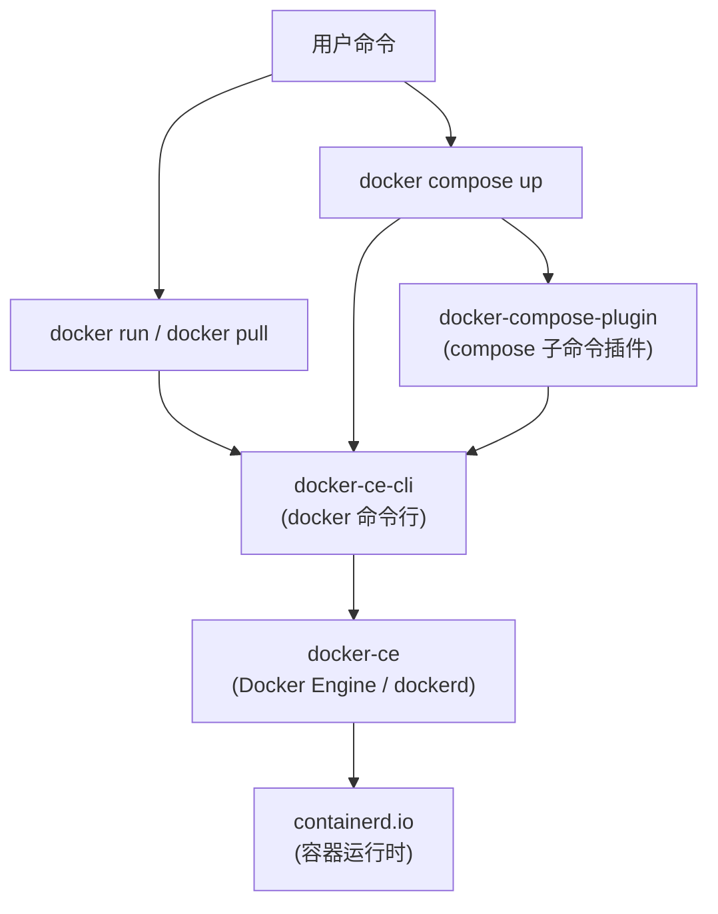

# 在 Ubuntu 上安装 Docker 与 Docker Compose

**官方文档**：[Install Docker Engine on Ubuntu](https://docs.docker.com/engine/install/ubuntu/)

## 本步目标

- 在 Ubuntu 上通过 Docker 官方 apt 源安装 Docker Engine。
- 安装 Docker Compose 插件，并使用 `docker compose` 命令。
- 完成安装后的基础验证。

## 问题背景

Ubuntu 自带的 `docker.io` 与 Docker 官方版本不是同一套发布渠道，容易与后续实验环境不一致。本步骤统一使用 Docker 官方仓库安装，并同时安装 Compose 插件。

## 理论说明

- `docker-ce` 提供 Docker Engine。
- `docker-ce-cli` 提供 `docker` 命令行。
- `containerd.io` 提供容器运行时。
- `docker-compose-plugin` 提供 `docker compose` 子命令。



本课程后续统一使用 `docker compose`，不是 `docker-compose`。

### `docker compose` 与 `docker-compose` 的区别

- **命令形态**：`docker compose` 是 Docker CLI 子命令（Compose V2）；`docker-compose` 是历史上的独立命令（Compose V1）。
- **安装方式**：`docker compose` 来自 `docker-compose-plugin`；`docker-compose` 需要单独安装旧版工具。
- **维护状态**：Compose V2（`docker compose`）是当前官方主线；`docker-compose` 属于旧方案，不建议新环境继续使用。
- **教学规范**：为避免学员在不同机器出现命令差异，本课程统一使用 `docker compose`（无连字符）。

## 安装前说明

- 若系统使用 `ufw` 或 `firewalld`，需注意 Docker 发布的端口可能绕过部分防火墙规则。
- Docker 依赖 `iptables` 规则工作；若系统已有较复杂的防火墙策略，安装前应先确认网络策略不会与 Docker 冲突。

## 验证方法

### 1. 确认系统版本

当前文档适用于 Docker 官方支持的 64 位 Ubuntu 版本，例如 `22.04`、`24.04`、`25.10`。可先执行：

```bash
cat /etc/os-release
```

关键看点：

- `ID=ubuntu`
- `VERSION_ID="22.04"`、`VERSION_ID="24.04"` 或 `VERSION_ID="25.10"`
- `VERSION_CODENAME` 有值，例如 `jammy`、`noble`

### 2. 卸载可能冲突的旧包

```bash
sudo apt remove -y docker.io docker-compose docker-compose-v2 docker-doc podman-docker containerd runc || true
```

关键看点：

- 即使部分包未安装，命令也可以继续执行。
- 这里卸载的是冲突包，不会自动删除你后面新安装的 Docker 官方包。

### 3. 添加 Docker 官方 apt 源并安装

```bash
sudo apt update
sudo apt install -y ca-certificates curl
sudo install -m 0755 -d /etc/apt/keyrings
sudo curl -fsSL https://download.docker.com/linux/ubuntu/gpg -o /etc/apt/keyrings/docker.asc
sudo chmod a+r /etc/apt/keyrings/docker.asc

sudo tee /etc/apt/sources.list.d/docker.sources <<EOF
Types: deb
URIs: https://download.docker.com/linux/ubuntu
Suites: $(. /etc/os-release && echo "${UBUNTU_CODENAME:-$VERSION_CODENAME}")
Components: stable
Signed-By: /etc/apt/keyrings/docker.asc
EOF

sudo apt update
sudo apt install -y docker-ce docker-ce-cli containerd.io docker-buildx-plugin docker-compose-plugin
```

关键看点：

- 安装包中必须包含 `docker-compose-plugin`。
- 这里安装完成后，后续应使用 `docker compose` 命令。

### 4. 启动 Docker 服务

多数 Ubuntu 环境在安装完成后会自动启动 Docker 服务；为保证课堂环境一致，这里统一显式执行启动与开机自启命令。

```bash
sudo systemctl enable --now docker
sudo systemctl status docker
```

预期结果：

- `docker` 服务状态为 `active (running)`。

### 5. 可选：配置数据目录与镜像加速

若需将镜像与容器数据存到指定目录，并配置国内/镜像加速（拉取镜像时走代理镜像站），可执行以下步骤。

**5.1 创建数据目录**

```bash
sudo mkdir -p /data/docker
```

**5.2 写入 daemon 配置**

`data-root` 指定镜像与容器数据的存储路径；`registry-mirrors` 为拉取镜像时使用的镜像加速列表，按顺序尝试。

```bash
sudo tee /etc/docker/daemon.json <<'EOF'
{
    "data-root": "/data/docker",
    "registry-mirrors": [
        "https://hub.xdark.top",
        "https://hub.littlediary.cn",
        "https://dockerpull.org",
        "https://hub.crdz.gq",
        "https://docker.1panel.live",
        "https://docker.unsee.tech",
        "https://docker.m.daocloud.io",
        "https://docker.kejilion.pro",
        "https://registry.dockermirror.com",
        "https://hub.rat.dev",
        "https://dhub.kubesre.xyz",
        "https://docker.nastool.de",
        "https://docker.udayun.com",
        "https://docker.rainbond.cc",
        "https://hub.geekery.cn",
        "https://docker.1panelproxy.com"
    ]
}
EOF
```

**5.3 重载配置并重启 Docker**

```bash
sudo systemctl daemon-reload
sudo systemctl restart docker
sudo systemctl status docker
```

配置生效后，`docker pull` 会优先通过上述镜像站拉取，镜像与容器数据将存放在 `/data/docker`。

### 6. 验证安装结果

执行以下命令可确认引擎与 Compose 插件已正确安装：

```bash
sudo docker version
sudo docker compose version
sudo docker run hello-world
```

**`docker version` 与 `docker compose version` 输出示例**

下面为某次安装后的原始输出，便于课堂对照。版本号会随安装时间不同而不同，只要结构类似即表示安装正常。

`docker version` 示例：

```
Client: Docker Engine - Community
 Version:           29.3.0
 API version:       1.54
 Go version:        go1.25.7
 Git commit:        5927d80
 Built:             Thu Mar  5 14:25:48 2026
 OS/Arch:           linux/amd64
 Context:           default

Server: Docker Engine - Community
 Engine:
  Version:          29.3.0
  API version:      1.54 (minimum version 1.40)
  Go version:       go1.25.7
  Git commit:       83bca51
  Built:            Thu Mar  5 14:25:48 2026
  OS/Arch:          linux/amd64
  Experimental:     false
 containerd:
  Version:          v2.2.2
  GitCommit:        301b2dac98f15c27117da5c8af12118a041a31d9
 runc:
  Version:          1.3.4
  GitCommit:        v1.3.4-0-gd6d73eb8
 docker-init:
  Version:          0.19.0
  GitCommit:        de40ad0
```

`docker compose version` 示例：

```
Docker Compose version v5.1.0
```

**简要说明**：

- **Client**：本机安装的 `docker` 命令行（docker-ce-cli）版本与 API 版本；OS/Arch 表示当前系统架构（如 linux/amd64）。
- **Server**：Docker Engine（dockerd）版本；安装成功后才会显示 Server 段。
- **containerd / runc**：容器运行时组件，由 `containerd.io` 等包提供，Engine 依赖它们创建并运行容器。
- **docker-init**：容器内 PID 1 的轻量 init，用于回收僵尸进程。
- **Docker Compose version**：Compose 插件版本，出现即说明 `docker-compose-plugin` 已安装且 `docker compose` 可用。

关键看点：

- `docker run hello-world` 能成功拉取并运行测试镜像。
- `docker compose version` 能正常输出版本号。
- 命令格式是 `docker compose`，中间是空格，不是 `docker-compose`。

### 7. 可选：允许当前用户直接使用 Docker

```bash
sudo usermod -aG docker "$USER"
```

执行后需要退出当前会话并重新登录。重新登录后可验证：

```bash
docker ps
docker compose version
```

## 预期结果

- `docker --version` 能正常输出版本。
- `docker compose version` 能正常输出版本。
- `docker run hello-world` 能成功运行。
- 后续执行 Compose 编排时，统一使用 `docker compose up -d`。

## 通过标准

- 已从 Docker 官方 apt 源成功安装 `docker-ce`、`docker-ce-cli`、`containerd.io`、`docker-compose-plugin`。
- `docker` 服务已启动并可正常运行容器。
- 能明确区分 `docker compose` 与 `docker-compose`，并在后续实验中使用前者。

## 参考

- [Install Docker Engine on Ubuntu](https://docs.docker.com/engine/install/ubuntu/)（官方安装指南）
- [Linux postinstall](https://docs.docker.com/engine/install/linux-postinstall/)（非 root 用户、镜像加速等可选配置）
- 官方文档中的 [Uninstall Docker Engine](https://docs.docker.com/engine/install/ubuntu/#uninstall-docker-engine) 小节（卸载与清理步骤）
