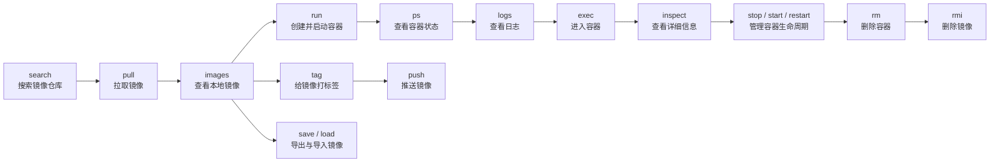
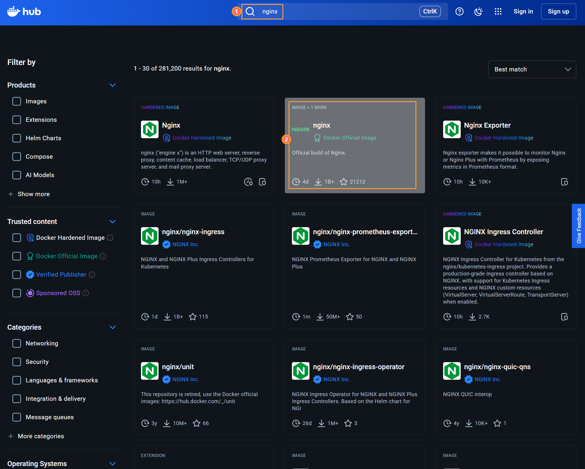

# Docker 常用命令：按一条完整操作链来学

## 本文目标

- 只讲日常最常用的 `docker` 命令，不展开 `docker compose`。
- 不按零散命令背诵，而是按一次完整操作过程来记。
- 每个命令只介绍高频参数，保证能上手、能排错、能通过课堂检查。

## 先记住一条主线

学习 Docker 命令，最容易乱的地方是命令很多、顺序很散。实际上在日常开发中，常见流程通常就是这一条线：



这张图表达的是 4 条最常见的操作线：

- 主操作线：`search -> pull -> images -> run -> ps -> logs -> exec -> inspect`
- 容器清理线：`inspect -> stop/start/restart -> rm -> rmi`
- 仓库分发线：`images -> tag -> push`
- 离线迁移线：`images -> save/load`

你可以把它理解成一句话：

- 先搜索镜像仓库，确认要用哪个镜像、哪个标签。
- 再把镜像拉下来。
- 再把容器跑起来。
- 跑起来之后查看状态、日志、进入容器排查问题。
- 不用了就停止、删除容器。
- 需要分发时就打标签、推送仓库。
- 需要离线迁移时就导出、导入镜像。
- 最后再删除本地镜像。

## 场景设定

下面统一使用 `nginx` 这个镜像，走一遍最常见的 Docker 操作流程。

假设我们的目标是：

- 先搜索 `nginx` 相关镜像，并确认准备拉取的 tag
- 拉取一个 `nginx` 镜像
- 运行成一个容器
- 查看运行状态和日志
- 进入容器排查问题
- 停止、启动、重启、删除容器
- 给镜像打标签并推送到镜像仓库
- 把镜像导出为文件，再导入到另一台机器

本文中穿插的“实机示例”来自本机真实执行，时间为 `2026-03-16`。
为了避免和正文中的基础示例名称冲突，实操时统一使用容器名 `mynginx-live`，宿主机端口使用 `28080`。
这样你在阅读时可以同时看到“标准写法”和“真实输出”。
整篇文章就按这条主线任务往下展开，不再在后面单独重复一遍命令清单。

## 1. `docker search`

作用：搜索镜像仓库。

```bash
docker search nginx
```

这条命令适合在最开始使用，用来快速了解 Docker Hub 上有哪些和 `nginx` 相关的仓库。

示例输出里通常会看到：

- `NAME`：仓库名
- `DESCRIPTION`：仓库说明
- `STARS`：收藏数，通常可作为热度参考
- `OFFICIAL`：是否为官方镜像
- `AUTOMATED`：是否为自动构建

关键看点：

- 想学标准用法时，应优先关注 `OFFICIAL` 列为 `[OK]` 的官方镜像
- 对于 `nginx`，通常应该优先使用官方仓库 `nginx`
- `docker search` 解决的是“拉哪个仓库”的问题，不是“这个仓库里有哪些 tag”的问题



如果你的习惯是“先看有哪些可选 tag，再决定 pull 哪个版本”，思路是对的，但这里要注意：

- `docker search nginx` 适合查“有哪些相关镜像仓库”
- 它不适合查 `nginx` 这个镜像仓库下面到底有哪些 tag

如果你想先看 Docker Hub 上 `nginx` 有哪些远端 tag，再决定拉哪个版本，更实用的方式是查 Docker Hub API，例如：

```bash
curl -s "https://hub.docker.com/v2/repositories/library/nginx/tags/?page_size=10" | python3 -c "import sys, json; data=json.load(sys.stdin); [print(item['name']) for item in data['results']]"
```

示例输出：

```text
latest
mainline
stable
alpine
1.29.6
1.29.6-alpine
1.28
1.28-alpine
bookworm
trixie
```

关键看点：

- 这里列出来的是远端仓库当前提供的 tag
- 看到合适的 tag 后，再执行对应的 `docker pull nginx:<tag>`
- 例如你想拉 Alpine 版本，就执行 `docker pull nginx:alpine`

## 2. `docker pull`

作用：拉取镜像。

```bash
docker pull nginx
docker pull nginx:latest
```

高频点：

- `nginx`：镜像名
- `nginx:latest`：镜像名加标签，`latest` 是标签

常用参数：

- `-a`
  拉取该镜像的所有标签，不常作为默认用法，知道即可。
- `--platform`
  指定平台，例如：

```bash
docker pull --platform linux/amd64 nginx
```

课堂里最需要记住的是：`pull` 就是把远程镜像拉到本地。

实机示例：

执行命令：

```bash
docker pull nginx
```

原始输出节选：

```text
Using default tag: latest
latest: Pulling from library/nginx
9eef040df109: Pulling fs layer
75a1d70aee50: Pulling fs layer
...
Digest: sha256:bc45d248c4e1d1709321de61566eb2b64d4f0e32765239d66573666be7f13349
Status: Downloaded newer image for nginx:latest
docker.io/library/nginx:latest
```

关键看点：

- `Using default tag: latest` 说明未显式写标签时，默认拉取 `latest`
- `Pulling fs layer` 说明镜像是按层下载的
- `Digest` 可用于确认镜像内容版本

## 3. `docker images`

作用：查看本地镜像。

```bash
docker images
docker images nginx
```

示例输出里通常会看到：

- `REPOSITORY`：镜像名
- `TAG`：标签
- `IMAGE ID`：镜像 ID
- `SIZE`：镜像大小

常用参数：

- `-q`
  只输出镜像 ID。

```bash
docker images -q
```

如果你的目标是“专门查看本地 `nginx` 镜像有哪些 tag”，最直接的命令就是：

```bash
docker images nginx
```

如果想把 `REPOSITORY`、`TAG`、`IMAGE ID`、`SIZE` 看得更清楚，可以这样写：

```bash
docker images nginx --format "table {{.Repository}}\t{{.Tag}}\t{{.ID}}\t{{.Size}}"
```

示例输出：

```text
REPOSITORY   TAG      IMAGE ID       SIZE
nginx        latest   bc45d248c4e1   251MB
nginx        alpine   f46cb72c7df0   81.2MB
```

关键看点：

- `REPOSITORY` 表示镜像名，这里是 `nginx`
- `TAG` 表示该镜像当前在本机已有的标签，例如 `latest`、`alpine`
- 同一个仓库名下可以同时存在多个 tag
- 如果两个 tag 对应的 `IMAGE ID` 相同，说明它们本质上指向同一个镜像内容


这里要特别区分：

- `docker images nginx` 看到的是本机已经存在的 `nginx` 镜像和 tag
- 它不能直接列出 Docker Hub 上 `nginx` 的全部远端 tag

这一步通常接在 `docker pull` 后面，用来确认镜像已经拉到本地。

实机示例：

执行命令：

```bash
docker images nginx
```

原始输出：

```text
WARNING: This output is designed for human readability. For machine-readable output, please use --format.
IMAGE          ID             DISK USAGE   CONTENT SIZE   EXTRA
nginx:alpine   f46cb72c7df0       93.5MB         26.9MB
nginx:latest   bc45d248c4e1        240MB         65.8MB   U
```

关键看点：

- `IMAGE` 一列里同时包含仓库名和标签
- `ID` 是镜像 ID，后续 `rmi` 时也可以直接使用
- 这里能看出 `nginx:latest` 比 `nginx:alpine` 更大

## 4. `docker run`

作用：基于镜像创建并启动容器。这是最核心的命令。

```bash
docker run -d --name mynginx -p 8080:80 nginx
```

这条命令的含义是：

- `-d`
  后台运行容器
- `--name mynginx`
  给容器起一个名字，后续管理更方便
- `-p 8080:80`
  把宿主机 `8080` 端口映射到容器的 `80` 端口
- `nginx`
  使用 `nginx` 镜像启动容器

执行后，可以通过下面的地址访问：

```text
http://localhost:8080
```

`docker run` 的高频参数很多，最常用的是下面这些：

- `-d`
  后台运行，适合服务类容器
- `--name`
  指定容器名
- `-p 宿主机端口:容器端口`
  端口映射
- `-e KEY=VALUE`
  传环境变量
- `-v 宿主机路径:容器路径`
  挂载目录或数据卷
- `-it`
  交互式运行，常配合 `bash` 或 `sh`
- `--rm`
  容器退出后自动删除
- `--restart unless-stopped`
  容器自动重启策略

再看两个很常见的例子。

后台服务方式：

```bash
docker run -d --name mynginx -p 8080:80 --restart unless-stopped nginx
```

交互调试方式：

```bash
docker run -it --rm ubuntu bash
```

这两个命令都很常见，一个偏服务部署，一个偏临时调试。

实机示例：

执行命令：

```bash
docker run -d --name mynginx-live -p 28080:80 nginx:latest
```

原始输出：

```text
561708f16f4967e07988c987019e2d35262f9af1a548f4811691298d6e72f7d8
```

关键看点：

- 成功时通常只返回容器 ID
- 返回了容器 ID，不代表业务一定已经可用，后面还要继续用 `ps`、`logs` 验证

## 5. `docker ps`

作用：查看容器。

```bash
docker ps
docker ps -a
```

高频点：

- `docker ps`
  只看正在运行的容器
- `docker ps -a`
  看所有容器，包括已经退出的容器

常用参数：

- `-a`
  查看所有容器
- `-q`
  只输出容器 ID

`docker run` 之后，第一件事通常就是用 `docker ps` 看容器是否真的跑起来了。

实机示例：

执行命令：

```bash
docker ps --filter name=mynginx-live
```

原始输出：

```text
CONTAINER ID   IMAGE          COMMAND                  CREATED         STATUS         PORTS                                       NAMES
561708f16f49   nginx:latest   "/docker-entrypoint.…"   7 seconds ago   Up 5 seconds   0.0.0.0:28080->80/tcp, [::]:28080->80/tcp   mynginx-live
```

关键看点：

- `STATUS` 为 `Up`，说明容器正在运行
- `PORTS` 显示了宿主机 `28080` 到容器 `80` 的映射
- `NAMES` 是后续 `logs`、`exec`、`inspect`、`rm` 最常用的定位方式

## 6. `docker logs`

作用：查看容器日志。

```bash
docker logs mynginx
```

常用参数：

- `-f`
  持续跟踪日志，类似 `tail -f`
- `--tail 100`
  只看最后 100 行
- `-t`
  显示时间戳

例如：

```bash
docker logs -f --tail 100 mynginx
```

如果容器启动失败，`logs` 往往是第一排查入口。

实机示例：

执行命令前，先访问一次服务，制造真实访问日志：

```bash
curl -I http://127.0.0.1:28080
docker logs mynginx-live
```

`docker logs` 原始输出节选：

```text
/docker-entrypoint.sh: Configuration complete; ready for start up
172.17.0.1 - - [16/Mar/2026:03:29:30 +0000] "HEAD / HTTP/1.1" 200 0 "-" "curl/8.5.0" "-"
2026/03/16 03:29:24 [notice] 1#1: nginx/1.29.6
```

关键看点：

- `Configuration complete; ready for start up` 说明启动初始化已完成
- `HEAD / HTTP/1.1 200` 表示请求已经真正到达服务并成功返回
- 可以从日志里直接看见 `nginx/1.29.6` 这样的版本信息

## 7. `docker exec`

作用：进入正在运行的容器，或者在容器内部执行命令。

进入容器最常见的写法：

```bash
docker exec -it mynginx /bin/sh
```

有些镜像带 `bash`，有些没有，所以更稳妥的写法通常是：

```bash
docker exec -it mynginx /bin/sh
```

如果镜像里有 `bash`，也可以这样：

```bash
docker exec -it mynginx bash
```

除了进入容器，也可以直接执行单条命令：

```bash
docker exec mynginx ls /usr/share/nginx/html
```

常用参数：

- `-i`
  保持标准输入打开
- `-t`
  分配一个终端

在实际使用中，最常见的组合就是 `-it`。

实机示例：

执行命令：

```bash
docker exec mynginx-live ls /usr/share/nginx/html
```

原始输出：

```text
50x.html
index.html
```

关键看点：

- 这说明命令已经在容器内部成功执行
- `index.html` 和 `50x.html` 是默认站点目录中的典型文件

## 8. `docker inspect`

作用：查看容器或镜像的详细信息。

```bash
docker inspect mynginx
docker inspect nginx
```

`inspect` 的输出通常是大段 JSON，里面能看到很多关键内容，比如：

- 容器 IP
- 端口映射
- 挂载信息
- 启动参数
- 环境变量
- 镜像层信息

最常见的用法是配合 `-f` 做格式化输出。

例如查看容器 IP：

```bash
docker inspect -f '{{.NetworkSettings.IPAddress}}' mynginx
```

例如查看容器状态：

```bash
docker inspect -f '{{.State.Status}}' mynginx
```

常用参数：

- `-f`
  按模板格式化输出，比直接看整段 JSON 更实用

如果你发现容器“明明启动了，但是访问不到”，`inspect` 往往能帮你定位端口、网络、挂载是不是配错了。

实机示例：

执行命令：

```bash
docker inspect -f 'status={{.State.Status}} ip={{range .NetworkSettings.Networks}}{{.IPAddress}}{{end}} ports={{json .NetworkSettings.Ports}}' mynginx-live
```

格式化输出结果：

```text
status=running ip=172.17.0.2 ports={"80/tcp":[{"HostIp":"0.0.0.0","HostPort":"28080"},{"HostIp":"::","HostPort":"28080"}]}
```

关键看点：

- `status=running` 能直接确认容器正在运行
- `ip=172.17.0.2` 是容器在桥接网络中的内部 IP
- `ports=...28080...` 说明端口映射已经生效

## 9. `docker stop`

作用：停止运行中的容器。

```bash
docker stop mynginx
```

常用参数：

- `-t`
  指定优雅停止等待时间，单位秒

```bash
docker stop -t 30 mynginx
```

默认情况下，Docker 会先给容器发送停止信号，等待一段时间后再强制结束。

## 10. `docker start`

作用：启动已经存在但处于停止状态的容器。

```bash
docker start mynginx
```

这条命令适合已经创建过的容器，不需要重新 `run`。

很多初学者容易混淆：

- `run`：创建并启动一个新容器
- `start`：启动一个已经存在的旧容器

## 11. `docker restart`

作用：重启容器。

```bash
docker restart mynginx
```

这个命令本质上可以理解为：

```text
stop + start
```

当你修改了某些配置，或者容器状态异常时，`restart` 很常用。

实机示例：

执行命令：

```bash
docker stop mynginx-live
docker start mynginx-live
docker restart mynginx-live
docker ps -a --filter name=mynginx-live
```

命令输出节选：

```text
mynginx-live
mynginx-live
mynginx-live
CONTAINER ID   IMAGE          COMMAND                  CREATED          STATUS         PORTS                                       NAMES
561708f16f49   nginx:latest   "/docker-entrypoint.…"   44 seconds ago   Up 4 seconds   0.0.0.0:28080->80/tcp, [::]:28080->80/tcp   mynginx-live
```

关键看点：

- `stop`、`start`、`restart` 成功时通常只回显容器名
- 执行完生命周期命令后，最好再看一次 `docker ps -a`

## 12. `docker rm`

作用：删除容器。

```bash
docker rm mynginx
```

如果容器还在运行，通常需要先停止：

```bash
docker stop mynginx
docker rm mynginx
```

也可以强制删除：

```bash
docker rm -f mynginx
```

常用参数：

- `-f`
  强制删除运行中的容器
- `-v`
  删除容器时一并删除匿名卷

这一步通常发生在“这个容器不用了，准备重新跑一个新的”时。

实机示例：

执行命令：

```bash
docker rm -f mynginx-live
```

原始输出：

```text
mynginx-live
```

关键看点：

- 删除成功时通常回显被删除的容器名
- `-f` 表示即使容器还在运行，也会先停止再删除

## 13. `docker tag`

作用：给镜像打标签。

例如把本地镜像改成准备推送到仓库的名字：

```bash
docker tag nginx:latest yourname/mynginx:v1
```

如果是私有仓库，通常会带仓库地址：

```bash
docker tag nginx:latest registry.example.com/project/mynginx:v1
```

这里最重要的是理解目标名称的格式：

```text
仓库地址/命名空间/镜像名:标签
```

如果目标镜像名不对，后面的 `push` 往往也会失败。

实机示例：

执行命令：

```bash
docker tag nginx:latest nginx:demo-v1
docker images nginx
```

验证输出：

```text
IMAGE           ID             DISK USAGE   CONTENT SIZE   EXTRA
nginx:alpine    f46cb72c7df0       93.5MB         26.9MB
nginx:demo-v1   bc45d248c4e1        240MB         65.8MB   U
nginx:latest    bc45d248c4e1        240MB         65.8MB   U
```

关键看点：

- `docker tag` 本身通常没有标准输出，所以要配合 `docker images` 验证
- `nginx:demo-v1` 和 `nginx:latest` 的 `ID` 相同，说明只是同一个镜像的两个标签

## 14. `docker push`

作用：把镜像推送到远程镜像仓库。

```bash
docker push yourname/mynginx:v1
```

如果是私有仓库：

```bash
docker push registry.example.com/project/mynginx:v1
```

常用参数：

- `-a`
  推送该仓库名下的所有标签

```bash
docker push -a yourname/mynginx
```

注意：

- `push` 之前通常要先执行 `docker login`
- 本地镜像名必须和目标仓库名匹配，所以常常要先 `docker tag`

因此这一组命令通常连着记：

```bash
docker tag nginx:latest yourname/mynginx:v1
docker push yourname/mynginx:v1
```

实机示例：

执行命令：

```bash
docker push nginx:latest
```

原始输出节选：

```text
The push refers to repository [docker.io/library/nginx]
...
failed commit on ref "manifest-sha256:a6bead2c897e9e39ca1a2dbd241f96dc181c8d32adcb6201258624fb37d2c7fe": server message: insufficient_scope: authorization failed
```

关键看点：

- 这次推送失败是正常现象，因为 `library/nginx` 是官方仓库，本机账号没有写入权限
- 最关键的是最后一行 `insufficient_scope: authorization failed`，它明确说明失败原因是权限不足

## 15. `docker save / docker load`

作用：导出和导入镜像，适合离线迁移。

导出镜像：

```bash
docker save -o mynginx_v1.tar yourname/mynginx:v1
```

导入镜像：

```bash
docker load -i mynginx_v1.tar
```

常用参数：

- `docker save -o 文件名`
  把镜像保存成 tar 文件
- `docker load -i 文件名`
  从 tar 文件导入镜像

这组命令很适合下面这些场景：

- 机器不能直接联网
- 需要把镜像拷贝到另一台服务器
- 需要备份镜像

这里顺便再强调一次：

- `save/load` 针对的是镜像
- `export/import` 针对的是容器文件系统

如果你的目标是“备份或迁移镜像”，应该优先记住的是 `save/load`。

实机示例：

导出镜像：

```bash
docker save -o /tmp/nginx-demo-v1.tar nginx:demo-v1
ls -lh /tmp/nginx-demo-v1.tar
```

验证输出：

```text
-rw------- 1 root root 63M Mar 16 11:29 /tmp/nginx-demo-v1.tar
```

导入镜像：

```bash
docker load -i /tmp/nginx-demo-v1.tar
```

原始输出：

```text
Loaded image: nginx:demo-v1
```

关键看点：

- `docker save` 成功时通常没有标准输出，所以要配合 `ls -lh` 看文件是否真的生成
- `Loaded image: nginx:demo-v1` 说明 tar 包中的镜像标签已经重新注册到本地

## 16. `docker rmi`

作用：删除镜像。

```bash
docker rmi yourname/mynginx:v1
docker rmi nginx:latest
```

常用参数：

- `-f`
  强制删除镜像

```bash
docker rmi -f nginx:latest
```

注意：

- 如果还有容器在使用这个镜像，删除通常会失败
- 一般应该先删容器，再删镜像

所以常见顺序是：

```bash
docker rm -f mynginx
docker rmi nginx:latest
```

实机示例：

执行命令：

```bash
docker rmi nginx:demo-v1
```

原始输出：

```text
Untagged: nginx:demo-v1
Untagged: moby-dangling@sha256:bc45d248c4e1d1709321de61566eb2b64d4f0e32765239d66573666be7f13349
```

关键看点：

- `Untagged` 表示删除的是标签引用
- 只要还有其他标签或容器引用同一个镜像，底层镜像层不一定会立刻被物理删除

## 最后给出一套最容易记的对应关系

- `docker search`
  搜索镜像仓库
- `docker pull`
  拉镜像
- `docker images`
  看镜像
- `docker run`
  创建并启动容器
- `docker ps`
  看容器
- `docker logs`
  看日志
- `docker exec`
  进容器
- `docker inspect`
  看详细信息
- `docker stop`
  停容器
- `docker start`
  启容器
- `docker restart`
  重启容器
- `docker rm`
  删容器
- `docker rmi`
  删镜像
- `docker tag`
  打标签
- `docker push`
  推镜像
- `docker save / docker load`
  导出 / 导入镜像

## 通过标准

- 能说清楚镜像和容器的区别。
- 能独立完成 `search -> pull -> run -> ps -> logs -> exec -> rm` 这条最核心流程。
- 知道 `run` 和 `start` 的区别。
- 知道 `rm` 删除容器，`rmi` 删除镜像。
- 知道镜像迁移优先用 `save/load`。
- 知道推送镜像通常是 `tag + push` 连着使用。
