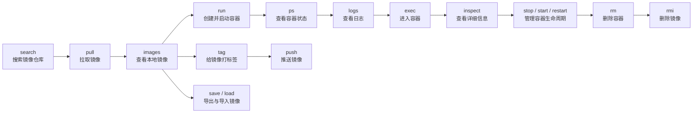
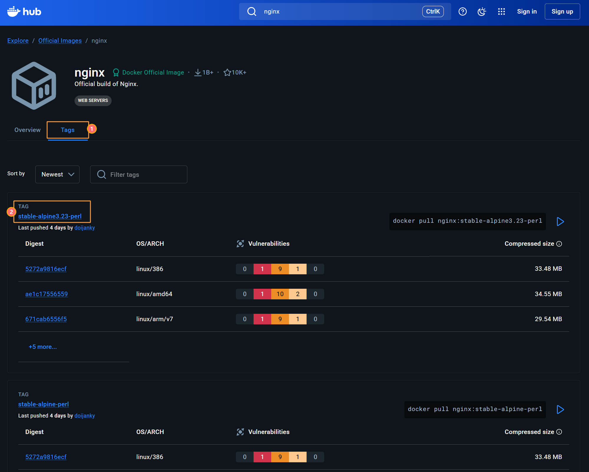
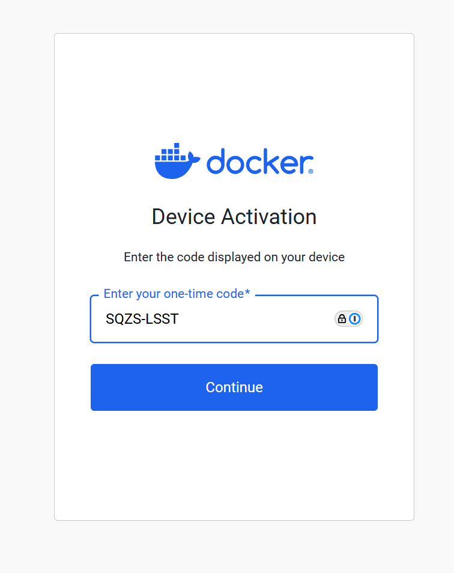

# Docker 常用命令：按一条完整操作链来学

## 本文目标

- 只讲日常最常用的 `docker` 命令，不展开 `docker compose`。
- 不按零散命令背诵，而是按一次完整操作过程来记。
- 每个命令只介绍高频参数，保证能上手、能排错、能通过课堂检查。

## 先记住一条主线

学习 Docker 命令，最容易乱的地方是命令很多、顺序很散。实际上在日常开发中，常见流程通常就是这一条线：



这张图表达的是 4 条最常见的操作线：

- 主操作线：`search -> pull -> images -> run -> ps -> logs -> exec -> inspect`
- 容器清理线：`inspect -> stop/start/restart -> rm -> rmi`
- 仓库分发线：`images -> tag -> push`
- 离线迁移线：`images -> save/load`

你可以把它理解成一句话：

- 先搜索镜像仓库，确认要用哪个镜像、哪个标签。
- 再把镜像拉下来。
- 再把容器跑起来。
- 跑起来之后查看状态、日志、进入容器排查问题。
- 不用了就停止、删除容器。
- 需要分发时就打标签、推送仓库。
- 需要离线迁移时就导出、导入镜像。
- 最后再删除本地镜像。

## 场景设定

下面统一使用 `nginx` 这个镜像，走一遍最常见的 Docker 操作流程。

假设我们的目标是：

- 先搜索 `nginx` 相关镜像，并确认准备拉取的 tag
- 拉取一个 `nginx` 镜像
- 运行成一个容器
- 查看运行状态和日志
- 进入容器排查问题
- 停止、启动、重启、删除容器
- 给镜像打标签并推送到镜像仓库
- 把镜像导出为文件，再导入到另一台机器

## 1. `docker search`

作用：搜索镜像仓库。

```bash
docker search nginx
```

这条命令适合在最开始使用，用来快速了解 Docker Hub 上有哪些和 `nginx` 相关的仓库。

示例输出里通常会看到：

- `NAME`：仓库名
- `DESCRIPTION`：仓库说明
- `STARS`：收藏数，通常可作为热度参考
- `OFFICIAL`：是否为官方镜像

有些 Docker 版本的 `docker search` 输出里还会出现：

- `AUTOMATED`：是否为自动构建

也就是说，这里的列并不是所有环境都完全一样，课堂里先重点看 `NAME`、`STARS`、`OFFICIAL` 就够了。

关键看点：

- 想学标准用法时，应优先关注 `OFFICIAL` 列为 `[OK]` 的官方镜像
- 对于 `nginx`，通常应该优先使用官方仓库 `nginx`
- `docker search` 解决的是“拉哪个仓库”的问题，不是“这个仓库里有哪些 tag”的问题


如果你的习惯是“先看有哪些可选 tag，再决定 pull 哪个版本”，思路是对的，但这里要注意：

- `docker search nginx` 适合查“有哪些相关镜像仓库”
- 它不适合查 `nginx` 这个镜像仓库下面到底有哪些 tag

如果你想先看 Docker Hub 上 `nginx` 有哪些远端 tag，再决定拉哪个版本，更实用的方式是查 Docker Hub API，例如：

```bash
curl -s "https://hub.docker.com/v2/repositories/library/nginx/tags/?page_size=10" | python3 -c "import sys, json; data=json.load(sys.stdin); [print(item['name']) for item in data['results']]"
```

这里的 `page_size=10` 表示当前这一页最多返回 10 个结果，方便课堂演示。
它不代表 `nginx` 只有 10 个 tag，更不代表已经把全部 tag 一次性列完了。

示例输出：

```text
latest
mainline
stable
alpine
1.29.6
1.29.6-alpine
1.28
1.28-alpine
bookworm
trixie
```

下面这张图可以理解成“在 Docker Hub 页面查看 tag 时的大致效果”：



关键看点：

- 这里列出来的是远端仓库当前返回的一部分 tag，不是完整 tag 清单
- 看到合适的 tag 后，再执行对应的 `docker pull nginx:<tag>`
- 例如你想拉 Alpine 版本，就执行 `docker pull nginx:alpine`

这里可以顺手把 `tag` 这个概念讲清楚。

### 什么是 tag

你可以先把它理解成：镜像的“版本名”或“标记名”。

Docker 镜像的常见写法是：

```text
镜像名:tag
```

例如：

- `nginx:1.29.6`
- `nginx:alpine`

这里：

- `nginx` 是镜像名
- `1.29.6`、`alpine` 就是 tag，`latest` 也是一种常见 tag

对初学者来说，最简单的理解方式就是：

- `nginx` 相当于软件名
- `tag` 相当于这个软件对应的版本、发行类型或构建标记

例如：

- `nginx:1.29.6`
  表示一个更明确的版本号
- `nginx:alpine`
  表示这个镜像基于 Alpine 这类更轻量的基础环境
- `nginx:latest`
  表示默认标签，通常指这个仓库当前默认指向的版本，但它不是固定版本

为什么要关心 tag？

- 因为不同 tag，镜像内容可能不同
- 版本不同，软件行为可能不同
- 基础环境不同，镜像大小、可用命令、兼容性也可能不同

所以在课堂里要让学员形成一个习惯：

- 不要只看镜像名
- 还要看它后面的 tag

比如下面这两个镜像都叫 `nginx`，但它们不是一回事：

```text
nginx:1.29.6
nginx:alpine
```

以后看到 `docker pull nginx:xxx`、`docker run nginx:xxx`、`docker tag old:new`，都可以先理解成一句话：

“我正在指定或修改这个镜像的标签。”

## 2. `docker pull`

作用：拉取镜像。

```bash
docker pull nginx:1.29.6
```

高频点：

- `nginx:1.29.6`：镜像名加标签，`1.29.6` 是标签
- `nginx`：镜像名

如果你想拉更轻量的 Alpine 变体，应当单独写成：

```bash
docker pull nginx:alpine
```

这里的 `alpine` 也是 tag，它表示这是一种不同构建类型的镜像。

这里要补一个很重要的习惯：

- 最好显式指定具体版本
- 不要把 `latest` 当成默认好习惯

原因是：

- `latest` 不是固定版本
- 今天拉到的 `latest`，和下次拉到的 `latest`，可能已经不是同一个内容
- 一旦上游镜像更新，环境结果就可能变化

所以更稳妥的习惯是：

- 学习时就尽量养成写明确 tag 的习惯
- 实际部署时，更要写明确 tag，例如 `nginx:1.29.6`

常用参数：

- `-a`
  拉取该镜像的所有标签，不常作为默认用法，知道即可。
- `--platform`
  指定镜像平台，例如：

```bash
docker pull --platform linux/amd64 nginx:1.29.6
```

这里要补一个实际使用中很容易遇到的问题。

同一个镜像，往往不只提供一种平台版本，例如：

- `linux/amd64`
- `linux/arm64`

不同机器默认拉取的平台，可能不一样。

例如：

- 如果你在常见的 x86 服务器上操作，默认更常见的是 `linux/amd64`
- 如果你在 Apple Silicon 的 Mac 上操作，例如 M1、M2、M3，默认更常见的是 `linux/arm64`

这意味着：

- 你和同学虽然执行的都是 `docker pull nginx:1.29.6`
- 但最终拉下来的镜像平台，可能并不一样

大多数情况下，Docker 会自动帮你选择适合当前机器的平台版本。
但如果你有下面这些需求，就要显式指定 `--platform`：

- 需要和服务器环境保持一致
- 需要测试某个特定架构
- 当前镜像默认平台和你的目标平台不一致

例如，假设你现在用的是 Mac，但后面部署目标是一台常见的 Linux x86 服务器，那么你可能会希望这样拉取：

```bash
docker pull --platform linux/amd64 nginx:1.29.6
```

课堂里先记住这一句就够了：

- `--platform` 是用来指定“拉哪个系统架构版本的镜像”
- Mac 上尤其容易遇到这个问题，因为不少新款 Mac 默认是 `arm64`

课堂里最需要记住的是：`pull` 就是把远程镜像拉到本地。

示例输出节选：

```text
1.29.6: Pulling from library/nginx
Digest: sha256:bc45d248c4e1d1709321de61566eb2b64d4f0e32765239d66573666be7f13349
Status: Image is up to date for nginx:1.29.6
docker.io/library/nginx:1.29.6
```

关键看点：

- 如果本地已经存在该镜像，可能不会再次下载层，而是直接提示 `Image is up to date`
- `Digest` 可用于确认镜像内容版本

## 3. `docker images`

作用：查看本地镜像。

```bash
docker images
```

这条命令查看本机所有镜像。

示例输出里通常会看到：

- `REPOSITORY`：镜像名
- `TAG`：标签
- `IMAGE ID`：镜像 ID
- `SIZE`：镜像大小

常用参数：

- `-q`
  只输出镜像 ID。

```bash
docker images -q
```

如果你的目标是“专门查看本地 `nginx` 镜像有哪些 tag”，最直接的命令就是：

```bash
docker images nginx
```

如果想把 `REPOSITORY`、`TAG`、`IMAGE ID`、`SIZE` 看得更清楚，可以这样写：

```bash
docker images nginx --format "table {{.Repository}}\t{{.Tag}}\t{{.ID}}\t{{.Size}}"
```

示例输出：

```text
REPOSITORY   TAG      IMAGE ID       SIZE
nginx        1.29.6   bc45d248c4e1   251MB
nginx        alpine   f46cb72c7df0   81.2MB
```

关键看点：

- `REPOSITORY` 表示镜像名，这里是 `nginx`
- `TAG` 表示该镜像当前在本机已有的标签，例如 `1.29.6`、`alpine`
- 同一个仓库名下可以同时存在多个 tag
- 如果两个 tag 对应的 `IMAGE ID` 相同，说明它们本质上指向同一个镜像内容
- 某些环境里还可能额外出现一行 `WARNING`，那只是输出格式提示，不影响看表格内容

这里要特别区分：

- `docker images nginx` 看到的是本机已经存在的 `nginx` 镜像和 tag
- 它不能直接列出 Docker Hub 上 `nginx` 的全部远端 tag

这一步通常接在 `docker pull` 后面，用来确认镜像已经拉到本地。

## 4. `docker run`

作用：基于镜像创建并启动容器。这是最核心的命令。

```bash
docker run -d --name nginx-lab-demo -p 38080:80 nginx:1.29.6
```

这条命令的含义是：

- `-d`
  后台运行容器
- `--name nginx-lab-demo`
  给容器起一个名字，后续管理更方便
- `-p 38080:80`
  把宿主机 `38080` 端口映射到容器的 `80` 端口
- `nginx:1.29.6`
  使用 `nginx:1.29.6` 镜像启动容器

这里要先记住一个很重要的点：

- `docker run` 是“创建并启动一个新容器”
- 如果同名容器已经存在，再次执行同样的 `--name`，就会报错

如果你没有显式指定 `--name`，Docker 会自动给容器生成一个随机名字。

例如：

```bash
docker run -d -p 39080:80 nginx:1.29.6
```

这时容器虽然能正常启动，但名字通常会像下面这样随机生成：

```text
focused_mclean
adoring_morse
vibrant_goldberg
```

关键看点：

- 不写 `--name` 并不会影响容器启动
- 但后续做 `docker logs`、`docker exec`、`docker inspect`、`docker rm` 时不够直观
- 所以日常学习和运维里，更推荐显式写 `--name`

执行后，在命令行环境里更适合这样验证服务是否可访问：

```bash
curl http://127.0.0.1:38080
```

如果你是在外部电脑上访问这台 Linux 服务器，例如在 Windows 浏览器里访问，那么应当打开这台服务器的 IP 或域名，例如：

```text
http://服务器IP:38080
```

`docker run` 的高频参数很多，最常用的是下面这些：

- `-d`
  后台运行，适合服务类容器
- `--name`
  指定容器名
- `-p 宿主机端口:容器端口`
  端口映射
- `-e KEY=VALUE`
  传环境变量
- `-v 宿主机路径:容器路径`
  挂载目录或数据卷
- `-it`
  交互式运行，常配合 `bash` 或 `sh`
- `--rm`
  容器退出后自动删除
- `--restart unless-stopped`
  容器自动重启策略

再看两个最常见的场景。

后台服务方式：

- 上面这条 `docker run -d --name nginx-lab-demo -p 38080:80 nginx:1.29.6` 就是最典型的后台服务方式
- 如果希望容器在 Docker 重启后自动拉起，可以在这条命令上补一个 `--restart unless-stopped`

交互调试方式：

```bash
docker run -it --rm nginx:1.29.6 /bin/sh
```

这两个命令都很常见，一个偏长期运行的服务容器，一个偏临时进入容器排查问题。

实际操作中，还很容易遇到下面这个报错：

```bash
docker run -d --name mynginx -p 8080:80 --restart unless-stopped nginx:1.29.6
```

原始报错：

```text
docker: Error response from daemon: Conflict. The container name "/mynginx" is already in use by container "15f2d87ef35cc43c0aa10efe30b9373fc38e903b8ed6a2d155b869183e8f7de9". You have to remove (or rename) that container to be able to reuse that name.

Run 'docker run --help' for more information
```

这个错误说明：

- 当前已经存在一个名字叫 `mynginx` 的容器
- Docker 容器名在同一台主机上必须唯一
- 所以不能再次用同一个名字创建新容器

看到这个错误时，常见处理方式有 3 种：

- 继续使用原容器，不再重复创建
- 先删除旧容器，再重新使用 `mynginx` 这个名字
- 换一个新的容器名和新的宿主机端口

例如本次继续执行时，可以改成：

```bash
docker run -d --name mynginx-2 -p 8081:80 --restart unless-stopped nginx:1.29.6
```

验证结果：

```text
mynginx-2    nginx:1.29.6    Up 1 second    0.0.0.0:8081->80/tcp, [::]:8081->80/tcp
```

这里不再重复展示 `docker run` 的实机输出，后面直接通过 `docker ps`、`docker logs`、`docker inspect` 来验证容器是否真的已经正常运行。

## 5. `docker ps`

作用：查看容器。

```bash
docker ps
```

这条命令只看正在运行的容器。

关键看点：

- 当你刚执行完 `docker run`，第一件事通常就是先看 `docker ps`
- 如果容器没有出现在这里，往往说明它没有正常处于运行状态

```bash
docker ps -a
```

这条命令看所有容器，包括已经退出的容器。

关键看点：

- 即使容器已经停止，`docker ps -a` 也能看到
- 当你怀疑容器“创建过，但是现在不见了”时，优先看这条命令

常用参数：

- `-a`
  查看所有容器
- `-q`
  只输出容器 ID

`docker run` 之后，第一件事通常就是先看 `docker ps`；如果没有看到目标容器，再补看 `docker ps -a`。

例如下面是 `docker ps` 的输出节选：

```text
CONTAINER ID   IMAGE          COMMAND                  CREATED         STATUS         PORTS                                       NAMES
155b4c3c1a14   nginx:1.29.6   "/docker-entrypoint.…"   2 seconds ago   Up 1 second    0.0.0.0:38080->80/tcp, [::]:38080->80/tcp   nginx-lab-demo
```

- `docker ps` 会把当前所有正在运行的容器都列出来
- 如果这台主机上还有其他运行中的容器，它们也会一起显示出来
- `STATUS` 为 `Up`，说明容器正在运行
- `PORTS` 能直接看到宿主机端口和容器端口的映射关系
- `NAMES` 是后续 `logs`、`exec`、`inspect`、`rm` 最常用的定位方式
- 如果你只想看某一个容器，也可以使用 `docker ps --filter name=nginx-lab-demo`

## 6. `docker logs`

作用：查看容器日志。

```bash
docker logs nginx-lab-demo
```

常用参数：

- `-f`
  持续跟踪日志，类似 `tail -f`
- `--tail 100`
  只看最后 100 行
- `-t`
  显示时间戳

例如：

```bash
docker logs -f --tail 100 nginx-lab-demo
```

如果容器启动失败，`logs` 往往是第一排查入口。

更适合课堂演示的方式是开两个终端：

终端 A：持续观察日志

```bash
docker logs -f --tail 100 nginx-lab-demo
```

终端 B：主动发起一次请求

```bash
curl -I http://127.0.0.1:38080
```

这时回到终端 A，通常会看到日志新增访问记录；如果多访问几次，就会连续新增多行。

例如，`docker logs nginx-lab-demo` 可能看到下面这样的输出：

```text
/docker-entrypoint.sh: /docker-entrypoint.d/ is not empty, will attempt to perform configuration
/docker-entrypoint.sh: Looking for shell scripts in /docker-entrypoint.d/
/docker-entrypoint.sh: Launching /docker-entrypoint.d/10-listen-on-ipv6-by-default.sh
10-listen-on-ipv6-by-default.sh: info: Getting the checksum of /etc/nginx/conf.d/default.conf
10-listen-on-ipv6-by-default.sh: info: Enabled listen on IPv6 in /etc/nginx/conf.d/default.conf
/docker-entrypoint.sh: Sourcing /docker-entrypoint.d/15-local-resolvers.envsh
/docker-entrypoint.sh: Launching /docker-entrypoint.d/20-envsubst-on-templates.sh
/docker-entrypoint.sh: Launching /docker-entrypoint.d/30-tune-worker-processes.sh
/docker-entrypoint.sh: Configuration complete; ready for start up
172.17.0.1 - - [16/Mar/2026:07:19:53 +0000] "HEAD / HTTP/1.1" 200 0 "-" "curl/8.5.0" "-"
172.17.0.1 - - [16/Mar/2026:08:04:10 +0000] "HEAD / HTTP/1.1" 200 0 "-" "curl/8.5.0" "-"
172.17.0.1 - - [16/Mar/2026:08:04:15 +0000] "HEAD / HTTP/1.1" 200 0 "-" "curl/8.5.0" "-"
2026/03/16 07:19:52 [notice] 1#1: nginx/1.29.6
```

关键看点：

- `Configuration complete; ready for start up` 说明启动初始化已完成
- `HEAD / HTTP/1.1 200` 表示请求已经真正到达服务并成功返回
- 可以从日志里直接看见 `nginx/1.29.6` 这样的版本信息
- `docker logs -f` 的价值就在于：当第二个终端发起请求后，你能立刻看到新增日志

## 7. `docker exec`

作用：进入正在运行的容器，或者在容器内部执行命令。

进入容器最常见的写法：

```bash
docker exec -it nginx-lab-demo /bin/sh
```

有些镜像带 `bash`，有些没有，所以更稳妥的默认习惯是优先尝试 `/bin/sh`。如果镜像里有 `bash`，也可以这样：

```bash
docker exec -it nginx-lab-demo bash
```

除了进入容器，也可以直接执行单条命令：

```bash
docker exec nginx-lab-demo ls /usr/share/nginx/html
```

常用参数：

- `-i`
  保持标准输入打开
- `-t`
  分配一个终端

在实际使用中，最常见的组合就是 `-it`。

例如执行 `docker exec nginx-lab-demo ls /usr/share/nginx/html`，可能会看到：

```text
50x.html
index.html
```

关键看点：

- 这说明命令已经在容器内部成功执行
- `index.html` 和 `50x.html` 是默认站点目录中的典型文件

## 8. `docker inspect`

作用：查看容器或镜像的详细信息。

```bash
docker inspect nginx-lab-demo
```

这条命令查看容器的完整详细信息。

如果你要查看镜像本身的详细信息，可以单独执行：

```bash
docker inspect nginx:1.29.6
```

`inspect` 的输出通常是大段 JSON，里面能看到很多关键内容，比如：

- 容器 IP
- 端口映射
- 挂载信息
- 启动参数
- 环境变量
- 镜像层信息

最常见的用法是配合 `-f` 做格式化输出。

例如查看容器 IP：

```bash
docker inspect -f '{{range .NetworkSettings.Networks}}{{.IPAddress}}{{end}}' nginx-lab-demo
```

这里说明一下：

- 早期资料里经常能看到 `{{.NetworkSettings.IPAddress}}`
- 但在当前很多 Docker 环境里，这样写已经可能报错
- 更稳妥的写法是遍历 `NetworkSettings.Networks` 再取 `IPAddress`

例如查看容器状态：

```bash
docker inspect -f '{{.State.Status}}' nginx-lab-demo
```

常用参数：

- `-f`
  按模板格式化输出，比直接看整段 JSON 更实用

如果你发现容器“明明启动了，但是访问不到”，`inspect` 往往能帮你定位端口、网络、挂载是不是配错了。

例如执行下面这条格式化命令：

```bash
docker inspect -f 'status={{.State.Status}} ip={{range .NetworkSettings.Networks}}{{.IPAddress}}{{end}} ports={{json .NetworkSettings.Ports}}' nginx-lab-demo
```

可能会看到：

```text
status=running ip=172.17.0.4 ports={"80/tcp":[{"HostIp":"0.0.0.0","HostPort":"38080"},{"HostIp":"::","HostPort":"38080"}]}
```

关键看点：

- `status=running` 能直接确认容器正在运行
- `ip=172.17.0.4` 是容器在桥接网络中的内部 IP
- `ports=...38080...` 说明端口映射已经生效

## 9. `docker stop`

作用：停止运行中的容器。

```bash
docker stop nginx-lab-demo
```

常用参数：

- `-t`
  指定优雅停止等待时间，单位秒

```bash
docker stop -t 30 nginx-lab-demo
```

默认情况下，Docker 会先给容器发送停止信号，等待一段时间后再强制结束。

## 10. `docker start`

作用：启动已经存在但处于停止状态的容器。

```bash
docker start nginx-lab-demo
```

这条命令适合已经创建过的容器，不需要重新 `run`。

很多初学者容易混淆：

- `run`：创建并启动一个新容器
- `start`：启动一个已经存在的旧容器

## 11. `docker restart`

作用：重启容器。

```bash
docker restart nginx-lab-demo
```

这个命令本质上可以理解为：

```text
stop + start
```

当你修改了某些配置，或者容器状态异常时，`restart` 很常用。

关键看点：

- `stop`、`start`、`restart` 成功时通常只回显容器名
- 执行完这些生命周期命令后，最好再看一次 `docker ps -a --filter name=nginx-lab-demo`

## 12. `docker rm`

作用：删除容器。

```bash
docker rm nginx-lab-demo
```

这条命令适合删除已经停止的容器。

> Note
> `docker rm nginx-lab-demo` 适合删除已经停止的容器。
> 如果你直接删除一个正在运行的容器，通常会看到类似报错：
>
> ```text
> Error response from daemon: cannot remove container "nginx-lab-demo": container is running: stop the container before removing or force remove
> ```
>
> 这句话的意思很直接：
> 要么先执行 `docker stop nginx-lab-demo`，
> 要么直接执行 `docker rm -f nginx-lab-demo`。

如果容器还在运行，更常见的写法是：

```bash
docker rm -f nginx-lab-demo
```

常用参数：

- `-f`
  强制删除运行中的容器
- `-v`
  删除容器时一并删除匿名卷

这一步通常发生在“这个容器不用了，准备重新跑一个新的”时。

关键看点：

- `docker rm` 适合删除已经停止的容器
- `docker rm -f` 适合直接删除正在运行的容器
- 删除成功时通常会回显被删除的容器名

## 13. `docker tag`

作用：给镜像打标签。

例如把本地镜像改成准备推送到仓库的名字：

```bash
docker tag nginx:1.29.6 collinsctk/docker2026_nginx:1.29.6
```

如果是私有仓库，通常会带仓库地址：

```bash
docker tag nginx:1.29.6 registry.example.com/project/mynginx:v1
```

这里最重要的是理解目标名称的格式：

```text
仓库地址/命名空间/镜像名:标签
```

如果目标镜像名不对，后面的 `push` 往往也会失败。

例如：

```bash
docker tag nginx:1.29.6 collinsctk/docker2026_nginx:1.29.6
```

关键看点：

- `docker tag` 本身通常没有标准输出
- 如果要验证新标签是否已经出现，可以回到前面的 `docker images nginx` 用法再看一次
- `collinsctk/docker2026_nginx:1.29.6` 和 `nginx:1.29.6` 的 `ID` 相同，说明只是同一个镜像的两个标签

## 14. `docker push`

作用：把镜像推送到远程镜像仓库。

```bash
docker push collinsctk/docker2026_nginx:1.29.6
```

如果是私有仓库：

```bash
docker push registry.example.com/project/mynginx:v1
```

常用参数：

- `-a`
  推送该仓库名下的所有标签

```bash
docker push -a collinsctk/docker2026_nginx
```

注意：

- `push` 之前通常要先执行 `docker login`
- 本地镜像名必须和目标仓库名匹配，所以常常要先 `docker tag`

在执行 `push` 之前，先登录 Docker Hub：

```bash
docker login
```

如果当前 Docker 版本启用了网页登录流程，终端里可能会看到类似输出：

```text
USING WEB-BASED LOGIN

i Info → To sign in with credentials on the command line, use 'docker login -u <username>'

Your one-time device confirmation code is: SQZS-LSST
Press ENTER to open your browser or submit your device code here: https://login.docker.com/activate

Waiting for authentication in the browser…

WARNING! Your credentials are stored unencrypted in '/root/.docker/config.json'.
Configure a credential helper to remove this warning. See
https://docs.docker.com/go/credential-store/

Login Succeeded
```

这一步的实际操作是：

- 在终端里执行 `docker login`
- 按提示回车，或手动打开 `https://login.docker.com/activate`
- 在网页里输入一次性验证码，例如 `SQZS-LSST`
- 浏览器完成登录后，终端里会显示 `Login Succeeded`

下面这张图就是浏览器里输入设备验证码时的大致界面：



因此这一组命令通常连着记：

```bash
docker tag nginx:1.29.6 collinsctk/docker2026_nginx:1.29.6
docker push collinsctk/docker2026_nginx:1.29.6
```

例如，实际执行成功后，终端里可能看到下面这样的输出：

```text
The push refers to repository [docker.io/collinsctk/docker2026_nginx]
a9d395129dce: Layer already exists
206356c42440: Layer already exists
75a1d70aee50: Layer already exists
18a071c04bd1: Layer already exists
79697674b897: Layer already exists
df9da45c1db2: Layer already exists
9eef040df109: Layer already exists
1.29.6: digest: sha256:a6bead2c897e9e39ca1a2dbd241f96dc181c8d32adcb6201258624fb37d2c7fe size: 2290

i Info → Not all multiplatform-content is present and only the available single-platform image was pushed
         sha256:bc45d248c4e1d1709321de61566eb2b64d4f0e32765239d66573666be7f13349 -> sha256:a6bead2c897e9e39ca1a2dbd241f96dc181c8d32adcb6201258624fb37d2c7fe
```

关键看点：

- `The push refers to repository [docker.io/collinsctk/docker2026_nginx]` 说明这次推送的目标仓库已经是你自己的仓库
- `Layer already exists` 说明远端仓库里已经有这些层，所以这次不需要重复上传
- `1.29.6: digest: ...` 说明这个 tag 已经成功推送
- 最后一段 `single-platform image was pushed` 说明这次推送的是当前可用的单平台镜像内容

## 15. `docker save / docker load`

作用：导出和导入镜像，适合离线迁移。

导出镜像：

```bash
docker save -o collinsctk_docker2026_nginx_1.29.6.tar collinsctk/docker2026_nginx:1.29.6
```

导入镜像：

```bash
docker load -i collinsctk_docker2026_nginx_1.29.6.tar
```

常用参数：

- `docker save -o 文件名`
  把镜像保存成 tar 文件
- `docker load -i 文件名`
  从 tar 文件导入镜像

这组命令很适合下面这些场景：

- 机器不能直接联网
- 需要把镜像拷贝到另一台服务器
- 需要备份镜像

这里顺便再强调一次：

- `save/load` 针对的是镜像
- `export/import` 针对的是容器文件系统

如果你的目标是“备份或迁移镜像”，应该优先记住的是 `save/load`。

例如导出后再用 `ls -lh` 查看文件，可能看到：

```text
-rw------- 1 root root 63M Mar 16 15:20 collinsctk_docker2026_nginx_1.29.6.tar
```

导入时常见输出如下：

```text
Loaded image: collinsctk/docker2026_nginx:1.29.6
```

关键看点：

- `docker save` 成功时通常没有标准输出，所以要配合 `ls -lh` 看文件是否真的生成
- `Loaded image: collinsctk/docker2026_nginx:1.29.6` 说明 tar 包中的镜像标签已经重新注册到本地

## 16. `docker rmi`

作用：删除镜像。

```bash
docker rmi nginx:1.29.6
```

常用参数：

- `-f`
  强制删除镜像

```bash
docker rmi -f nginx:1.29.6
```

注意：

- 如果还有容器在使用这个镜像，删除通常会失败
- 一般应该先删容器，再删镜像

所以常见顺序是：

```bash
docker rm -f nginx-lab-demo
docker rmi nginx:1.29.6
```

关键看点：

- 删除镜像时，常见输出会出现 `Untagged`
- `Untagged` 表示删除的是标签引用
- 只要还有其他标签或容器引用同一个镜像，底层镜像层不一定会立刻被物理删除

## 最后给出一套最容易记的对应关系

- `docker search`
  搜索镜像仓库
- `docker pull`
  拉镜像
- `docker images`
  看镜像
- `docker run`
  创建并启动容器
- `docker ps`
  看容器
- `docker logs`
  看日志
- `docker exec`
  进容器
- `docker inspect`
  看详细信息
- `docker stop`
  停容器
- `docker start`
  启容器
- `docker restart`
  重启容器
- `docker rm`
  删容器
- `docker rmi`
  删镜像
- `docker tag`
  打标签
- `docker push`
  推镜像
- `docker save / docker load`
  导出 / 导入镜像

## 通过标准

- 能说清楚镜像和容器的区别。
- 能独立完成 `search -> pull -> run -> ps -> logs -> exec -> rm` 这条最核心流程。
- 知道 `run` 和 `start` 的区别。
- 知道 `rm` 删除容器，`rmi` 删除镜像。
- 知道镜像迁移优先用 `save/load`。
- 知道推送镜像通常是 `tag + push` 连着使用。
