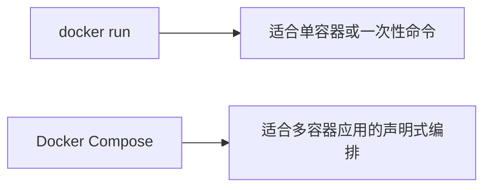
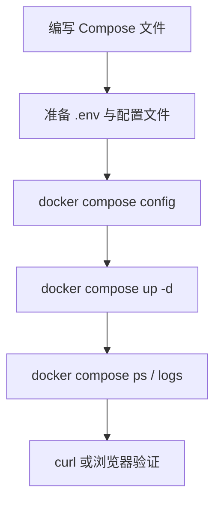

# Docker Compose 理论与核心概念

## 本章目标

本章围绕 Docker Compose 的核心价值展开，重点回答以下三个问题：

1. Docker Compose 到底解决什么问题？
2. 为什么多容器场景下，`docker run` 很快会变得难以维护？
3. `services`、`volumes`、`networks`、环境变量、健康检查这些概念，在实际项目中分别承担什么职责？

本章包含两个实验：

- 基础实验：`nginx + flask + redis`
- 完整实验：`nginx + filebeat + elasticsearch + kibana + cert-init`

## 1. Compose 是什么

Docker 官方文档对 Compose 的描述非常直接：

> “With Docker Compose, you can define all of your containers and their configurations in a single YAML file.”

中文翻译：

> 使用 Docker Compose，可以把多个容器及其配置统一定义在一个 YAML 文件中。

来源：

- Docker Docs, *What is Docker Compose?*
  - <https://docs.docker.com/get-started/docker-concepts/the-basics/what-is-docker-compose/>

这句话说明了 3 个关键点：

1. Compose 面向的是“一组相关容器”，而不是单个容器。
2. Compose 的入口是一份声明式文件，而不是一长串运行命令。
3. Compose 管理的不只是镜像名，还包括端口、卷、网络、环境变量、依赖关系等运行时配置。

官方文档还给出了一句更凝练的表述：

> “Compose is a declarative tool.”

中文翻译：

> Compose 是一个声明式工具。

所谓“声明式”，就是先描述目标状态，再由 Docker 去完成创建、连接和启动这些动作。  
因此，Compose 文件更像一份应用清单，而不是一份脚本。

## 2. Compose 与 `docker run` 的关系

在单容器场景下，`docker run` 往往已经足够。例如：

```bash
docker run -d --name web -p 8080:80 nginx:1.29.1
```

同一个“单容器”需求，用 Compose 也可以描述，例如在项目目录下放一个 `compose.yaml`：

```yaml
services:
  web:                          # 服务名，对应 docker run 的 --name web
    image: nginx:1.29.1         # 使用镜像
    ports:
      - "8080:80"                # 宿主机端口:容器端口，对应 -p 8080:80
```

用 `docker compose up -d` 即可启动，效果与上面这条 `docker run` 等价。  
Compose 文件还支持注释，便于写清每项含义、纳入版本管理；单容器时能提升可复现性，多容器时则更能体现编排优势。

**Compose 文件名**：通常推荐使用 `compose.yaml` 或 `compose.yml`（也兼容旧名 `docker-compose.yaml`、`docker-compose.yml`）。如果文件名不同，或文件不在当前工作目录下，可以用 `-f` 指定，例如：`docker compose -f /path/to/compose.yaml up -d` 或 `docker compose -f ./subdir/docker-compose.yml up -d`。

但当一个应用由多个容器组成时，问题会很快出现：

- 启动命令越来越长
- 端口、卷、网络分散在多条命令里
- 服务之间的依赖关系不直观
- 团队成员难以确认一套环境应该怎样完整启动
- 停止、重建、迁移环境时成本变高

这正是 Compose 的适用场景。  
它不是用来替代 Docker，而是用来组织和管理一个多容器应用。

可以把两者的关系理解成：



### 2.1 一个直观对比案例

下面故意选一个很常见、但已经不是“单容器”的需求。  
这里不要求立即执行，重点是体会两种表达方式的差异。

需求如下：

- 一个 `nginx` 对外提供 `8080`
- 一个 `app` 负责业务逻辑
- 一个 `redis` 负责缓存，并且数据要持久化
- `app` 通过服务名 `redis` 访问缓存
- 整套环境需要能统一启动、统一停止

如果用 `docker run` 来做，通常至少要写成下面这样：

```bash
docker network create demo-net
docker volume create redis-data

docker run -d \
  --name redis \
  --network demo-net \
  -v redis-data:/data \
  --restart unless-stopped \
  redis:8.2 \
  redis-server --appendonly yes

docker run -d \
  --name app \
  --network demo-net \
  -e CACHE_HOST=redis \
  -e CACHE_PORT=6379 \
  -e APP_ENV=prod \
  --restart unless-stopped \
  myorg/demo-app:1.0

docker run -d \
  --name nginx \
  --network demo-net \
  -p 8080:80 \
  -v ./nginx/default.conf:/etc/nginx/conf.d/default.conf:ro \
  --restart unless-stopped \
  nginx:1.29.1
```

这时读者通常会立刻感受到几个问题：

- 必须先记得创建网络和卷
- 三个服务分散在三条长命令里
- `app` 依赖 `redis` 这件事，只能从环境变量里间接看出来
- 如果要换端口、加卷、改环境变量，就要重新改命令并再次执行
- 团队协作时，别人往往不容易一次性拼出完整运行方式

同样的需求，用 Compose 表达通常是下面这样：

```yaml
services:
  redis:
    image: redis:8.2
    command: ["redis-server", "--appendonly", "yes"]
    restart: unless-stopped
    volumes:
      - redis-data:/data

  app:
    image: myorg/demo-app:1.0
    restart: unless-stopped
    environment:
      CACHE_HOST: redis
      CACHE_PORT: 6379
      APP_ENV: prod
    depends_on:
      - redis

  nginx:
    image: nginx:1.29.1
    restart: unless-stopped
    ports:
      - "8080:80"
    volumes:
      - ./nginx/default.conf:/etc/nginx/conf.d/default.conf:ro
    depends_on:
      - app

volumes:
  redis-data:
```

这里没有显式定义 `networks`，因为 Compose 会自动为项目创建默认网络；因此 `app` 仍然可以直接通过服务名 `redis` 访问缓存。

启动时只需要：

```bash
docker compose up -d
```

停止并删除当前项目资源时通常只需要：

```bash
docker compose down
```

这个对比里，Compose 的优势不只是“命令更短”，而是“应用结构终于被写出来了”。  
打开这份 YAML，就能一次性看见：

- 有哪些服务
- 每个服务用什么镜像
- 端口怎么映射
- 哪些目录或卷需要挂载
- 服务之间谁依赖谁

从教学角度，可以把这种差异概括成下表：

| 对比项 | `docker run` | Compose |
| --- | --- | --- |
| 初次启动 | 先建网络、建卷，再逐条启动容器 | 一条 `docker compose up -d` |
| 阅读结构 | 需要从多条命令里自己拼关系 | 打开 YAML 就能看到整体结构 |
| 修改配置 | 反复改长命令，容易漏项 | 改 Compose 文件即可 |
| 团队协作 | 常依赖文档、聊天记录、命令历史 | 配置文件本身就是文档 |
| 停止清理 | 需要分别停容器、删网络、删卷 | 可以按项目统一管理 |

因此，`docker run` 的问题不在于“不能启动多个容器”，而在于当容器一多，整个应用的结构会散落在命令历史里；Compose 的价值，就是把这些零散信息收拢成一份可以阅读、可以复用、可以版本管理的应用清单。

## 3. Compose 与 Dockerfile 的关系

Docker 官方文档写道：

> “A Dockerfile provides instructions to build a container image while a Compose file defines your running containers.”

中文翻译：

> Dockerfile 用来说明如何构建镜像；Compose 文件用来定义容器如何运行。

来源：

- Docker Docs, *What is Docker Compose?*
  - <https://docs.docker.com/get-started/docker-concepts/the-basics/what-is-docker-compose/>

因此，两者的职责可以明确区分：

- `Dockerfile` 解决“镜像怎么构建”
- `Compose 文件` 解决“容器怎么组织和运行”

这也是实际项目中最常见的组合方式：

- 一部分服务直接使用现成镜像
- 一部分服务使用本地 Dockerfile 构建
- Compose 统一把这些服务编排起来

## 4. Compose 解决的核心问题

从教学角度看，Compose 的价值可以概括为 5 个方面。

### 4.1 用一个文件描述一个应用

一份 Compose 文件可以集中定义：

- 有哪些服务
- 每个服务使用什么镜像，或者如何构建镜像
- 需要开放哪些端口
- 需要挂载哪些卷
- 服务连接到哪些网络
- 启动时需要哪些环境变量
- 是否需要健康检查与自动重启

这让多容器应用具备了可读性、可复制性和可维护性。

### 4.2 统一生命周期管理

一个 Compose 项目最常用的生命周期命令并不多：

```bash
docker compose up -d
docker compose ps
docker compose logs -f
docker compose exec <service> sh
docker compose down
docker compose down -v
```

每条命令的作用如下：

- `docker compose up -d`
  创建并启动项目中的服务，`-d` 表示后台运行。
- `docker compose ps`
  查看当前项目中各个服务的运行状态、健康状态与端口映射。
- `docker compose logs -f`
  持续跟踪项目日志，适合观察启动过程和排错。
- `docker compose exec <service> sh`
  进入指定服务对应的容器内部，便于检查配置、查看文件、执行调试命令。
- `docker compose down`
  停止并删除当前项目创建的容器、网络等资源。
- `docker compose down -v`
  在 `down` 的基础上，连同项目使用的具名卷一起删除。

这些命令的重点不在于机械记忆，而在于把一个多容器应用作为整体来管理。

### 4.3 自带服务发现

Docker 官方的 Compose Networking 文档说明：

> “By default Compose sets up a single network for your app.”

中文翻译：

> 默认情况下，Compose 会为整个应用创建一个网络。

同时官方还说明：

> “Each container can now look up the service name `web` or `db` and get back the appropriate container's IP address.”

中文翻译：

> 容器可以直接使用服务名，例如 `web` 或 `db`，并解析到对应容器的 IP 地址。

来源：

- Docker Docs, *Networking in Compose*
  - <https://docs.docker.com/compose/how-tos/networking/>

这意味着在 Compose 中，服务之间通常不需要硬编码 IP。  
只要它们位于同一网络，就可以通过服务名互相访问；如果需要更贴近业务语义的域名，也可以通过 `networks.aliases` 提供别名。

### 4.4 统一管理持久化与共享数据

Compose 文件可以统一定义卷。例如：

- Redis 的数据目录持久化到具名卷
- Nginx 的日志目录共享给 Filebeat 采集
- 证书目录由初始化服务生成后再挂载给其他服务

把这类关系统一写进 Compose 文件后，数据路径和服务关系都会更清晰。

### 4.5 表达依赖关系与启动顺序

Docker 官方文档指出：

> “Compose always starts and stops containers in dependency order.”

中文翻译：

> Compose 总是按照依赖顺序启动和停止容器。

但官方紧接着又强调：

> “Compose does not wait until a container is ‘ready’, only until it’s running.”

中文翻译：

> Compose 不会等待容器“真正就绪”，它只会等待容器进入运行状态。

来源：

- Docker Docs, *Control startup order in Compose*
  - <https://docs.docker.com/compose/how-tos/startup-order/>

这里需要区分两个概念：

- 运行状态：容器中的主进程已经启动，`docker ps` 或 `docker compose ps` 能看到它处于 `Up`
- 真正就绪：服务已经完成初始化，能够正常监听端口并稳定响应请求

可以简单理解为：

- 运行状态：容器活着
- 真正就绪：服务能用

例如数据库容器通常很快就会进入 `Up` 状态，但此时它仍可能在初始化数据目录、加载系统表或回放日志，应用立即连接仍然可能失败。

因此，`depends_on` 需要分两种情况理解：

- 如果使用短语法（如 `depends_on: [redis]`），它主要表达启动顺序，不能保证前一个服务已经可用
- 如果需要等待服务真正就绪，应给被依赖服务配置 `healthcheck`，并在 `depends_on` 中使用 `condition: service_healthy`
- 如果依赖的是一次性初始化任务，则常见写法是 `condition: service_completed_successfully`

这也是为什么在实际项目里，`depends_on` 往往要和 `healthcheck` 搭配使用，而不是单独理解成“已经准备好了”。

## 5. Compose 文件中的核心对象

Docker 官方的 Compose File Reference 把应用模型拆成若干顶层元素。  
本章重点关注以下 4 个：

- `services`
- `volumes`
- `networks`
- 环境变量与变量替换

### 5.1 `services`

`services` 是 Compose 文件的核心。  
可以把每个 service 理解成“应用中的一个角色”。

例如在完整实验中：

- `cert-init`：一次性证书初始化服务
- `elasticsearch`：搜索与存储服务
- `kibana`：可视化服务
- `nginx`：HTTPS 站点与反向代理
- `filebeat`：日志采集服务

每个 service 通常会包含以下常见字段：

- `image`
- `build`
- `ports`
- `volumes`
- `networks`
- `environment`
- `depends_on`
- `healthcheck`
- `restart`
- `user`
- `command`
- `entrypoint`

### 5.2 `volumes`

Compose 官方参考文档对卷的说明是：

> “Volumes are persistent data stores implemented by the container engine.”

中文翻译：

> 卷是由容器引擎实现的持久化数据存储机制。

来源：

- Docker Docs, *Compose file reference: Volumes*
  - <https://docs.docker.com/reference/compose-file/volumes/>

教学中可以把卷分成两类：

1. 具名卷
   - 由 Docker 管理
   - 适合数据库、缓存等持久化目录
2. bind mount
   - 把宿主机上的具体文件或目录挂进容器
   - 适合配置文件、源码、证书目录

例如：

- `redisdata:/data` 是具名卷
- `./nginx/default.conf:/etc/nginx/conf.d/default.conf:ro` 是 bind mount

### 5.3 `networks`

Compose 官方文档说明：

> “Networks let services communicate with each other.”

中文翻译：

> 网络用于让服务之间能够互相通信。

来源：

- Docker Docs, *Compose file reference: Networks*
  - <https://docs.docker.com/reference/compose-file/networks/>

这里最重要的不是网络底层细节，而是下面 3 个事实：

1. Compose 会默认给项目创建网络
2. 同一网络中的服务可以通过服务名互相访问
3. 可以用多个自定义网络表达“谁应该互通、谁应该隔离”

例如：

- 基础实验中，`nginx` 同时连接 `frontend` 和 `backend`
- 完整实验中，`edge` 表示入口流量，`elastic` 表示内部服务流量

### 5.4 环境变量与变量替换

Docker 官方文档对变量替换写得很明确：

> “Both braced (`${VAR}`) and unbraced (`$VAR`) expressions are supported.”

中文翻译：

> Compose 同时支持带花括号和不带花括号的变量表达式。

官方还指出：

> “An `.env` file in Docker Compose is a text file used to define variables that should be made available for interpolation when running `docker compose up`.”

中文翻译：

> 在 Docker Compose 中，`.env` 文件用于定义变量，供 `docker compose up` 时进行变量替换。

来源：

- Docker Docs, *Variable interpolation*
  - <https://docs.docker.com/compose/how-tos/environment-variables/variable-interpolation/>

需要区分清楚：`.env` 是给 **Compose 自己**用的——在解析、执行 `docker compose up` 时，用其中的变量去替换 compose 文件里的 `${VAR}` 占位符；**不是**自动发给每个容器。若要让某个服务（容器）读到某个变量，必须在对应服务的 `environment` 或 `env_file` 里显式写出来，或在该服务里引用 `${VAR}`（此时 Compose 会先把变量代入，再传给该服务）。用 YAML 片段说明如下。

**1. Compose 用 `.env` 做文件内替换**（例如端口、镜像名等，与“是否进容器”无关）：

```yaml
# .env 中有 APP_PORT=8080、NGINX_IMAGE=nginx:1.29.1
services:
  web:
    image: ${NGINX_IMAGE}      # Compose 解析时替换为 nginx:1.29.1
    ports:
      - "${APP_PORT}:80"       # 解析时替换为 8080:80
```

**2. 只有写进服务的 `environment`（或 `env_file`），容器内才能读到**：

```yaml
services:
  web:
    image: nginx:1.29.1
    environment:
      - APP_NAME=${APP_NAME}   # Compose 先代入 .env 中的 APP_NAME，再作为环境变量传入容器
    # 或者用 env_file 把整份文件交给该服务：
    # env_file:
    #   - .env
```

`.env` 的价值不只是少打几次字，更重要的是：

- 让 Compose 文件更整洁
- 让实验参数更集中
- 便于切换不同环境

## 6. 一个 Compose 项目的基本工作流

Compose 的常见使用流程可以概括为下面 6 步：



这里可以顺带认识一下 `docker compose config`。  
它不是启动项目的必需步骤，但在教学和排错时很有价值，因为它可以把：

- `.env` 中的变量
- Compose 文件中的引用
- 默认值与最终展开结果

展示为一份“最终生效配置”。

因此，`docker compose config` 更适合作为检查工具，而不是启动项目的前置条件。

## 7. Compose 的常见命令

下面这些命令可以作为本章的“最小常用命令集”。

### 7.1 启动项目

```bash
docker compose up -d
```

- `up`：创建并启动服务
- `-d`：后台运行

### 7.2 查看状态

```bash
docker compose ps
```

查看每个服务是否已启动、是否健康、端口是否已发布。

### 7.3 查看日志

```bash
docker compose logs -f
docker compose logs --tail=50 nginx
```

- `logs -f`：持续跟踪项目日志
- `--tail=50 nginx`：只查看某个服务最近的日志

### 7.4 进入容器

```bash
docker compose exec nginx sh
docker compose exec elasticsearch bash
```

进入指定服务对应的容器内部，检查配置、查看文件或执行调试命令。

### 7.5 停止并删除项目

```bash
docker compose down
```

如果连具名卷一起清理：

```bash
docker compose down -v
```

需要注意的是，一旦带 `-v`，像数据库、Redis、Elasticsearch 这类服务的持久化数据也会被一起删除。

## 8. 学习 Compose 时需要建立的 4 个认识

### 8.1 `ports` 是给宿主机访问的，不是给容器互访的

这是 Compose 初学阶段最容易混淆的地方。

如果 `app` 和 `redis` 在同一个 Compose 网络里，那么：

- `app` 访问 `redis:6379`，不需要 `ports`
- `ports` 只是在宿主机上发布访问入口

官方 Networking 文档也明确区分了：

- `HOST_PORT`
- `CONTAINER_PORT`

因此，容器间通信看的是容器端口和网络；外部访问才看宿主机端口映射。

### 8.2 `depends_on` 不等于服务就绪

短语法 `depends_on` 只能解决启动顺序问题，不能替代健康检查。  
如果希望依赖“就绪状态”，应给被依赖服务定义 `healthcheck`，再配合 `condition: service_healthy`；对于一次性初始化任务，则可使用 `condition: service_completed_successfully`。

### 8.3 卷不仅用于持久化，也用于共享

教学中如果只强调“数据库要持久化”，对 Compose 的理解仍然不完整。  
在完整实验中：

- `nginxlogs` 卷由 `nginx` 写入
- `filebeat` 同时以只读方式挂载并采集

这说明卷除了保存数据，还可以承担服务间的数据交接。

### 8.4 Compose 更像“应用清单”，不是脚本

Compose 文件是对应用结构的描述，而不是一堆命令的堆砌。  
因此编写 Compose 文件时，应优先考虑：

- 角色划分是否清晰
- 网络边界是否清晰
- 数据路径是否清晰
- 依赖关系是否清晰

而不是只想着“怎么把命令塞进 YAML 里”。

## 9. 本章总结

学习 Compose 时，最重要的不是记住所有字段，而是建立下面这个整体认识：

- Compose 用来描述一个多容器应用
- Compose 文件是声明式的应用清单
- `services`、`volumes`、`networks` 是最核心的三个对象
- `.env`、`depends_on`、`healthcheck`、`restart` 是日常高频能力
- `docker compose up -d`、`ps`、`logs`、`exec`、`down` 是最常用的管理命令

后续两个实验会沿着这个理论框架展开：  
基础实验用于讲清最常见的 Compose 结构，完整实验则用于展示 Compose 如何承载一个更真实、带 TLS、带共享卷、带初始化服务的多容器应用。
