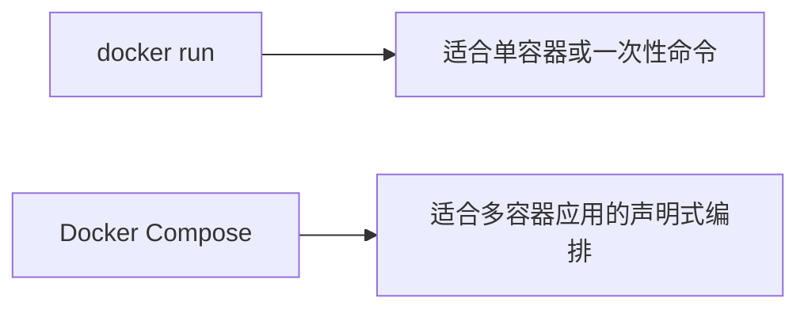
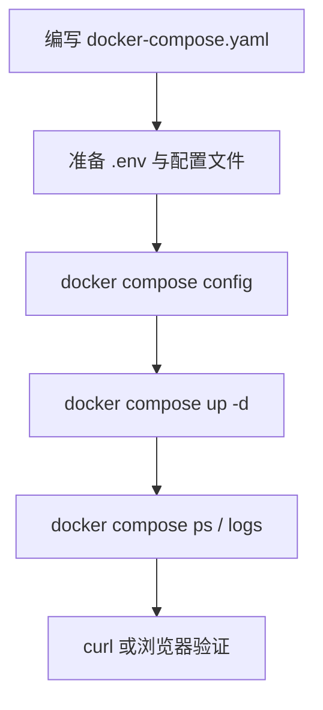

# Docker Compose 理论与核心概念

## 本章目标

本章围绕 Docker Compose 的核心价值展开，重点回答以下三个问题：

1. Docker Compose 到底解决什么问题？
2. 为什么多容器场景下，`docker run` 很快会变得难以维护？
3. `services`、`volumes`、`networks`、环境变量、健康检查这些概念，在实际项目中分别承担什么职责？

本章包含两个实验：

- 基础实验：`nginx + flask + redis`
- 完整实验：`nginx + filebeat + elasticsearch + kibana + cert-init`

## 1. Compose 是什么

Docker 官方文档对 Compose 的描述非常直接：

> “With Docker Compose, you can define all of your containers and their configurations in a single YAML file.”

中文翻译：

> 使用 Docker Compose，可以把多个容器及其配置统一定义在一个 YAML 文件中。

来源：

- Docker Docs, *What is Docker Compose?*
  - <https://docs.docker.com/get-started/docker-concepts/the-basics/what-is-docker-compose/>

这句话虽然短，但信息量很大。它至少说明了 3 件事：

1. Compose 面向的不是单个容器，而是“一组相关容器”。
2. Compose 的入口不是一长串命令，而是一个声明式文件。
3. Compose 关心的不只是镜像名，还包括端口、卷、网络、环境变量、启动顺序等运行时配置。

官方文档还给了另一句非常关键的话：

> “Compose is a declarative tool.”

中文翻译：

> Compose 是一个声明式工具。

这里的“声明式”可以理解为：不必一步一步告诉 Docker 先做什么、后做什么，而是描述“目标状态应该是什么样子”。  
Compose 读取 `docker-compose.yaml` 后，会根据声明去创建网络、卷、容器，并按照依赖顺序启动它们。

## 2. Compose 与 `docker run` 的关系

初学 Docker 时，很多场景都可以用 `docker run` 解决。例如：

```bash
docker run -d --name web -p 8080:80 nginx:1.29.1
```

当只有一个容器时，这种方式没有问题。  
但如果一个应用由 3 到 5 个容器组成，很快就会遇到下面这些问题：

- 命令过长，难以复用
- 端口、卷、网络分散在多条命令里，难以审查
- 团队成员很难确认“正确启动方式”到底是哪几条命令
- 服务之间的依赖关系不直观
- 停止、删除、重建一整套环境时很繁琐

这就是 Compose 出现的背景。  
它不是用来“替代 Docker”，而是用来管理一个由多个容器组成的应用。

可以把两者关系理解成下面这样：



## 3. Compose 与 Dockerfile 的关系

这一点在教学里很容易混淆，所以必须单独说明。

Docker 官方文档写道：

> “A Dockerfile provides instructions to build a container image while a Compose file defines your running containers.”

中文翻译：

> Dockerfile 用来说明如何构建镜像；Compose 文件用来定义容器如何运行。

来源：

- Docker Docs, *What is Docker Compose?*
  - <https://docs.docker.com/get-started/docker-concepts/the-basics/what-is-docker-compose/>

也就是说：

- `Dockerfile` 解决“镜像怎么做出来”
- `docker-compose.yaml` 解决“容器怎么组织起来运行”

两者并不是互斥关系，反而经常一起使用。

例如在基础实验中：

- `app/Dockerfile` 负责构建 Flask 应用镜像
- `docker-compose.yaml` 负责定义 `app`、`nginx`、`redis` 三个服务如何一起启动

## 4. Compose 解决的核心问题

从教学角度，Compose 最重要的价值可以归纳为 5 个方面。

### 4.1 用一个文件描述一个应用

一份 `docker-compose.yaml` 可以同时定义：

- 有哪些服务
- 每个服务使用哪个镜像，或者如何构建镜像
- 需要开放哪些端口
- 需要挂载哪些卷
- 服务之间连接到哪些网络
- 服务启动时需要哪些环境变量
- 是否需要健康检查
- 是否需要自动重启

这让多容器项目具备了可读性和可复制性。

### 4.2 统一生命周期管理

一个 Compose 项目最常用的生命周期命令并不多：

```bash
docker compose up -d
docker compose ps
docker compose logs -f
docker compose exec <service> sh
docker compose down
docker compose down -v
```

每条命令的作用如下：

- `docker compose up -d`
  创建并启动 Compose 项目中的服务，`-d` 表示后台运行。
- `docker compose ps`
  查看当前项目中各个服务的运行状态、健康状态与端口映射。
- `docker compose logs -f`
  持续跟踪项目日志，适合观察启动过程和排错。
- `docker compose exec <service> sh`
  进入指定服务对应的容器内部，便于检查配置、查看文件、执行调试命令。
- `docker compose down`
  停止并删除当前项目创建的容器、网络等资源。
- `docker compose down -v`
  在 `down` 的基础上，连同项目使用的具名卷一起删除。

这些命令的重点不在于机械记忆，而在于把一个多容器应用作为整体来管理。

### 4.3 自带服务发现

Docker 官方的 Compose Networking 文档说明：

> “By default Compose sets up a single network for your app.”

中文翻译：

> 默认情况下，Compose 会为整个应用创建一个网络。

同时官方还说明：

> “Each container can now look up the service name `web` or `db` and get back the appropriate container's IP address.”

中文翻译：

> 容器可以直接使用服务名，例如 `web` 或 `db`，并解析到对应容器的 IP 地址。

来源：

- Docker Docs, *Networking in Compose*
  - <https://docs.docker.com/compose/how-tos/networking/>

这意味着在 Compose 里，服务间通信通常不需要硬编码 IP。

例如：

- `app` 访问 Redis 时，主机名可以直接写 `redis`
- `kibana` 访问 Elasticsearch 时，主机名可以写 `es01.qytdocker2026.com`

前者是服务名，后者可以通过 `networks.aliases` 在 Compose 网络里实现。

### 4.4 统一管理持久化与共享数据

Compose 文件中可以统一定义卷。例如：

- Redis 的数据目录可以持久化到具名卷
- Nginx 的日志目录可以共享给 Filebeat 采集
- 证书目录可以由一次性初始化服务生成，再挂载给其他服务只读使用

这类关系如果分散在多条 `docker run` 命令里，维护成本会很高；而在 Compose 中，拓扑结构会清楚得多。

### 4.5 表达依赖关系与启动顺序

Docker 官方文档指出：

> “Compose always starts and stops containers in dependency order.”

中文翻译：

> Compose 总是按照依赖顺序启动和停止容器。

但官方紧接着又强调：

> “Compose does not wait until a container is ‘ready’, only until it’s running.”

中文翻译：

> Compose 不会等待容器“真正就绪”，它只会等待容器进入运行状态。

来源：

- Docker Docs, *Control startup order in Compose*
  - <https://docs.docker.com/compose/how-tos/startup-order/>

这两句话必须连在一起看。  
它们共同说明：

- `depends_on` 有意义
- 但只有 `depends_on` 还不够
- 更稳妥的方式是 `depends_on + healthcheck`

这也是本章两个实验都会重点展示的知识点。

这里的“运行状态”和“真正就绪”需要区分开来。

- 运行状态：容器中的主进程已经启动，`docker ps` 或 `docker compose ps` 能看到它处于 `Up`
- 真正就绪：服务已经完成初始化，能够正常监听端口并稳定响应请求

可以简化理解为：

- 运行状态：容器活着
- 真正就绪：服务能用

例如数据库容器往往很快进入 `Up` 状态，但此时它仍可能在初始化数据目录、加载系统表或回放日志，应用立即连接仍然可能失败。

这正是 Compose 官方文档强调的重点：  
`depends_on` 只能表达启动顺序，不能天然保证前一个服务已经可用。  
因此，在需要初始化时间的服务前面，通常还要配合 `healthcheck`。

## 5. Compose 文件中的核心对象

Docker 官方的 Compose File Reference 把应用模型拆成若干顶层元素。教学里最常用的几个如下：

- `services`
- `volumes`
- `networks`
- `configs`
- `secrets`

本章重点使用前 3 个。

### 5.1 `services`

`services` 是 Compose 文件最核心的部分。  
可以把每个 service 理解成“应用中的一个角色”。

例如在完整实验中：

- `cert-init`：一次性证书初始化服务
- `elasticsearch`：搜索与存储服务
- `kibana`：可视化服务
- `nginx`：HTTPS 站点与反向代理
- `filebeat`：日志采集服务

每个 service 通常会包含这些常见字段：

- `image`
- `build`
- `ports`
- `volumes`
- `networks`
- `environment`
- `depends_on`
- `healthcheck`
- `restart`
- `user`
- `command`
- `entrypoint`

### 5.2 `volumes`

Compose 官方参考文档对卷的说明是：

> “Volumes are persistent data stores implemented by the container engine.”

中文翻译：

> 卷是由容器引擎实现的持久化数据存储机制。

来源：

- Docker Docs, *Compose file reference: Volumes*
  - <https://docs.docker.com/reference/compose-file/volumes/>

教学里可以把卷分成两类理解：

1. 具名卷
   - 由 Docker 管理
   - 适合数据库数据、缓存数据等持久化目录
2. bind mount
   - 把宿主机上的具体文件或目录挂进容器
   - 适合配置文件、源码、证书目录

例如：

- `redisdata:/data` 是具名卷
- `./nginx/default.conf:/etc/nginx/conf.d/default.conf:ro` 是 bind mount

### 5.3 `networks`

Compose 官方文档说明：

> “Networks let services communicate with each other.”

中文翻译：

> 网络用于让服务之间能够互相通信。

来源：

- Docker Docs, *Compose file reference: Networks*
  - <https://docs.docker.com/reference/compose-file/networks/>

教学里最重要的不是网络底层细节，而是下面 3 个事实：

1. Compose 会默认给项目创建网络
2. 同一网络中的服务可以通过服务名互相访问
3. 可以用多个自定义网络表达“谁应该互通、谁应该隔离”

基础实验中会把 `nginx` 放到 `frontend` 和 `backend` 两个网络里，这样它既能对外提供入口，又能访问后端应用。  
完整实验中则会用 `elastic` 和 `edge` 两个网络，分别表达“内部服务流量”和“外部入口流量”。

### 5.4 环境变量与变量替换

Docker 官方文档对变量替换写得很明确：

> “Both braced (`${VAR}`) and unbraced (`$VAR`) expressions are supported.”

中文翻译：

> Compose 同时支持带花括号和不带花括号的变量表达式。

官方也指出：

> “An `.env` file in Docker Compose is a text file used to define variables that should be made available for interpolation when running `docker compose up`.”

中文翻译：

> 在 Docker Compose 中，`.env` 文件用于定义变量，供 `docker compose up` 时进行变量替换。

来源：

- Docker Docs, *Variable interpolation*
  - <https://docs.docker.com/compose/how-tos/environment-variables/variable-interpolation/>

这一点在教学中非常值得强调，因为 `.env` 的价值不只是“省得手打”，更重要的是：

- 让 Compose 文件更整洁
- 让实验参数更集中
- 便于切换不同环境

## 6. 一个 Compose 项目的基本工作流

Compose 的常见使用流程可以归纳为下面 6 步：



这里可以顺带认识一下 `docker compose config`。  
它不是启动项目的必需步骤，但在教学和排错时很有价值，因为它可以把：

- `.env` 中的变量
- Compose 文件中的引用
- 默认值与最终展开结果

全部展示为一份“最终生效配置”。

换句话说，`docker compose config` 更适合作为检查工具，而不是启动项目的前置条件。

## 7. Compose 的常见命令

下面这些命令可以作为本章的“最小常用命令集”。

### 7.1 启动项目

```bash
docker compose up -d
```

- `up`：创建并启动服务
- `-d`：后台运行

### 7.2 查看状态

```bash
docker compose ps
```

查看每个服务是否已启动、是否健康、端口是否已发布。

### 7.3 查看日志

```bash
docker compose logs -f
docker compose logs --tail=50 nginx
```

### 7.4 进入容器

```bash
docker compose exec nginx sh
docker compose exec elasticsearch bash
```

### 7.5 停止并删除项目

```bash
docker compose down
```

如果连具名卷一起清理：

```bash
docker compose down -v
```

这条命令在实验环境中很常用，但也要提醒学员：  
一旦带 `-v`，像数据库、Redis、Elasticsearch 的持久化数据也会被一起删掉。

## 8. 本章必须建立的 4 个认识

### 8.1 `ports` 是给宿主机访问的，不是给容器互访的

这是 Compose 初学阶段最容易混淆的地方。

如果 `app` 和 `redis` 在同一个 Compose 网络里，那么：

- `app` 访问 `redis:6379`，不需要 `ports`
- `ports` 只是在宿主机上发布访问入口

官方 Networking 文档也明确区分了：

- `HOST_PORT`
- `CONTAINER_PORT`

教学里必须让学生看明白：  
容器间通信看的是容器端口和网络，外部访问才看宿主机端口映射。

### 8.2 `depends_on` 不等于服务就绪

`depends_on` 可以解决启动顺序问题，但不能替代健康检查。  
只要后端服务需要初始化时间，就应优先考虑增加 `healthcheck`。

### 8.3 卷不仅用于持久化，也用于共享

教学中经常只强调“数据库要持久化”，但这不够。  
完整实验里更能体现 Compose 价值的是：

- `nginxlogs` 卷由 `nginx` 写入
- `filebeat` 同时挂载只读采集

这说明卷除了保存数据，还能承担服务间的数据交接。

### 8.4 Compose 更像“应用清单”，不是脚本

Compose 文件是对应用结构的描述，而不是一堆命令的堆砌。  
因此写 Compose 文件时，应该优先考虑：

- 角色划分是否清晰
- 网络边界是否清晰
- 数据路径是否清晰
- 依赖关系是否清晰

而不是只想着“怎么把命令塞进 YAML 里”。

## 9. 本章总结

学习 Compose 时，最重要的不是记住所有字段，而是建立这样一个整体认识：

- Compose 用来描述一个多容器应用
- Compose 文件是声明式的应用清单
- `services`、`volumes`、`networks` 是最核心的三个对象
- `.env`、`depends_on`、`healthcheck`、`restart` 是日常高频能力
- `docker compose config`、`up -d`、`ps`、`logs` 是最值得掌握的命令

后续两个实验会沿着这个理论框架展开。  
基础实验用于把最常见的 Compose 结构讲透，完整实验则用于展示 Compose 如何承载一个更真实、带 TLS、带共享卷、带初始化服务的多容器应用。
