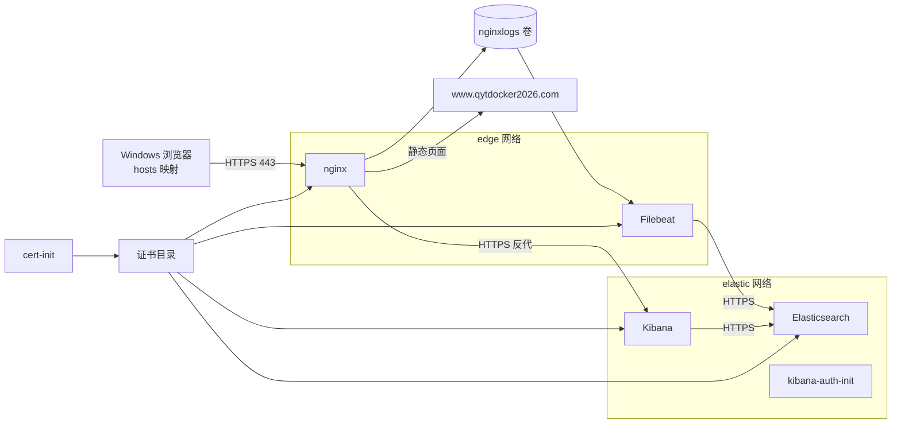
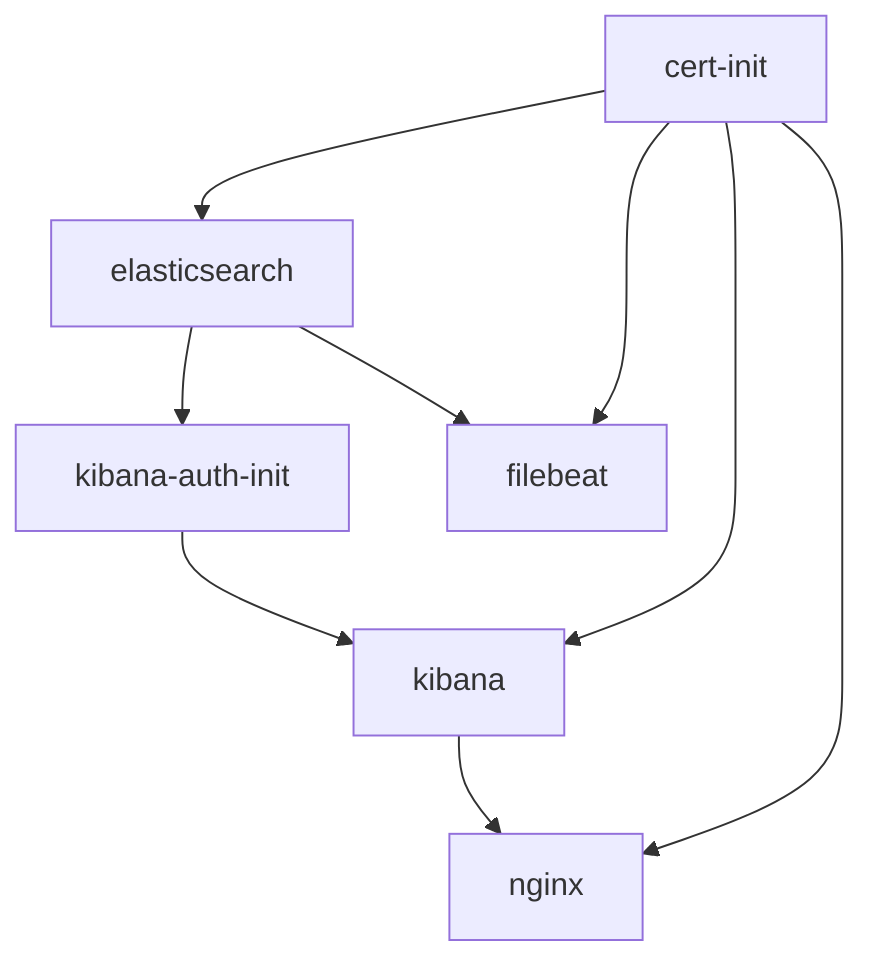
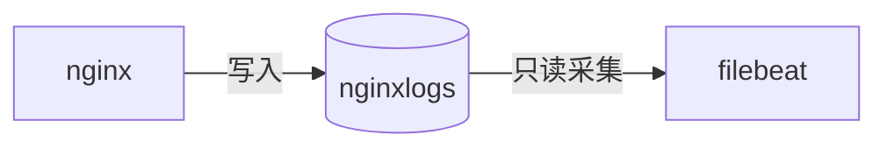

# Docker Compose 完整实验：TLS + ELK + Nginx

## 本实验目标

本实验使用一个相对复杂但仍然可控的 Compose 项目，来集中展示多容器应用编排中的关键能力。

服务清单如下：

- `cert-init`
- `elasticsearch`
- `kibana-auth-init`
- `kibana`
- `nginx`
- `filebeat`

本实验主要展示的 Compose 能力包括：

- 多服务定义
- 自定义网络
- 网络别名
- 具名卷与共享卷
- bind mount
- 环境变量
- 健康检查
- 启动顺序控制
- 一次性初始化服务
- 反向代理
- 容器内部 TLS 通信

## 1. 实验拓扑



这张图里有 4 条值得重点观察的链路：

1. `cert-init -> 证书目录 -> 其他服务`
2. `nginx -> nginxlogs 卷 -> filebeat`
3. `filebeat -> elasticsearch` 的 HTTPS 链路
4. `nginx -> kibana` 的 HTTPS 反向代理链路

## 2. 实验目录

```text
lab/elastic_tls/
├── .env
├── docker-compose.yaml
├── certs/
│   └── generated/
├── filebeat/
│   └── filebeat.yml
├── init/
│   ├── configure-kibana-user.sh
│   └── generate-certs.sh
└── nginx/
    ├── html/
    │   └── index.html
    └── nginx.conf
```

根证书文件位于：

- [ca.cer](/docker_k8s_2026/docker/docker_6_compose/certs/ca.cer)
- [ca-key.pem](/docker_k8s_2026/docker/docker_6_compose/certs/ca-key.pem)

## 3. 域名与证书规划

本实验使用独立签发的证书，不使用泛域名证书。

域名规划如下：

- `www.qytdocker2026.com`
- `es01.qytdocker2026.com`
- `kibana01.qytdocker2026.com`
- `filebeat01.qytdocker2026.com`

外部访问方式：

- 由 Windows 客户端自行做 `hosts` 映射
- 本章只提醒如何映射，不把重点放在 Windows 操作本身

容器内部访问方式：

- 使用 Compose 网络别名 `aliases`
- 让内部服务也能用完整域名互相访问

**关键看点**

- 外部域名解析和 Compose 内部服务发现不是一回事
- 同一台机器上，外部可用 `hosts`，内部可用 `network aliases`
- 只要证书 SAN 中包含这些 FQDN，TLS 校验就能通过

## 4. Compose 文件整体结构

完整 Compose 文件见：

- [docker-compose.yaml](/docker_k8s_2026/docker/docker_6_compose/lab/elastic_tls/docker-compose.yaml)

在进入具体服务之前，先用结构化视角理解这一份文件：



这个启动图体现了两个 Compose 设计要点：

1. 一次性任务可以独立成服务
2. `depends_on` 的条件可以精确到 `service_completed_successfully` 和 `service_healthy`

## 5. 先读 `.env`

本实验的环境变量文件如下：

```env
STACK_VERSION=8.19.0
NGINX_VERSION=1.29.1
ELASTIC_PASSWORD=Cisc0123!
KIBANA_SYSTEM_PASSWORD=Cisc0123!
COMPOSE_PROJECT_NAME=compose-elk
```

文件位置：

- [.env](/docker_k8s_2026/docker/docker_6_compose/lab/elastic_tls/.env)

这里的教学重点不是密码本身，而是 Compose 变量替换能力：

- 镜像版本统一在 `.env` 中定义
- 密码参数统一在 `.env` 中定义
- 项目名也可以通过 `.env` 控制

这让 Compose 文件更整洁。

## 6. `cert-init`：一次性初始化服务

这是本实验最有教学价值的部分之一。

Compose 文件中的定义如下：

```yaml
cert-init:
  image: alpine:3.22
  entrypoint: ["/bin/sh", "/init/generate-certs.sh"]
  restart: "no"
  volumes:
    - ../../certs:/ca:ro
    - ./certs/generated:/output
    - ./init/generate-certs.sh:/init/generate-certs.sh:ro
```

这个服务的职责很单纯：

- 读取实验目录中的根证书和私钥
- 用 `openssl` 逐个签发各服务证书
- 输出到 `./certs/generated`
- 完成任务后退出

脚本内容如下：

```sh
#!/bin/sh
set -eu

apk add --no-cache openssl >/dev/null

mkdir -p /output/ca /output/nginx /output/elasticsearch /output/kibana /output/filebeat
cp /ca/ca.cer /output/ca/ca.crt
SERIAL_FILE=/output/ca/ca.srl
[ -f "$SERIAL_FILE" ] || echo "1000" > "$SERIAL_FILE"

generate_cert() {
  name="$1"
  common_name="$2"
  alt_names="$3"
  target_dir="/output/$name"
  mkdir -p "$target_dir"
  echo "generating certificate for $common_name"
  cat > "$target_dir/openssl.cnf" <<EOF
[ req ]
distinguished_name = dn
req_extensions = req_ext
prompt = no

[ dn ]
CN = ${common_name}

[ req_ext ]
subjectAltName = ${alt_names}
extendedKeyUsage = serverAuth, clientAuth
keyUsage = digitalSignature, keyEncipherment
EOF

  openssl genrsa -out "$target_dir/tls.key" 2048 >/dev/null 2>&1
  openssl req -new -key "$target_dir/tls.key" -out "$target_dir/tls.csr" -config "$target_dir/openssl.cnf" >/dev/null 2>&1
  openssl x509 -req -in "$target_dir/tls.csr" -CA /ca/ca.cer -CAkey /ca/ca-key.pem -CAserial "$SERIAL_FILE" -out "$target_dir/tls.crt" -days 825 -sha256 -extensions req_ext -extfile "$target_dir/openssl.cnf" >/dev/null 2>&1

  cp /ca/ca.cer "$target_dir/ca.crt"
  chmod 644 "$target_dir/tls.key" "$target_dir/tls.crt" "$target_dir/ca.crt"
  rm -f "$target_dir/tls.csr" "$target_dir/openssl.cnf"
}

generate_cert nginx "www.qytdocker2026.com" "DNS:www.qytdocker2026.com,DNS:nginx"
generate_cert elasticsearch "es01.qytdocker2026.com" "DNS:es01.qytdocker2026.com,DNS:elasticsearch,DNS:localhost,IP:127.0.0.1"
generate_cert kibana "kibana01.qytdocker2026.com" "DNS:kibana01.qytdocker2026.com,DNS:kibana,DNS:localhost,IP:127.0.0.1"
generate_cert filebeat "filebeat01.qytdocker2026.com" "DNS:filebeat01.qytdocker2026.com,DNS:filebeat"
echo "all certificates generated under /output"
```

文件位置：

- [generate-certs.sh](/docker_k8s_2026/docker/docker_6_compose/lab/elastic_tls/init/generate-certs.sh)

**关键看点**

- 这是一个非常典型的“一次性任务容器”
- Compose 不只是适合长期运行服务，也适合做初始化步骤
- `restart: "no"` 正好表达“执行成功后退出”的语义

## 7. `elasticsearch`：被依赖的核心服务

`elasticsearch` 的 Compose 定义里最值得观察的是 4 个部分：

1. `depends_on`
2. TLS 相关环境变量
3. `healthcheck`
4. 证书目录挂载

这里不展开讲 Elasticsearch 原理，只聚焦与 Compose 相关的部分。

### 7.1 依赖关系

```yaml
depends_on:
  cert-init:
    condition: service_completed_successfully
```

这说明：

- 证书没生成完，Elasticsearch 就不应该启动

### 7.2 健康检查

```yaml
healthcheck:
  test: ["CMD-SHELL", "curl --silent --fail --cacert /usr/share/elasticsearch/config/certs/ca.crt -u elastic:${ELASTIC_PASSWORD} https://127.0.0.1:9200/_cluster/health >/dev/null"]
```

这是一条非常好的教学示例，因为它清楚展示了：

- 健康检查不一定是纯 TCP
- 在 HTTPS 场景下，应当连带证书校验一起验证
- `healthcheck` 可以成为后续服务的启动依据

## 8. `kibana-auth-init`：第二个一次性服务

Kibana 连接 Elasticsearch 时，不能直接长期使用 `elastic` 超级用户。  
为了让实验更顺利、结构更清楚，本案例引入了第二个一次性服务：

- `kibana-auth-init`

它的职责非常明确：

- 等待 Elasticsearch 健康
- 调用 ES API 设置 `kibana_system` 密码
- 完成后退出

脚本内容如下：

```sh
#!/bin/sh
set -eu

echo "setting kibana_system password"

curl --silent --fail \
  --cacert /certs/ca.crt \
  -u "elastic:${ELASTIC_PASSWORD}" \
  -H 'Content-Type: application/json' \
  -X POST \
  https://es01.qytdocker2026.com:9200/_security/user/kibana_system/_password \
  -d "{\"password\":\"${KIBANA_SYSTEM_PASSWORD}\"}" >/dev/null

echo "kibana_system password updated"
```

文件位置：

- [configure-kibana-user.sh](/docker_k8s_2026/docker/docker_6_compose/lab/elastic_tls/init/configure-kibana-user.sh)

**关键看点**

- Compose 可以让“初始化脚本”成为应用结构的一部分
- 这比把初始化过程散落在手工命令里更容易复现

## 9. `kibana`：TLS 终端与被反代服务

Kibana 服务本身开启了 HTTPS，并通过如下环境变量连接 Elasticsearch：

```yaml
ELASTICSEARCH_HOSTS: '["https://es01.qytdocker2026.com:9200"]'
ELASTICSEARCH_SSL_CERTIFICATEAUTHORITIES: /usr/share/kibana/config/certs/ca.crt
ELASTICSEARCH_USERNAME: kibana_system
ELASTICSEARCH_PASSWORD: ${KIBANA_SYSTEM_PASSWORD}
```

这个片段非常适合用来讲 Compose 的两个概念：

1. 环境变量不仅可以传简单参数，也能传复杂配置项
2. 只要内部 DNS 名称与证书 SAN 对齐，容器间 TLS 完全可以走 FQDN

## 10. `nginx`：HTTPS 入口与 Kibana 反向代理

本实验中的 `nginx` 做两件事：

1. 对外提供 `https://www.qytdocker2026.com`
2. 反代 `https://kibana01.qytdocker2026.com`

Nginx 配置如下：

```nginx
server {
    listen 80;
    server_name www.qytdocker2026.com kibana01.qytdocker2026.com;
    return 301 https://$host$request_uri;
}

server {
    listen 443 ssl;
    server_name www.qytdocker2026.com;

    ssl_certificate     /etc/nginx/certs/nginx/tls.crt;
    ssl_certificate_key /etc/nginx/certs/nginx/tls.key;

    root   /usr/share/nginx/html;
    index  index.html;

    location / {
        try_files $uri $uri/ =404;
    }
}

server {
    listen 443 ssl;
    server_name kibana01.qytdocker2026.com;

    ssl_certificate     /etc/nginx/certs/kibana/tls.crt;
    ssl_certificate_key /etc/nginx/certs/kibana/tls.key;

    location / {
        proxy_pass https://kibana01.qytdocker2026.com:5601;
        proxy_http_version 1.1;
        proxy_ssl_name kibana01.qytdocker2026.com;
        proxy_ssl_trusted_certificate /etc/nginx/certs/ca/ca.crt;
        proxy_ssl_verify on;
        proxy_ssl_server_name on;
        proxy_set_header Upgrade $http_upgrade;
        proxy_set_header Connection "upgrade";
        proxy_set_header Host $host;
        proxy_set_header X-Real-IP $remote_addr;
        proxy_set_header X-Forwarded-For $proxy_add_x_forwarded_for;
        proxy_set_header X-Forwarded-Proto https;
    }
}
```

文件位置：

- [nginx.conf](/docker_k8s_2026/docker/docker_6_compose/lab/elastic_tls/nginx/nginx.conf)

**关键看点**

- 同一个 Nginx 同时承载静态站点和反向代理
- 反代到 Kibana 时，Nginx 也会校验后端证书
- 这不是“只把流量转过去”，而是完整的 TLS 代理链路

## 11. `filebeat`：共享卷与内部 HTTPS 输出

Filebeat 配置如下：

```yaml
filebeat.inputs:
  - type: filestream
    id: nginx-access
    enabled: true
    paths:
      - /var/log/nginx/access-compose.log
      - /var/log/nginx/error-compose.log
    fields:
      service_name: nginx
      compose_demo: elastic_tls
    fields_under_root: true

output.elasticsearch:
  hosts: ["https://es01.qytdocker2026.com:9200"]
  username: elastic
  password: ${ELASTIC_PASSWORD}
  ssl.certificate_authorities: ["/usr/share/filebeat/certs/ca/ca.crt"]
```

文件位置：

- [filebeat.yml](/docker_k8s_2026/docker/docker_6_compose/lab/elastic_tls/filebeat/filebeat.yml)

教学里最重要的不是 Filebeat 语法，而是这两个 Compose 设计：

1. `nginxlogs` 卷由 `nginx` 写、`filebeat` 读
2. `filebeat` 访问 Elasticsearch 时，也走 FQDN + TLS

这体现了 Compose 的两个核心能力：

- 用卷在多个服务之间共享数据
- 用网络别名和证书支持内部安全通信

## 12. Compose 网络设计

本实验定义了两个网络：

- `edge`
- `elastic`

其中：

- `nginx` 同时连接 `edge` 和 `elastic`
- `filebeat` 同时连接 `edge` 和 `elastic`
- `elasticsearch` 与 `kibana` 只连接 `elastic`

为什么这么设计？

### 12.1 `edge` 网络

表示面向入口流量的一侧。  
`nginx` 在这里承担 HTTPS 入口，`filebeat` 放进这个网络主要是为了在教学中展示一个服务可以同时参与多个网络。

### 12.2 `elastic` 网络

表示内部服务通信的一侧。  
Elasticsearch、Kibana、Nginx、Filebeat 都在这个网络里完成内部调用。

### 12.3 `aliases`

Compose 文件中最值得注意的是：

```yaml
networks:
  elastic:
    aliases:
      - es01.qytdocker2026.com
```

以及类似的：

- `kibana01.qytdocker2026.com`
- `www.qytdocker2026.com`
- `filebeat01.qytdocker2026.com`

这正是本实验实现“容器内部使用完整域名”的关键。

**关键看点**

- Compose 自带 DNS，但默认解析的是服务名
- 通过 `aliases`，可以让容器内部也解析业务需要的 FQDN
- 证书 SAN 与网络别名对齐后，TLS 校验才能顺利通过

## 13. Compose 卷设计

本实验定义了 3 个具名卷：

- `esdata`
- `kibanadata`
- `nginxlogs`

其中最有教学价值的是 `nginxlogs`：



这个卷并不是为了持久化数据库，而是为了在两个服务之间共享数据。  
这比“只讲数据库卷”更能体现 Compose 在实际项目中的价值。

## 14. 配置检查命令

`docker compose config` 不是启动实验的必需步骤，但在排查变量替换和检查最终配置时很有帮助。

```bash
cd /docker_k8s_2026/docker/docker_6_compose/lab/elastic_tls
docker compose config
```

这一步尤其重要，因为本实验中存在大量变量替换：

- `${STACK_VERSION}`
- `${NGINX_VERSION}`
- `${ELASTIC_PASSWORD}`
- `${KIBANA_SYSTEM_PASSWORD}`

如果只想直接启动完整实验，也可以直接执行下一节的 `docker compose up -d`。

## 15. 启动实验

```bash
cd /docker_k8s_2026/docker/docker_6_compose/lab/elastic_tls
docker compose up -d
```

本实验最终只需要这一条启动命令。  
证书生成、密码初始化、主服务启动，都会由 Compose 根据依赖关系完成。

## 16. 实验验证

### 16.1 查看服务状态

实际输出如下：

```text
NAME                          IMAGE                                                  COMMAND                  SERVICE         CREATED             STATUS                       PORTS
compose-elk-elasticsearch-1   docker.elastic.co/elasticsearch/elasticsearch:8.19.0   "/bin/tini -- /usr/l…"   elasticsearch   About an hour ago   Up About an hour (healthy)   9200/tcp, 9300/tcp
compose-elk-filebeat-1        docker.elastic.co/beats/filebeat:8.19.0                "/usr/bin/tini -- /u…"   filebeat        About an hour ago   Up About an hour
compose-elk-kibana-1          docker.elastic.co/kibana/kibana:8.19.0                 "/bin/tini -- /usr/l…"   kibana          About an hour ago   Up About an hour (healthy)   5601/tcp
compose-elk-nginx-1           nginx:1.29.1                                           "/docker-entrypoint.…"   nginx           About an hour ago   Up About an hour             80/tcp, 0.0.0.0:443->443/tcp, [::]:443->443/tcp
```

命令：

```bash
docker compose ps
```

**关键看点**

- `elasticsearch` 和 `kibana` 均进入 `healthy`
- 对外只发布了 `443`
- `5601` 没有直接发布到宿主机，而是交给 Nginx 反向代理

### 16.2 查看初始化日志

命令：

```bash
docker compose logs --tail=30 cert-init kibana-auth-init
```

实际输出节选：

```text
kibana-auth-init-1  | setting kibana_system password
kibana-auth-init-1  | kibana_system password updated
cert-init-1         | generating certificate for www.qytdocker2026.com
cert-init-1         | generating certificate for es01.qytdocker2026.com
cert-init-1         | generating certificate for kibana01.qytdocker2026.com
cert-init-1         | generating certificate for filebeat01.qytdocker2026.com
cert-init-1         | all certificates generated under /output
```

**关键看点**

- Compose 中的一次性服务确实参与了整个应用启动流程
- 证书与密码初始化都被“编排”进了项目，而不是靠手工命令完成

### 16.3 验证 HTTPS 首页

如果当前机器本身没有做 `hosts` 映射，可以用 `curl --resolve` 临时验证：

```bash
curl --resolve www.qytdocker2026.com:443:127.0.0.1 \
  --cacert ./certs/generated/ca/ca.crt \
  -s https://www.qytdocker2026.com/
```

实际输出：

```html
<!DOCTYPE html>
<html lang="zh-CN">
<head>
  <meta charset="UTF-8">
  <meta name="viewport" content="width=device-width, initial-scale=1.0">
  <title>Compose TLS Demo</title>
</head>
<body>
  <h1>Docker Compose TLS Demo</h1>
  <p>www.qytdocker2026.com served by nginx in Docker Compose.</p>
  <p>Access Kibana through https://kibana01.qytdocker2026.com after hosts mapping.</p>
</body>
</html>
```

这说明：

- Nginx 对外 HTTPS 正常
- 证书链校验正常
- 静态站点已可访问

### 16.4 验证 Kibana HTTPS 反代

命令：

```bash
curl --resolve kibana01.qytdocker2026.com:443:127.0.0.1 \
  --cacert ./certs/generated/ca/ca.crt \
  -sI https://kibana01.qytdocker2026.com/
```

实际输出：

```text
HTTP/1.1 302 Found
Server: nginx/1.29.1
location: /login?next=%2F
kbn-name: kibana01.qytdocker2026.com
```

**关键看点**

- 外部请求先到 Nginx
- Nginx 已经成功反代到 Kibana
- `location: /login` 说明 Kibana 已在后端正常响应

### 16.5 验证 Nginx 日志已写入共享卷

命令：

```bash
docker exec compose-elk-nginx-1 sh -c 'tail -n 5 /var/log/nginx/access-compose.log'
```

实际输出节选：

```text
172.21.0.1 - - [17/Mar/2026:03:36:21 +0000] "GET / HTTP/1.1" 200 394 "-" "curl/8.5.0" "-"
172.21.0.1 - - [17/Mar/2026:04:49:29 +0000] "GET / HTTP/1.1" 200 394 "-" "curl/8.5.0" "-"
172.21.0.1 - - [17/Mar/2026:04:49:29 +0000] "HEAD / HTTP/1.1" 302 0 "-" "curl/8.5.0" "-"
```

这一步说明：

- Nginx 的确把日志写入了共享目录
- Filebeat 后续有真实数据可采集

### 16.6 验证 Filebeat 索引写入

命令：

```bash
docker exec compose-elk-elasticsearch-1 sh -c \
  'curl --silent --cacert /usr/share/elasticsearch/config/certs/ca.crt \
  -u elastic:Cisc0123! \
  https://127.0.0.1:9200/_cat/indices/filebeat*?v'
```

实际输出：

```text
health status index                                 uuid                   pri rep docs.count docs.deleted store.size pri.store.size dataset.size
yellow open   .ds-filebeat-8.19.0-2026.03.17-000001 0gB40fUdS--nA1G1gmtxRQ   1   1         19            0     40.7kb         40.7kb       40.7kb
```

**关键看点**

- Filebeat 已经成功连接 Elasticsearch
- 日志文档已经进入索引
- 这说明共享卷、内部 DNS、内部 TLS 三个环节都工作正常

### 16.7 验证日志文档内容

命令：

```bash
docker exec compose-elk-elasticsearch-1 sh -c \
  'curl --silent --cacert /usr/share/elasticsearch/config/certs/ca.crt \
  -u elastic:Cisc0123! \
  "https://127.0.0.1:9200/filebeat-*/_search?q=service_name:nginx&size=1&pretty"'
```

实际输出节选：

```json
{
  "hits" : {
    "total" : {
      "value" : 19,
      "relation" : "eq"
    },
    "hits" : [
      {
        "_source" : {
          "@timestamp" : "2026-03-17T03:36:23.839Z",
          "service_name" : "nginx",
          "message" : "172.21.0.1 - - [17/Mar/2026:03:36:21 +0000] \"GET / HTTP/1.1\" 200 394 \"-\" \"curl/8.5.0\" \"-\"",
          "compose_demo" : "elastic_tls",
          "env" : "lab"
        }
      }
    ]
  }
}
```

这一步表明：

- Filebeat 采集到的正是 Nginx 的日志文件
- 自定义字段 `service_name`、`compose_demo` 已经写入
- 数据链路已经完全跑通

## 17. 这个实验里最值得学生掌握的 Compose 设计

### 17.1 一次性服务也是 Compose 的一等公民

`cert-init` 和 `kibana-auth-init` 都不是长期运行服务，但它们非常适合交给 Compose 管理。  
这说明 Compose 并不只是“把几个后台服务拉起来”，它还适合管理初始化任务。

### 17.2 共享卷不是数据库专属

`nginxlogs` 是本实验中最有代表性的卷。  
它让学生看到：卷既可以保存数据，也可以作为服务之间的数据交换通道。

### 17.3 `aliases` 让内部 FQDN 成为可能

很多同学一提到“域名”，就会立刻联想到额外部署 DNS。  
但在单机 Compose 场景里，更简洁的做法往往是：

- 外部：`hosts`
- 内部：`network aliases`

这正是本实验采用的方案。

### 17.4 `healthcheck` 决定了启动是否可靠

如果没有健康检查：

- Elasticsearch 刚起来但尚未可用时，Kibana 很容易报错
- 证书刚生成完但服务还没准备好时，后续链路会很脆弱

因此本实验虽然复杂，但依然尽量用 Compose 原生能力表达“谁依赖谁、依赖到什么程度”。

## 18. Windows 客户端访问提醒

如果需要在 Windows 浏览器中访问：

- `https://www.qytdocker2026.com`
- `https://kibana01.qytdocker2026.com`

请在 Windows 侧完成 `hosts` 映射，例如：

```text
<Docker 主机 IP>  www.qytdocker2026.com
<Docker 主机 IP>  kibana01.qytdocker2026.com
```

同时需要信任本实验使用的根证书。  
这一步只作为访问提醒，不是本章重点。

## 19. 常见问题

### 19.1 为什么 Kibana 不直接映射 `5601:5601`？

因为本实验要展示“入口服务 + 反向代理”的 Compose 组织方式。  
把 Kibana 放到 Nginx 后面，能更自然地展示：

- 多个域名入口
- Nginx 按域名分发
- 反向代理后端也是 HTTPS

### 19.2 为什么 Nginx 不直接读取容器 stdout 日志？

因为本实验的重点是展示共享卷。  
把日志明确写到 `/var/log/nginx/*.log`，再由 Filebeat 读取，更符合教学目的。

### 19.3 为什么 `cert-init` 不用外部脚本？

因为本实验强调“尽量只靠 `docker compose up -d` 完成一切”。  
把签发逻辑放进 Compose 服务中，正好满足这个要求。

## 20. 本实验小结

这个完整案例真正要让学生看到的，不是 Elastic Stack 的细节，而是 Compose 如何把一个较复杂的系统组织得清清楚楚：

- 入口服务是谁
- 初始化服务是谁
- 内部网络如何划分
- 卷如何共享
- 证书如何分发
- 依赖关系如何表达
- TLS 如何融入多容器编排

如果学生能够真正理解这个案例，那么他们学到的就不只是“会写几行 YAML”，而是开始具备了用 Compose 组织真实应用结构的能力。
