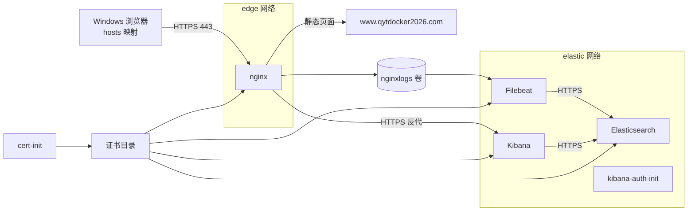
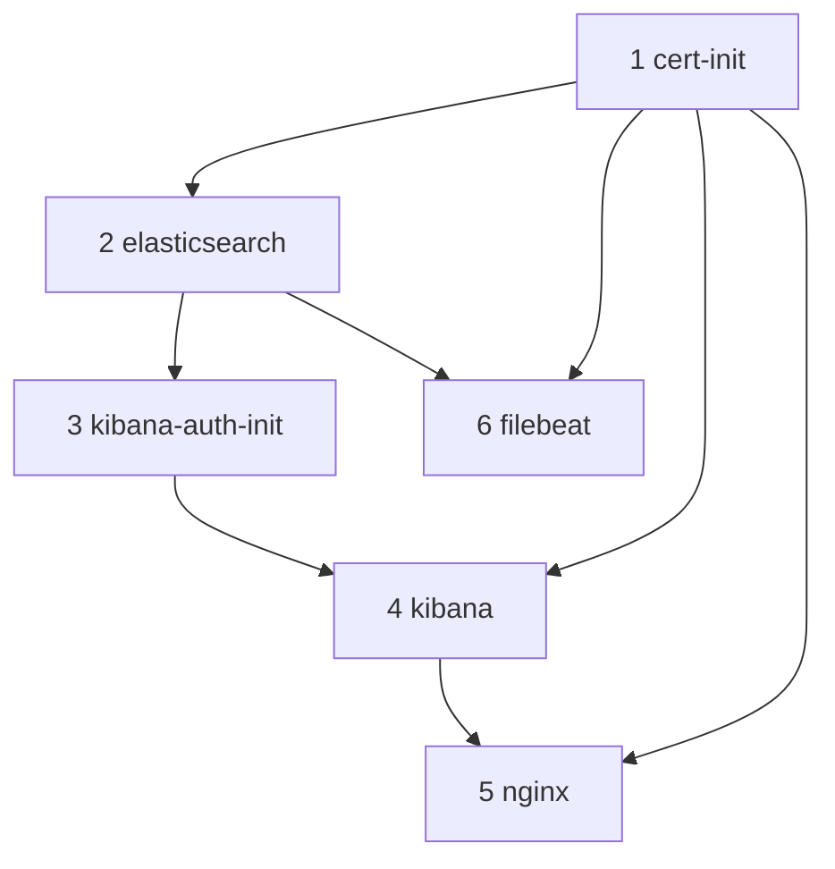
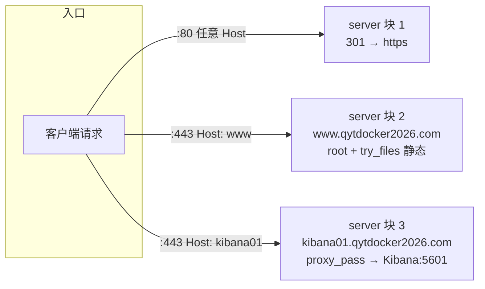
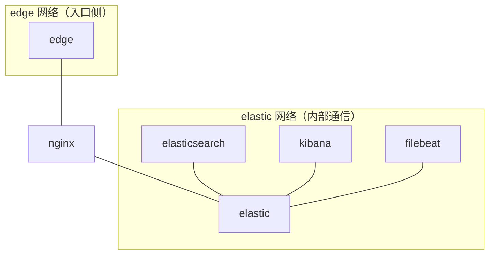
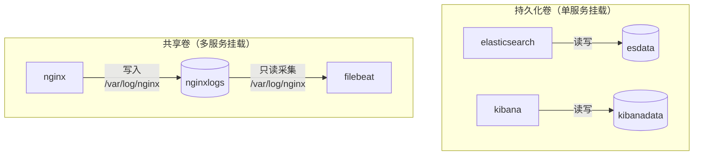
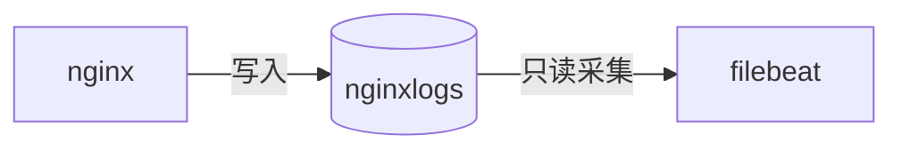
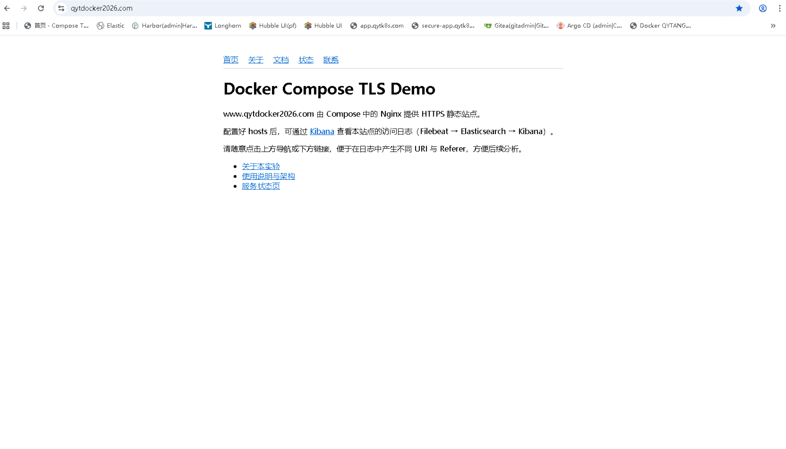
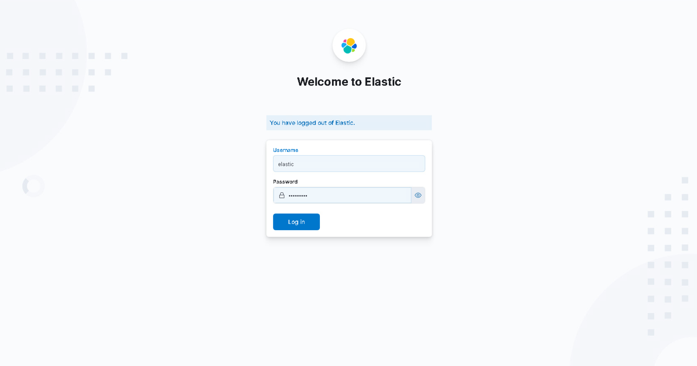
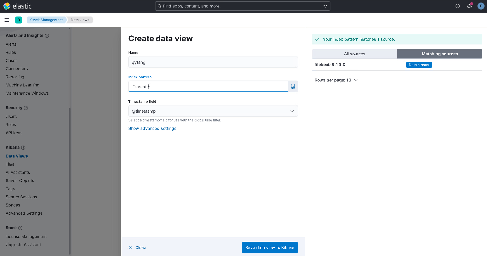
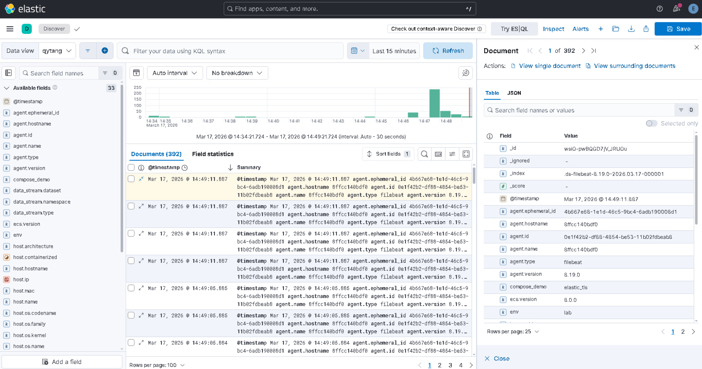

# Docker Compose 完整实验：TLS + ELK + Nginx

## 本实验目标

本实验使用一个相对复杂但仍然可控的 Compose 项目，来集中展示多容器应用编排中的关键能力。

服务清单如下：

- `cert-init`
- `elasticsearch`
- `kibana-auth-init`
- `kibana`
- `nginx`
- `filebeat`

本实验主要展示的 Compose 能力包括：

- 多服务定义
- 自定义网络
- 网络别名
- 具名卷与共享卷
- `bind mount`
- 环境变量
- 健康检查
- 启动顺序控制
- 一次性初始化服务
- 反向代理
- 容器内部 TLS 通信

## 1. 实验拓扑



这张图里有 4 条值得重点观察的链路：

1. `cert-init -> 证书目录 -> 其他服务`
2. `nginx -> nginxlogs 卷 -> filebeat`
3. `filebeat -> elasticsearch` 的 HTTPS 链路
4. `nginx -> kibana` 的 HTTPS 反向代理链路

## 2. 实验目录

```text
lab/elastic_tls/
├── .env
├── docker-compose.yaml
├── certs/
│   └── generated/
├── filebeat/
│   └── filebeat.yml
├── init/
│   ├── configure-kibana-user.sh
│   └── generate-certs.sh
└── nginx/
    ├── html/
    │   └── index.html
    └── nginx.conf
```

根证书文件位于：

- [ca.cer](/docker_k8s_2026/docker/docker_6_compose/certs/ca.cer)
- [ca-key.pem](/docker_k8s_2026/docker/docker_6_compose/certs/ca-key.pem)

## 3. 域名与证书规划

本实验使用独立签发的证书，不使用泛域名证书。

域名规划如下：

- `www.qytdocker2026.com`
- `es01.qytdocker2026.com`
- `kibana01.qytdocker2026.com`
- `filebeat01.qytdocker2026.com`

外部访问方式：

- Windows 客户端通过 `hosts` 映射访问 `www.qytdocker2026.com` 与 `kibana01.qytdocker2026.com`

容器内部访问方式：

- 使用 Compose 网络别名 `aliases`
- 让内部服务也能用完整域名互相访问

**关键看点**

- 外部域名解析和 Compose 内部服务发现不是一回事
- 外部通过 `hosts` 映射域名到 Docker 主机 IP，内部由 Compose 内置 DNS 解析服务名与别名
- 只要证书 SAN 中包含这些 FQDN，TLS 校验就能通过

## 4. Compose 文件整体结构

完整 Compose 文件见：

- [docker-compose.yaml](/docker_k8s_2026/docker/docker_6_compose/lab/elastic_tls/docker-compose.yaml)

在进入具体服务之前，先用结构化视角理解这一份文件：



图中箭头表示依赖与启动顺序，可按下面的顺序理解：

- ① **cert-init**：先跑完证书生成
- ② **elasticsearch**：再起 Elasticsearch
- ③ **kibana-auth-init**：用 ES 给 Kibana 系统用户设密
- ④ **kibana**：起 Kibana
- ⑤ **nginx**：Kibana 就绪后起 Nginx 作入口
- ⑥ **filebeat**：证书和 ES 就绪后启动，采日志入 ES

这个启动图体现了两个 Compose 设计要点：

1. 一次性任务可以独立成服务
2. `depends_on` 的条件可以精确到 `service_completed_successfully` 和 `service_healthy`

这里可以顺手把 `depends_on.condition` 的 3 个常见取值区分清楚：

- `service_started`
  只要求依赖服务已经启动。
- `service_healthy`
  要求依赖服务通过 `healthcheck`。
- `service_completed_successfully`
  要求依赖服务执行完毕，而且退出码是 `0`。

在本实验里：

- `cert-init`、`kibana-auth-init` 这类一次性任务，更适合用 `service_completed_successfully`
- `elasticsearch`、`kibana` 这类长期运行服务，更适合配合 `healthcheck` 使用 `service_healthy`

## 5. 先读 `.env`

本实验的环境变量文件如下：

```env
STACK_VERSION=8.19.0
NGINX_VERSION=1.29.1
ELASTIC_PASSWORD=Cisc0123
KIBANA_SYSTEM_PASSWORD=Cisc0123
COMPOSE_PROJECT_NAME=compose-elk
```

文件位置：

- [.env](/docker_k8s_2026/docker/docker_6_compose/lab/elastic_tls/.env)

这里更值得注意的是 Compose 的变量替换能力：

- 镜像版本统一在 `.env` 中定义
- 密码参数统一在 `.env` 中定义
- 项目名也可以通过 `.env` 控制

这让 Compose 文件更整洁。

## 6. `cert-init`：一次性初始化服务

这是本实验最有教学价值的部分之一。

Compose 文件中的定义如下：

```yaml
cert-init:
  image: alpine:3.22
  entrypoint: ["/bin/sh", "/init/generate-certs.sh"]
  restart: "no"
  volumes:
    - ../../certs:/ca:ro
    - ./certs/generated:/output
    - ./init/generate-certs.sh:/init/generate-certs.sh:ro
```

这个服务的职责很单纯：

- 读取实验目录中的根证书和私钥
- 用 `openssl` 逐个签发各服务证书
- 输出到 `./certs/generated`
- 完成任务后退出

脚本内容如下：

```sh
#!/bin/sh
set -eu

apk add --no-cache openssl >/dev/null

mkdir -p /output/ca /output/nginx /output/elasticsearch /output/kibana /output/filebeat
cp /ca/ca.cer /output/ca/ca.crt
SERIAL_FILE=/output/ca/ca.srl
[ -f "$SERIAL_FILE" ] || echo "1000" > "$SERIAL_FILE"

generate_cert() {
  name="$1"
  common_name="$2"
  alt_names="$3"
  target_dir="/output/$name"
  mkdir -p "$target_dir"
  echo "generating certificate for $common_name"
  cat > "$target_dir/openssl.cnf" <<EOF
[ req ]
distinguished_name = dn
req_extensions = req_ext
prompt = no

[ dn ]
CN = ${common_name}

[ req_ext ]
subjectAltName = ${alt_names}
extendedKeyUsage = serverAuth, clientAuth
keyUsage = digitalSignature, keyEncipherment
EOF

  openssl genrsa -out "$target_dir/tls.key" 2048 >/dev/null 2>&1
  openssl req -new -key "$target_dir/tls.key" -out "$target_dir/tls.csr" -config "$target_dir/openssl.cnf" >/dev/null 2>&1
  openssl x509 -req -in "$target_dir/tls.csr" -CA /ca/ca.cer -CAkey /ca/ca-key.pem -CAserial "$SERIAL_FILE" -out "$target_dir/tls.crt" -days 825 -sha256 -extensions req_ext -extfile "$target_dir/openssl.cnf" >/dev/null 2>&1

  cp /ca/ca.cer "$target_dir/ca.crt"
  chmod 644 "$target_dir/tls.key" "$target_dir/tls.crt" "$target_dir/ca.crt"
  rm -f "$target_dir/tls.csr" "$target_dir/openssl.cnf"
}

generate_cert nginx "www.qytdocker2026.com" "DNS:www.qytdocker2026.com,DNS:nginx"
generate_cert elasticsearch "es01.qytdocker2026.com" "DNS:es01.qytdocker2026.com,DNS:elasticsearch,DNS:localhost,IP:127.0.0.1"
generate_cert kibana "kibana01.qytdocker2026.com" "DNS:kibana01.qytdocker2026.com,DNS:kibana,DNS:localhost,IP:127.0.0.1"
generate_cert filebeat "filebeat01.qytdocker2026.com" "DNS:filebeat01.qytdocker2026.com,DNS:filebeat"
echo "all certificates generated under /output"
```

文件位置：

- [generate-certs.sh](/docker_k8s_2026/docker/docker_6_compose/lab/elastic_tls/init/generate-certs.sh)

**关键看点**

- 这是一个非常典型的“一次性任务容器”
- Compose 不只是适合长期运行服务，也适合做初始化步骤
- `restart: "no"` 正好表达“执行成功后退出”的语义

## 7. `elasticsearch`：被依赖的核心服务

`elasticsearch` 的 Compose 定义里最值得观察的是 4 个部分：

1. `depends_on`
2. TLS 相关环境变量
3. `healthcheck`
4. 证书目录挂载

这里不展开讲 Elasticsearch 原理，只聚焦与 Compose 相关的部分。

### 7.1 依赖关系

```yaml
depends_on:
  cert-init:
    condition: service_completed_successfully
```

这说明：

- 证书没生成完，Elasticsearch 就不应该启动

### 7.2 健康检查

```yaml
healthcheck:
  test: ["CMD-SHELL", "curl --silent --fail --cacert /usr/share/elasticsearch/config/certs/ca.crt -u elastic:${ELASTIC_PASSWORD} https://127.0.0.1:9200/_cluster/health >/dev/null"]
```

这是一条非常好的教学示例，因为它清楚展示了：

- 健康检查不一定是纯 TCP
- 在 HTTPS 场景下，应当连带证书校验一起验证
- `healthcheck` 可以成为后续服务的启动依据

## 8. `kibana-auth-init`：第二个一次性服务

Kibana 连接 Elasticsearch 时，需要先准备好 `kibana_system` 账户密码。  
因此本实验引入了第二个一次性服务 `kibana-auth-init`。

它的职责非常明确：

- 等待 Elasticsearch 健康
- 调用 ES API 设置 `kibana_system` 密码
- 完成后退出

脚本内容如下：

```sh
#!/bin/sh
set -eu

echo "setting kibana_system password"

curl --silent --fail \
  --cacert /certs/ca.crt \
  -u "elastic:${ELASTIC_PASSWORD}" \
  -H 'Content-Type: application/json' \
  -X POST \
  https://es01.qytdocker2026.com:9200/_security/user/kibana_system/_password \
  -d "{\"password\":\"${KIBANA_SYSTEM_PASSWORD}\"}" >/dev/null

echo "kibana_system password updated"
```

文件位置：

- [configure-kibana-user.sh](/docker_k8s_2026/docker/docker_6_compose/lab/elastic_tls/init/configure-kibana-user.sh)

**关键看点**

- Compose 可以让“初始化脚本”成为应用结构的一部分
- 这比把初始化过程散落在手工命令里更容易复现

## 9. `kibana`：开启 HTTPS，并作为 Nginx 的上游服务

这一节有两个点要同时看：

1. Kibana 自己开启了 HTTPS
2. Kibana 作为 Nginx 反向代理的上游服务存在

相关环境变量如下：

```yaml
SERVER_SSL_ENABLED: "true"
SERVER_SSL_CERTIFICATE: /usr/share/kibana/config/certs/tls.crt
SERVER_SSL_KEY: /usr/share/kibana/config/certs/tls.key
SERVER_PUBLICBASEURL: https://kibana01.qytdocker2026.com
ELASTICSEARCH_HOSTS: '["https://es01.qytdocker2026.com:9200"]'
ELASTICSEARCH_SSL_CERTIFICATEAUTHORITIES: /usr/share/kibana/config/certs/ca.crt
ELASTICSEARCH_USERNAME: kibana_system
ELASTICSEARCH_PASSWORD: ${KIBANA_SYSTEM_PASSWORD}
```

从这个片段里，可以读出两层关系：

- 对外，Kibana 自己监听的是 HTTPS，因此 Nginx 反代到 Kibana 时，走的不是明文 HTTP，而是 HTTPS 上游
- 对内，Kibana 访问 Elasticsearch 时，同样走 HTTPS，并校验证书

这也说明了 Compose 中环境变量的两种常见用途：

1. 环境变量不仅可以传简单参数，也可以传列表或 JSON 形式的复杂值
2. 只要内部 DNS 名称与证书 SAN 对齐，容器间 TLS 完全可以走 FQDN

## 10. `nginx`：HTTPS 入口与 Kibana 反向代理

本实验中的 `nginx` 做两件事：

1. 对外提供 `https://www.qytdocker2026.com`
2. 反代 `https://kibana01.qytdocker2026.com`

按域名与端口的请求走向如下（对应下文的三个 `server` 块）：



Nginx 配置如下：

```nginx
server {
    listen 80;
    server_name www.qytdocker2026.com kibana01.qytdocker2026.com;
    return 301 https://$host$request_uri;
}

server {
    listen 443 ssl;
    server_name www.qytdocker2026.com;

    ssl_certificate     /etc/nginx/certs/nginx/tls.crt;
    ssl_certificate_key /etc/nginx/certs/nginx/tls.key;

    root   /usr/share/nginx/html;
    index  index.html;

    location / {
        try_files $uri $uri/ =404;
    }
}

server {
    listen 443 ssl;
    server_name kibana01.qytdocker2026.com;

    ssl_certificate     /etc/nginx/certs/kibana/tls.crt;
    ssl_certificate_key /etc/nginx/certs/kibana/tls.key;

    location / {
        proxy_pass https://kibana01.qytdocker2026.com:5601;
        proxy_http_version 1.1;
        proxy_ssl_name kibana01.qytdocker2026.com;
        proxy_ssl_trusted_certificate /etc/nginx/certs/ca/ca.crt;
        proxy_ssl_verify on;
        proxy_ssl_server_name on;
        proxy_set_header Upgrade $http_upgrade;
        proxy_set_header Connection "upgrade";
        proxy_set_header Host $host;
        proxy_set_header X-Real-IP $remote_addr;
        proxy_set_header X-Forwarded-For $proxy_add_x_forwarded_for;
        proxy_set_header X-Forwarded-Proto https;
    }
}
```

文件位置：

- [nginx.conf](/docker_k8s_2026/docker/docker_6_compose/lab/elastic_tls/nginx/nginx.conf)

**关键看点**

- 同一个 Nginx 同时承载静态站点和反向代理
- 反代到 Kibana 时，Nginx 也会校验后端证书
- 这不是“只把流量转过去”，而是完整的 TLS 代理链路

## 11. `filebeat`：共享卷与内部 HTTPS 输出

Filebeat 配置如下：

```yaml
filebeat.inputs:
  - type: filestream
    id: nginx-access
    enabled: true
    paths:
      - /var/log/nginx/access-compose.log
      - /var/log/nginx/error-compose.log
    fields:
      service_name: nginx
      compose_demo: elastic_tls
    fields_under_root: true

output.elasticsearch:
  hosts: ["https://es01.qytdocker2026.com:9200"]
  username: elastic
  password: ${ELASTIC_PASSWORD}
  ssl.certificate_authorities: ["/usr/share/filebeat/certs/ca/ca.crt"]
```

文件位置：

- [filebeat.yml](/docker_k8s_2026/docker/docker_6_compose/lab/elastic_tls/filebeat/filebeat.yml)

这里还有一个很容易忽略的小点：`fields` 不是 Filebeat 的控制参数，而是给每条日志额外加上的自定义字段。  
例如这里的 `service_name: nginx`、`compose_demo: elastic_tls`，就是为了让日志进入 Elasticsearch 后更容易按服务名、实验名做筛选。

教学里最重要的不是 Filebeat 语法，而是这两个 Compose 设计：

1. `nginxlogs` 卷由 `nginx` 写、`filebeat` 读
2. `filebeat` 访问 Elasticsearch 时，也走 FQDN + TLS

这体现了 Compose 的两个核心能力：

- 用卷在多个服务之间共享数据
- 用网络别名和证书支持内部安全通信

## 12. Compose 网络设计

本实验定义了两个网络：

- `edge`
- `elastic`

其中：

- `nginx` 同时连接 `edge` 和 `elastic`
- `filebeat` 只连接 `elastic`
- `elasticsearch` 与 `kibana` 只连接 `elastic`



为什么这么设计？

### 12.1 `edge` 网络

表示面向入口流量的一侧。  
这里只有 `nginx` 接入，因为它承担对外 HTTPS 入口。

### 12.2 `elastic` 网络

表示内部服务通信的一侧。  
Elasticsearch、Kibana、Nginx、Filebeat 都在此网络中，反代和日志上报等内部调用都走这一侧。

### 12.3 `aliases`

Compose 文件中最值得注意的是：

```yaml
networks:
  elastic:
    aliases:
      - es01.qytdocker2026.com
```

以及类似的：

- `kibana01.qytdocker2026.com`
- `www.qytdocker2026.com`
- `filebeat01.qytdocker2026.com`

这正是本实验实现“容器内部使用完整域名”的关键。

**关键看点**

- Compose 自带 DNS，但默认解析的是服务名
- 通过 `aliases`，可以让容器内部也解析业务需要的 FQDN
- 证书 SAN 与网络别名对齐后，TLS 校验才能顺利通过

## 13. Compose 卷设计

本实验定义了 3 个具名卷，与服务的挂载、读写关系如下：



- **esdata / kibanadata**：仅单个服务挂载，用于数据持久化。
- **nginxlogs**：由 `nginx` 写入日志、`filebeat` 只读采集，是典型的“卷在服务间共享数据”的用法。

其中最有教学价值的是 `nginxlogs`，其数据流如下：



这个卷并不是为了持久化数据库，而是为了在两个服务之间共享数据。  
这比“只讲数据库卷”更能体现 Compose 在实际项目中的价值。

## 14. 配置检查命令

`docker compose config` 不是启动实验的必需步骤，但在排查变量替换和检查最终配置时很有帮助。

```bash
cd /docker_k8s_2026/docker/docker_6_compose/lab/elastic_tls
docker compose config
```

这一步尤其重要，因为本实验中存在大量变量替换：

- `${STACK_VERSION}`
- `${NGINX_VERSION}`
- `${ELASTIC_PASSWORD}`
- `${KIBANA_SYSTEM_PASSWORD}`

如果只想直接启动完整实验，也可以直接执行下一节的 `docker compose up -d`。

## 15. 启动实验

```bash
cd /docker_k8s_2026/docker/docker_6_compose/lab/elastic_tls
docker compose up -d
```

本实验最终只需要这一条启动命令。  
证书生成、密码初始化、主服务启动，都会由 Compose 根据依赖关系完成。

## 16. 实验验证

下面的 `docker compose` 命令，都默认在实验目录中执行。  
先进入：

```bash
cd /docker_k8s_2026/docker/docker_6_compose/lab/elastic_tls
```

### 16.1 查看服务状态

执行：

```bash
docker compose ps
```

示例输出：

```text
NAME                          IMAGE                                                  COMMAND                  SERVICE         CREATED             STATUS                       PORTS
compose-elk-elasticsearch-1   docker.elastic.co/elasticsearch/elasticsearch:8.19.0   "/bin/tini -- /usr/l…"   elasticsearch   About an hour ago   Up About an hour (healthy)   9200/tcp, 9300/tcp
compose-elk-filebeat-1        docker.elastic.co/beats/filebeat:8.19.0                "/usr/bin/tini -- /u…"   filebeat        About an hour ago   Up About an hour
compose-elk-kibana-1          docker.elastic.co/kibana/kibana:8.19.0                 "/bin/tini -- /usr/l…"   kibana          About an hour ago   Up About an hour (healthy)   5601/tcp
compose-elk-nginx-1           nginx:1.29.1                                           "/docker-entrypoint.…"   nginx           About an hour ago   Up About an hour             80/tcp, 0.0.0.0:443->443/tcp, [::]:443->443/tcp
```

**关键看点**

- `elasticsearch` 和 `kibana` 均进入 `healthy`
- 对外只发布 Nginx `443`；Kibana 不直接映射端口，通过 Nginx 反代访问

### 16.2 查看初始化日志

命令：

```bash
docker compose logs --tail=30 cert-init kibana-auth-init
```

实际输出节选：

```text
kibana-auth-init-1  | setting kibana_system password
kibana-auth-init-1  | kibana_system password updated
cert-init-1         | generating certificate for www.qytdocker2026.com
cert-init-1         | generating certificate for es01.qytdocker2026.com
cert-init-1         | generating certificate for kibana01.qytdocker2026.com
cert-init-1         | generating certificate for filebeat01.qytdocker2026.com
cert-init-1         | all certificates generated under /output
```

**关键看点**

- Compose 中的一次性服务确实参与了整个应用启动流程
- 证书与密码初始化都被“编排”进了项目，而不是靠手工命令完成

### 16.3 验证 HTTPS 首页

在 Windows 客户端完成 `hosts` 映射并信任根证书后，直接用浏览器访问：

```text
https://www.qytdocker2026.com/
```

`hosts` 示例：

```text
<Docker 主机 IP>  www.qytdocker2026.com
```

正常情况下，会看到 Nginx 提供的静态首页：



**关键看点**

- Nginx 对外 HTTPS 正常
- 证书链校验通过
- 静态站点已经可访问

### 16.4 验证 Kibana HTTPS 反代

继续在 Windows 浏览器中访问：

```text
https://kibana01.qytdocker2026.com
```

`hosts` 示例：

```text
<Docker 主机 IP>  kibana01.qytdocker2026.com
```

正常情况下，会先看到 Kibana 登录页，这说明请求已经经过 Nginx 成功反代到 Kibana：



**关键看点**

- 外部请求先到 Nginx
- Nginx 已经成功反代到 Kibana
- Kibana 登录页能够正常返回

### 16.5 验证 Nginx 日志已写入共享卷

命令：

```bash
docker exec compose-elk-nginx-1 sh -c 'tail -n 5 /var/log/nginx/access-compose.log'
```

实际输出节选：

```text
172.21.0.1 - - [17/Mar/2026:03:36:21 +0000] "GET / HTTP/1.1" 200 394 "-" "curl/8.5.0" "-"
172.21.0.1 - - [17/Mar/2026:04:49:29 +0000] "GET / HTTP/1.1" 200 394 "-" "curl/8.5.0" "-"
172.21.0.1 - - [17/Mar/2026:04:49:29 +0000] "HEAD / HTTP/1.1" 302 0 "-" "curl/8.5.0" "-"
```

这一步说明：

- Nginx 的确把日志写入了共享目录
- Filebeat 后续有真实数据可采集

### 16.6 验证共享卷：Filebeat 侧也能看到 Nginx 的日志

本实验的重点是 Compose 的**卷共享**：Nginx 把访问日志写入 `nginxlogs` 卷，Filebeat 挂载同一卷只读。验证方式：在 Filebeat 容器内读同一路径，能看到与 Nginx 写入一致的内容，即说明共享卷工作正常。

执行（在 Filebeat 容器内查看共享卷中的日志文件）：

```bash
docker exec compose-elk-filebeat-1 sh -c 'tail -n 5 /var/log/nginx/access-compose.log'
```

示例输出（与 16.5 在 Nginx 容器内看到的为同一文件内容）：

```text
172.21.0.1 - - [17/Mar/2026:03:36:21 +0000] "GET / HTTP/1.1" 200 394 "-" "curl/8.5.0" "-"
...
```

**关键看点**：同一卷在 Nginx 里写、在 Filebeat 里读，两服务通过 Compose 卷共享完成日志传递。

### 16.7 在 Kibana 中查看日志

在浏览器登录 Kibana 后，首次查看 Filebeat 写入的 Nginx 日志需要先创建 **Data View**（旧版为 Index Pattern），再在 **Discover** 中查询。

**创建 Data View**：进入 Stack Management → Data Views → Create data view。Index pattern 填写 `filebeat-*`，时间字段选 `@timestamp`，保存即可。




**在 Discover 中查看**：左侧菜单进入 Discover，选择刚创建的 Data View，即可按时间浏览、筛选 Nginx 访问日志（如按 `message`、`service_name` 等字段）。



## 17. 这个实验里最值得学生掌握的 Compose 设计

### 17.1 一次性服务也是 Compose 的一等公民

`cert-init` 和 `kibana-auth-init` 都不是长期运行服务，但它们非常适合交给 Compose 管理。  
这说明 Compose 并不只是“把几个后台服务拉起来”，它还适合管理初始化任务。

### 17.2 共享卷不是数据库专属

`nginxlogs` 是本实验中最有代表性的卷。  
它让学生看到：卷既可以保存数据，也可以作为服务之间的数据交换通道。

### 17.3 `aliases` 让内部 FQDN 成为可能

很多同学一提到“域名”，就会立刻联想到额外部署 DNS。  
但在单机 Compose 场景里，更简洁的做法是：

- 外部：`hosts` 映射
- 内部：Compose 自带 **DNS**，通过 `network aliases` 把 FQDN 解析到对应服务

本实验采用上述方式，证书 SAN 与这些 FQDN 对齐即可通过 TLS 校验。

### 17.4 `healthcheck` 决定了启动是否可靠

如果没有健康检查：

- Elasticsearch 刚起来但尚未可用时，Kibana 很容易报错
- 证书刚生成完但服务还没准备好时，后续链路会很脆弱

因此本实验虽然复杂，但依然尽量用 Compose 原生能力表达“谁依赖谁、依赖到什么程度”。

## 18. 本实验小结

这个完整案例要说明的是，Compose 如何把一个较复杂的系统组织得清清楚楚：

- 入口服务是谁
- 初始化服务是谁
- 内部网络如何划分
- 卷如何共享
- 证书如何分发
- 依赖关系如何表达
- TLS 如何融入多容器编排

如果学生能够真正理解这个案例，那么他们学到的就不只是“会写几行 YAML”，而是开始具备了用 Compose 组织真实应用结构的能力。

## 19. 清空环境

本实验应以空环境开始、以空环境结束。验证完成后，在 ELK 项目目录停止并删除容器、网络与卷：

```bash
cd /docker_k8s_2026/docker/docker_6_compose/lab/elastic_tls
docker compose down -v
```

如需保留卷数据，可去掉 `-v`，仅删除容器与网络。执行后可用 `docker ps`、`docker network ls` 确认无 `compose-elk-*` 相关资源，环境即已还原。
