# 本步目标

- 理解 Docker 并不是唯一的容器方案。
- 理解 Docker 的几个典型边界与设计取舍。
- 认识 `Podman` 与 `containerd + nerdctl` 这两条常见替代路线。
- 了解这些方案的基础命令，以及与 `docker compose` 相近的工作方式。

# 问题背景

在学习 Docker、Dockerfile、Compose 之后，容易产生一种误区：

> 容器 = Docker

这种理解在工程实践中并不准确。Docker 仍然广泛使用，但它不是唯一的容器方案。

本节旨在建立更完整的容器生态视角，介绍 Docker 之外的常见容器方案及其适用场景。

# 官方资料

以下资料来自各方案的官方文档或官方仓库：

- Docker Overview  
  <https://docs.docker.com/get-started/docker-overview/>
- Docker Live Restore  
  <https://docs.docker.com/engine/daemon/live-restore/>
- Podman 文档  
  <https://docs.podman.io/en/latest/markdown/podman.1.html>
- Podman Compose 文档  
  <https://docs.podman.io/en/latest/markdown/podman-compose.1.html>
- nerdctl 官方仓库  
  <https://github.com/containerd/nerdctl>

# 理论说明

## 1. 为什么会有 Docker 之外的方案

Docker 官方文档明确说明，Docker 使用的是 client-server 架构，其中包括：

- Docker client
- Docker daemon
- images
- containers
- registries

这层关系可以用一张总览图来理解：

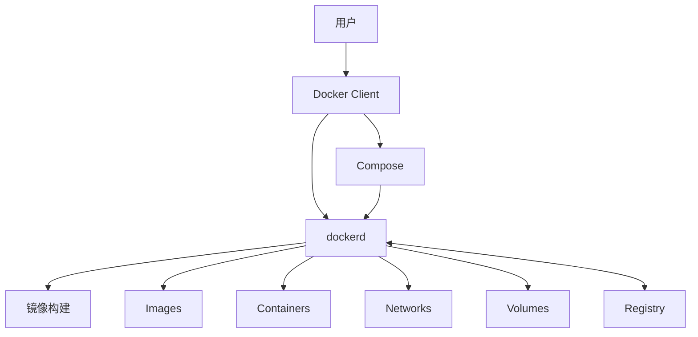

这张图表达的是：

- 用户通常先接触的是 `docker` 命令和 `docker compose`
- 背后的核心控制点是 `dockerd`（Docker daemon，负责在后台接收和协调各类 Docker 操作）
- 镜像、容器、网络、卷、镜像仓库交互等能力，都围绕这条中心链路展开

Docker 的成功，在于它将以下能力整合为一套连贯的工程体验：

- 镜像构建
- 镜像分发
- 容器运行
- CLI
- 网络
- 卷
- Compose

这套一体化设计显著降低了容器技术的使用门槛，但也带来了几个典型边界。这些边界不一定是缺陷，更多属于设计取舍。

> Note
>
> Docker 的成功可类比为 iPhone 对智能手机体验的整合。很多底层能力并不是 Docker 首先发明的，但 Docker 将它们打通成了一套连贯的工程体验。

### 1.1 Docker 的几个典型边界

#### 1.1.1 daemon 架构

Docker 以 `dockerd` 为中心。  
这种架构带来统一管理的好处，但也意味着很多功能都依赖 daemon。

因此，一旦 daemon 异常，最先受到影响的是管理面：

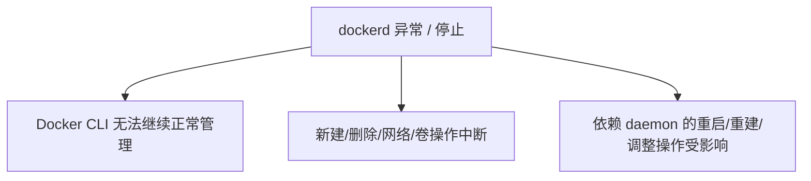

需要明确的是，daemon 终止并不意味着所有容器必然立即停止。具体机制如下：

- **默认情况下**，daemon 终止会关闭运行中的容器
- Docker 提供了 `live-restore` 机制作为例外

因此，默认行为下 daemon 退出会影响运行中的容器；而启用 `live-restore` 后，容器可以在 daemon 暂时不可用时继续运行，但管理面仍会受影响。

`live-restore` 默认未开启，需要在 `/etc/docker/daemon.json` 中显式配置 `"live-restore": true`。  
注意不要与 `restart` 策略混淆：

- `live-restore` 关注的是 `dockerd` 不可用时，已运行容器能否继续运行
- `restart` 策略关注的是容器退出后是否自动重启

Docker 官方文档明确写到：

> By default, when the Docker daemon terminates, it shuts down running containers.

可译为：

> 默认情况下，当 Docker daemon 终止时，它会关闭正在运行的容器。

官方同时说明：

> You can configure the daemon so that containers remain running if the daemon becomes unavailable.

可译为：

> 可以配置 daemon，使其在不可用时仍然让容器继续运行。

总结 daemon 架构的核心影响：

- 管理中心高度集中
- 默认情况下，daemon 的可用性直接影响运行中的容器
- 即使启用 `live-restore`，daemon 不可用时管理能力仍显著下降

#### 1.1.2 其他边界

除 daemon 架构外，Docker 还有几个常见的讨论点：

- **工具边界较大**：Docker 同时扮演 CLI、镜像构建、容器运行、应用编排等多个角色，容易让初学者把"容器生态"误解成"只有 Docker 一套东西"。
- **rootful 使用习惯更常见**：虽然 Docker 也支持 rootless，但多数生产和实验环境仍以 rootful 模式为主。在更强调最小权限的场景下，用户会更愿意考虑其他方案。
- **不是所有需求的最佳形态**：有些场景更在意 daemonless、rootless、或更贴近底层运行时的能力，这时就会出现 Docker 之外的选择。

## 2. 生态位置总览

这几种方案并不是互相完全替代的关系，而是在不同层次解决问题。

关键事实：Docker 自身的底层也使用 `containerd`。具体而言，`dockerd` 负责对外提供管理面，底层调用 `containerd` 管理容器生命周期，`containerd` 再通过 `runc` 等 OCI runtime 创建容器。`containerd` 是 Docker 与 `nerdctl` 共同的基础组件，而 Podman 走了另一条路线。

以下三张图分别展示各路线的完整栈：

**Docker 路线**：CLI / Compose 围绕 `dockerd` 工作，`dockerd` 底层调用 `containerd`，再由 `runc` 等 OCI runtime 创建容器。

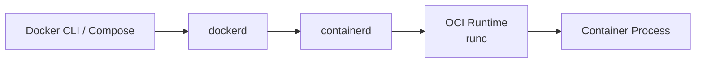

**Podman 路线**：没有中心化 daemon，命令直接通过 `libpod` / `conmon` 管理容器。

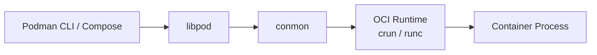

**nerdctl 路线**：跳过 `dockerd`，直接对接 `containerd`。

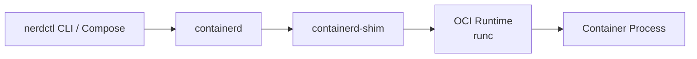

三者最终都通过 OCI 兼容的 runtime（如 `runc`、`crun`）创建容器，区别主要在上层管理架构。

## 3. Podman

Podman 官方文档对自己的描述是：

> Podman ... is a fully featured container engine that is a simple daemonless tool.

可译为：

> Podman 是一个功能完整的容器引擎，同时是一个简单的 daemonless 工具。

官方文档还写道：

> Podman provides a Docker-CLI comparable command line ...

可译为：

> Podman 提供了与 Docker CLI 可比拟的命令行体验。

### 3.1 Podman 的特点

- daemonless
- rootless 体验较强
- 命令风格接近 Docker
- 迁移成本较低

### 3.2 Podman 为什么是 daemonless

Podman 的 daemonless 并不是说系统里绝对没有任何辅助进程，而是指 Podman 没有像 `dockerd` 那样常驻、集中的中心管理 daemon。

Docker 的典型路径：

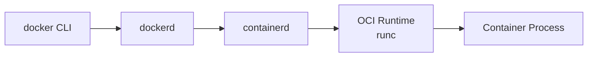

Podman 的路径：

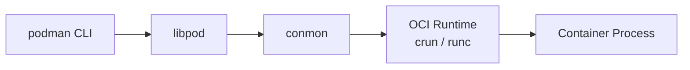

各组件的职责：

- `podman` 命令发起一次容器管理操作
- `libpod` 负责容器对象和状态管理
- `conmon` 负责监控容器进程，并处理标准输入输出、退出状态等
- `crun` 或 `runc` 等 OCI runtime 负责真正创建容器
- 容器启动之后，并不依赖一个 `dockerd` 式的中心 daemon 持续维持

Podman 所说的 daemonless，核心含义是：

- 没有一个统一的 `dockerd`
- 容器生命周期不绑定在某个中心守护进程上
- 命令是按次执行的，而不是所有请求都必须先交给一个常驻 daemon

> Podman 的 daemonless，指的是没有 Docker 那种中心化的 `dockerd`；它并不是"完全没有任何辅助进程"，而是把容器创建与管理拆成了更分散的组件。

### 3.3 Podman 安装示例

在 Ubuntu 24.04 等 Debian 系发行版上，可通过以下方式安装：

```bash
apt-get update
apt-get install -y podman podman-compose
```

`podman` 提供容器引擎本体；`podman-compose` 提供一个常见的 compose provider。`podman compose` 实际调用哪个 provider，取决于本机环境中的可用组件。

### 3.4 Podman 基础命令

```bash
podman pull nginx:latest
podman run -d --name web -p 8080:80 nginx:latest
podman ps
podman exec -it web sh
podman logs -f web
podman stop web
podman rm web
```

单容器场景下，很多命令几乎可以直接把 `docker` 替换成 `podman`。

### 3.5 Podman 与 Compose

Podman 官方文档对 `podman compose` 的说明是：

> podman compose - Run Compose workloads via an external compose provider

可译为：

> `podman compose` 用于通过外部 compose provider 运行 Compose 工作负载。

官方还明确写道：

> `podman compose` is a thin wrapper around an external compose provider ...

可译为：

> `podman compose` 本质上是对外部 compose provider 的一个轻量封装。

这意味着：

- Podman 可以使用 Compose 风格工作流
- 但它不是自己重新定义了一套完全独立的 Compose 规范
- 对常见场景而言，通常可以直接复用 `docker-compose.yaml`
- 在较复杂特性上，仍应以实际测试和官方文档为准

### 3.6 验证：使用 Podman 运行已有 Compose 项目

本节使用本仓库已有的 Compose 实验进行真实验证，测试 Podman 对 Docker Compose 文件的兼容性。

测试目录：[docker-compose.yaml](/docker_k8s_2026/docker/docker_6_compose/lab/basic/docker-compose.yaml)

#### 验证方法

```bash
cd /docker_k8s_2026/docker/docker_6_compose/lab/basic
podman compose up -d
podman compose ps
curl -s http://127.0.0.1:8080/
```

#### 预期结果

`podman compose ps` 输出类似：

```text
>>>> Executing external compose provider "/usr/libexec/docker/cli-plugins/docker-compose". Please refer to the documentation for details. <<<<

NAME            IMAGE                                  COMMAND                  SERVICE   CREATED          STATUS          PORTS
basic-app-1     docker.io/library/basic-app:latest     "python /app/app.py"     app       27 seconds ago   Up 25 seconds
basic-nginx-1   docker.io/library/nginx:1.29.1         "nginx -g daemon off;"   nginx     27 seconds ago   Up 11 seconds   80/tcp
basic-redis-1   docker.io/library/redis:8.2.3-alpine   "redis-server --appe…"   redis     27 seconds ago   Up 26 seconds
```

`curl` 输出类似：

```json
{"app_env":"prod","app_name":"compose-basic-demo","cache_host":"redis","cache_port":6379,"hits":1}
```

#### 通过标准

- `redis`、`app`、`nginx` 三个容器均成功启动
- `curl -s http://127.0.0.1:8080/` 正常返回 JSON 数据
- `build`、`ports`、`volumes`、`networks`、`healthcheck`、`depends_on` 等常见能力工作正常

#### 关键看点

在本次 Ubuntu 24.04 测试环境中，`podman compose` 提示调用了 external compose provider（Docker Compose 插件）。虽然调用的是 Docker Compose 前端，但后端通信目标仍然是本地 Podman socket（`/run/podman/podman.sock`），最终启动的是 Podman 容器。

实际调用关系如下：

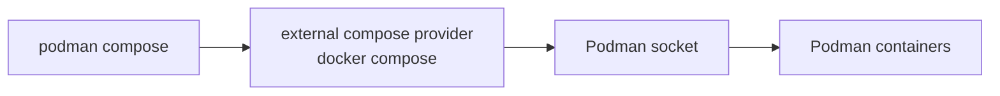

因此，`podman compose` 本质上是 Podman 提供的 Compose 风格入口，而非与 Docker Compose 完全同构的独立实现。

## 4. containerd + nerdctl

`nerdctl` 官方 README 的描述：

> nerdctl: Docker-compatible CLI for containerd

可译为：

> `nerdctl` 是面向 `containerd` 的 Docker 兼容 CLI。

官方 README 还明确列出：

- Same UI/UX as `docker`
- Supports Docker Compose (`nerdctl compose up`)
- Supports rootless mode

### 4.1 nerdctl 的特点

- 命令体验接近 Docker
- 更贴近 `containerd`
- 支持 Compose
- 适合理解现代运行时栈

### 4.2 nerdctl 与 containerd 的关系

`nerdctl` 自身只是命令行工具，并不是完整的容器引擎。真正负责容器管理和运行时协调的是 `containerd`；真正把容器进程创建出来的则是更下层的 OCI runtime（如 `runc`）。

在日常开发中，通常较少直接操作 `containerd`，主要原因在于其定位偏向底层：

- `docker` 面向开发者和运维人员，命令、构建、日志、网络、卷、Compose 等能力已整合为完整产品
- `containerd` 定位为容器平台内部的核心组件，负责镜像、容器生命周期、快照、运行时协调等底层能力
- 如需更贴近 `containerd` 层进行操作，通常配合 `nerdctl` 使用，而非直接面对底层接口

从 Docker 这条链路往下看：

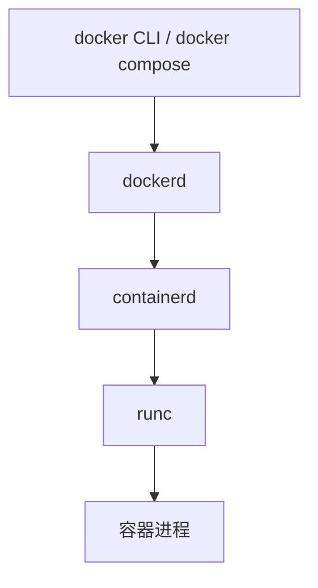

各层职责：

- `docker CLI` / `docker compose` 是最上层的人机交互入口
- `dockerd` 负责对外提供 Docker 的管理面
- `containerd` 负责更底层的容器生命周期与镜像管理
- `runc` 负责真正把容器进程创建出来

而 `nerdctl` 的链路则跳过了 `dockerd`：

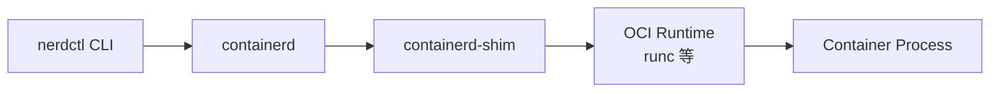

这意味着：

- `nerdctl` 负责提供接近 Docker 的使用体验
- `containerd` 负责镜像、容器、快照、运行时等核心管理
- 下面仍然有后台服务层，并不是 Podman 那种 daemonless 路线

`nerdctl` 虽然没有 `dockerd`，但仍然依赖 `containerd` 这一后台服务。从这个意义上说，它并不是 Podman 式的 daemonless，只是把后端核心从 `dockerd` 换成了 `containerd`。

### 4.3 nerdctl 安装示例

在本次测试环境里，`containerd` 已经存在，但 `nerdctl` 默认并未安装。一种直接可用的方式是从 nerdctl 官方 GitHub Release 获取二进制。

由于 `nerdctl compose` 在遇到包含本地 `build` 的 Compose 项目时依赖 BuildKit，因此需要一并安装以下三个组件：

| 组件 | 职责 |
|---|---|
| `nerdctl` | 面向用户的 CLI |
| `buildctl` | BuildKit 的客户端命令 |
| `buildkitd` | BuildKit 的后台服务 |

本次测试实际使用 `nerdctl-full-2.2.1-linux-amd64.tar.gz`，安装命令如下：

```bash
cd /tmp
curl -fL -o nerdctl-full-2.2.1-linux-amd64.tar.gz \
  https://github.com/containerd/nerdctl/releases/download/v2.2.1/nerdctl-full-2.2.1-linux-amd64.tar.gz

tar -xzf nerdctl-full-2.2.1-linux-amd64.tar.gz -C /usr/local \
  bin/nerdctl \
  bin/buildkitd \
  bin/buildctl

nerdctl --version
buildkitd --version
buildctl --version
```

如果只需体验 `nerdctl run`、`nerdctl ps` 等基础命令，安装 `nerdctl` 本身即可；如果要使用 `nerdctl compose` 且 Compose 文件包含本地构建，则需要 `buildkitd` 与 `buildctl`。

### 4.4 nerdctl 基础命令

```bash
nerdctl pull nginx:latest
nerdctl run -d --name web -p 8080:80 nginx:latest
nerdctl ps
nerdctl exec -it web sh
nerdctl logs -f web
nerdctl stop web
nerdctl rm web
```

### 4.5 nerdctl 与 Compose

`nerdctl compose` 通常可以直接使用 `docker-compose.yaml`，但在复杂特性、边缘配置和兼容性细节上，仍应以实际测试结果为准。

需要避免的误区是认为 `nerdctl compose` 与 Docker Compose 完全等价。具体差异如下：

- 如果 Compose 文件只使用现成镜像、没有本地 `build`，通常更容易直接启动
- 如果 Compose 文件包含本地 `build`，需要先准备好 `buildctl` / `buildkitd`
- `nerdctl compose` 对某些 Compose 特性的支持可能和 Docker Compose 不完全一致

### 4.6 验证：使用 nerdctl 运行已有 Compose 项目

本节同样使用本仓库已有的基础实验进行验证。

测试目录：[docker-compose.yaml](/docker_k8s_2026/docker/docker_6_compose/lab/basic/docker-compose.yaml)

#### 验证方法

第一步，启动 BuildKit（在单独终端中执行）：

```bash
mkdir -p /run/buildkit
buildkitd --addr unix:///run/buildkit/buildkitd.sock
```

第二步，启动 Compose 项目：

```bash
cd /docker_k8s_2026/docker/docker_6_compose/lab/basic
nerdctl compose up -d
nerdctl compose ps
curl -s http://127.0.0.1:8080/
```

#### 预期结果

`nerdctl compose ps` 输出类似：

```text
NAME             IMAGE                                   COMMAND                   SERVICE    STATUS     PORTS
basic-nginx-1    docker.io/library/nginx:1.29.1          "/docker-entrypoint.…"    nginx      running    0.0.0.0:8080->80/tcp
basic-app-1      docker.io/library/basic-app:latest      "python /app/app.py"      app        running
basic-redis-1    docker.io/library/redis:8.2.3-alpine    "docker-entrypoint.s…"    redis      running
```

`curl` 输出类似：

```json
{"app_env":"prod","app_name":"compose-basic-demo","cache_host":"redis","cache_port":6379,"hits":1}
```

#### 通过标准

- 三个容器均成功启动并处于 `running` 状态
- `curl -s http://127.0.0.1:8080/` 正常返回 JSON 数据

#### 关键看点

`nerdctl compose` 在启动过程中会明确提示忽略以下字段：

- `HealthCheck`
- `depends_on.condition: service_healthy`

如果未启动 `buildkitd`，包含本地构建的 Compose 文件会报错：

```text
`buildctl` needs to be installed and `buildkitd` needs to be running
```

这些差异说明：

1. `nerdctl compose` 对基础实验可以正常工作
2. 但对 Compose 特性的支持细节与 Docker Compose 存在差异，尤其是 `healthcheck`、`depends_on.condition`、本地构建依赖 `buildkitd` 等方面

相比于 Podman 作为 Docker 的直接替代品，`nerdctl` 的核心价值在于：

- 展示 Docker 风格 CLI 之下可以对接不同运行时
- 帮助建立"容器生态不等于 `dockerd`"的认识

因此，`nerdctl compose` 更适合在理解 containerd 栈或进行贴近底层的实验时使用；如果目标是获得与 Docker Compose 尽量一致的日常体验，Docker 或 Podman 更为省心。

## 5. 基础命令对照

### 5.1 单容器命令对照

| 目标 | Docker | Podman | nerdctl |
|---|---|---|---|
| 拉镜像 | `docker pull nginx` | `podman pull nginx` | `nerdctl pull nginx` |
| 启动 | `docker run -d ...` | `podman run -d ...` | `nerdctl run -d ...` |
| 查看 | `docker ps` | `podman ps` | `nerdctl ps` |
| 进入 | `docker exec -it web sh` | `podman exec -it web sh` | `nerdctl exec -it web sh` |
| 日志 | `docker logs -f web` | `podman logs -f web` | `nerdctl logs -f web` |
| 停止 | `docker stop web` | `podman stop web` | `nerdctl stop web` |
| 删除 | `docker rm web` | `podman rm web` | `nerdctl rm web` |

单容器场景下，三者的命令几乎只是替换了工具名称。

### 5.2 Compose 类工作流对照

| 目标 | Docker | Podman | nerdctl |
|---|---|---|---|
| 启动多容器 | `docker compose up -d` | `podman compose up -d` | `nerdctl compose up -d` |
| 查看状态 | `docker compose ps` | `podman compose ps` | `nerdctl compose ps` |
| 看日志 | `docker compose logs -f` | `podman compose logs -f` | `nerdctl compose logs -f` |
| 停止删除 | `docker compose down` | `podman compose down` | `nerdctl compose down` |

## 6. 怎么选

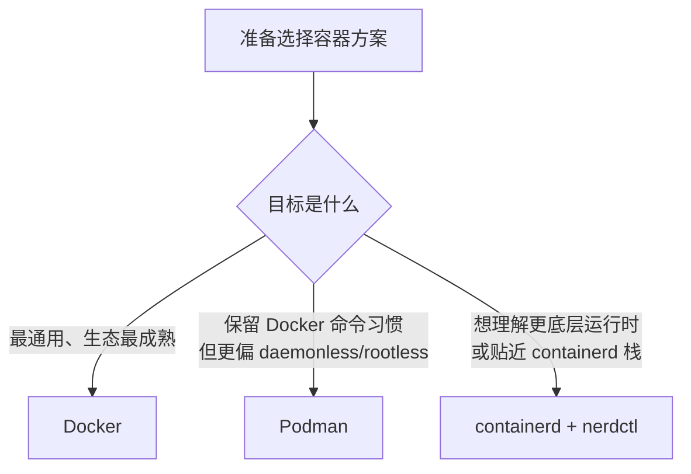

一句话概括：

- `Docker`：最通用，教材与生态最成熟
- `Podman`：最像 Docker 的平替，daemonless / rootless 体验更好
- `nerdctl`：更贴近 `containerd`，适合理解底层运行时栈

## 7. 本节结论

本节的核心结论：

> Docker 很重要，但它不是唯一容器方案。

具体而言：

- Docker 适合入门和日常开发
- Podman 适合希望保持 Docker 习惯、同时更看重 daemonless/rootless 的场景
- nerdctl 适合理解更底层的容器运行时栈

学习 Docker 的最终目的，不应停留在记住几条命令，而应逐步建立对容器生态分层的认识。
