# 本步目标

- 理解 Docker 并不是唯一的容器方案。
- 理解 Docker 的几个典型边界与设计取舍。
- 认识 `Podman` 与 `containerd + nerdctl` 这两条常见替代路线。
- 了解这些方案的基础命令，以及与 `docker compose` 相近的工作方式。

# 问题背景

学完 Docker、Dockerfile、Compose 之后，很容易形成一个错觉：

> 容器 = Docker

这个理解在入门阶段问题不大，但在工程上并不准确。  
Docker 很重要，也依然广泛使用，但它不是唯一方案。

这也是本节的目的：  
不是否定 Docker，而是建立一个更完整的容器工具视角。

# 官方资料

以下资料来自各方案的官方文档或官方仓库：

- Docker Overview  
  <https://docs.docker.com/get-started/docker-overview/>
- Docker Live Restore  
  <https://docs.docker.com/engine/daemon/live-restore/>
- Podman 文档  
  <https://docs.podman.io/en/latest/markdown/podman.1.html>
- Podman Compose 文档  
  <https://docs.podman.io/en/latest/markdown/podman-compose.1.html>
- nerdctl 官方仓库  
  <https://github.com/containerd/nerdctl>

# 理论说明

## 1. 为什么会有 Docker 之外的方案

Docker 官方文档明确说明，Docker 使用的是 client-server 架构，其中包括：

- Docker client
- Docker daemon
- images
- containers
- registries

这层关系可以先用一张总览图来理解：

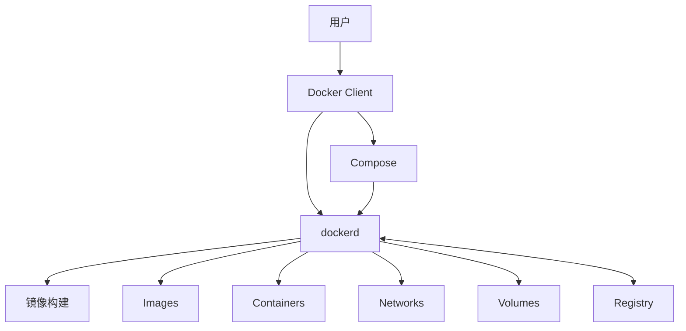

这张图表达的是：

- 用户通常先接触的是 `docker` 命令和 `docker compose`
- 背后的核心控制点是 `dockerd`（也就是 Docker daemon，负责在后台接收和协调各类 Docker 操作）
- 镜像、容器、网络、卷、镜像仓库交互等能力，都围绕这条中心链路展开

Docker 的成功，正是因为它把很多能力打包得很完整：

- 镜像构建
- 镜像分发
- 容器运行
- CLI
- 网络
- 卷
- Compose

但这套"一体化体验"也带来了几个典型边界。  
这些边界不一定是缺陷，很多时候更像设计取舍。

> Note
>
> 可以把 Docker 的成功，类比为 iPhone 对智能手机体验的整合。很多底层能力并不是 Docker 首先发明的，但 Docker 把镜像构建、镜像分发、容器运行、网络、卷、CLI、Compose 等能力打通成了一套连贯的工程体验，显著降低了容器技术的使用门槛。

### 1.1 Docker 的几个典型边界

#### 1.1.1 daemon 架构

Docker 以 `dockerd` 为中心。  
这种架构带来统一管理的好处，但也意味着很多功能都依赖 daemon。

因此，一旦 daemon 异常，最先受到影响的是管理面：

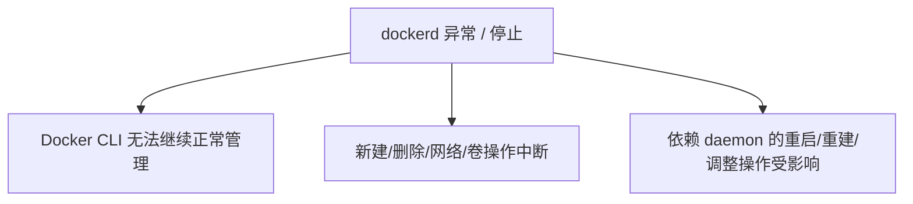

这里有一个必须说清楚的细节：  
不能简单地说"daemon 一死，所有容器一定立刻全部挂掉"。

更准确的说法是：

- **默认情况下**，daemon 终止会关闭运行中的容器
- Docker 提供了 `live-restore` 机制作为例外

也就是说，这里不能把问题说成绝对的"容器一定全部立即停止"。  
更准确的理解是：默认行为下，daemon 退出会影响运行中的容器；而启用 `live-restore` 后，容器可以在 daemon 暂时不可用时继续运行，但这并不等于 Docker 的管理面也一切正常。

`live-restore` 默认不是开启的，需要显式配置；例如可在 `/etc/docker/daemon.json` 中加入 `"live-restore": true`。  
它也不要和 `restart: always`、`unless-stopped` 混淆：

- `live-restore` 关注的是 `dockerd` 不可用时，已运行容器能否继续运行
- `restart` 策略关注的是容器退出后是否自动重启

Docker 官方文档明确写到：

> By default, when the Docker daemon terminates, it shuts down running containers.

可译为：

> 默认情况下，当 Docker daemon 终止时，它会关闭正在运行的容器。

官方同时说明：

> You can configure the daemon so that containers remain running if the daemon becomes unavailable.

可译为：

> 可以配置 daemon，使其在不可用时仍然让容器继续运行。

因此，这一层真正值得强调的问题是：

- 管理中心比较集中
- 默认情况下，daemon 的可用性会直接影响运行中的容器
- 即使启用了 `live-restore`，daemon 不可用时，管理能力仍然会明显下降

#### 1.1.2 其他边界

除 daemon 架构外，Docker 还有几个常见的讨论点：

- **工具边界较大**：Docker 同时扮演 CLI、镜像构建、容器运行、应用编排等多个角色，容易让初学者把"容器生态"误解成"只有 Docker 一套东西"。
- **rootful 使用习惯更常见**：虽然 Docker 也支持 rootless，但多数生产和实验环境仍以 rootful 模式为主。在更强调最小权限的场景下，用户会更愿意考虑其他方案。
- **不是所有需求的最佳形态**：有些场景更在意 daemonless、rootless、或更贴近底层运行时的能力，这时就会出现 Docker 之外的选择。

## 2. 生态位置总览

这几种方案并不是"互相完全替代"的关系，更像是在不同层次解决问题。

一个值得注意的事实：Docker 自身的底层也使用 `containerd`。  
但更准确地说，`dockerd` 负责对外提供 Docker 的管理面，底层再调用 `containerd` 管理容器生命周期，而 `containerd` 默认再通过 `runc` 这类 OCI runtime 真正创建容器。  
换句话说，`containerd` 是 Docker 与 `nerdctl` 共同的基础组件，而 Podman 则走了另一条路线。

以下三张图分别展示各路线的完整栈：

**Docker 路线**：CLI / Compose 围绕 `dockerd` 工作，`dockerd` 底层再调用 `containerd`，再由后者通过 `runc` 等 OCI runtime 创建容器。

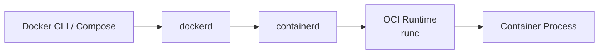

**Podman 路线**：没有中心化 daemon，命令直接通过 `libpod` / `conmon` 管理容器。

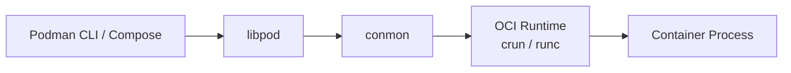

**nerdctl 路线**：跳过 `dockerd`，直接对接 `containerd`。

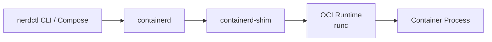

三者最终都通过 OCI 兼容的 runtime（如 `runc`、`crun`）创建容器，区别主要在上层管理架构。

## 3. Podman

Podman 官方文档对自己的描述是：

> Podman ... is a fully featured container engine that is a simple daemonless tool.

可译为：

> Podman 是一个功能完整的容器引擎，同时是一个简单的 daemonless 工具。

官方文档还写道：

> Podman provides a Docker-CLI comparable command line ...

可译为：

> Podman 提供了与 Docker CLI 可比拟的命令行体验。

### 3.1 Podman 的特点

- daemonless
- rootless 体验较强
- 命令风格接近 Docker
- 迁移成本较低

### 3.2 Podman 为什么是 daemonless

这里的 daemonless，并不是说系统里绝对没有任何辅助进程，而是说 Podman 没有像 `dockerd` 那样常驻、集中的中心管理 daemon。

Docker 的典型路径可以概括为：

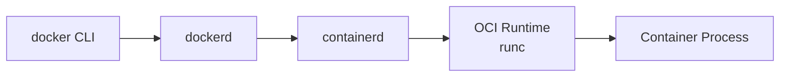

而 Podman 更接近下面这条路径：

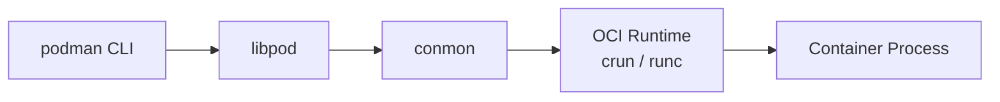

这张图表达的重点是：

- `podman` 命令发起一次容器管理操作
- `libpod` 负责容器对象和状态管理
- `conmon` 负责监控容器进程，并处理标准输入输出、退出状态等
- `crun` 或 `runc` 这样的 OCI runtime 负责真正创建容器
- 容器启动之后，并不依赖一个 `dockerd` 式的中心 daemon 持续维持

因此，Podman 所说的 daemonless，核心含义是：

- 没有一个统一的 `dockerd`
- 容器生命周期不绑定在某个中心守护进程上
- 命令是按次执行的，而不是所有请求都必须先交给一个常驻 daemon

可以把它概括成一句话：

> Podman 的 daemonless，指的是没有 Docker 那种中心化的 `dockerd`；它并不是"完全没有任何辅助进程"，而是把容器创建与管理拆成了更分散的组件。

### 3.3 Podman 安装示例

如果是在 Ubuntu 24.04 这类 Debian 系发行版上，一个直接可用的安装方式是：

```bash
apt-get update
apt-get install -y podman podman-compose
```

这里安装 `podman` 是为了获得容器引擎本体；安装 `podman-compose` 则是为了提供一个常见的 compose provider。  
不过 `podman compose` 实际调用哪个 provider，仍取决于本机环境中的可用组件。

### 3.4 Podman 基础命令

```bash
podman pull nginx:latest
podman run -d --name web -p 8080:80 nginx:latest
podman ps
podman exec -it web sh
podman logs -f web
podman stop web
podman rm web
```

如果只是单容器场景，很多命令几乎可以直接把 `docker` 替换成 `podman`。

### 3.5 Podman 与 Compose

Podman 官方文档对 `podman compose` 的说明是：

> podman compose - Run Compose workloads via an external compose provider

可译为：

> `podman compose` 用于通过外部 compose provider 运行 Compose 工作负载。

官方还明确写道：

> `podman compose` is a thin wrapper around an external compose provider ...

可译为：

> `podman compose` 本质上是对外部 compose provider 的一个轻量封装。

这意味着：

- Podman 可以使用 Compose 风格工作流
- 但它不是自己重新定义了一套完全独立的 Compose 规范
- 对常见场景而言，通常可以直接复用 `docker-compose.yaml`
- 但不宜机械理解成与 Docker Compose 100% 等价，在较复杂特性上，仍应以实际测试和官方文档为准

### 3.6 一个真实测试：直接拉起 `docker_6_compose/lab/basic`

为了避免只停留在理论层面，这里直接用本仓库已经写好的 Compose 实验做一次真实验证。

测试目录：

- [docker-compose.yaml](/docker_k8s_2026/docker/docker_6_compose/lab/basic/docker-compose.yaml)

测试命令：

```bash
cd /docker_k8s_2026/docker/docker_6_compose/lab/basic
podman compose up -d
```

在本次 Ubuntu 24.04 测试环境里，这个实验可以成功启动。  
实际验证结果包括：

- `redis` 与 `app` 都进入 `healthy`
- `nginx` 成功启动
- 宿主机访问 `http://127.0.0.1:8080/` 可以正常返回 JSON

例如查看状态时：

```bash
podman compose ps
```

可以看到类似输出：

```text
>>>> Executing external compose provider "/usr/libexec/docker/cli-plugins/docker-compose". Please refer to the documentation for details. <<<<

NAME            IMAGE                                  COMMAND                  SERVICE   CREATED          STATUS          PORTS
basic-app-1     docker.io/library/basic-app:latest     "python /app/app.py"     app       27 seconds ago   Up 25 seconds
basic-nginx-1   docker.io/library/nginx:1.29.1         "nginx -g daemon off;"   nginx     27 seconds ago   Up 11 seconds   80/tcp
basic-redis-1   docker.io/library/redis:8.2.3-alpine   "redis-server --appe…"   redis     27 seconds ago   Up 26 seconds
```

例如：

```bash
curl -s http://127.0.0.1:8080/
```

返回结果类似：

```json
{"app_env":"prod","app_name":"compose-basic-demo","cache_host":"redis","cache_port":6379,"hits":1}
```

这说明至少对这个基础实验而言，Podman 环境下复用 Compose 文件是可行的；`build`、`ports`、`volumes`、`networks`、`healthcheck`、`depends_on` 这些常见能力都工作正常。

不过这次测试还有一个很值得记录的细节：在本机上执行 `podman compose` 时，Podman 明确提示它调用了一个 **external compose provider**，这里实际调用的是 Docker 的 compose 插件。  
但这并不等于“容器是 Docker 在管”。更准确地说，是 **Docker Compose 这个前端 provider** 在工作，而它的后端通信目标仍然是本地 Podman socket（本机为 `/run/podman/podman.sock`），所以最终启动出来的仍然是 Podman 容器。

也就是说，这里的实际关系更接近：

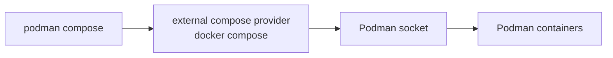

这也再次说明：`podman compose` 更适合理解成“Podman 提供 Compose 风格入口”，而不是“与 Docker Compose 完全同构的一套独立实现”。

## 4. containerd + nerdctl

`nerdctl` 官方 README 开头就写得很清楚：

> nerdctl: Docker-compatible CLI for containerd

可译为：

> `nerdctl` 是面向 `containerd` 的 Docker 兼容 CLI。

官方 README 还明确列出：

- Same UI/UX as `docker`
- Supports Docker Compose (`nerdctl compose up`)
- Supports rootless mode

### 4.1 nerdctl 的特点

- 命令体验接近 Docker
- 更贴近 `containerd`
- 支持 Compose
- 适合理解现代运行时栈

### 4.2 nerdctl 与 containerd 的关系

`nerdctl` 自己只是命令行工具，它并不是完整容器引擎。真正负责容器管理和运行时协调的，是后面的 `containerd`；而真正把容器进程创建出来的，则是更下层的 OCI runtime（如 `runc`）。

这里还需要补一个很实用的认识：日常开发里，大家通常不会直接操作 `containerd`，不是因为它不能用，而是因为它更偏底层。

- `docker` 更像面向开发者和运维人员的完整产品，命令、构建、日志、网络、卷、Compose 等能力都已经整合好了
- `containerd` 更像容器平台内部的核心组件，负责镜像、容器生命周期、快照、运行时协调等底层能力
- 因此，大多数日常场景会优先使用 Docker；如果想更贴近 `containerd` 这一层，通常也会配合 `nerdctl`，而不是直接面对更底层接口

如果从 Docker 这条常见链路往下看，大致可以理解成：

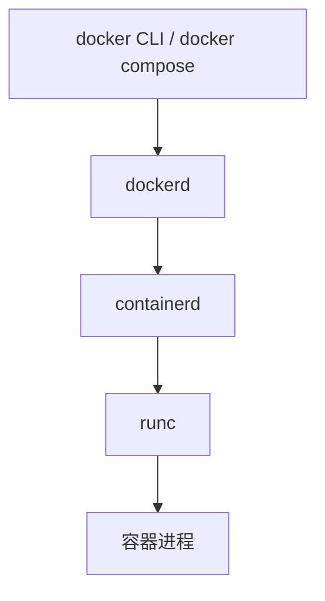

这张图表达的是：

- `docker CLI` / `docker compose` 是最上层的人机交互入口
- `dockerd` 负责对外提供 Docker 的管理面
- `containerd` 负责更底层的容器生命周期与镜像管理
- `runc` 负责真正把容器进程创建出来

这条关系可以用下图理解：

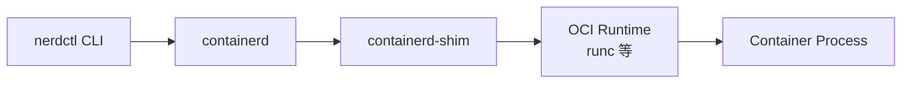

这意味着：

- `nerdctl` 负责提供接近 Docker 的使用体验
- `containerd` 负责镜像、容器、快照、运行时等核心管理
- 下面仍然有后台服务层，并不是 Podman 那种 daemonless 路线

`nerdctl` 虽然没有 `dockerd`，但它仍然依赖 `containerd` 这一后台服务。  
从这个意义上说，它并不是 Podman 式的 daemonless，只是把后端核心从 `dockerd` 换成了 `containerd`。

### 4.3 nerdctl 安装示例

在本次测试环境里，`containerd` 已经存在，但 `nerdctl` 默认并未安装。  
一种直接可用的方式，是从 nerdctl 官方 GitHub Release 获取二进制。

本次测试实际使用的是 `nerdctl-full-2.2.1-linux-amd64.tar.gz`，并从中安装了：

- `nerdctl`
- `buildkitd`
- `buildctl`

这里之所以顺带安装 `buildkitd` / `buildctl`，是因为 `nerdctl compose` 遇到需要本地构建镜像的 Compose 项目时，会依赖 BuildKit。

这里先把 3 个组件的分工说清楚：

- `nerdctl`：给人直接使用的 CLI
- `buildctl`：BuildKit 的客户端命令
- `buildkitd`：BuildKit 的后台服务

可直接参考下面这组命令：

```bash
cd /tmp
curl -fL -o nerdctl-full-2.2.1-linux-amd64.tar.gz \
  https://github.com/containerd/nerdctl/releases/download/v2.2.1/nerdctl-full-2.2.1-linux-amd64.tar.gz

tar -xzf nerdctl-full-2.2.1-linux-amd64.tar.gz -C /usr/local \
  bin/nerdctl \
  bin/buildkitd \
  bin/buildctl

nerdctl --version
buildkitd --version
buildctl --version
```

如果只是想先体验 `nerdctl run`、`nerdctl ps` 这类基础命令，安装 `nerdctl` 本身就够了；  
如果要跑 `nerdctl compose`，而且 Compose 文件里包含本地构建，通常还需要 `buildkitd` 与 `buildctl`。

### 4.4 nerdctl 基础命令

```bash
nerdctl pull nginx:latest
nerdctl run -d --name web -p 8080:80 nginx:latest
nerdctl ps
nerdctl exec -it web sh
nerdctl logs -f web
nerdctl stop web
nerdctl rm web
```

### 4.5 nerdctl 与 Compose

`nerdctl compose` 也通常可以直接使用 `docker-compose.yaml`。  
但在复杂特性、边缘配置和兼容性细节上，仍应以实际测试结果为准。

这里特别要避免一个过度简化的理解：  
并不是“安装完 `nerdctl` 之后，就一定可以像 Docker 那样直接 `compose up -d`”。

更准确地说：

- 如果 Compose 文件只使用现成镜像、没有本地 `build`，通常更容易直接启动
- 如果 Compose 文件里包含本地 `build`，往往还需要先准备好 `buildctl` / `buildkitd`
- 即使能够启动，`nerdctl compose` 对某些 Compose 特性的支持也可能和 Docker Compose 不完全一样

### 4.6 一个真实测试：直接拉起 `docker_6_compose/lab/basic`

这里同样直接用本仓库已经写好的基础实验来做验证。

测试目录：

- [docker-compose.yaml](/docker_k8s_2026/docker/docker_6_compose/lab/basic/docker-compose.yaml)

第一次直接执行：

```bash
cd /docker_k8s_2026/docker/docker_6_compose/lab/basic
nerdctl compose up -d
```

可以看到一个很有代表性的结果：`nerdctl compose` 并不是完全照搬 Docker Compose 的行为。  
它会明确提示忽略一部分字段，例如：

- `HealthCheck`
- `depends_on.condition: service_healthy`

同时，如果 Compose 文件里包含本地构建，还需要先有 BuildKit。  
本次测试里，第一次执行时就报出了这一类错误：

```text
`buildctl` needs to be installed and `buildkitd` needs to be running
```

因此，实际测试时需要先启动 `buildkitd`，例如先在一个终端里执行：

```bash
mkdir -p /run/buildkit
buildkitd --addr unix:///run/buildkit/buildkitd.sock
```

再在另一个终端里执行：

```bash
cd /docker_k8s_2026/docker/docker_6_compose/lab/basic
nerdctl compose up -d
```

在这种前提下，本次基础实验最终可以成功启动。  
例如：

```bash
nerdctl compose ps
```

可以看到类似结果：

```text
NAME             IMAGE                                   COMMAND                   SERVICE    STATUS     PORTS
basic-nginx-1    docker.io/library/nginx:1.29.1          "/docker-entrypoint.…"    nginx      running    0.0.0.0:8080->80/tcp
basic-app-1      docker.io/library/basic-app:latest      "python /app/app.py"      app        running
basic-redis-1    docker.io/library/redis:8.2.3-alpine    "docker-entrypoint.s…"    redis      running
```

继续验证：

```bash
curl -s http://127.0.0.1:8080/
```

返回结果类似：

```json
{"app_env":"prod","app_name":"compose-basic-demo","cache_host":"redis","cache_port":6379,"hits":1}
```

这次真实测试说明了两点：

1. `nerdctl compose` 对这个基础实验并不是完全不能用，最终是可以跑起来的
2. 但它对 Compose 特性的支持细节，确实和 Docker Compose 存在差异，尤其是 `healthcheck`、`depends_on.condition`、本地构建依赖 `buildkitd` 这些点

因此，`nerdctl compose` 更适合在“理解 containerd 栈”或“做较贴近底层的实验”时使用；如果目标是获得与 Docker Compose 尽量一致的日常体验，通常仍然是 Docker 或 Podman 那一侧更省心。

如果说 Podman 更像“Docker 的近邻平替”，那么 `nerdctl` 更适合用来帮助理解：

- Docker 风格 CLI 之下还可以接不同运行时
- 容器生态并不只等于 `dockerd`

## 5. 基础命令对照

### 5.1 单容器命令对照

| 目标 | Docker | Podman | nerdctl |
|---|---|---|---|
| 拉镜像 | `docker pull nginx` | `podman pull nginx` | `nerdctl pull nginx` |
| 启动 | `docker run -d ...` | `podman run -d ...` | `nerdctl run -d ...` |
| 查看 | `docker ps` | `podman ps` | `nerdctl ps` |
| 进入 | `docker exec -it web sh` | `podman exec -it web sh` | `nerdctl exec -it web sh` |
| 日志 | `docker logs -f web` | `podman logs -f web` | `nerdctl logs -f web` |
| 停止 | `docker stop web` | `podman stop web` | `nerdctl stop web` |
| 删除 | `docker rm web` | `podman rm web` | `nerdctl rm web` |

单容器场景下，三者的命令几乎只是替换了工具名称。

### 5.2 Compose 类工作流对照

| 目标 | Docker | Podman | nerdctl |
|---|---|---|---|
| 启动多容器 | `docker compose up -d` | `podman compose up -d` | `nerdctl compose up -d` |
| 查看状态 | `docker compose ps` | `podman compose ps` | `nerdctl compose ps` |
| 看日志 | `docker compose logs -f` | `podman compose logs -f` | `nerdctl compose logs -f` |
| 停止删除 | `docker compose down` | `podman compose down` | `nerdctl compose down` |

## 6. 怎么选

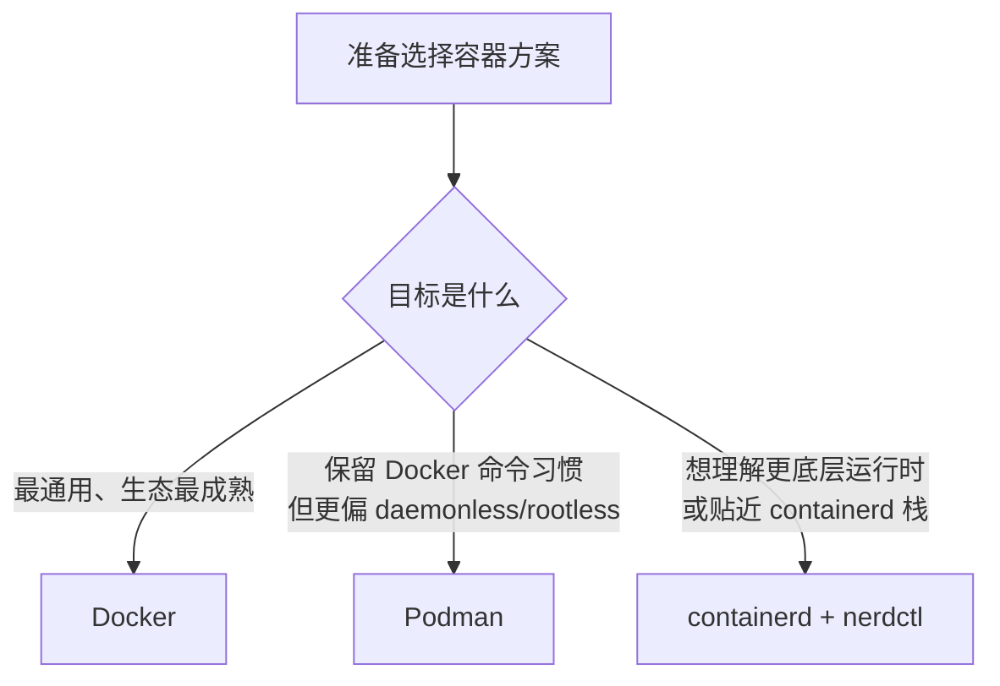

可以用一句话概括：

- `Docker`：最通用，教材与生态最成熟
- `Podman`：最像 Docker 的平替，daemonless / rootless 体验更好
- `nerdctl`：更贴近 `containerd`，适合理解底层运行时栈

## 7. 本节结论

本节最重要的结论不是"Docker 不好"，而是：

> Docker 很重要，但它不是唯一容器方案。

更准确地说：

- Docker 适合入门和日常开发
- Podman 适合希望保持 Docker 习惯、同时更看重 daemonless/rootless 的场景
- nerdctl 适合理解更底层的容器运行时栈

因此，学习 Docker 的最终目的，不应停留在"记住几条命令"，而应逐步建立对容器生态分层的认识。
