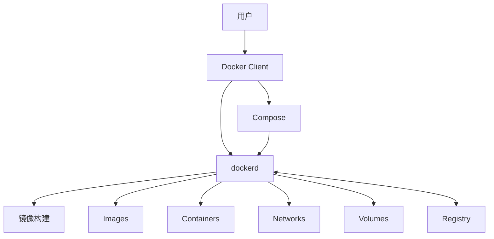
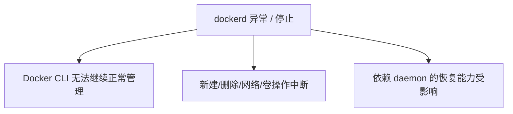
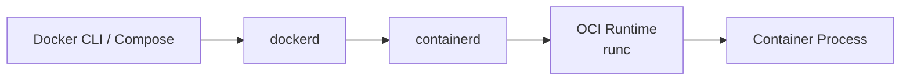
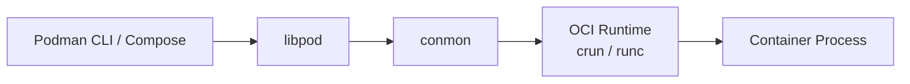
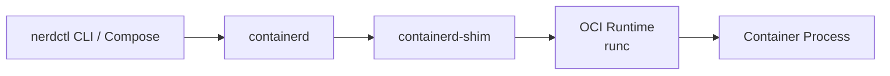
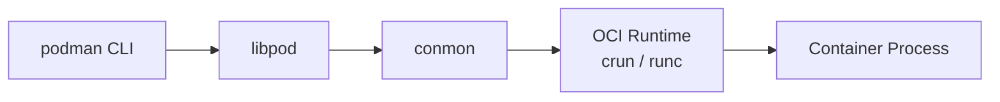
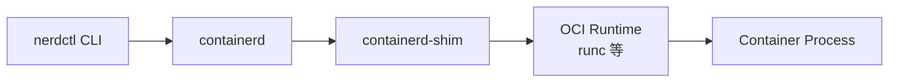
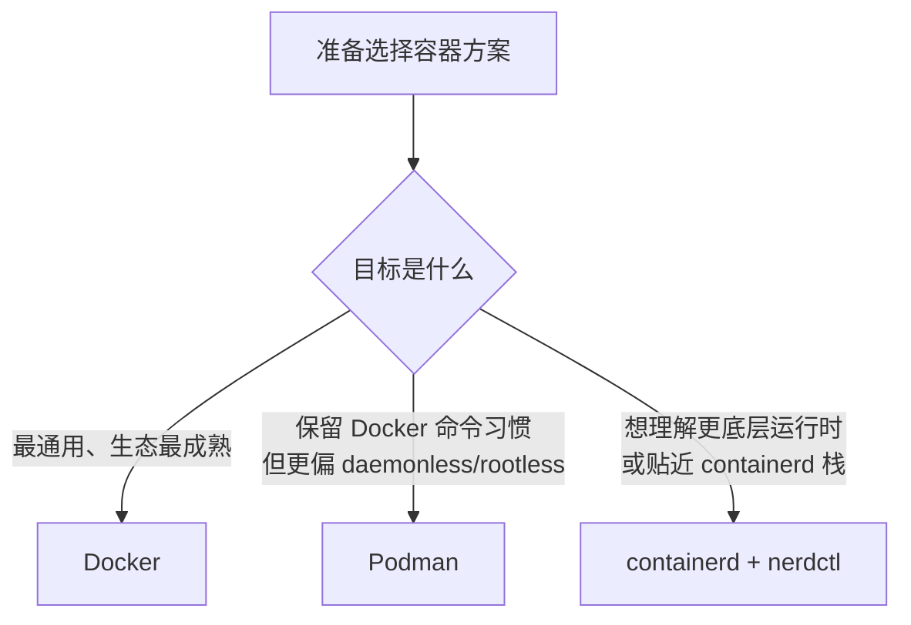

# 本步目标

- 理解 Docker 并不是唯一的容器方案。
- 理解 Docker 的几个典型边界与设计取舍。
- 认识 `Podman` 与 `containerd + nerdctl` 这两条常见替代路线。
- 了解这些方案的基础命令，以及与 `docker compose` 相近的工作方式。

# 问题背景

学完 Docker、Dockerfile、Compose 之后，很容易形成一个错觉：

> 容器 = Docker

这个理解在入门阶段问题不大，但在工程上并不准确。  
Docker 很重要，也依然广泛使用，但它不是唯一方案。

这也是本节的目的：  
不是否定 Docker，而是建立一个更完整的容器工具视角。

# 官方资料

以下资料来自各方案的官方文档或官方仓库：

- Docker Overview  
  <https://docs.docker.com/get-started/docker-overview/>
- Docker Live Restore  
  <https://docs.docker.com/engine/daemon/live-restore/>
- Podman 文档  
  <https://docs.podman.io/en/latest/markdown/podman.1.html>
- Podman Compose 文档  
  <https://docs.podman.io/en/latest/markdown/podman-compose.1.html>
- nerdctl 官方仓库  
  <https://github.com/containerd/nerdctl>

# 理论说明

## 1. 为什么会有 Docker 之外的方案

Docker 官方文档明确说明，Docker 使用的是 client-server 架构，其中包括：

- Docker client
- Docker daemon
- images
- containers
- registries

这层关系可以先用一张总览图来理解：



这张图表达的是：

- 用户通常先接触的是 `docker` 命令和 `docker compose`
- 背后的核心控制点是 `dockerd`
- 镜像、容器、网络、卷、镜像仓库交互等能力，都围绕这条中心链路展开

Docker 的成功，正是因为它把很多能力打包得很完整：

- 镜像构建
- 镜像分发
- 容器运行
- CLI
- 网络
- 卷
- Compose

但这套"一体化体验"也带来了几个典型边界。  
这些边界不一定是缺陷，很多时候更像设计取舍。

### 1.1 Docker 的几个典型边界

#### 1.1.1 daemon 架构

Docker 以 `dockerd` 为中心。  
这种架构带来统一管理的好处，但也意味着很多功能都依赖 daemon。

因此，一旦 daemon 异常，最先受到影响的是管理面：



这里有一个必须说清楚的细节：

- 不能简单地说"daemon 一死，所有容器一定立刻全部挂掉"
- 更准确的说法是：**默认情况下**，daemon 终止会关闭运行中的容器；但 Docker 提供了 `live-restore` 机制作为例外

Docker 官方文档明确写到：

> By default, when the Docker daemon terminates, it shuts down running containers.

可译为：

> 默认情况下，当 Docker daemon 终止时，它会关闭正在运行的容器。

官方同时说明：

> You can configure the daemon so that containers remain running if the daemon becomes unavailable.

可译为：

> 可以配置 daemon，使其在不可用时仍然让容器继续运行。

因此，这一层真正值得强调的问题是：

- 管理中心比较集中
- 默认情况下，daemon 的可用性会直接影响运行中的容器
- 即使启用了 `live-restore`，daemon 不可用时，管理能力仍然会明显下降

#### 1.1.2 其他边界

除 daemon 架构外，Docker 还有几个常见的讨论点：

- **工具边界较大**：Docker 同时扮演 CLI、镜像构建、容器运行、应用编排等多个角色，容易让初学者把"容器生态"误解成"只有 Docker 一套东西"。
- **rootful 使用习惯更常见**：虽然 Docker 也支持 rootless，但多数生产和实验环境仍以 rootful 模式为主。在更强调最小权限的场景下，用户会更愿意考虑其他方案。
- **不是所有需求的最佳形态**：有些场景更在意 daemonless、rootless、或更贴近底层运行时的能力，这时就会出现 Docker 之外的选择。

## 2. 生态位置总览

这几种方案并不是"互相完全替代"的关系，更像是在不同层次解决问题。

一个值得注意的事实：Docker 自身的底层也使用 `containerd` 作为容器运行时。  
换句话说，`containerd` 是 Docker 与 nerdctl 共同的基础组件，而 Podman 则走了另一条路线。

以下三张图分别展示各路线的完整栈：

**Docker 路线**：CLI / Compose 围绕 `dockerd` 工作，`dockerd` 底层再调用 `containerd`。



**Podman 路线**：没有中心化 daemon，命令直接通过 `libpod` / `conmon` 管理容器。



**nerdctl 路线**：跳过 `dockerd`，直接对接 `containerd`。



三者最终都通过 OCI 兼容的 runtime（如 `runc`、`crun`）创建容器，区别主要在上层管理架构。

## 3. Podman

Podman 官方文档对自己的描述是：

> Podman ... is a fully featured container engine that is a simple daemonless tool.

可译为：

> Podman 是一个功能完整的容器引擎，同时是一个简单的 daemonless 工具。

官方文档还写道：

> Podman provides a Docker-CLI comparable command line ...

可译为：

> Podman 提供了与 Docker CLI 可比拟的命令行体验。

### 3.1 Podman 的特点

- daemonless
- rootless 体验较强
- 命令风格接近 Docker
- 迁移成本较低

### 3.2 Podman 为什么是 daemonless

这里的 daemonless，并不是说系统里绝对没有任何辅助进程，而是说 Podman 没有像 `dockerd` 那样常驻、集中的中心管理 daemon。

Docker 的典型路径可以概括为：

```text
docker CLI -> dockerd -> containerd / runtime -> container
```

而 Podman 更接近下面这条路径：



这张图表达的重点是：

- `podman` 命令发起一次容器管理操作
- `libpod` 负责容器对象和状态管理
- `conmon` 负责监控容器进程，并处理标准输入输出、退出状态等
- `crun` 或 `runc` 这样的 OCI runtime 负责真正创建容器
- 容器启动之后，并不依赖一个 `dockerd` 式的中心 daemon 持续维持

因此，Podman 所说的 daemonless，核心含义是：

- 没有一个统一的 `dockerd`
- 容器生命周期不绑定在某个中心守护进程上
- 命令是按次执行的，而不是所有请求都必须先交给一个常驻 daemon

可以把它概括成一句话：

> Podman 的 daemonless，指的是没有 Docker 那种中心化的 `dockerd`；它并不是"完全没有任何辅助进程"，而是把容器创建与管理拆成了更分散的组件。

### 3.3 Podman 基础命令

```bash
podman pull nginx:latest
podman run -d --name web -p 8080:80 nginx:latest
podman ps
podman exec -it web sh
podman logs -f web
podman stop web
podman rm web
```

如果只是单容器场景，很多命令几乎可以直接把 `docker` 替换成 `podman`。

### 3.4 Podman 与 Compose

Podman 官方文档对 `podman compose` 的说明是：

> podman compose - Run Compose workloads via an external compose provider

可译为：

> `podman compose` 用于通过外部 compose provider 运行 Compose 工作负载。

官方还明确写道：

> `podman compose` is a thin wrapper around an external compose provider ...

可译为：

> `podman compose` 本质上是对外部 compose provider 的一个轻量封装。

这意味着：

- Podman 可以使用 Compose 风格工作流
- 但它不是自己重新定义了一套完全独立的 Compose 规范
- 对常见场景而言，通常可以直接复用 `docker-compose.yaml`
- 但不宜机械理解成与 Docker Compose 100% 完全等价，在较复杂特性上，仍应以实际测试和官方文档为准

## 4. containerd + nerdctl

`nerdctl` 官方 README 开头就写得很清楚：

> nerdctl: Docker-compatible CLI for containerd

可译为：

> `nerdctl` 是面向 `containerd` 的 Docker 兼容 CLI。

官方 README 还明确列出：

- Same UI/UX as `docker`
- Supports Docker Compose (`nerdctl compose up`)
- Supports rootless mode

### 4.1 nerdctl 的特点

- 命令体验接近 Docker
- 更贴近 `containerd`
- 支持 Compose
- 适合理解现代运行时栈

### 4.2 nerdctl 与 containerd 的关系

`nerdctl` 自己只是命令行工具，它并不是完整容器引擎。真正负责容器管理和运行时协调的，是后面的 `containerd`。

这条关系可以用下图理解：



这意味着：

- `nerdctl` 负责提供接近 Docker 的使用体验
- `containerd` 负责镜像、容器、快照、运行时等核心管理
- 下面仍然有后台服务层，并不是 Podman 那种 daemonless 路线

`nerdctl` 虽然没有 `dockerd`，但它仍然依赖 `containerd` 这一后台服务。  
从这个意义上说，它并不是 Podman 式的 daemonless，只是把后端核心从 `dockerd` 换成了 `containerd`。

### 4.3 nerdctl 基础命令

```bash
nerdctl pull nginx:latest
nerdctl run -d --name web -p 8080:80 nginx:latest
nerdctl ps
nerdctl exec -it web sh
nerdctl logs -f web
nerdctl stop web
nerdctl rm web
```

### 4.4 nerdctl 与 Compose

`nerdctl compose` 也通常可以直接使用 `docker-compose.yaml`。  
但在复杂特性、边缘配置和兼容性细节上，仍应以实际测试结果为准。

如果 Podman 更像"Docker 的近邻平替"，那么 `nerdctl` 更适合用来帮助理解：

- Docker 风格 CLI 之下还可以接不同运行时
- 容器生态并不只等于 `dockerd`

## 5. 基础命令对照

### 5.1 单容器命令对照

| 目标 | Docker | Podman | nerdctl |
|---|---|---|---|
| 拉镜像 | `docker pull nginx` | `podman pull nginx` | `nerdctl pull nginx` |
| 启动 | `docker run -d ...` | `podman run -d ...` | `nerdctl run -d ...` |
| 查看 | `docker ps` | `podman ps` | `nerdctl ps` |
| 进入 | `docker exec -it web sh` | `podman exec -it web sh` | `nerdctl exec -it web sh` |
| 日志 | `docker logs -f web` | `podman logs -f web` | `nerdctl logs -f web` |
| 停止 | `docker stop web` | `podman stop web` | `nerdctl stop web` |
| 删除 | `docker rm web` | `podman rm web` | `nerdctl rm web` |

单容器场景下，三者的命令几乎只是替换了工具名称。

### 5.2 Compose 类工作流对照

| 目标 | Docker | Podman | nerdctl |
|---|---|---|---|
| 启动多容器 | `docker compose up -d` | `podman compose up -d` | `nerdctl compose up -d` |
| 查看状态 | `docker compose ps` | `podman compose ps` | `nerdctl compose ps` |
| 看日志 | `docker compose logs -f` | `podman compose logs -f` | `nerdctl compose logs -f` |
| 停止删除 | `docker compose down` | `podman compose down` | `nerdctl compose down` |

## 6. 怎么选



可以用一句话概括：

- `Docker`：最通用，教材与生态最成熟
- `Podman`：最像 Docker 的平替，daemonless / rootless 体验更好
- `nerdctl`：更贴近 `containerd`，适合理解底层运行时栈

## 7. 本节结论

本节最重要的结论不是"Docker 不好"，而是：

> Docker 很重要，但它不是唯一容器方案。

更准确地说：

- Docker 适合入门和日常开发
- Podman 适合希望保持 Docker 习惯、同时更看重 daemonless/rootless 的场景
- nerdctl 适合理解更底层的容器运行时栈

因此，学习 Docker 的最终目的，不应停留在"记住几条命令"，而应逐步建立对容器生态分层的认识。
