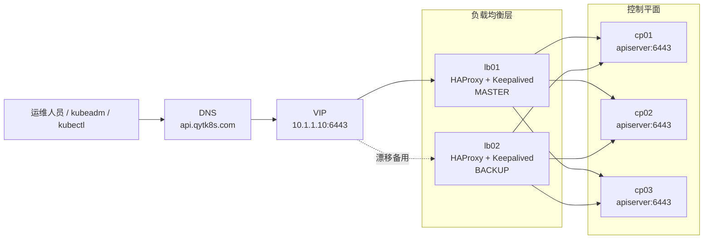
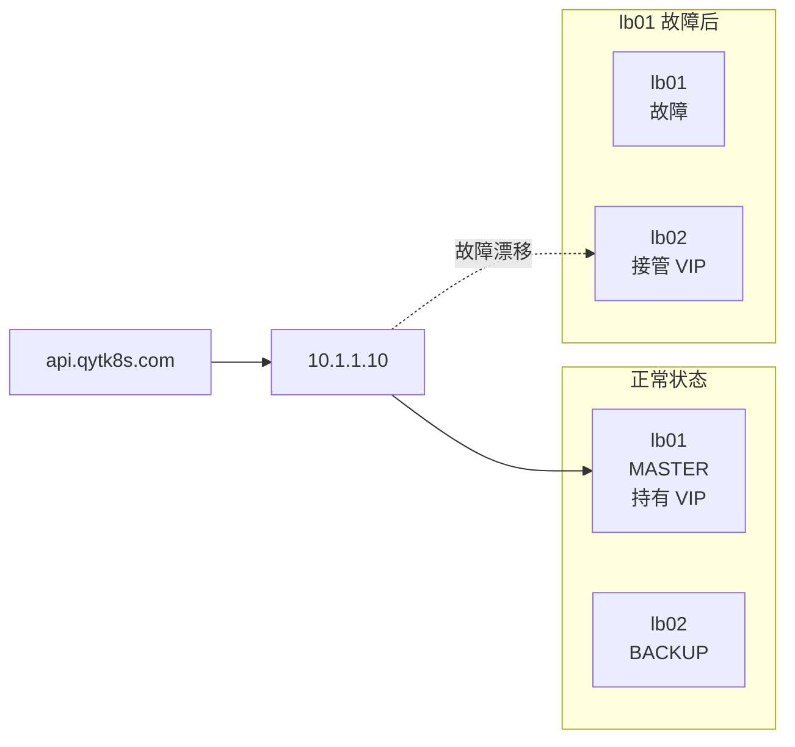
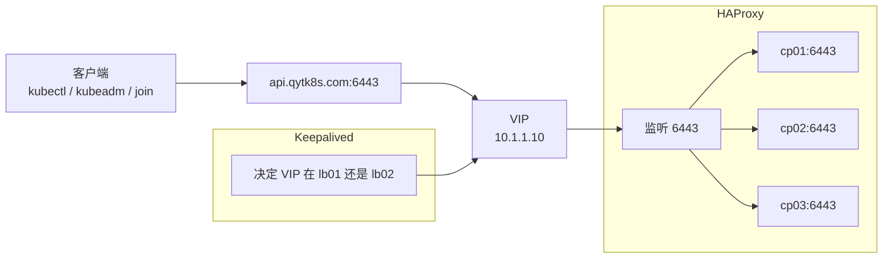
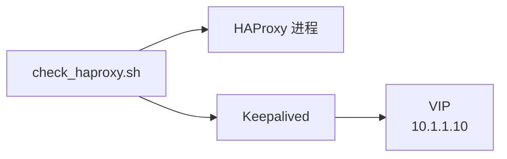

# 第 4 步：部署 API Server 高可用入口

## 本步目标

在 `lb01` 和 `lb02` 上部署一套用于 Kubernetes API Server 的高可用入口。

本步完成后，希望达到下面的状态：

- `api.qytk8s.com` 指向 VIP `10.1.1.10`
- `lb01` 和 `lb02` 运行 `HAProxy`
- `lb01` 和 `lb02` 运行 `Keepalived`
- VIP `10.1.1.10` 在正常情况下漂移到 `lb01`
- 后续 `kubeadm init` 可以把 `api.qytk8s.com:6443` 作为控制平面统一入口

---

## 为什么需要这一步

我们这一章不是单控制平面，而是：

- `cp01`
- `cp02`
- `cp03`

组成三控制平面高可用架构。

如果没有一个固定入口，后续客户端、`kubeadm join`、`kubectl`、甚至后续的自动化脚本都需要记住某一台控制平面的真实地址。

这不符合高可用设计。

所以这里要先准备一层入口：

- `HAProxy`：负责把 `6443` 端口的流量转发给控制平面节点
- `Keepalived`：负责提供漂移 VIP

---

## 先看整体关系图

### 图 1：API Server 高可用入口全景图



这张图对应的是本步最核心的访问链路：

- 客户端不直接访问 `cp01/cp02/cp03`
- 客户端只访问 `api.qytk8s.com:6443`
- 域名先解析到 VIP `10.1.1.10`
- VIP 当前挂在哪台 LB 上，就由哪台机器上的 `HAProxy` 负责转发到 3 台控制平面

### 图 2：`lb01` 故障后的漂移关系



这张图用来讲“为什么客户端配置不用改”：

- 无论 `lb01` 是否故障，客户端都还是访问 `api.qytk8s.com`
- 变化的只是 VIP 实际挂载在哪台负载均衡节点上
- 这就是 `Keepalived` 在高可用入口里的价值

---

## 两个组件分别做什么

### 图 3：`HAProxy` 和 `Keepalived` 的配合关系



这张图只强调职责边界：

- `Keepalived` 负责决定 VIP 挂在哪台负载均衡节点上
- `HAProxy` 负责接住进入 `6443` 的流量，并转发到后端控制平面

### HAProxy 做什么

`HAProxy` 是四层负载均衡器。

在这里，它只做一件事：

- 监听 `6443`
- 把进入的流量转发给：
  - `cp01:6443`
  - `cp02:6443`
  - `cp03:6443`

### Keepalived 做什么

`Keepalived` 负责管理一个漂移的虚拟 IP（VIP）。

在这里，这个 VIP 是：

- `10.1.1.10`

正常情况下：

- VIP 在 `lb01`

如果 `lb01` 挂掉：

- VIP 漂移到 `lb02`

这样，外部永远只访问一个固定入口：

- `api.qytk8s.com:6443`

---

## 健康检查与 VIP 漂移

### 图 4：健康检查脚本如何影响 VIP 漂移



这张图补的是“切换条件”：

- `Keepalived` 不是无脑持有 VIP
- 它会通过 `check_haproxy.sh` 检查本机 `HAProxy` 是否正常
- 如果本机 `HAProxy` 异常，`Keepalived` 才有理由放弃 VIP，让另一台接管

这一段建议直接结合原始配置一起理解。

#### 关键代码 1：健康检查脚本本体

```bash
#!/usr/bin/env bash
systemctl is-active --quiet haproxy
```

解释：

- 这个脚本非常短，但作用很明确
- 它只检查一件事：本机 `haproxy` 服务是否处于 `active`
- 如果 `haproxy` 正常，脚本返回 `0`
- 如果 `haproxy` 异常，脚本返回非 `0`

#### 关键代码 2：`Keepalived` 如何引用这个脚本

以 `lb01` 为例，核心配置是：

```conf
vrrp_script chk_haproxy {
   script "/etc/keepalived/check_haproxy.sh"
   interval 2
   weight 10
}
```

解释：

- `chk_haproxy` 是一个自定义健康检查项
- `script` 指定实际执行的脚本路径
- `interval 2` 表示每 `2` 秒检查一次
- `weight 10` 表示这个检查结果会影响当前节点的 VRRP 选举能力

#### 关键代码 3：把健康检查挂到 VIP 实例上

```conf
vrrp_instance VI_K8S_API {
    state MASTER
    interface ens160
    virtual_router_id 51
    priority 200
    advert_int 1

    virtual_ipaddress {
        10.1.1.10/24 dev ens160
    }

    track_script {
        chk_haproxy
    }
}
```

解释：

- `vrrp_instance VI_K8S_API` 就是这组 VIP 漂移实例
- `priority 200` 说明 `lb01` 默认优先级更高，所以正常情况下它持有 VIP
- `track_script { chk_haproxy }` 表示这个 VIP 实例会持续参考 `chk_haproxy` 的检查结果
- 也就是说，VIP 是否继续留在本机，不只看 VRRP 主备关系，还要看本机 `haproxy` 是否健康

#### 关键代码 4：为什么 `lb02` 能接管

`lb02` 的核心差异是：

```conf
vrrp_instance VI_K8S_API {
    state BACKUP
    priority 150
}
```

解释：

- `lb02` 默认是 `BACKUP`
- 它的优先级低于 `lb01`
- 但如果 `lb01` 因为 `haproxy` 异常而不再适合持有 VIP，`lb02` 就会接管 `10.1.1.10`

所以这条链路可以直接理解成：

1. `check_haproxy.sh` 检查本机 `haproxy`
2. `Keepalived` 每 2 秒执行一次这个检查
3. `track_script` 把检查结果绑定到 VIP 实例
4. `lb01` 正常时持有 VIP
5. `lb01` 的 `haproxy` 异常时，VIP 才会漂移到 `lb02`

---

## 本步固定参数

- VIP：`10.1.1.10`
- 域名：`api.qytk8s.com`
- 网卡：`ens160`
- `lb01`：主节点（MASTER）
- `lb02`：备节点（BACKUP）

---

## 对应脚本

本步对应脚本：

- `k8s/01-k8s-architecture/scripts/04_setup_haproxy_keepalived_remote.sh`

本步还会直接使用下面这些原始配置文件：

- `k8s/01-k8s-architecture/configs/loadbalancer/haproxy.cfg`
- `k8s/01-k8s-architecture/configs/loadbalancer/keepalived-lb01.conf`
- `k8s/01-k8s-architecture/configs/loadbalancer/keepalived-lb02.conf`
- `k8s/01-k8s-architecture/configs/loadbalancer/check_haproxy.sh`

这个脚本会做下面几件事：

1. 在 `lb01`、`lb02` 安装 `haproxy` 和 `keepalived`
2. 读取 Git 项目中的原始配置文件
3. 把 `haproxy.cfg`、`keepalived.conf` 和健康检查脚本下发到远端
4. 启动并设置服务开机自启

---

## 脚本内部在做什么

下面对脚本内部关键动作进行拆解说明。

现在的结构已经调整为：

- 配置文件单独放在 Git 项目里
- 脚本本身只负责安装、读取本地文件、下发到远端、启动服务
- 原始配置与自动化脚本的职责边界更加清晰

---

## 脚本执行主线

如果把 `04_setup_haproxy_keepalived_remote.sh` 当成一个“自动化编排器”，它的主线其实非常清晰：

1. 先检查本地原始配置文件是否齐全
2. 先配置 `lb01`
3. 再配置 `lb02`
4. 每台机器都按同样顺序执行：
   - 安装软件
   - 下发 `haproxy.cfg`
   - 下发 `check_haproxy.sh`
   - 下发 `keepalived.conf`
   - 启动服务并检查状态

也就是说，这个脚本已经不再承担“定义配置内容”的责任，而是只承担“把 Git 中的标准配置落到远端节点并启动”的责任。

---

## 先看脚本的核心函数

### `require_local_files()`

这一段会先检查下面 4 个文件是否都已经存在：

```bash
for file in \
  "${HAPROXY_CFG}" \
  "${CHECK_SCRIPT}" \
  "${KEEPALIVED_LB01}" \
  "${KEEPALIVED_LB02}"; do
  if [[ ! -f "${file}" ]]; then
    echo "ERROR: 缺少配置文件: ${file}"
    exit 1
  fi
done
```

它的意义是：

- 如果 Git 项目里的配置文件不完整，脚本直接退出
- 不会出现“远端装了软件，但配置只下发了一半”的半成品状态

### `install_packages()`

这段函数会通过 SSH 在目标节点上执行真正的安装命令：

```bash
ssh -o BatchMode=yes -o StrictHostKeyChecking=no "root@${node}" "bash -s" <<'EOF'
set -euo pipefail
export DEBIAN_FRONTEND=noninteractive
apt-get update -y
apt-get install -y haproxy keepalived
mkdir -p /etc/haproxy /etc/keepalived
EOF
```

这里需要重点理解两点：

- 安装动作是在远端 `lb01/lb02` 上完成的，不是在 `ops` 本机
- 除了安装软件，还会提前创建 `/etc/haproxy` 和 `/etc/keepalived`

### `push_file()`

这一段是整个重构后的关键：

```bash
ssh -o BatchMode=yes -o StrictHostKeyChecking=no "root@${node}" "cat > ${remote_path}" < "${local_path}"
```

它的含义是：

- 左边 `< "${local_path}"`：从 `ops` 本地读取 Git 中的原始配置文件
- 右边 `"cat > ${remote_path}"`：把文件内容直接写入远端目标路径

这就是当前采用的结构：

- 原始配置文件保存在 Git 项目中
- 脚本只负责读取并下发
- 不再把配置本体埋在 heredoc 里

### `configure_node()`

这段函数把单台机器的处理流程固定为 5 步：

```bash
echo "[${node} 1/5] 安装 haproxy 和 keepalived"
install_packages "${node}"

echo "[${node} 2/5] 下发 haproxy.cfg"
push_file "${node}" "${HAPROXY_CFG}" "/etc/haproxy/haproxy.cfg"

echo "[${node} 3/5] 下发健康检查脚本"
push_file "${node}" "${CHECK_SCRIPT}" "/etc/keepalived/check_haproxy.sh"
ssh -o BatchMode=yes -o StrictHostKeyChecking=no "root@${node}" "chmod +x /etc/keepalived/check_haproxy.sh"

echo "[${node} 4/5] 下发 keepalived.conf"
push_file "${node}" "${keepalived_conf}" "/etc/keepalived/keepalived.conf"

echo "[${node} 5/5] 启动 haproxy 和 keepalived"
```

这一段把单台机器的处理顺序固定了下来：

- 第一步解决“软件是否存在”
- 第二步和第三步解决“配置是否下发”
- 第四步解决“主备配置是否分别落到正确节点”
- 第五步解决“服务是否立即生效”

### `main()`

入口函数其实只做三件事：

```bash
require_local_files
configure_node "lb01" "${KEEPALIVED_LB01}"
configure_node "lb02" "${KEEPALIVED_LB02}"
```

也就是说，这个脚本已经变成了一个非常标准的“配置编排器”。

---

## 按 `lb01` 展开后，实际执行命令长什么样

如果把 `configure_node "lb01" "${KEEPALIVED_LB01}"` 展开看，它最终做的事情可以近似理解为下面这组动作：

```bash
ssh root@lb01 "apt-get update -y && apt-get install -y haproxy keepalived && mkdir -p /etc/haproxy /etc/keepalived"

ssh root@lb01 "cat > /etc/haproxy/haproxy.cfg" < /docker_k8s_2026/k8s/01-k8s-architecture/configs/loadbalancer/haproxy.cfg

ssh root@lb01 "cat > /etc/keepalived/check_haproxy.sh" < /docker_k8s_2026/k8s/01-k8s-architecture/configs/loadbalancer/check_haproxy.sh
ssh root@lb01 "chmod +x /etc/keepalived/check_haproxy.sh"

ssh root@lb01 "cat > /etc/keepalived/keepalived.conf" < /docker_k8s_2026/k8s/01-k8s-architecture/configs/loadbalancer/keepalived-lb01.conf

ssh root@lb01 "systemctl enable --now haproxy keepalived && systemctl restart haproxy keepalived && systemctl is-active haproxy keepalived"
```

`lb02` 与此完全同构，只是最后一份配置文件会换成：

```text
configs/loadbalancer/keepalived-lb02.conf
```

这一段说明脚本的本质是对一组明确系统命令的顺序编排。

---

## 执行命令

先给脚本增加执行权限：

```bash
chmod +x /docker_k8s_2026/k8s/01-k8s-architecture/scripts/04_setup_haproxy_keepalived_remote.sh
```

然后执行：

```bash
bash /docker_k8s_2026/k8s/01-k8s-architecture/scripts/04_setup_haproxy_keepalived_remote.sh
```

---

## 执行后的验证

### 验证 1：检查服务状态

```bash
for node in lb01 lb02; do
  echo "===== ${node} ====="
  ssh root@${node} "systemctl is-active haproxy keepalived"
done
```

预期：

- 每台机器都会先打印主机名分隔线
- `haproxy` 和 `keepalived` 都显示为 `active`

### 验证 2：检查 VIP 在哪台机器上

```bash
for node in lb01 lb02; do
  echo "===== ${node} ====="
  ssh root@${node} "ip addr show ens160 | grep 10.1.1.10 || true"
done
```

预期：

- 哪台机器输出了 `10.1.1.10`，VIP 就在那台机器上
- 正常情况下，VIP 出现在 `lb01`

### 验证 3：检查 `api.qytk8s.com` 是否能连到 6443

```bash
nc -vz api.qytk8s.com 6443
```

预期：

- TCP 端口可以建立连接

说明：

- 此时后端控制平面节点还没有启动 API Server
- 所以这里的重点是“入口层已经准备好”，不是 API Server 已经可用

### 验证 4：检查配置文件

```bash
echo "===== lb01 haproxy.cfg ====="
ssh root@lb01 "cat /etc/haproxy/haproxy.cfg"
echo "===== lb01 keepalived.conf ====="
ssh root@lb01 "cat /etc/keepalived/keepalived.conf"
```

预期：

- `HAProxy` 后端包含 `cp01`、`cp02`、`cp03`
- `Keepalived` 已配置 VIP `10.1.1.10`

---

## 配置文件关键内容解读

配置文件的关键内容如下。

### `haproxy.cfg` 重点看哪里

这个文件现在可以直接在 Git 项目里查看：

- `k8s/01-k8s-architecture/configs/loadbalancer/haproxy.cfg`

```text
defaults
    mode tcp

frontend k8s_api_frontend
    bind *:6443
    default_backend k8s_api_backend

backend k8s_api_backend
    balance roundrobin
    option tcp-check
    server cp01 cp01:6443 check
    server cp02 cp02:6443 check
    server cp03 cp03:6443 check
```

这几行足够说明核心思想：

- `mode tcp`：这里不是七层 HTTP 代理，而是四层 TCP 转发
- `bind *:6443`：对外暴露 Kubernetes API 入口
- `default_backend k8s_api_backend`：入口收到流量后，统一打到控制平面后端池
- `cp01/cp02/cp03`：三控制平面都已经纳入负载均衡池

### `keepalived.conf` 重点看哪里

这两个文件现在也都在 Git 项目里可直接查看：

- `k8s/01-k8s-architecture/configs/loadbalancer/keepalived-lb01.conf`
- `k8s/01-k8s-architecture/configs/loadbalancer/keepalived-lb02.conf`

```text
vrrp_instance VI_K8S_API {
    state MASTER
    interface ens160
    virtual_router_id 51
    priority 200

    authentication {
        auth_type PASS
        auth_pass K8S2026
    }

    virtual_ipaddress {
        10.1.1.10/24 dev ens160
    }

    track_script {
        chk_haproxy
    }
}
```

这几行的关键含义如下：

- `state MASTER/BACKUP`：定义启动时的初始主备姿态
- `priority`：决定谁更优先持有 VIP
- `virtual_ipaddress`：真正漂移的是 `10.1.1.10`
- `track_script`：VIP 是否继续保留，要看 `haproxy` 是否健康

这里还需要特别说明一个经常被问到的问题：

- `state MASTER/BACKUP` 不是最终决定谁持有 VIP 的唯一因素
- 真正更关键的是 `priority`

也就是说：

- `lb01` 当前配置为 `priority 200`
- `lb02` 当前配置为 `priority 150`

因此在两台节点都健康时：

- `lb01` 会优先成为持有 `10.1.1.10` 的节点
- `lb02` 作为备节点等待

### 默认是否抢占

当前这套课程配置里，两份 `keepalived.conf` 都没有出现：

```conf
nopreempt
```

这意味着本章当前采用的是默认抢占模型。

它的含义是：

- 当 `lb01` 故障时，VIP 会漂移到 `lb02`
- 当 `lb01` 恢复后，因为它优先级更高，通常会把 VIP 再抢回去

如果显式加入：

```conf
nopreempt
```

则含义会变成：

- 高优先级节点恢复后，不主动抢回 VIP
- 当前已经持有 VIP 的节点会继续保持主角色，直到再次发生故障切换

所以这一章可以这样记：

- 默认：有抢占
- 写了 `nopreempt`：不抢占

---

## 本步完成标准

只要满足下面条件，就可以进入下一步：

- `lb01` 和 `lb02` 的 `haproxy` 正常运行
- `lb01` 和 `lb02` 的 `keepalived` 正常运行
- VIP `10.1.1.10` 已成功漂移到主节点
- `api.qytk8s.com` 已成为后续 kubeadm 可以使用的统一入口

---

## 下一步

下一步进入 containerd 安装：

- `docs/06_containerd.md`
