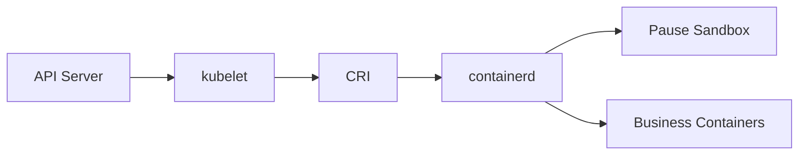
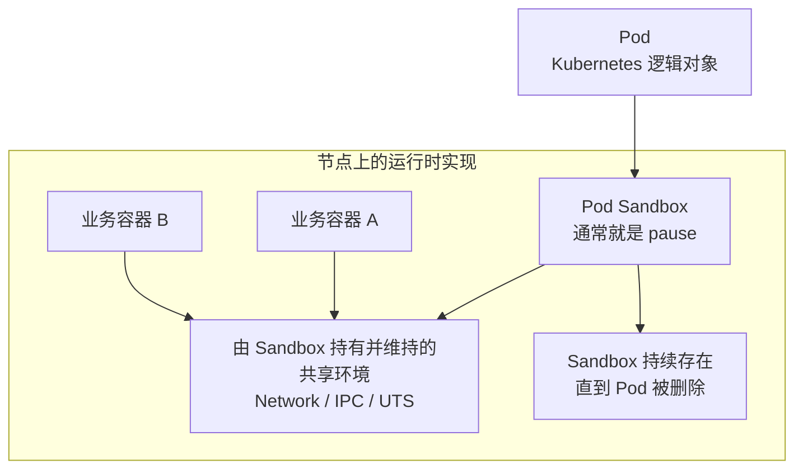
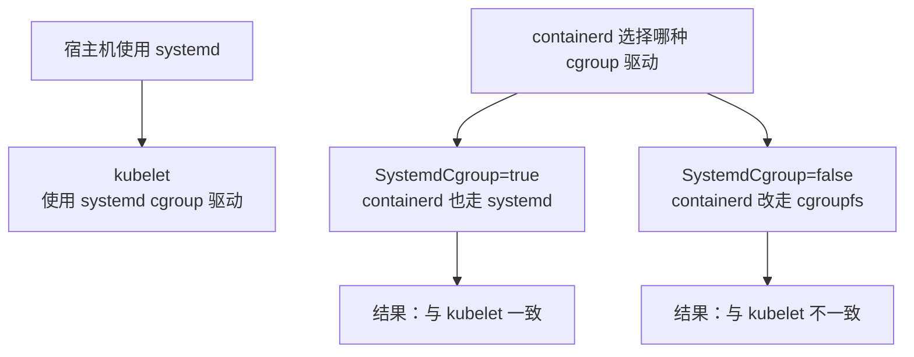
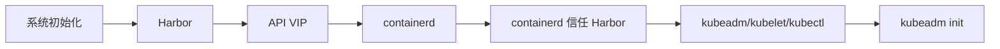

# 第 5 步：在 Kubernetes 节点安装 containerd

## 本步目标

在所有 Kubernetes 节点上安装并启用 `containerd`，为后续 `kubelet` 接管 Pod 生命周期准备统一的容器运行时环境。

本步完成后，应达到下面状态：

- `cp01`、`cp02`、`cp03` 已安装 `containerd`
- `wk-app01`、`wk-app02`、`wk-edge01`、`wk-obs01` 已安装 `containerd`
- `containerd` 服务处于 `active (running)` 状态
- `/etc/containerd/config.toml` 已生成
- `SystemdCgroup = true` 已生效

## 执行标记

- **执行标记：必须执行**

说明：

- 第一章从基础环境起点开始时，本步必须实际执行
- 本步完成后，后续 `kubeadm`、`kubelet` 与 Pod 沙箱创建才有统一的容器运行时基础

## 问题背景

Kubernetes 并不直接负责启动容器。

它真正负责的是：

- 通过 `API Server` 接收期望状态
- 由 `Scheduler` 决定 Pod 放到哪个节点
- 由节点上的 `kubelet` 负责把 Pod 真正落地

但是 `kubelet` 也不直接创建容器。它需要调用一个符合 `CRI`（Container Runtime Interface）标准的容器运行时。

在当前课程中，这个容器运行时统一选择：

- `containerd`

如果没有这一步，后面的 `kubeadm init` 即使成功生成了控制面配置，节点也没有实际能力去创建 Pod 沙箱和业务容器。

## 理论说明

### 什么是容器运行时

容器运行时（Container Runtime）负责完成下面这些底层动作：

- 拉取镜像
- 创建容器
- 启动 Pod 沙箱
- 管理容器生命周期
- 向 `kubelet` 返回容器状态

在 Kubernetes 体系里，运行时不再是“可有可无的配角”，而是节点最底层的关键组件之一。

### 为什么本课程选择 `containerd`

本课程统一使用 `containerd`，原因如下：

- 它是 Kubernetes 当前主流的容器运行时之一
- 结构清晰，适合教学
- 与 `kubelet` 通过 `CRI` 对接稳定
- 比“把完整 Docker 当运行时”更贴近当前 Kubernetes 实践

### `kubelet`、`containerd` 与 Pod 的关系



这条链路说明：

- `API Server` 只保存集群目标状态
- `kubelet` 负责在节点上执行 Pod 生命周期
- `kubelet` 通过 `CRI` 调用 `containerd`
- `containerd` 负责真正创建 `pause sandbox` 和业务容器

### 为什么这里必须先讲 `pause sandbox`

Kubernetes 中一个 Pod 并不是“直接把业务容器跑起来”这么简单。

在大多数实现里，Pod 在节点上会先落地成一个 `Pod Sandbox`：

- 通常就是 `pause` 镜像

这个 `Pod Sandbox` 负责承载 Pod 级别的基础命名空间，例如：

- 网络命名空间：决定 Pod 看到的网卡、IP、路由等网络环境
- IPC：决定 Pod 内容器之间如何共享进程间通信资源，例如共享内存、信号量、消息队列
- UTS：决定 Pod 看到的主机名与域名标识

后续业务容器再加入这个 `Pod Sandbox`。

也就是说：

- 没有容器运行时，就没有 Pod 沙箱
- 没有 Pod 沙箱，就谈不上真正创建 Pod

也正因为节点在创建 `Pod Sandbox` 时需要实际拉取 `pause` 镜像，所以后续第 6 步要继续把 `sandbox_image` 固定指向本地 Harbor 中的 `pause:3.10`



这张图要表达的是：

- `Pod` 是 Kubernetes 里的逻辑对象
- 在节点运行时层面，`Pod` 会先落地为一个 `Pod Sandbox`
- 这个 `Pod Sandbox` 通常就是 `pause`
- 业务容器不是先各自独立启动，而是加入这组由 `Sandbox` 持有的共享环境
- `pause` 不是“创建完就消失”的临时动作，它通常会持续存在，直到这个 `Pod` 被删除
- 所以 `pause` 不是业务定义的一部分，但它是 `Pod` 运行时实现的基础

### 为什么必须设置 `SystemdCgroup = true`

这一点是本步最关键的配置项。

Ubuntu Server 24.04 使用 `systemd` 作为系统初始化与服务管理器。Kubernetes 节点上的 `kubelet` 也更适合与 `systemd` 方式的 cgroup 管理保持一致。

如果 `containerd` 与 `kubelet` 的 cgroup 驱动不一致，后续可能出现：

- 资源统计不一致
- Pod 管理行为异常
- 节点运行时和 `kubelet` 协调不稳定

因此本课程统一固定：

```text
SystemdCgroup = true
```



这张图要表达的是：

- 宿主机本身使用 `systemd`
- `kubelet` 本身更适合按 `systemd` 方式管理 cgroup
- `containerd` 有两种常见方式：
  - `SystemdCgroup=true`：通过 `systemd` 管理 cgroup
  - `SystemdCgroup=false`：通过 `cgroupfs` 管理 cgroup
- 所谓“不一致”，就是 `kubelet` 固定走 `systemd`，但 `containerd` 选成了 `cgroupfs`
- 本课程把 `SystemdCgroup` 固定为 `true`，就是为了让 `containerd` 与 `kubelet` 保持一致

### 本步在第一章中的位置

本步不是孤立动作，而是第一章主线中的中间关键节点。



这里的顺序不能颠倒：

- 先有容器运行时
- 再让运行时信任 Harbor
- 再安装 `kubeadm`、`kubelet`、`kubectl`
- 最后再做 `kubeadm init`

## 对应脚本

本步对应脚本：

- `k8s/01-k8s-architecture/scripts/05_install_containerd_remote.sh`

这个脚本会在所有 Kubernetes 节点上完成下面 4 件事：

1. 安装 `containerd`
2. 生成默认配置文件 `/etc/containerd/config.toml`
3. 将 `SystemdCgroup` 从 `false` 改为 `true`
4. 启动 `containerd` 并设置开机自启

## 脚本内部在做什么

### 目标节点范围

脚本固定操作下面 7 台节点：

- `cp01`
- `cp02`
- `cp03`
- `wk-app01`
- `wk-app02`
- `wk-edge01`
- `wk-obs01`

这说明本步只针对 Kubernetes 节点执行，不处理：

- `lb01`
- `lb02`
- `harbor`
- `git`
- `ops`

### 脚本执行主线

如果把 `05_install_containerd_remote.sh` 看作一个批量初始化脚本，它的主线非常清楚：

1. 遍历全部 Kubernetes 节点
2. 通过 `ssh` 在远端安装 `containerd`
3. 生成默认 `config.toml`
4. 调整 `SystemdCgroup`
5. 启动服务并打印关键状态

### 关键动作 1：安装 `containerd`

脚本首先在远端执行：

```bash
apt-get update -y
apt-get install -y containerd
```

这一步解决的是“节点上是否已经具备容器运行时二进制和 systemd service”。

### 关键动作 2：生成默认配置文件

```bash
mkdir -p /etc/containerd
containerd config default >/etc/containerd/config.toml
```

这一步的意义是：

- 不依赖人工拼写配置
- 先拿到一份标准默认配置
- 后续只修改课程真正需要固定的关键项

### 关键动作 3：修改 cgroup 驱动

```bash
sed -ri 's/SystemdCgroup = false/SystemdCgroup = true/' /etc/containerd/config.toml
```

这一步把默认配置中的：

```text
SystemdCgroup = false
```

改成：

```text
SystemdCgroup = true
```

这是本步最重要的配置变更。

### 关键动作 4：启动服务

```bash
systemctl enable --now containerd
systemctl restart containerd
```

这一步同时完成两件事：

- 立即启动 `containerd`
- 确保节点重启后自动拉起

## 执行命令

先给脚本增加执行权限：

```bash
chmod +x /docker_k8s_2026/k8s/01-k8s-architecture/scripts/05_install_containerd_remote.sh
```

然后执行：

```bash
bash /docker_k8s_2026/k8s/01-k8s-architecture/scripts/05_install_containerd_remote.sh
```

## 验证方法

建议至少抽查一台控制平面和一台工作节点，例如：

- `cp01`
- `wk-app01`

### 验证 1：检查 `containerd` 版本

```bash
ssh root@cp01 "containerd --version"
ssh root@wk-app01 "containerd --version"
```

预期结果：

- 能看到 `containerd 1.7.x`

### 验证 2：检查服务状态

```bash
ssh root@cp01 "systemctl status containerd --no-pager"
ssh root@wk-app01 "systemctl status containerd --no-pager"
```

预期结果：

- 输出中应包含 `active (running)`

关键看点：

- `Loaded`：说明 service 已安装并被 systemd 识别
- `Active: active (running)`：说明运行时进程已正常拉起
- 不需要逐行阅读完整输出，重点看 `Active` 字段即可

### 验证 3：检查 `SystemdCgroup`

```bash
ssh root@cp01 "containerd config dump | grep SystemdCgroup | head -n 1"
ssh root@wk-app01 "containerd config dump | grep SystemdCgroup | head -n 1"
```

预期结果：

```text
SystemdCgroup = true
```

这代表节点运行时已经按课程统一标准切换到 `systemd` 方式的 cgroup 驱动。

### 验证 4：检查配置文件是否存在

```bash
ssh root@cp01 "ls -l /etc/containerd/config.toml"
ssh root@wk-app01 "ls -l /etc/containerd/config.toml"
```

预期结果：

- `/etc/containerd/config.toml` 文件存在

## 预期结果

本步执行完成后，节点整体应呈现下面状态：

- 容器运行时已经就绪
- 配置文件已经固定
- `SystemdCgroup = true` 已生效
- 后续可以继续配置 Harbor 信任关系

此时还不意味着：

- Kubernetes 已初始化
- 节点已经加入集群
- Pod 网络已经就绪

本步只是为后续 `kubeadm` 与 `kubelet` 提供稳定运行时基础。

## 通过标准

满足下面条件即可通过本步：

- 全部 7 台 Kubernetes 节点均已安装 `containerd`
- 全部 7 台节点的 `containerd` 服务均为 `active (running)`
- 全部 7 台节点均已生成 `/etc/containerd/config.toml`
- 抽查节点上 `SystemdCgroup = true`

## 下一步

下一步进入 Harbor 信任与 `pause` 沙箱镜像配置：

- `docs/07_containerd_harbor.md`

## 附录：受限网络环境下为 `containerd` 配置上游镜像代理（可选）

这一段不属于本课程默认主线，只适用于下面这种情况：

- 当前环境访问 `docker.io`、`registry.k8s.io` 存在明显网络限制
- 需要先让节点具备更稳定的上游拉取能力
- 但当前环境还没有完全切到 Harbor，或者只是临时排障

如果你当前实验环境网络直连正常，这一段可以跳过。

也就是说，本课程主线仍然是：

1. 第 5 步先安装并启用 `containerd`
2. 第 6 步再把 Harbor 信任关系和 `pause` 镜像切到本地 Harbor

下面这一段只是一个“受限网络备用方案”。

### 适用思路

`containerd` 支持按镜像仓库目录写入 `hosts.toml`：

- `/etc/containerd/certs.d/docker.io/hosts.toml`
- `/etc/containerd/certs.d/registry.k8s.io/hosts.toml`

这样可以告诉 `containerd`：

- 当访问 `docker.io` 时，优先尝试哪些代理地址
- 当访问 `registry.k8s.io` 时，优先尝试哪些代理地址

### 示例配置

下面示例只是说明 `hosts.toml` 的写法，不代表这些公共代理地址长期稳定可用。  
实际使用前应逐一验证；如果只是公共代理，更保守的做法通常是优先只授予 `pull` 能力。

下面示例可以在节点上手工执行：

```bash
mkdir -p /etc/containerd/certs.d/docker.io

cat > /etc/containerd/certs.d/docker.io/hosts.toml <<'EOF'
server = "https://docker.io"

[host."https://docker-0.unsee.tech"]
  capabilities = ["pull", "resolve"]

[host."https://docker.1panel.live"]
  capabilities = ["pull", "resolve"]

[host."https://registry.dockermirror.com"]
  capabilities = ["pull", "resolve"]

[host."https://docker.imgdb.de"]
  capabilities = ["pull", "resolve"]

[host."https://docker.m.daocloud.io"]
  capabilities = ["pull", "resolve"]

[host."https://hub.firefly.store"]
  capabilities = ["pull", "resolve"]

[host."https://hub.littlediary.cn"]
  capabilities = ["pull", "resolve"]

[host."https://hub.rat.dev"]
  capabilities = ["pull", "resolve"]

[host."https://dhub.kubesre.xyz"]
  capabilities = ["pull", "resolve"]

[host."https://cjie.eu.org"]
  capabilities = ["pull", "resolve"]

[host."https://docker.kejilion.pro"]
  capabilities = ["pull", "resolve"]

[host."https://docker.1panelproxy.com"]
  capabilities = ["pull", "resolve"]

[host."https://docker.hlmirror.com"]
  capabilities = ["pull", "resolve"]
EOF

mkdir -p /etc/containerd/certs.d/registry.k8s.io

cat > /etc/containerd/certs.d/registry.k8s.io/hosts.toml <<'EOF'
server = "https://registry.k8s.io"

[host."https://docker-0.unsee.tech"]
  capabilities = ["pull", "resolve"]

[host."https://docker.1panel.live"]
  capabilities = ["pull", "resolve"]

[host."https://registry.dockermirror.com"]
  capabilities = ["pull", "resolve"]

[host."https://docker.imgdb.de"]
  capabilities = ["pull", "resolve"]

[host."https://docker.m.daocloud.io"]
  capabilities = ["pull", "resolve"]

[host."https://hub.firefly.store"]
  capabilities = ["pull", "resolve"]

[host."https://hub.littlediary.cn"]
  capabilities = ["pull", "resolve"]

[host."https://hub.rat.dev"]
  capabilities = ["pull", "resolve"]

[host."https://dhub.kubesre.xyz"]
  capabilities = ["pull", "resolve"]

[host."https://cjie.eu.org"]
  capabilities = ["pull", "resolve"]

[host."https://docker.kejilion.pro"]
  capabilities = ["pull", "resolve"]

[host."https://docker.1panelproxy.com"]
  capabilities = ["pull", "resolve"]

[host."https://docker.hlmirror.com"]
  capabilities = ["pull", "resolve"]
EOF

systemctl daemon-reload
systemctl restart containerd
systemctl enable containerd
```

### 使用时要注意什么

- 这些代理地址属于外部可变资源，不属于课程固定资产
- 某些地址今天可用，不代表以后仍然可用
- 这一段更适合“受限网络临时应急”或“实验备用方案”
- 如果后续已经按第 6 步切到 Harbor，课程镜像仍应优先走 Harbor，而不是长期依赖外部代理
- `harbor.qytk8s.com` 的 `hosts.toml` 配置与这里的 `docker.io`、`registry.k8s.io` 目录配置可以并存
