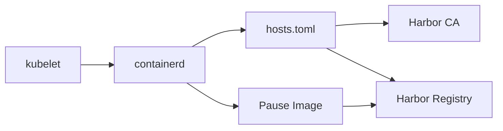
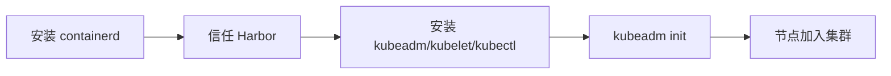

# 第 6 步：让 containerd 信任 Harbor

## 本步目标

让所有 Kubernetes 节点上的 `containerd` 能够以受信任方式访问 `harbor.qytk8s.com`，并把 Pod 沙箱镜像统一切换到本地 Harbor。

本步完成后，应达到下面状态：

- Harbor CA 已分发到所有 Kubernetes 节点
- `/etc/containerd/certs.d/harbor.qytk8s.com/hosts.toml` 已生成
- `config_path` 已指向 `/etc/containerd/certs.d`
- `sandbox_image` 已切换为 `harbor.qytk8s.com/k8s/pause:3.10`
- `containerd` 重启后保持 `active (running)`

这里先做的是“让节点具备从 Harbor 受信任拉取镜像的能力”，不是提前把所有镜像预拉到所有节点。

---

## 执行标记

- **执行标记：必须执行**
- 即使 Harbor 本身已保留并恢复正常，本步仍然必须执行
- 因为前一步只是安装了 `containerd`，并没有让每个 Kubernetes 节点信任 Harbor
- 如果跳过本步，后续 `kubeadm init` 和 Pod 沙箱拉取都可能无法正确从 Harbor 获取镜像

---

## 本步顺序

下面动作默认都在 `ops` 节点上发起：

1. 向 7 台 Kubernetes 节点分发 Harbor CA
2. 在各节点写入 Harbor 对应的 `hosts.toml`
3. 修改 `containerd` 的 `config_path` 与 `sandbox_image`
4. 重启各节点上的 `containerd`
5. 抽查节点配置与服务状态

---

## 问题背景

当前课程的第一章已经完成两项关键准备：

- Harbor 已作为私有镜像仓库提供 HTTPS 入口
- 所有 Kubernetes 节点已经安装 `containerd`

但这还不够。

原因是：

- Harbor 使用的是课程内部 CA 签发的 HTTPS 证书
- `containerd` 默认并不信任这套内部 CA
- `containerd` 默认的 Pod 沙箱镜像也不是 Harbor 中的 `pause:3.10`

因此，如果不继续补这一层配置，后续节点在拉取 Harbor 镜像时会缺少受信任证书链，Pod 沙箱镜像路径也不会统一落到本地仓库。

---

## 理论说明

### 为什么 Harbor CA 必须分发到每个节点

Harbor 当前通过：

- `https://harbor.qytk8s.com`

对外提供服务。

这意味着每个 Kubernetes 节点在拉取镜像时，都会先做 HTTPS 证书校验。

如果节点不信任签发 Harbor 证书的 CA，就会出现下面这类问题：

- TLS 握手失败
- 镜像仓库证书不受信任
- `containerd` 无法完成镜像解析与拉取

所以这里不是“为了让浏览器不报错”才分发 CA，而是为了让节点级容器运行时能建立受信任连接。

### `containerd` 与 Harbor 的关系



这张图说明了本步的 3 个关键点：

- `kubelet` 通过 `containerd` 拉取镜像
- `containerd` 通过 `hosts.toml` 知道如何访问 Harbor
- `hosts.toml` 还会告诉 `containerd` 去哪里找 Harbor 的 CA

### 为什么这里使用 `hosts.toml`

`containerd` 在访问私有仓库时，需要知道下面这些信息：

- 目标仓库地址是什么
- 当前仓库支持哪些能力
- 应该使用哪个 CA 去校验证书

在本课程中，这些信息通过：

- `/etc/containerd/certs.d/harbor.qytk8s.com/hosts.toml`

统一提供。

当前配置中的关键字段如下：

```toml
server = "https://harbor.qytk8s.com"

[host."https://harbor.qytk8s.com"]
  capabilities = ["pull", "resolve"]
  ca = "/etc/containerd/certs.d/harbor.qytk8s.com/ca.crt"
```

关键字段说明：

- `server`
  - 表示这个目录对应的镜像仓库地址
- `capabilities = ["pull", "resolve"]`
  - 表示允许 `containerd` 从该仓库执行镜像解析与拉取
- `ca`
  - 表示校验 Harbor HTTPS 证书时应使用的 CA 证书路径

### 为什么还要修改 `config_path`

仅仅把 `hosts.toml` 放到目录里还不够。

因为 `containerd` 默认未必会去：

- `/etc/containerd/certs.d`

检索仓库配置。

所以还需要在 `/etc/containerd/config.toml` 中明确设置：

```text
config_path = "/etc/containerd/certs.d"
```

这样 `containerd` 才会把：

- Harbor 的 `hosts.toml`
- Harbor 的 `ca.crt`

纳入自己的仓库访问配置。

### 为什么必须修改 `sandbox_image`

`pause` 不是普通业务镜像，它是 Pod 沙箱镜像。

后续只要有 Pod 被创建，节点就会优先尝试拉取：

- `pause`

如果这里仍然保留默认上游地址，会带来两个问题：

- Pod 沙箱创建仍然依赖外部镜像源
- 即使业务镜像都已本地化，最基础的 Pod 启动过程仍未完全本地化

因此必须把：

```text
sandbox_image = "harbor.qytk8s.com/k8s/pause:3.10"
```

写死到 `containerd` 配置中。

### 本步在第一章中的位置

本步是“容器运行时安装完成”与“Kubernetes 工具安装”之间的桥梁步骤。



它的作用是把“能运行容器”推进到“能稳定从本地 Harbor 拉取控制面和 Pod 沙箱镜像”。

---

## 对应脚本

本步对应脚本：

- `k8s/01-k8s-architecture/scripts/06_config_containerd_harbor_remote.sh`

这个脚本默认在 `ops` 节点执行。

这个脚本会完成下面 5 项动作：

1. 从 `ops` 向所有 Kubernetes 节点分发 Harbor CA
2. 创建 Harbor 对应的 `hosts.toml`
3. 把 `config_path` 指向 `/etc/containerd/certs.d`
4. 把 `sandbox_image` 改为 `harbor.qytk8s.com/k8s/pause:3.10`
5. 重启 `containerd`

---

## 脚本内部在做什么

### 目标节点范围

本步固定操作下面 7 台 Kubernetes 节点：

- `cp01`
- `cp02`
- `cp03`
- `wk-app01`
- `wk-app02`
- `wk-edge01`
- `wk-obs01`

### 脚本执行主线

脚本主线可以概括为：

1. 检查 `ops` 本地是否存在 Harbor CA
2. 逐台节点创建 Harbor 证书目录
3. 逐台节点分发 `ca.crt`
4. 逐台节点写入 `hosts.toml`
5. 修改 `config.toml` 中的 `config_path` 与 `sandbox_image`
6. 重启 `containerd` 并打印关键结果

### 关键动作 1：分发 Harbor CA

脚本首先检查本地 CA 是否存在：

```bash
if [[ ! -f "${HARBOR_CA_LOCAL}" ]]; then
  echo "缺少 Harbor CA 证书：${HARBOR_CA_LOCAL}"
  exit 1
fi
```

然后把证书下发到远端：

```bash
mkdir -p /etc/containerd/certs.d/harbor.qytk8s.com
scp ... ca.crt root@node:/etc/containerd/certs.d/harbor.qytk8s.com/ca.crt
```

这一步解决的是“节点是否持有 Harbor 的信任根证书”。

### 关键动作 2：写入 `hosts.toml`

脚本在远端创建：

```toml
server = "https://harbor.qytk8s.com"

[host."https://harbor.qytk8s.com"]
  capabilities = ["pull", "resolve"]
  ca = "/etc/containerd/certs.d/harbor.qytk8s.com/ca.crt"
```

这一步解决的是“containerd 应如何访问 Harbor”。

### 关键动作 3：修改 `config_path`

脚本执行：

```bash
sed -ri 's#config_path = ""#config_path = "/etc/containerd/certs.d"#' /etc/containerd/config.toml
```

这一步解决的是“containerd 是否真的会去读取 `hosts.toml`”。

### 关键动作 4：修改 `sandbox_image`

脚本执行：

```bash
sed -ri 's#sandbox_image = ".*"#sandbox_image = "harbor.qytk8s.com/k8s/pause:3.10"#' /etc/containerd/config.toml
```

这一步解决的是“Pod 沙箱镜像是否统一切换到 Harbor”。

### 关键动作 5：重启 `containerd`

脚本最后执行：

```bash
systemctl restart containerd
```

这一步的意义是让以下配置立即生效：

- Harbor CA 目录引用
- `hosts.toml`
- `config_path`
- `sandbox_image`

---

## 执行命令

下面命令默认在 `ops` 上执行。

先给脚本增加执行权限：

```bash
chmod +x /docker_k8s_2026/k8s/01-k8s-architecture/scripts/06_config_containerd_harbor_remote.sh
```

然后执行：

```bash
bash /docker_k8s_2026/k8s/01-k8s-architecture/scripts/06_config_containerd_harbor_remote.sh
```

---

## 验证方法

建议至少抽查：

- `cp01`
- `wk-app01`

下面命令默认也在 `ops` 上执行。

### 验证 1：检查 Harbor CA 是否存在

```bash
ssh root@cp01 "ls -l /etc/containerd/certs.d/harbor.qytk8s.com/ca.crt"
ssh root@wk-app01 "ls -l /etc/containerd/certs.d/harbor.qytk8s.com/ca.crt"
```

预期结果：

- `ca.crt` 文件存在

### 验证 2：检查 `hosts.toml`

```bash
ssh root@cp01 "cat /etc/containerd/certs.d/harbor.qytk8s.com/hosts.toml"
```

预期结果：

```toml
server = "https://harbor.qytk8s.com"

[host."https://harbor.qytk8s.com"]
  capabilities = ["pull", "resolve"]
  ca = "/etc/containerd/certs.d/harbor.qytk8s.com/ca.crt"
```

关键看点：

- `server` 是否指向 `https://harbor.qytk8s.com`
- `capabilities` 是否包含 `pull` 与 `resolve`
- `ca` 是否指向正确的 Harbor CA 路径

### 验证 3：检查 `config_path` 与 `sandbox_image`

```bash
ssh root@cp01 "grep -n 'config_path' /etc/containerd/config.toml && grep -n 'sandbox_image' /etc/containerd/config.toml"
```

预期结果：

```text
config_path = "/etc/containerd/certs.d"
sandbox_image = "harbor.qytk8s.com/k8s/pause:3.10"
```

关键看点：

- `config_path` 是否已经指向 Harbor 证书目录
- `sandbox_image` 是否已经切换到 Harbor 中的 `pause:3.10`

### 验证 4：检查 `containerd` 服务状态

```bash
ssh root@cp01 "systemctl status containerd --no-pager"
ssh root@wk-app01 "systemctl status containerd --no-pager"
```

预期结果：

- 输出中应包含 `active (running)`

关键看点：

- `Active: active (running)` 表示重启后服务正常
- 这里只关注 `Active` 字段即可

### 验证 5：检查 Harbor 中 `pause` 仓库是否存在

```bash
curl -k -s -u 'admin:Harbor12345' \
  "https://harbor.qytk8s.com/api/v2.0/projects/k8s/repositories?page=1&page_size=20" | jq -r '.[].name'
```

预期结果：

- 输出结果中应包含：

```text
k8s/pause
```

关键看点：

- 只需要确认仓库名列表中存在 `k8s/pause`
- 不需要逐行阅读 Harbor API 返回的完整 JSON

说明：

- 当前步骤尚未要求节点必须已经实际拉取 `pause` 镜像
- 真正的 Pod 沙箱镜像拉取会在后续 `kubeadm init`、节点加入集群以及 Pod 创建过程中自然发生
- 因此这里不使用 `crictl` 作为验证手段

---

## 预期结果

本步执行完成后，节点侧应满足下面这些条件：

- `containerd` 已具备访问 Harbor 的受信任证书链
- Harbor 仓库访问规则已写入 `hosts.toml`
- Pod 沙箱镜像已统一改为 Harbor 版本
- 后续控制面和节点启动会优先走本地 Harbor

---

## 通过标准

满足下面条件即可通过本步：

- 全部 Kubernetes 节点均已存在 Harbor CA 文件
- 全部 Kubernetes 节点均已生成 Harbor 对应的 `hosts.toml`
- 抽查节点上 `config_path = "/etc/containerd/certs.d"`
- 抽查节点上 `sandbox_image = "harbor.qytk8s.com/k8s/pause:3.10"`
- 抽查节点上 `containerd` 服务状态为 `active (running)`

---

## 下一步

下一步进入 Kubernetes 基础工具安装：

- `docs/08_kube_tools.md`
