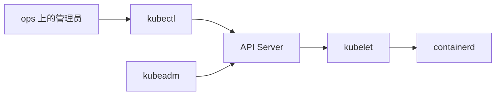
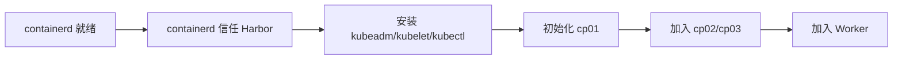

# 第 7 步：安装 kubeadm、kubelet、kubectl

## 本步目标

在所有 Kubernetes 节点上安装固定版本的：

- `kubeadm`
- `kubelet`
- `kubectl`

并在 `ops` 本机安装固定版本的：

- `kubectl`

本步完成后，应达到下面状态：

- `cp01`、`cp02`、`cp03` 已安装 `kubeadm`、`kubelet`、`kubectl`
- `wk-app01`、`wk-app02`、`wk-edge01`、`wk-obs01` 已安装 `kubeadm`、`kubelet`、`kubectl`
- `ops` 已安装 `kubectl`
- 所有节点的 Kubernetes 工具版本统一固定为 `v1.33.9`
- 所有 Kubernetes 节点上的 `kubelet` 已设置为开机自启

## 执行标记

- **执行标记：必须执行**

说明：

- 前两步只解决了容器运行时与 Harbor 信任链问题
- 本步才真正为后续 `kubeadm init`、控制平面加入、工作节点加入准备 Kubernetes 基础工具

## 问题背景

到当前步骤为止，节点已经具备：

- 操作系统基础环境
- 容器运行时 `containerd`
- 访问 Harbor 的受信任配置

但节点还不具备真正参与 Kubernetes 集群初始化的工具。

后续第一章还要完成：

- 初始化第一个控制平面
- 加入额外控制平面
- 加入工作节点
- 在 `ops` 上统一执行 `kubectl`

这些动作都离不开：

- `kubeadm`
- `kubelet`
- `kubectl`

## 理论说明

### 这三个工具分别解决什么问题

#### `kubeadm`

`kubeadm` 负责集群初始化与节点加入。

它主要解决：

- 初始化控制平面
- 生成 join 命令
- 把控制平面节点或工作节点加入现有集群

#### `kubelet`

`kubelet` 是每个 Kubernetes 节点上的核心代理进程。

它主要解决：

- 接收控制平面下发的 Pod 期望状态
- 调用容器运行时创建和管理 Pod
- 向控制平面回报节点与 Pod 状态

#### `kubectl`

`kubectl` 是 Kubernetes 的命令行管理工具。

它主要解决：

- 查询节点、Pod、Deployment、Service 等资源
- 对集群提交声明式配置
- 执行常见运维与验证命令

### 三者之间的关系



这张图表达了本步最重要的边界：

- `kubectl` 负责“管集群”
- `kubeadm` 负责“建集群、加节点”
- `kubelet` 负责“在节点上真正运行 Pod”

### 为什么 `ops` 只安装 `kubectl`

当前课程的单点执行原则是：

- 用户只在 `ops` 节点复制、粘贴、执行命令

因此 `ops` 的职责是：

- 作为统一管理入口
- 负责执行脚本
- 负责后续 `kubectl` 验证与集群运维

`ops` 并不作为 Kubernetes 节点加入集群，所以不需要安装：

- `kubeadm`
- `kubelet`

在 `ops` 上只安装 `kubectl` 即可满足后续课程要求。

### 为什么 Kubernetes 节点必须同时安装三者

在 Kubernetes 节点上：

- `kubeadm` 用于当前章节的初始化与加入动作
- `kubelet` 用于节点长期运行
- `kubectl` 用于在节点本机做辅助排查与验证

也就是说，本课程并不是只安装最小工具，而是统一把节点侧工具集准备完整。

### 为什么必须锁定版本

本课程统一冻结 Kubernetes 版本为：

- `v1.33.9`

在 APT 包层面，本步固定安装：

- `1.33.9-1.1`

这样做的原因是：

- 保证快照恢复后结果一致
- 避免仓库补丁版本漂移
- 避免 `kubeadm`、`kubelet`、`kubectl` 之间版本不一致

如果不锁版本，后续可能出现：

- 节点安装到新版本包
- `kubeadm init` 与课程文档版本不一致
- 二刷时结果不可复现

### 本步在第一章中的位置



本步的作用是把“节点运行容器的基础条件”推进到“节点已经具备 Kubernetes 初始化与加入能力”。

## 对应脚本

本步对应脚本：

- `k8s/01-k8s-architecture/scripts/07_install_kube_tools_remote.sh`

这个脚本会完成两部分工作：

1. 在 `ops` 本机安装固定版本的 `kubectl`
2. 在所有 Kubernetes 节点安装固定版本的 `kubeadm`、`kubelet`、`kubectl`

## 脚本内部在做什么

### 固定版本参数

脚本中已经写死下面这些参数：

- Kubernetes Minor 仓库：`v1.33`
- APT 包版本：`1.33.9-1.1`

这意味着本步不是“装最新版本”，而是“装课程冻结版本”。

### 脚本执行主线

脚本整体分为两段：

1. 先在 `ops` 本机安装 `kubectl`
2. 再逐台远端节点安装 `kubeadm`、`kubelet`、`kubectl`

每台节点上的安装流程固定为：

1. 导入 Kubernetes APT 仓库签名密钥
2. 写入 Kubernetes APT 仓库配置
3. 直接安装固定版本软件包
4. 对软件包执行 `apt-mark hold`

### 关键动作 1：导入仓库密钥

脚本执行：

```bash
mkdir -p /etc/apt/keyrings
curl -fsSL "https://pkgs.k8s.io/core:/stable:/v1.33/deb/Release.key" \
  | gpg --dearmor -o /etc/apt/keyrings/kubernetes-apt-keyring.gpg --yes
```

这一步解决的是：

- 节点能否验证 Kubernetes APT 仓库签名

### 关键动作 2：写入 APT 仓库

脚本会写入：

```text
deb [signed-by=/etc/apt/keyrings/kubernetes-apt-keyring.gpg] https://pkgs.k8s.io/core:/stable:/v1.33/deb/ /
```

这一步解决的是：

- 节点应从哪个固定 Minor 仓库安装 Kubernetes 工具

### 关键动作 3：直接安装并锁定固定版本

脚本会安装：

```bash
apt-get install -y \
  kubelet=1.33.9-1.1 \
  kubeadm=1.33.9-1.1 \
  kubectl=1.33.9-1.1
```

随后执行：

```bash
apt-mark hold kubelet kubeadm kubectl
```

对于 `ops` 本机，则只安装并锁定：

```bash
kubectl=1.33.9-1.1
```

这里不再额外判断“当前候选版本是不是最新课程版本”，而是直接按课程冻结版本安装。

如果未来某一天仓库里已经不存在：

```text
1.33.9-1.1
```

那么 `apt-get install kubeadm=1.33.9-1.1 ...` 会直接失败。

这反而更符合课程目标：

- 课程版本继续锁死为 `v1.33.9`
- 不跟随仓库里的更新补丁自动漂移

### 关键动作 4：启用 `kubelet`

脚本安装完成后会检查：

```bash
systemctl is-enabled kubelet
```

这一步的意义是：

- 即使集群还未初始化，`kubelet` 也应作为节点长期组件提前进入受管状态

## 执行命令

先给脚本增加执行权限：

```bash
chmod +x /docker_k8s_2026/k8s/01-k8s-architecture/scripts/07_install_kube_tools_remote.sh
```

然后执行：

```bash
bash /docker_k8s_2026/k8s/01-k8s-architecture/scripts/07_install_kube_tools_remote.sh
```

## 验证方法

### 验证 1：检查 `ops` 本机的 `kubectl`

```bash
kubectl version --client
```

预期结果：

- 输出中应包含 `v1.33.9`

关键看点：

- 这里只关注 `Client Version` 对应的版本号

### 验证 2：检查控制平面节点工具版本

```bash
ssh root@cp01 "kubeadm version -o short && kubectl version --client && systemctl is-enabled kubelet"
```

预期结果：

- `kubeadm` 输出应为 `v1.33.9`
- `kubectl` 客户端版本应为 `v1.33.9`
- `kubelet` 应返回 `enabled`

关键看点：

- 第一行看 `kubeadm`
- 第二行看 `kubectl`
- 最后一行看 `kubelet` 是否已经设置开机自启

### 验证 3：检查工作节点工具版本

```bash
ssh root@wk-app01 "kubeadm version -o short && kubectl version --client && systemctl is-enabled kubelet"
```

预期结果：

- 与控制平面节点一致

### 验证 4：检查软件包是否已被锁定

```bash
ssh root@cp01 "apt-mark showhold | grep -E 'kubeadm|kubelet|kubectl'"
```

预期结果：

- 输出中应包含：
  - `kubeadm`
  - `kubelet`
  - `kubectl`

说明：

- 这代表版本锁定已经生效

## 预期结果

本步执行完成后，整体应呈现下面状态：

- `ops` 已成为后续统一管理入口
- 所有 Kubernetes 节点都具备初始化与加入集群所需工具
- `kubelet` 已进入受管状态
- 工具版本已固定，不会在后续刷课过程中自动漂移

## 通过标准

满足下面条件即可通过本步：

- `ops` 本机已安装 `kubectl`
- 所有 Kubernetes 节点均已安装 `kubeadm`、`kubelet`、`kubectl`
- 抽查节点工具版本均为 `v1.33.9`
- 抽查节点 `kubelet` 状态为 `enabled`
- 抽查节点已对 `kubeadm`、`kubelet`、`kubectl` 执行 `apt-mark hold`

## 下一步

下一步进入第一个控制平面初始化：

- `docs/09_kubeadm_init.md`
