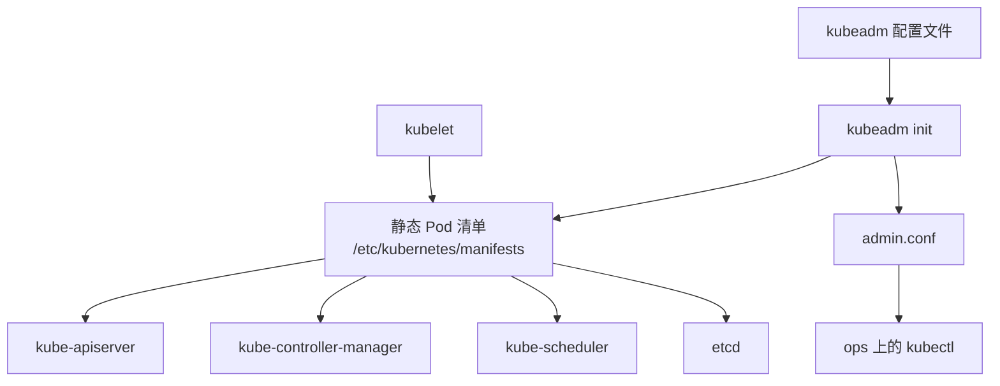
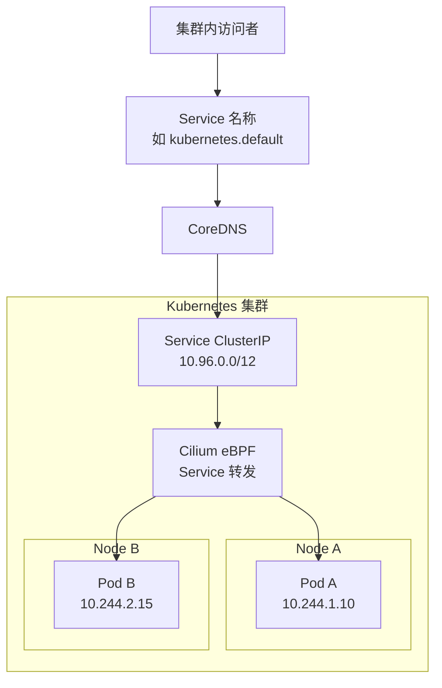
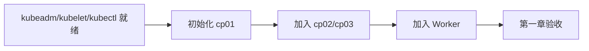

# 第 8 步：初始化第一个控制平面节点

## 本步目标

在 `cp01` 上完成第一台控制平面节点初始化，并把 `ops` 配置为后续统一管理入口。

本步完成后，应达到下面状态：

- `cp01` 已成为集群中的第一个控制平面节点
- 控制平面统一入口固定为 `api.qytk8s.com:6443`
- `cp01` 已生成 `admin.conf`
- `ops` 已拿到可用的 `kubectl` 配置文件
- `cp01` 上已生成后续节点加入所需的 join 命令文件

---

## 执行标记

- **执行标记：必须执行**

说明：

- 本步是第一章真正意义上的“集群诞生点”
- 前面的步骤只是在准备运行时、仓库、入口和工具链
- 从本步开始，控制平面对象会第一次在 `cp01` 上正式生成

---

## 本步顺序

下面动作默认都在 `ops` 节点上发起：

1. 让 `cp01` 下载 `kubeadm` 初始化配置文件
2. 在 `cp01` 执行 `kubeadm init`
3. 在 `cp01` 生成本机可用的 `kubectl` 配置
4. 在 `cp01` 生成 Worker 与控制平面 join 命令文件
5. 把 `admin.conf` 拷回 `ops`
6. 在 `ops` 验证 `kubectl`

---

## 问题背景

到当前步骤为止，已经完成了下面这些基础准备：

- 操作系统初始化
- Harbor 与核心镜像准备
- `api.qytk8s.com:6443` 的 VIP 高可用入口
- `containerd` 安装与 Harbor 信任
- `kubeadm`、`kubelet`、`kubectl` 安装

这些步骤解决的是“节点是否具备成为 Kubernetes 集群成员的前提条件”。

但它们还没有真正创建出集群本身。

`kubeadm init` 这一动作负责完成下面这件关键事情：

- 在 `cp01` 上生成第一个控制平面

也就是说，本步之后才会第一次出现：

- `API Server`
- `Controller Manager`
- `Scheduler`
- `etcd`
- 集群管理员 kubeconfig

---

## 理论说明

### 经典的四个控制平面组件

从本步开始，下面这 4 个经典组件会第一次真正出现在 `cp01` 上。

#### `kube-apiserver`

原文：

> The API server is a component of the Kubernetes control plane that exposes the Kubernetes API. The API server is the front end for the Kubernetes control plane.

翻译：

- `kube-apiserver` 是 Kubernetes 控制平面中对外暴露 Kubernetes API 的组件
- 它是整个控制平面的前端入口

你可以先把它粗略理解为：

- 控制平面的“接待员”
- 几乎所有管理操作，都会先到 `kube-apiserver`

#### `etcd`

原文：

> Consistent and highly-available key value store used as Kubernetes' backing store for all cluster data.

翻译：

- `etcd` 是一个具备一致性和高可用能力的键值数据库
- 它是 Kubernetes 保存集群全部关键数据的后端存储

你可以先把它粗略理解为：

- Kubernetes 的“数据库”
- 集群对象、状态、配置，最终都要落到 `etcd`

#### `kube-scheduler`

原文：

> Control plane component that watches for newly created Pods with no assigned node, and selects a node for them to run on.

翻译：

- `kube-scheduler` 会持续观察那些新创建但还没有分配到节点的 Pod
- 然后为这些 Pod 选择一个合适的节点，并完成调度绑定

你可以先把它粗略理解为：

- “分配员”
- 它负责决定一个 Pod 最终应该落到哪台 Node

#### `kube-controller-manager`

原文：

> Control Plane component that runs controller processes.
>
> Logically, each controller is a separate process, but to reduce complexity, they are all compiled into a single binary and run in a single process.

翻译：

- `kube-controller-manager` 是负责运行各类控制器进程的控制平面组件
- 从逻辑上看，每个控制器都像是一个独立进程
- 但为了降低复杂度，它们被编译进同一个二进制，并运行在同一个进程中

常见控制器示例：

- `Node controller`
  - 关注节点状态，发现节点掉线后作出响应
- `Replication controller`
  - 维护系统中副本对象的期望 Pod 数量
- `Endpoints controller`
  - 填充 `Endpoints` 对象，把 `Service` 和后端 `Pod` 关联起来
- `Service Account & Token controllers`
  - 为新命名空间创建默认服务账户和 API 访问令牌

你可以先把它粗略理解为：

- “管理者”
- 它持续把集群实际状态往期望状态拉齐

### `kubeadm init` 到底在做什么

`kubeadm init` 不是单纯执行一条“安装命令”，而是在当前节点上完成第一套控制平面初始化。

它会完成的典型动作包括：

- 生成集群证书与密钥
- 生成控制面静态 Pod 清单
- 启动 `API Server`、`Controller Manager`、`Scheduler`
- 初始化本地 `etcd`
- 生成 `admin.conf`
- 生成后续节点加入集群所需的 token 与 join 命令

### 控制平面初始化关系图



这张图说明：

- `kubeadm` 负责生成控制面配置与静态 Pod 清单
- `kubelet` 负责根据这些静态 Pod 清单把控制面真正拉起来
- `admin.conf` 则是后续 `kubectl` 管理集群的入口凭据

### 为什么必须从第一台控制平面开始就使用 `api.qytk8s.com`

本课程要搭建的是：

- `cp01`
- `cp02`
- `cp03`

三控制平面高可用架构。

因此，从第一台控制平面初始化开始，就必须把统一入口固定为：

- `api.qytk8s.com:6443`

如果这里直接使用某一台控制平面的真实 IP，后续扩展高可用时就会出现入口切换问题。

也就是说，本步初始化的不是“只属于 `cp01` 的集群”，而是“未来三控制平面集群的第一块基础”。

### 为什么这里使用 kubeadm 配置文件

当前课程不使用超长单行命令，而是固定使用配置文件：

- `manifests/kubeadm-init-cp01.yaml`

这样做的优点是：

- 参数集中，便于审阅
- 关键设计项可直接固化在 Git 中
- 后续二刷时，配置来源稳定

当前最关键的字段包括：

- `advertiseAddress`
- `bindPort`
- `kubernetesVersion`
- `controlPlaneEndpoint`
- `imageRepository`
- `serviceSubnet`
- `podSubnet`
- `dnsDomain`
- `certSANs`
- `criSocket`
- `cgroupDriver`

### 本步配置文件关键字段示意

配置文件中的关键字段如下：

```yaml
apiVersion: kubeadm.k8s.io/v1beta4
kind: InitConfiguration
localAPIEndpoint:
  advertiseAddress: 10.1.1.101
  bindPort: 6443
nodeRegistration:
  criSocket: unix:///run/containerd/containerd.sock
  name: cp01
---
apiVersion: kubeadm.k8s.io/v1beta4
kind: ClusterConfiguration
kubernetesVersion: v1.33.9
controlPlaneEndpoint: api.qytk8s.com:6443
imageRepository: harbor.qytk8s.com/k8s
networking:
  serviceSubnet: 10.96.0.0/12
  podSubnet: 10.244.0.0/16
  dnsDomain: cluster.local
apiServer:
  certSANs:
    - api.qytk8s.com
    - 10.1.1.10
    - cp01
    - cp02
    - cp03
```

关键字段说明：

- `advertiseAddress`
  - 固定 `cp01` 本机对外通告的 API Server 地址
- `bindPort`
  - 固定 API Server 监听端口为 `6443`
- `kubernetesVersion`
  - 固定控制平面版本为 `v1.33.9`
- `controlPlaneEndpoint`
  - 固定整个控制平面的统一入口
- `imageRepository`
  - 让 `kubeadm` 从 Harbor 获取控制面镜像
- `serviceSubnet`
  - 固定 Service 网段
- `podSubnet`
  - 固定后续 Pod 网段
- `dnsDomain`
  - 固定集群内部 DNS 域为 `cluster.local`
- `certSANs`
  - 让 API Server 证书同时覆盖域名、VIP 和控制平面节点名
- `criSocket`
  - 固定 `kubeadm` 对接的容器运行时套接字

同一份配置文件中还定义了：

```yaml
apiVersion: kubelet.config.k8s.io/v1beta1
kind: KubeletConfiguration
cgroupDriver: systemd
```

这表示：

- 本课程明确让 `kubeadm` 通过 `containerd` 作为容器运行时
- `kubelet` 继续固定使用 `systemd` 作为 cgroup 驱动

这里可以先做一个很简单的理解：

- `serviceSubnet = 10.96.0.0/12`
  - 这是集群里 `Service` 使用的虚拟地址段
  - 例如 `kubernetes.default` 这种 Service，拿到的就是这个网段里的虚拟 IP
- `podSubnet = 10.244.0.0/16`
  - 这是后续 Pod 使用的地址段
  - CNI 安装完成后，Pod 之间通信会基于这个网段展开

下面这张图描述的是“网络平面补齐之后”的完整访问关系，用来帮助理解这两个网段各自承担什么角色。



这张图想表达的是：

- 集群内通常先通过 `CoreDNS` 把 `Service` 名称解析成 `ClusterIP`
- `Service` 拿到的是 `serviceSubnet` 里的虚拟 IP
- 后端真正运行的是 `podSubnet` 里的 Pod IP
- 访问路径通常是“先访问 Service，再由 Service 转到后端 Pod”
- 在这套课程主线里，`Service -> Pod` 这段转发能力由 `Cilium eBPF` 提供

### `advertiseAddress` 和 `controlPlaneEndpoint` 不要混淆

这两个字段都和 API Server 有关，但职责不同：

- `advertiseAddress = 10.1.1.101`
  - 表示 `cp01` 这台控制平面节点，对外通告自己的真实地址
- `controlPlaneEndpoint = api.qytk8s.com:6443`
  - 表示整个控制平面对外统一使用的访问入口

可以简单理解为：

- `advertiseAddress` 是“这台机器自己是谁”
- `controlPlaneEndpoint` 是“整个控制平面统一从哪里进”

### 为什么本步完成后节点通常仍是 `NotReady`

这是本页最容易让人误判的地方。

本步完成后，`cp01` 通常已经出现在节点列表中，但状态多半仍然是：

- `NotReady`

这并不代表 `kubeadm init` 失败。

原因是：

- 当前第一章还没有安装 CNI
- 没有 CNI，节点网络插件尚未就绪
- 没有 CNI，`CoreDNS` 往往也不会进入正常运行状态

所以本步的标准现象应理解为：

- 控制平面初始化成功
- 但节点网络仍未完成

### 本步在第一章中的位置



本步是后续控制平面扩展和 Worker 加入的前提。

---

## 对应脚本

本步对应脚本：

- `k8s/01-k8s-architecture/scripts/08_kubeadm_init_remote.sh`

本步使用的配置文件：

- `k8s/01-k8s-architecture/manifests/kubeadm-init-cp01.yaml`

HTTP 发布地址：

- `http://ops:9000/01-k8s-architecture/manifests/kubeadm-init-cp01.yaml`

下面脚本默认在 `ops` 上执行。

---

## 脚本内部在做什么

### 脚本执行主线

脚本整体分为 4 个阶段：

1. 让 `cp01` 从 `ops` 下载 `kubeadm` 初始化配置文件
2. 在 `cp01` 执行初始化，包括 `kubeadm init`、本机 `kubectl` 配置、join 命令生成
3. 将 `admin.conf` 拷回 `ops`
4. 在 `ops` 立即验证 `kubectl`

### 关键动作 1：下发配置文件

脚本执行：

```bash
ssh root@cp01 "curl -fsSL http://ops:9000/01-k8s-architecture/manifests/kubeadm-init-cp01.yaml -o /root/kubeadm-init.yaml"
```

这一步解决的是：

- `cp01` 直接从 `ops` 获取课程冻结配置

### 关键动作 2：执行 `kubeadm init`

脚本在 `cp01` 上执行：

```bash
if [[ -f /etc/kubernetes/admin.conf ]]; then
  kubeadm reset -f
  rm -rf /etc/cni/net.d /etc/kubernetes /var/lib/etcd /root/.kube
fi

kubeadm init \
  --config /root/kubeadm-init.yaml \
  --upload-certs
```

这一步是整个第一章最核心的初始化动作。

其中：

- `--config`
  - 表示使用固定配置文件
- `--upload-certs`
  - 表示为后续控制平面加入准备证书分发基础

同时要注意：

- 如果 `cp01` 上已经存在旧的初始化结果，脚本会先执行 `kubeadm reset -f`
- 并清理 `/etc/cni/net.d`、`/etc/kubernetes`、`/var/lib/etcd`、`/root/.kube`
- 也就是说，这个脚本天然适合“重刷第一台控制平面”的场景

### 关键动作 3：配置 `cp01` 本机 kubectl

脚本执行：

```bash
mkdir -p /root/.kube
cp /etc/kubernetes/admin.conf /root/.kube/config
chmod 600 /root/.kube/config
```

这一步解决的是：

- 在 `cp01` 本机直接执行 `kubectl` 时，能够以管理员身份访问集群

### 关键动作 4：生成 join 命令文件

脚本会在 `cp01` 上生成两个文件：

- `/root/kubeadm-join-worker.sh`
- `/root/kubeadm-join-control-plane.sh`

这两个文件分别用于：

- 后续 Worker 节点加入
- 后续额外控制平面节点加入

### 关键动作 5：把 `admin.conf` 拷回 `ops`

脚本执行：

```bash
scp root@cp01:/etc/kubernetes/admin.conf /root/.kube/config
```

这一步非常关键，因为后续课程默认都在 `ops` 上执行 `kubectl`。

也就是说，本步不仅初始化了 `cp01`，还同时建立了：

- `ops -> 集群` 的统一管理入口

---

## 执行命令

下面命令默认在 `ops` 上执行。

先给脚本增加执行权限：

```bash
chmod +x /docker_k8s_2026/k8s/01-k8s-architecture/scripts/08_kubeadm_init_remote.sh
```

然后执行：

```bash
bash /docker_k8s_2026/k8s/01-k8s-architecture/scripts/08_kubeadm_init_remote.sh
```

---

## 验证方法

下面命令默认也在 `ops` 上执行。

### 验证 1：在 `cp01` 上检查节点列表

```bash
ssh root@cp01 "kubectl get nodes -o wide"
```

预期结果：

- 能看到 `cp01`
- `ROLES` 中应包含 `control-plane`
- 当前状态通常为 `NotReady`

关键看点：

- `NAME` 是否出现 `cp01`
- `ROLES` 是否为控制平面
- `STATUS` 为 `NotReady` 在当前步骤属于标准现象

### 验证 2：在 `ops` 上检查 kubectl

```bash
kubectl get nodes -o wide
```

预期结果：

- 在 `ops` 上也能看到 `cp01`

这说明：

- `admin.conf` 已成功拷回 `ops`
- 后续可以继续在 `ops` 上统一管理集群

### 验证 3：检查 join 命令文件

```bash
ssh root@cp01 "ls -l /root/kubeadm-join-worker.sh /root/kubeadm-join-control-plane.sh"
```

预期结果：

- 两个文件都存在

### 验证 4：检查 kube-system 中的核心 Pod

```bash
ssh root@cp01 "kubectl get pods -n kube-system -o wide"
```

预期结果：

- 能看到与控制面相关的核心 Pod，例如：
  - `kube-apiserver-cp01`
  - `kube-controller-manager-cp01`
  - `kube-scheduler-cp01`
  - `etcd-cp01`

关键看点：

- `kube-apiserver`
- `kube-controller-manager`
- `kube-scheduler`
- `etcd`

说明：

- 此时 `coredns` 可能尚未正常运行
- 这是因为第一章尚未安装 CNI，属于标准现象

---

## 预期结果

本步执行完成后，第一台控制平面已经存在，整体应呈现下面状态：

- `cp01` 已成为控制平面节点
- `ops` 已能使用 `kubectl`
- 后续控制平面加入命令和 Worker 加入命令已生成
- 当前节点整体可能仍为 `NotReady`
- `CoreDNS` 可能尚未正常运行

这些现象在第一章当前阶段都属于标准结果。

---

## 通过标准

满足下面条件即可通过本步：

- `cp01` 已成功完成 `kubeadm init`
- `ops` 上已经可用 `kubectl`
- `cp01` 已出现在节点列表中
- `/root/kubeadm-join-worker.sh` 已生成
- `/root/kubeadm-join-control-plane.sh` 已生成
- `kube-system` 中已出现 `kube-apiserver`、`controller-manager`、`scheduler`、`etcd` 对应核心 Pod

---

## 下一步

下一步进入额外控制平面节点加入：

- `docs/10_join_control_planes.md`
