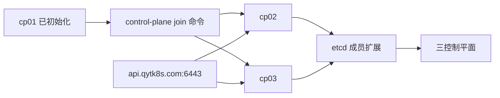
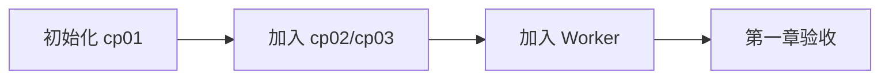

# 第 9 步：加入额外控制平面节点

## 本步目标

把 `cp02` 和 `cp03` 加入当前集群，使控制平面从单节点扩展为三节点高可用架构。

本步完成后，应达到下面状态：

- `cp01`、`cp02`、`cp03` 都已经加入集群
- 三台节点都具备 `control-plane` 角色
- 控制平面统一入口仍然是 `api.qytk8s.com:6443`
- 后续客户端和自动化脚本都继续通过同一个统一入口访问控制平面

## 执行标记

- **执行标记：必须执行**

说明：

- 本步是第一章高可用控制平面建设的第二阶段
- 如果只停留在 `cp01`，当前集群仍然只是“单控制平面起点”
- 完成本步后，课程中设计的三控制平面架构才真正成立

## 问题背景

在上一步中，`cp01` 已经完成了第一台控制平面初始化。

此时已经具备：

- 控制平面统一入口 `api.qytk8s.com:6443`
- 控制面组件运行基础
- `admin.conf`
- Worker 和控制平面 join 命令文件

但当前仍然只有一台控制平面节点。

这意味着：

- 控制平面仍存在单点
- 控制面高可用还没有真正形成
- 后续任何“多控制平面”相关教学都没有真实承载基础

因此还需要把：

- `cp02`
- `cp03`

继续加入现有集群。

## 理论说明

### 为什么控制平面加入和 Worker 加入不是一回事

Worker 节点加入集群时，主要是为了成为业务工作负载承载节点。

而控制平面节点加入时，不只是“加一个节点”这么简单，还要同时补齐控制面能力。

控制平面节点加入后，通常会具备：

- `API Server`
- `Controller Manager`
- `Scheduler`
- 对应控制面证书
- `etcd` 成员配置

因此，控制平面加入的语义比 Worker 节点加入更重。

### 控制平面加入关系图



这张图说明：

- join 命令由 `cp01` 提供
- `cp02`、`cp03` 都通过统一入口加入
- 加入后不仅扩展节点数量，也扩展控制平面和 `etcd` 成员体系

### 为什么这里必须使用 control-plane join 命令

控制平面节点加入时，必须使用带下面参数的 join 命令：

- `--control-plane`
- `--certificate-key`

原因是控制平面节点除了加入集群之外，还需要额外获得：

- 控制面证书
- API Server 相关配置
- Scheduler / Controller Manager 相关配置
- `etcd` 成员相关配置

如果缺少这两个关键参数，节点即使加入，也不会成为完整控制平面。

### 为什么统一入口仍然必须保持不变

在整个三控制平面加入过程中，客户端与节点加入入口都应继续保持为：

- `api.qytk8s.com:6443`

这代表：

- 即使控制平面成员扩展，入口模型也不发生变化
- 负载均衡和 VIP 这一层在前面已经设计完成
- 后续所有控制面访问都继续依赖前面建立的统一入口

### 本步结束后为什么节点仍可能是 `NotReady`

这一步完成后，`cp02`、`cp03` 会出现在节点列表中，但当前节点状态仍可能是：

- `NotReady`

这同样属于标准现象。

原因不是控制平面加入失败，而是：

- 第一章仍然尚未安装 CNI
- 没有 CNI，节点网络还未完成

因此本步判断成功与否时，重点应看：

- 节点是否已加入
- `control-plane` 角色是否存在

而不是把 `Ready` 作为当前阶段唯一标准。

### 本步在第一章中的位置



本步是“单控制平面起点”向“三控制平面高可用架构”演进的关键步骤。

## 对应脚本

本步对应脚本：

- `k8s/01-k8s-architecture/scripts/09_join_control_planes_remote.sh`

这个脚本会完成下面 3 项动作：

1. 从 `cp01` 读取控制平面 join 命令
2. 依次在 `cp02`、`cp03` 上执行加入
3. 在 `ops` 上查看当前节点列表

## 脚本内部在做什么

### 脚本执行主线

脚本整体主线非常清晰：

1. 从 `cp01` 读取 `/root/kubeadm-join-control-plane.sh`
2. 依次处理 `cp02`
3. 依次处理 `cp03`
4. 在 `ops` 上执行 `kubectl get nodes -o wide`

### 关键动作 1：读取 join 命令

脚本执行：

```bash
ssh root@cp01 'cat /root/kubeadm-join-control-plane.sh'
```

这一步解决的是：

- 后续控制平面节点加入使用同一份已生成的标准 join 命令

### 关键动作 2：对目标节点做预清理

如果目标节点上已经存在旧的 Kubernetes 配置，脚本会先执行：

```bash
kubeadm reset -f
rm -rf /etc/cni/net.d /etc/kubernetes /var/lib/etcd /root/.kube
```

这一步的意义是：

- 避免节点保留旧初始化残留
- 让本次控制平面加入在干净状态下进行

### 关键动作 3：执行 control-plane join

脚本在 `cp02`、`cp03` 上分别执行从 `cp01` 读取到的 join 命令。

这一步的核心意义是：

- 让两台节点加入当前集群
- 同时把它们扩展为控制平面节点

### 关键动作 4：在 `ops` 上验证当前节点列表

脚本最后执行：

```bash
kubectl get nodes -o wide
```

这一步用于在统一管理入口确认：

- `cp02`
- `cp03`

都已经出现在集群中。

## 执行命令

先给脚本增加执行权限：

```bash
chmod +x /docker_k8s_2026/k8s/01-k8s-architecture/scripts/09_join_control_planes_remote.sh
```

然后执行：

```bash
bash /docker_k8s_2026/k8s/01-k8s-architecture/scripts/09_join_control_planes_remote.sh
```

## 验证方法

### 验证 1：查看节点列表

```bash
kubectl get nodes -o wide
```

预期结果：

- 能看到：
  - `cp01`
  - `cp02`
  - `cp03`

关键看点：

- 三台控制平面节点是否都已出现
- 当前 `STATUS` 仍可能是 `NotReady`

### 验证 2：查看控制平面角色

```bash
kubectl get nodes
```

预期结果：

- `ROLES` 一列中，`cp01`、`cp02`、`cp03` 都应显示 `control-plane`

关键看点：

- 不需要把焦点放在节点 IP 等次要字段
- 这一页最重要的是“控制平面角色是否已建立”

### 验证 3：查看控制面标签

```bash
kubectl get nodes --show-labels | grep 'node-role.kubernetes.io/control-plane'
```

预期结果：

- 三台控制平面节点都应带有：

```text
node-role.kubernetes.io/control-plane
```

### 验证 4：查看 `kube-system` 中控制面 Pod 分布

```bash
kubectl get pods -n kube-system -o wide
```

预期结果：

- `cp02`、`cp03` 加入后，应能看到对应节点上的控制面 Pod，例如：
  - `kube-apiserver-cp02`
  - `kube-controller-manager-cp02`
  - `kube-scheduler-cp02`
  - `etcd-cp02`
  - `kube-apiserver-cp03`
  - `kube-controller-manager-cp03`
  - `kube-scheduler-cp03`
  - `etcd-cp03`

关键看点：

- 控制面静态 Pod 是否已经扩展到新节点
- 当前 `coredns` 或节点状态仍可能未完全就绪，这不影响本步结论

## 预期结果

本步执行完成后，控制平面整体应呈现下面状态：

- 三台控制平面节点都已加入集群
- 控制平面角色已扩展完成
- 高可用控制平面的基础架构已经成型
- 后续 Worker 节点将继续加入这个统一控制平面

## 通过标准

满足下面条件即可通过本步：

- `cp02` 已加入集群
- `cp03` 已加入集群
- 节点列表中已出现三台控制平面节点
- 三台节点都具备 `control-plane` 角色
- `kube-system` 中已能看到 `cp02`、`cp03` 对应的控制面核心 Pod

## 下一步

下一步进入 Worker 节点加入：

- `docs/11_join_workers.md`
