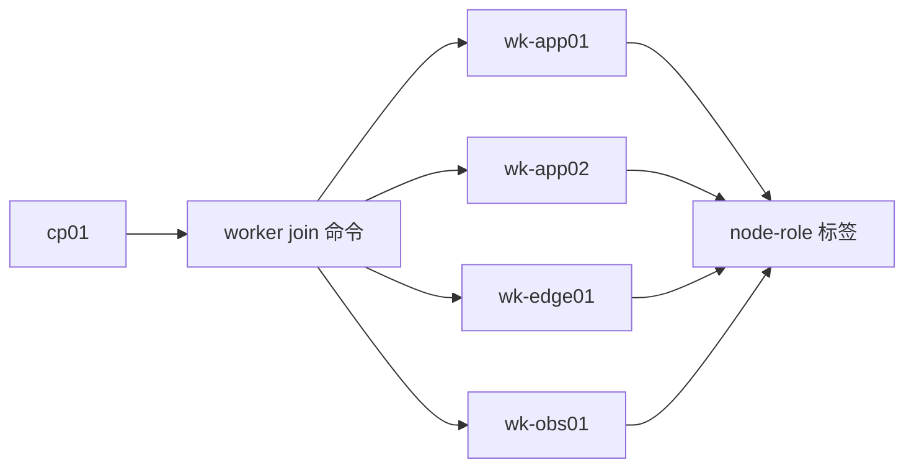
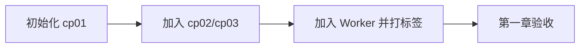

# 第 10 步：加入 Worker 节点

## 本步目标

把 4 台 Worker 节点加入当前集群，并提前写入后续章节会使用的角色标签。

本步完成后，应达到下面状态：

- `wk-app01`
- `wk-app02`
- `wk-edge01`
- `wk-obs01`

都已经加入集群。

同时，4 台 Worker 节点应带有下面标签：

- `wk-app01` -> `node-role=app`
- `wk-app02` -> `node-role=app`
- `wk-edge01` -> `node-role=edge`
- `wk-obs01` -> `node-role=observability`

## 执行标记

- **执行标记：必须执行**

说明：

- 本步完成后，第一章规划中的 `3 控制平面 + 4 Worker` 拓扑才完整落地
- 节点标签也是后续章节调度、发布与观测规划的重要基础，不是附属动作

## 问题背景

上一步已经完成：

- `cp01`
- `cp02`
- `cp03`

三台控制平面节点加入集群。

这意味着控制平面高可用基础已经建立，但当前集群仍缺少真正承载后续业务与平台组件的 Worker 节点。

后续章节还会依赖下面这些节点职责：

- `wk-app01`、`wk-app02` 承载业务应用
- `wk-edge01` 承载入口组件
- `wk-obs01` 承载可观测性组件

因此，本步不仅要完成 Worker 加入，还要把这些节点职责提前固化成标签。

## 理论说明

### Worker 节点在集群中的作用

Worker 节点的主要职责是承载工作负载。

在本课程中，后续会放到 Worker 节点上的典型组件包括：

- 业务 Pod
- 网关入口组件
- 可观测性组件
- 存储相关工作负载

也就是说：

- 控制平面负责管理集群
- Worker 负责承载集群中的大部分实际业务工作负载

### Worker join 和 control-plane join 的区别

Worker 节点加入时，不需要扩展控制面组件，也不需要额外接收控制平面证书。

因此 Worker join 相比控制平面 join 更轻量。

它的核心目标是：

- 让节点成为可调度工作负载的集群成员

而不是扩展控制面。

### 为什么本步就要提前打标签

当前课程并不是把节点加入后再临时决定用途，而是在课程设计层面已经预先规划了节点职责。

这 4 台 Worker 的角色分别是：

- `wk-app01`、`wk-app02`
  - 业务应用承载节点
- `wk-edge01`
  - 北向入口组件承载节点
- `wk-obs01`
  - 可观测性组件承载节点

因此这里提前打标签，意义在于：

- 把后续调度逻辑前置固化
- 让课程中的节点角色从第一章开始就具有一致性
- 避免后续章节再重复做“节点职责初始化”

### Worker 加入与标签关系图



这张图说明：

- Worker join 命令由 `cp01` 提供
- 4 台 Worker 依次加入现有集群
- 加入完成后，节点角色通过标签显式写入集群对象

### 为什么现在节点仍可能不是 `Ready`

本步完成后，Worker 节点虽然已经加入集群，但状态仍可能是：

- `NotReady`

这属于当前阶段的标准现象。

原因仍然是：

- 第一章还没有安装 CNI
- 没有 CNI，节点网络插件尚未就绪

因此本步的判断重点应放在：

- 节点是否已加入
- 标签是否已写入

而不是是否已经 `Ready`

### 本步在第一章中的位置



本步完成后，第一章规划的节点拓扑与基础角色划分才算全部到位。

## 对应脚本

本步对应脚本：

- `k8s/01-k8s-architecture/scripts/10_join_workers_remote.sh`

这个脚本会完成下面 3 项动作：

1. 从 `cp01` 读取 Worker join 命令
2. 依次让 4 台 Worker 节点加入集群
3. 在 `ops` 上通过 `kubectl label node` 给节点写入角色标签

## 脚本内部在做什么

### 脚本执行主线

脚本整体分为 3 个阶段：

1. 依次处理 4 台 Worker 节点加入
2. 对 4 台 Worker 节点打标签
3. 在 `ops` 上查看完整节点列表与标签

### 关键动作 1：读取 Worker join 命令

脚本执行：

```bash
ssh root@cp01 'cat /root/kubeadm-join-worker.sh'
```

这一步解决的是：

- 让所有 Worker 使用同一份标准 join 命令加入现有集群

### 关键动作 2：对目标节点做预清理

如果目标节点上已存在旧的 Kubernetes 配置，脚本会先执行：

```bash
kubeadm reset -f
rm -rf /etc/cni/net.d /etc/kubernetes /var/lib/etcd /root/.kube
```

这一步的作用是：

- 避免旧残留影响本次加入
- 让 Worker 以标准状态重新加入

### 关键动作 3：执行 Worker join

脚本会依次在下面节点上执行加入：

- `wk-app01`
- `wk-app02`
- `wk-edge01`
- `wk-obs01`

这一步完成后，4 台节点都会出现在集群节点列表中。

### 关键动作 4：写入角色标签

脚本会在 `ops` 上执行：

```bash
kubectl label node wk-app01 node-role=app --overwrite
kubectl label node wk-app02 node-role=app --overwrite
kubectl label node wk-edge01 node-role=edge --overwrite
kubectl label node wk-obs01 node-role=observability --overwrite
```

这一步把节点职责显式写入集群对象中。

## 执行命令

先给脚本增加执行权限：

```bash
chmod +x /docker_k8s_2026/k8s/01-k8s-architecture/scripts/10_join_workers_remote.sh
```

然后执行：

```bash
bash /docker_k8s_2026/k8s/01-k8s-architecture/scripts/10_join_workers_remote.sh
```

## 验证方法

### 验证 1：查看完整节点列表

```bash
kubectl get nodes -o wide
```

预期结果：

- 节点列表中应能看到 7 台 Kubernetes 节点：
  - `cp01`
  - `cp02`
  - `cp03`
  - `wk-app01`
  - `wk-app02`
  - `wk-edge01`
  - `wk-obs01`

关键看点：

- 4 台 Worker 是否已全部出现
- 当前 `STATUS` 仍可能为 `NotReady`

### 验证 2：查看标签

```bash
kubectl get nodes --show-labels | grep 'node-role='
```

预期结果：

- `wk-app01`、`wk-app02` 应带有 `node-role=app`
- `wk-edge01` 应带有 `node-role=edge`
- `wk-obs01` 应带有 `node-role=observability`

关键看点：

- 只关注 4 台 Worker 的自定义标签是否正确

### 验证 3：查看节点角色分布

```bash
kubectl get nodes
```

预期结果：

- `cp01`、`cp02`、`cp03` 的 `ROLES` 应为 `control-plane`
- 4 台 Worker 的 `ROLES` 通常显示为 `<none>`

说明：

- 这里的课程角色是通过自定义标签 `node-role=*` 来表达
- Worker 的 Kubernetes 原生 `ROLES` 一列仍可能显示为 `<none>`

## 预期结果

本步执行完成后，集群整体应呈现下面状态：

- `3 控制平面 + 4 Worker` 拓扑已经完整
- Worker 节点已具备后续工作负载承载基础
- 节点课程角色标签已提前准备好
- 第一章的节点规划与职责划分已经全部落地

## 通过标准

满足下面条件即可通过本步：

- 4 台 Worker 已加入集群
- 节点列表中已出现全部 7 台 Kubernetes 节点
- 4 台 Worker 的 `node-role=*` 标签已正确写入
- 已能区分控制平面节点与 Worker 节点的角色分工

## 下一步

下一步进入第一章总验收：

- `docs/12_verify.md`
