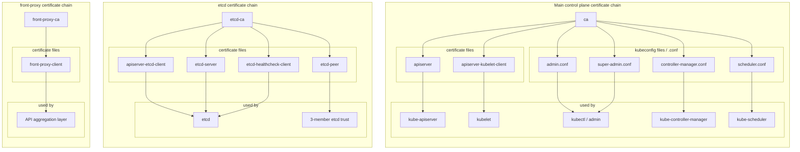

# 第 11 步：Kubernetes 集群证书说明与续期方法

## 本步目标

在第一章基础架构已经完成后，补齐一层经常被忽略但非常重要的运维认知：

- Kubernetes 控制平面证书分成哪些类型
- 这些证书默认有效期大致是多少
- 当前集群应该如何查看证书剩余时间
- 后续如果证书临近到期，应该如何续期

这一页用于把第一章控制平面证书的查看与续期方法真正测试一遍。

---

## 执行标记

- **执行标记：测试与验证**

说明：

- 本步不是为了新增基础组件
- 而是要在第一章结束后，实际查看一次控制平面证书状态
- 如有需要，也可以现场执行一次续期测试
- 这一页没有新增脚本，直接在控制平面节点执行 `kubeadm` 相关命令即可

---

## 问题背景

到第 11 步结束时，第一章已经完成：

- `Harbor`
- `lb01/lb02 + VIP`
- `3` 台控制平面
- `4` 台 Worker

但 Kubernetes 还有一层很关键的隐性基础设施：

- 控制平面证书
- `etcd` 证书
- 聚合代理相关证书
- 管理员访问 kubeconfig 里的客户端证书

这些证书不会在第一章安装当天暴露问题，但如果完全不了解它们的有效期和续期方式，后面会影响：

- `kubectl` 管理
- API Server 到 `etcd` 的通信
- 控制平面组件互信
- 多控制平面长期运行

---

## 理论说明

### Kubernetes 证书大致分两类

#### 第 1 类：普通控制平面证书

典型包括：

- `apiserver`
- `apiserver-etcd-client`
- `apiserver-kubelet-client`
- `front-proxy-client`
- `etcd-server`
- `etcd-peer`
- `etcd-healthcheck-client`
- `admin.conf`
- `controller-manager.conf`
- `scheduler.conf`

这类证书的特点是：

- 用来建立组件之间的 TLS 信任
- 通常有效期比 CA 更短
- 后续日常维护主要关注它们

更直观地看，这一类就是 `kubeadm certs check-expiration` 输出表格上半部分的内容：

- `admin.conf`
- `apiserver`
- `apiserver-etcd-client`
- `apiserver-kubelet-client`
- `controller-manager.conf`
- `etcd-healthcheck-client`
- `etcd-peer`
- `etcd-server`
- `front-proxy-client`
- `scheduler.conf`
- `super-admin.conf`

#### 第 2 类：CA 证书

典型包括：

- `ca`
- `etcd-ca`
- `front-proxy-ca`

这类证书的特点是：

- 它们是签发其他证书的根
- 有效期通常更长
- 不会像普通叶子证书那样频繁续期

更直观地看，这一类就是 `kubeadm certs check-expiration` 输出表格下半部分的内容：

- `ca`
- `etcd-ca`
- `front-proxy-ca`

### 控制平面证书全景图

下面这张图改成“纵向三条证书链”，避免横向铺得太宽。



这张图想表达的是：

- `ca` 主要负责签发 Kubernetes 主控制面这条信任链
- `etcd-ca` 主要负责签发 `etcd` 相关信任链
- `front-proxy-ca` 主要负责签发 `front-proxy` 这条信任链
- `apiserver` 是 API Server 对外服务端证书
- `apiserver-kubelet-client` 是 API Server 访问 `kubelet` 时使用的客户端证书
- `apiserver-etcd-client` 是 API Server 访问 `etcd` 时使用的客户端证书
- `etcd-server`、`etcd-peer`、`etcd-healthcheck-client` 都属于 `etcd` 证书体系
- `.conf` 不是单独的 CA 或普通证书文件，它本质上是 `kubeconfig`
- `admin.conf`、`controller-manager.conf`、`scheduler.conf`、`super-admin.conf` 内部包含访问地址、CA 信息以及客户端证书 / 私钥引用或内容

可以先用一句话记住：

- `ca` 管主控制面
- `etcd-ca` 管 `etcd`
- `front-proxy-ca` 管 `front-proxy`
- 其余大多数都是被这些 CA 签出来、供具体组件使用的 certificate files 或 kubeconfig files

### 当前这套 kubeadm 集群的默认有效期认知

对这套课程环境，可以先建立一个很实用的默认认知：

- kubeadm 管理的普通控制平面证书：通常约 `1` 年
- kubeadm 管理的 CA：通常约 `10` 年

这也是 kubeadm 集群中最常见的表现形式：

- 普通证书剩余时间约 `364d`
- CA 剩余时间约 `9y`

### 为什么要在第一章就讲证书

因为第一章已经把控制平面真正搭起来了。

从这一刻开始，这个集群就不只是：

- “能跑起来”

还应该被理解成：

- “是一套需要长期维护的控制平面”

而证书续期正是控制平面维护的基础知识之一。

---

## 查看当前证书状态

在任意控制平面节点上执行：

```bash
ssh root@cp01 'kubeadm certs check-expiration'
```

示例输出如下：

```text
[check-expiration] Reading configuration from the "kubeadm-config" ConfigMap in namespace "kube-system"...
[check-expiration] Use 'kubeadm init phase upload-config --config your-config-file' to re-upload it.

CERTIFICATE                EXPIRES                  RESIDUAL TIME   CERTIFICATE AUTHORITY   EXTERNALLY MANAGED
admin.conf                 Mar 13, 2027 00:09 UTC   364d            ca                      no
apiserver                  Mar 13, 2027 00:09 UTC   364d            ca                      no
apiserver-etcd-client      Mar 13, 2027 00:09 UTC   364d            etcd-ca                 no
apiserver-kubelet-client   Mar 13, 2027 00:09 UTC   364d            ca                      no
controller-manager.conf    Mar 13, 2027 00:09 UTC   364d            ca                      no
etcd-healthcheck-client    Mar 13, 2027 00:09 UTC   364d            etcd-ca                 no
etcd-peer                  Mar 13, 2027 00:09 UTC   364d            etcd-ca                 no
etcd-server                Mar 13, 2027 00:09 UTC   364d            etcd-ca                 no
front-proxy-client         Mar 13, 2027 00:09 UTC   364d            front-proxy-ca          no
scheduler.conf             Mar 13, 2027 00:09 UTC   364d            ca                      no
super-admin.conf           Mar 12, 2027 13:53 UTC   364d            ca                      no

CERTIFICATE AUTHORITY   EXPIRES                  RESIDUAL TIME   EXTERNALLY MANAGED
ca                      Mar 09, 2036 13:53 UTC   9y              no
etcd-ca                 Mar 09, 2036 13:53 UTC   9y              no
front-proxy-ca          Mar 09, 2036 13:53 UTC   9y              no
```

可以概括成：

- 普通控制平面证书到期时间大多约为：`2027-03-13`
- `ca / etcd-ca / front-proxy-ca` 到期时间约为：`2036-03-09`

关键看点：

- 先看普通证书剩余时间是否接近 `1` 年
- 再看 CA 剩余时间是否接近 `10` 年
- 更重要的是区分：
  - 哪些是普通证书
  - 哪些是 CA

---

## 如何续期

### 续期 1：在控制平面节点上续期 kubeadm 管理的证书

```bash
ssh root@cp01 'kubeadm certs renew all'
```

这条命令会续期 kubeadm 管理的控制平面证书。

这里要特别强调一点：

- 即使证书还没有过期，也可以主动执行续期

### 续期 2：让控制平面组件重新加载新证书

最常见做法是在控制平面节点上重启 `kubelet`：

```bash
ssh root@cp01 'systemctl restart kubelet'
ssh root@cp02 'systemctl restart kubelet'
ssh root@cp03 'systemctl restart kubelet'
```

原因是：

- `kube-apiserver`
- `kube-controller-manager`
- `kube-scheduler`
- `etcd`

这类静态 Pod 都由 `kubelet` 管理，重启 `kubelet` 后会触发它们重新加载证书。

可以再简单记一句：

- 如果这次续期的是 `apiserver`、`etcd`、`controller-manager`、`scheduler` 这些控制平面相关证书，就主要处理控制平面节点
- 只有在后续真的涉及 CA 更换，或者 Worker 自己的 `kubelet` 证书异常时，才需要单独处理 Worker 节点

### 续期 3：再次检查结果

```bash
ssh root@cp01 'kubeadm certs check-expiration'
```

关键看点：

- 普通证书的到期时间应被刷新
- CA 到期时间通常不会因为这一步发生变化

---

## 验证结果

在完成续期后，可以用下面这组命令进行验证：

```bash
ssh root@cp01 'kubeadm certs renew all'
ssh root@cp01 'systemctl restart kubelet'
ssh root@cp01 'kubeadm certs check-expiration'
```

预期结果：

- 证书虽然还没有过期，但仍然可以主动续期
- 普通证书到期时间被刷新到了新的时间点
- 控制平面静态 Pod 在重启 `kubelet` 后会重新加载证书

---

## 边界说明

这一页讲的是：

- kubeadm 管理的 Kubernetes 控制平面证书

它不包括课程里另外一类手工签发证书，例如：

- `harbor.qytk8s.com`
- `app.qytk8s.com`
- `longhorn.qytk8s.com`
- `netdevops.qytk8s.com`
- `grafana.qytk8s.com`
- `jaeger.qytk8s.com`

---

## 生产实践建议

在生产环境中，证书续期不应依赖人工临时想起，而应纳入日常运维流程。

建议做法：

- 将 `kubeadm certs check-expiration` 纳入周期性巡检，例如每月或每季度检查一次
- 在证书临近到期前，提前安排维护窗口，不要等到过期后再处理
- 续期时按控制平面节点逐台执行，避免同时重启全部控制平面节点上的 `kubelet`
- 续期完成后，再次检查证书剩余时间，并确认控制平面静态 Pod 已恢复正常

这些证书在本课程里是通过 Harbor CA 手工签发并下发到对应组件的，续期方式也不同：

- 重新签发证书
- 重新更新对应 Secret 或服务配置

---

## 本步完成标准

满足下面条件即可进入第一章总验收：

- 你已经区分 Kubernetes 普通证书和 CA 的作用
- 你知道当前集群应使用 `kubeadm certs check-expiration` 查看剩余时间
- 你知道后续可使用 `kubeadm certs renew all` 续期普通控制平面证书
- 你知道课程中手工签发的业务域名证书不属于这一套续期范围

---

## 下一步

下一步进入第一章总验收：

- `docs/13_verify.md`
