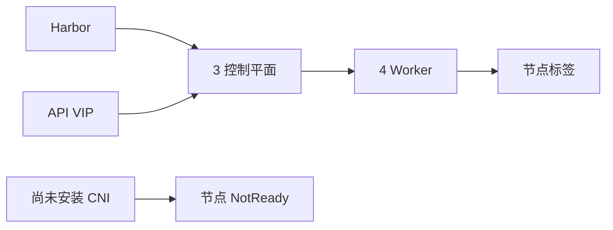

# 第 11 步：本章总验收

## 本步目标

对第一章已经完成的 Kubernetes 基础架构进行总体验收，并明确当前章节的标准结束状态。

本章结束时，标准结果不是“所有节点已经 `Ready`”，而是：

- Harbor 正常
- API 高可用入口正常
- `3` 台控制平面和 `4` 台 Worker 已全部加入
- 节点标签已写入
- 控制面核心 Pod 已启动
- 因为尚未安装 CNI，节点整体 `NotReady` 属于标准现象

## 执行标记

- **执行标记：只读验证**

说明：

- 本步只用于验收第一章结果
- 不做新配置下发，不修改现有环境

## 问题背景

第一章的目标是先完成 Kubernetes 基础架构，而不是一次性完成整套云原生平台。

到本章结束时，已经完成的是：

- Harbor
- 高可用 API 入口
- 第一个控制平面初始化
- 额外控制平面加入
- Worker 节点加入
- 节点角色标签

但还没有完成的是：

- CNI 安装
- Pod 网络
- Service 与 DNS 的完整运行平面

因此，本章总验收必须按照“第一章的阶段目标”来判断，而不能拿“完整可用集群”的标准提前要求它。

## 理论说明

### 为什么第一章结束时节点仍可能是 `NotReady`

这里必须区分两个阶段：

1. 控制平面和节点加入完成
2. 网络插件与 Pod 网络完成

当前第一章已经完成的是第 1 阶段，还没有进入第 2 阶段。

没有安装 CNI 时，节点通常会表现为：

- `NotReady`

同时，`CoreDNS` 也通常会表现为：

- `Pending`

这不代表第一章失败，而是说明集群已经推进到了“等待下一章网络插件接管”的阶段。

### 第一章结束状态关系图



这张图说明：

- 基础架构已经完整
- 但网络层还没有完成
- 因此 `NotReady` 是当前章节的标准结果之一

## 验收方法

### 验收 1：查看完整节点列表

```bash
kubectl get nodes -o wide
```

预期结果：

- 共 `7` 个节点
- 包含 `3` 台控制平面：
  - `cp01`
  - `cp02`
  - `cp03`
- 包含 `4` 台 Worker：
  - `wk-app01`
  - `wk-app02`
  - `wk-edge01`
  - `wk-obs01`
- 当前节点状态大概率为 `NotReady`

关键看点：

- 节点数量是否完整
- 控制平面和 Worker 是否都已经出现
- 当前 `NotReady` 是否被正确理解为“尚未安装 CNI”

### 验收 2：查看节点标签

```bash
kubectl get nodes --show-labels | grep 'node-role='
```

预期结果：

- `wk-app01`、`wk-app02` 带有 `node-role=app`
- `wk-edge01` 带有 `node-role=edge`
- `wk-obs01` 带有 `node-role=observability`

关键看点：

- 只关注 4 台 Worker 的课程角色标签
- 不需要人工通读全部标签内容

### 验收 3：查看控制面核心 Pod

```bash
kubectl get pods -n kube-system -o wide
```

预期结果：

- `cp01`、`cp02`、`cp03` 上都应出现对应控制面核心 Pod
- 应能看到：
  - `kube-apiserver-*`
  - `kube-controller-manager-*`
  - `kube-scheduler-*`
  - `etcd-*`
- `kube-proxy` 应在全部节点上运行
- `coredns` 当前可能为 `Pending`

关键看点：

- 不需要逐个分析每个 Pod 的所有字段
- 重点确认控制面静态 Pod 是否已经分布到 3 台控制平面节点
- `CoreDNS Pending` 在本章阶段属于标准现象

### 验收 4：查看 Harbor 健康状态

```bash
curl -k -s https://harbor.qytk8s.com/api/v2.0/health | jq -r '.status'
```

预期结果：

```text
healthy
```

关键看点：

- 只需要确认最终状态为 `healthy`
- 不需要人工阅读完整 JSON

### 验收 5：查看 API 高可用入口

```bash
nc -vz api.qytk8s.com 6443
```

预期结果：

- 连接成功

关键看点：

- 只需要确认 `6443` 端口可达
- 这说明 `lb01/lb02 + VIP` 的入口模型已经生效

### 验收 6：查看控制平面角色分布

```bash
kubectl get nodes
```

预期结果：

- `cp01`、`cp02`、`cp03` 的 `ROLES` 应显示 `control-plane`
- 4 台 Worker 的 `ROLES` 通常显示为 `<none>`

说明：

- Worker 的课程角色是通过 `node-role=*` 标签表达
- `ROLES` 一列与课程自定义标签是两套不同信息

## 预期结果

第一章验收通过后，整体应呈现下面状态：

- Harbor 正常
- `api.qytk8s.com:6443` 可达
- 三控制平面已建立
- 四台 Worker 已加入
- 节点角色标签已写入
- 控制面核心 Pod 已正常分布
- 当前集群尚未安装 CNI，因此节点整体仍可能是 `NotReady`

## 本章最终完成标准

满足下面条件即可判定第一章完成：

- Harbor 健康状态为 `healthy`
- `api.qytk8s.com:6443` 连接成功
- 节点列表中已出现全部 `7` 台 Kubernetes 节点
- `cp01`、`cp02`、`cp03` 均具备 `control-plane` 角色
- 4 台 Worker 的 `node-role=*` 标签已正确写入
- `kube-system` 中已出现三台控制平面对应的核心 Pod
- 当前节点 `NotReady` 的原因已明确为“尚未安装 CNI”

## 下一章衔接

下一章将进入：

- `Cilium`
- `eBPF`
- `Hubble`

也就是：

- 云原生网络与服务互联
