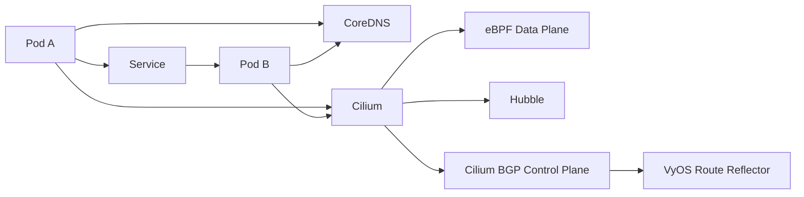

# 第二章理论导读：Cilium、eBPF 与 Hubble

## 本步目标

在正式进入第二章实操前，先建立统一的理论边界，明确下面几个核心问题：

- 第二章到底在解决什么问题
- 为什么这一章选择 `Cilium`
- `Cilium` 和 `Hubble` 分别负责什么
- 以前熟悉 `Calico` 的读者，应如何理解这套方案
- 第二章里的 `L7` 与后续 `Istio` 的边界是什么

## 问题背景

第一章结束后，已经完成了：

- 控制平面初始化
- Worker 节点加入
- Harbor 与 API 高可用入口

但此时集群仍然缺少真正可用的网络平面：

- 节点仍可能是 `NotReady`
- `CoreDNS` 仍可能是 `Pending`
- Pod 网络尚未建立

因此，第二章的任务不是简单地“把节点变成 Ready”，而是要把集群推进到**东西向网络、服务发现、网络可观测与基础零信任能力都可用**的状态。

## 理论说明

### 第二章到底在讲什么

第二章聚焦的是 Kubernetes 集群中的**东西向流量**。

这一章最终要回答的问题包括：

- Pod 之间如何互通
- Service 与 DNS 如何工作
- `Cilium` 如何接管 CNI
- `eBPF` 如何替代传统 `kube-proxy`
- `Hubble` 如何把东西向流量可视化
- `L3/L4/L7` 策略如何逐层收紧访问
- `Cilium BGP Control Plane` 如何把 Pod 网络接入外部路由体系

### 第二章总关系图

这张图可以把第二章的主线一次看清楚：

- `Cilium` 负责网络接入与转发能力
- `eBPF` 负责数据平面增强
- `Hubble` 负责流量观测
- `Cilium BGP Control Plane` 负责把集群网络接入外部路由体系

### 什么是 `Cilium`

`Cilium` 是一个基于 `eBPF` 的云原生网络与安全平台。

在本课程的第二章里，`Cilium` 不只是一个 CNI 插件，而是统一承载下面这些能力的网络底座：

- 网络连通
- Service 转发
- 安全策略
- 流量可观测
- BGP 控制面

第二章理解 `Cilium` 时，建议优先抓住下面 5 个关键词：

- `CNI`
- `eBPF`
- `kube-proxy replacement`
- `NetworkPolicy / L7 Policy`
- `Observability`

### 什么是 `eBPF kube-proxy replacement`

传统 Kubernetes 集群中，`kube-proxy` 主要负责：

- Service VIP 转发
- NodePort 转发
- 后端 Pod 负载分发

而第二章中 `Cilium` 演示的是：

- 不再依赖传统 `kube-proxy`
- 由 `eBPF` 在内核数据路径中接管 Service 转发

这意味着：

- Service 转发不再主要依赖传统规则堆叠
- 数据平面能力更贴近内核
- 后续讲可观测、策略、性能路径时更自然

### 什么是 `Hubble`

如果说 `Cilium` 是网络与安全底座，那么 `Hubble` 就是这套底座的可视化观察窗口。

通过 `Hubble` 可以直接观察：

- 谁访问谁
- 流量位于哪个 namespace
- 哪个 Pod 发起请求
- 流量 verdict 是什么
- 请求是 `FORWARDED` 还是 `DROPPED`

> 术语说明：`verdict`
>
> `verdict` 表示 `Cilium/Hubble` 对一条流量的最终处理结论。
>
> - `FORWARDED`：这条流量被放行并继续转发
> - `DROPPED`：这条流量被丢弃
>
> 观察流量时，可以把几个字段分开理解：
>
> - `source / destination`：是谁到谁
> - `protocol / L7`：访问的是什么协议、方法或路径
> - `verdict`：这条流量最后的命运是什么

因此，第二章里二者的分工可以概括为：

- `Cilium` 负责执行网络与安全动作
- `Hubble` 负责展示这些动作的流量结果

## 常见问题

### 为什么这一章选 `Cilium`，而不是先讲 `Calico`

这是第二章最常见的问题之一，应当保留并明确回答。

结论不是“`Calico` 落后，`Cilium` 更高级”，而是：

> 第二章选择 `Cilium`，是因为它更适合把 **eBPF、东西向可观测、L7 感知策略、BGP 控制面** 这条主线一次讲透。

如果读者以前主要使用的是 `Calico`，通常已经熟悉：

- `BGP`
- `NetworkPolicy`
- `iptables`
- 先打通网络，再逐步加策略

这些经验完全有效，而且在很多生产环境里依然成立。

第二章之所以切到 `Cilium`，是因为本章要强调的是：

- `eBPF kube-proxy replacement`
- 直接观察东西向流量
- 在同一套体系内演示 `L3/L4` 到 `L7`
- 把 `BGP Control Plane` 和 `Route Reflector` 连起来讲

从课程表达角度看，`Cilium` 更适合承载这一组目标。

可以用下面这组对比帮助记忆：

- `Calico` 更像传统云原生网络中的成熟强者
- `Cilium` 更像把 `eBPF`、可观测和安全能力收得更紧的现代网络底座

### 这一章的 `L7` 和后面的 `Istio` 到底有什么不同

这同样是第二章中很常见的问题。

很多读者会问：

> 既然 `Cilium` 已经能按 `GET / POST` 做控制，那后面为什么还要讲 `Istio`？

这里必须区分边界。

#### `Cilium L7` 更偏什么

`Cilium L7` 本质上仍然是**网络侧的安全控制**，只是在传统 `IP / Port` 基础上进一步具备了应用协议感知能力。

它已经能够识别：

- `HTTP Method`
- `HTTP Path`

因此它更像：

- 网络底座上的应用感知防火墙
- 零信任网络准入的一部分

#### `Istio` 更偏什么

`Istio` 更偏向服务身份、安全与治理层。

它更关注：

- 服务身份
- `mTLS`
- `JWT`
- `AuthorizationPolicy`
- 请求级认证与授权
- 流量治理

也就是说，`Istio` 更偏向回答：

- 调用方是谁
- 是否具有合法凭据
- 这个服务身份能否调用另一个服务
- 这部分流量是否要灰度到新版本

#### 两者的一句话区分

- `Cilium L7`：偏**网络准入控制**
- `Istio`：偏**服务身份、安全与治理**

#### 对本课程的分工

在本课程中：

- 第二章先解决网络底座、可观测与基础零信任
- 后续如果进入 `Istio`，再补服务身份、`mTLS`、更细粒度授权与流量治理

## 通过标准

阅读完本页后，应能明确下面这些结论：

- 第二章的主线是东西向网络，而不是北向入口
- `Cilium` 不只是 CNI，而是承载网络、安全、观测与 BGP 的统一底座
- `Hubble` 是 `Cilium` 的流量可视化观察窗口
- 第二章选择 `Cilium` 的原因是教学主线匹配，而不是简单否定 `Calico`
- 第二章里的 `L7` 与后续 `Istio` 并不冲突，二者分工不同

## 下一步

进入第二章总览，确认执行顺序与章节边界：

- `docs/01_chapter_guide.md`
