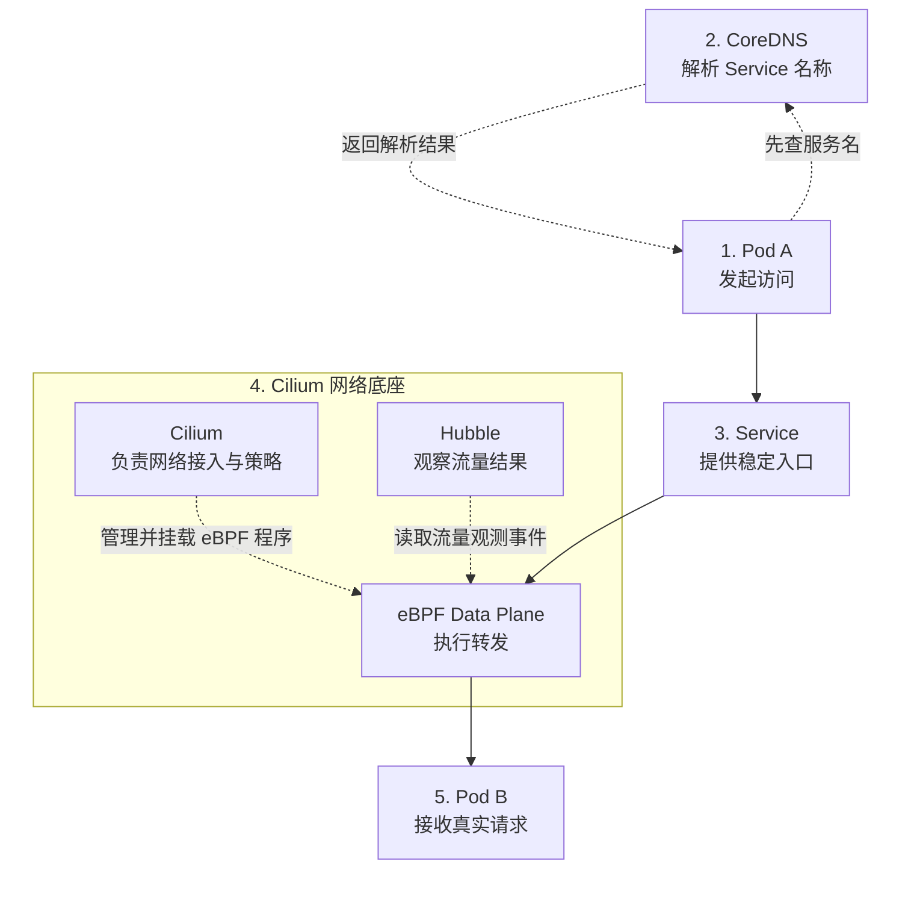
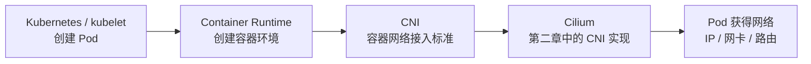
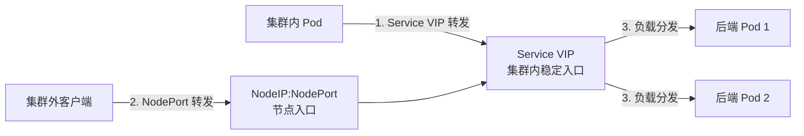
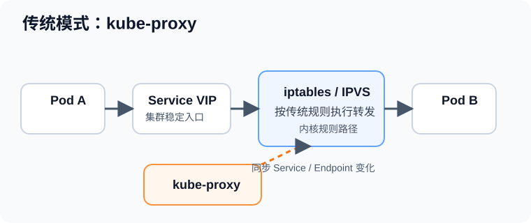
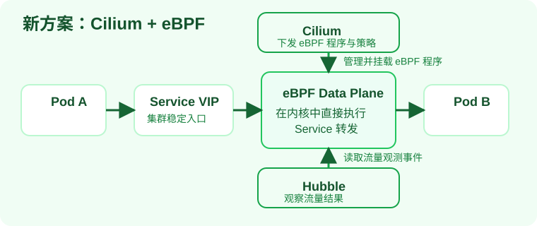

# 第二章理论导读：Cilium、eBPF 与 Hubble

## 本步目标

在正式进入第二章实操前，先建立统一的理论边界，明确下面几个核心问题：

- 第二章到底在解决什么问题
- 为什么这一章选择 `Cilium`
- `Cilium` 和 `Hubble` 分别负责什么
- 以前熟悉 `Calico` 的读者，应如何理解这套方案
- 第二章里的 `L7` 与后续 `Istio` 的边界是什么

---

## 问题背景

第一章结束后，已经完成了：

- 控制平面初始化
- Worker 节点加入
- Harbor 与 API 高可用入口

但此时集群仍然缺少真正可用的网络平面：

- 节点仍可能是 `NotReady`
- `CoreDNS` 仍可能是 `Pending`
- Pod 网络尚未建立

因此，第二章的任务不是简单地“把节点变成 Ready”，而是要把集群推进到**东西向网络、服务发现、网络可观测与基础零信任能力都可用**的状态。

---

## 理论说明

### 第二章到底在讲什么

第二章聚焦的是 Kubernetes 集群中的**东西向流量**。

这一章最终要回答的问题包括：

- Pod 之间如何互通
- Service 与 DNS 如何工作
- `Cilium` 如何接管 CNI
- `eBPF` 如何替代传统 `kube-proxy`
- `Hubble` 如何把东西向流量可视化
- `L3/L4/L7` 策略如何逐层收紧访问

### 第二章总关系图

这张图可以把第二章的主线一次看清楚：

- 带序号的框表示第二章关键顺序：先由 `CoreDNS` 完成名称解析，再进入 `Pod A -> Service -> Cilium 网络底座 -> Pod B` 的转发主链路
- 第 `4` 步被收敛成一个总框，表示第二章真正补齐的是整套 `Cilium` 网络底座，而不只是单个组件
- `CoreDNS` 被放在主链路上方，表示它承担的是访问前的名称解析，而不是业务转发链路中的中间跳点
- 这个总框里包含 `CNI`、`eBPF Data Plane` 与 `Hubble`：`Cilium` 负责网络接入与策略，`eBPF Data Plane` 负责执行转发，`Hubble` 负责观察流量结果

### 什么是 `CNI`

`CNI` 全称是 `Container Network Interface`，可以理解为“容器网络接入标准”。

它本身不是某一个具体网络产品，而是一组约定，用来解决下面这个问题：

- 当 Kubernetes 创建一个 Pod 后，谁来给这个 Pod 配置网络
- 谁来分配 Pod 的网络身份
- 谁来把这个 Pod 接入到整个集群网络中

下面这张图更适合第二章的语境：

在第二章的语境里，理解 `CNI` 最重要的是下面 3 点：

- 没有 `CNI`，Pod 即使被创建出来，也不具备完整可用的网络能力
- Kubernetes 通过 `CNI` 这套标准，把“给 Pod 接网”这件事交给具体实现去完成
- `Cilium` 就是第二章里承担这个角色的具体实现，它负责把 Pod 真正接入集群网络

因此，第二章安装 `Cilium` 的意义，不只是“多装一个组件”，而是把第一章尚未完成的 **Pod 网络接入能力** 正式补齐。

### 什么是 `Cilium`

`Cilium` 是一个基于 `eBPF` 的云原生网络与安全平台。

在本课程的第二章里，`Cilium` 不只是一个 CNI 插件，而是统一承载下面这些能力的网络底座：

- 网络连通
- Service 转发
- 安全策略
- 流量可观测

第二章理解 `Cilium` 时，可优先把握下面 5 个关键词：

- `CNI`
- `eBPF`
- `kube-proxy replacement`
- `NetworkPolicy / L7 Policy`
- `Observability`

### 什么是 `eBPF kube-proxy replacement`

传统 Kubernetes 集群中，`kube-proxy` 主要负责：

- Service VIP 转发
- NodePort 转发
- 后端 Pod 负载分发

这三件事放在同一张图里更容易区分：

这张图表达的是同一条服务访问链路里的 3 个不同观察点：

- `Service VIP 转发`
  - 集群内请求先命中 `Service` 的稳定入口
- `NodePort 转发`
  - 同一个 `Service` 还可以通过每个节点上的 `NodeIP:NodePort` 对外暴露
- `后端 Pod 负载分发`
  - 请求进入 `Service` 后，最终还要选中一个具体后端 `Pod`

因此，`Service VIP` 和 `NodePort` 更像两种入口形式，而“后端 Pod 负载分发”是入口之后的最后一步。

而第二章中 `Cilium` 演示的是：

- 不再依赖传统 `kube-proxy`
- 由 `eBPF` 在内核数据路径中接管 Service 转发

下面把两种方案真正并排放在一起：

| 传统模式：`kube-proxy` | 新方案：`Cilium + eBPF` |
| --- | --- |
|  |  |

这张并排图要强调的关键是：**Service 转发的承载方式变了**。

- 传统方案：`kube-proxy` 持续把 `Service / Endpoint` 变化转换成 `iptables / IPVS` 规则
- `eBPF` 方案：由 `Cilium` 把转发逻辑挂到 `eBPF Data Plane`，在内核数据路径中执行

> 说明：这张图只画 `Service VIP` 路径；`NodePort` 可以按同样思路理解。

也要避免一个误解：

> `iptables / IPVS` 本身也在内核里，`eBPF` 的优势不是“终于进入内核”，而是 **更可编程，也更容易统一转发、策略和观测**。

### `eBPF` 相对传统方案的优势

- 规则维护更直接：更偏“程序 + map”，而不是大量规则堆叠
- 数据路径更灵活：不只是固定转发模块，更容易扩展能力
- 更容易统一策略与观测：后面讲 `Hubble` 和 `L7` 会更自然

### 什么是 `Hubble`

如果说 `Cilium` 是网络与安全底座，那么 `Hubble` 就是这套底座的可视化观察窗口。

通过 `Hubble` 可以直接观察：

- 谁访问谁
- 流量位于哪个 namespace
- 哪个 Pod 发起请求
- 流量 verdict 是什么

> 术语说明：`verdict`
>
> `verdict` 表示 `Cilium/Hubble` 对一条流量的最终处理结论。
>
> - `FORWARDED`：这条流量被放行并继续转发
> - `DROPPED`：这条流量被丢弃
>
> 观察流量时，可以把几个字段分开理解：
>
> - `source / destination`：是谁到谁
> - `protocol / L7`：访问的是什么协议、方法或路径
> - `verdict`：这条流量最后的命运是什么

因此，第二章里二者的分工可以概括为：

- `Cilium` 负责执行网络与安全动作
- `Hubble` 负责展示这些动作的流量结果

---

## 常见问题

### 为什么这一章使用 `Cilium`，而不是 `Calico`

结论不是“`Calico` 落后，`Cilium` 更高级”，而是**第二章的主线更适合用 `Cilium` 来讲**。

- `Calico` 更适合代表传统云原生网络中的成熟实现
- `Cilium` 更适合把 `eBPF`、东西向可观测和 `L7` 感知策略放到一条主线里说明

因此，第二章选择 `Cilium`，是教学主线选择，不是否定 `Calico`。

### 这一章的 `L7` 和后面的 `Istio` 到底有什么不同

二者都能看到 `HTTP` 层，但关注点不同：

- `Cilium L7`：偏**网络准入控制**，按 `Method / Path` 决定是否放行
- `Istio`：偏**服务身份、安全与治理**，更关注 `mTLS`、`JWT`、授权与流量治理

在本课程中：

- 第二章先解决网络底座、可观测与基础零信任
- 后续如果进入 `Istio`，再补服务身份、更细粒度授权与流量治理

---

## 通过标准

阅读完本页后，应能明确下面这些结论：

- 第二章的主线是东西向网络，而不是北向入口
- `Cilium` 不只是 CNI，而是承载网络、安全与观测的统一底座
- `Hubble` 是 `Cilium` 的流量可视化观察窗口
- 第二章选择 `Cilium` 的原因是教学主线匹配，而不是简单否定 `Calico`
- 第二章里的 `L7` 与后续 `Istio` 并不冲突，二者分工不同

---

## 下一步

进入第二章总览，确认执行顺序与章节边界：

- `docs/01_chapter_guide.md`
