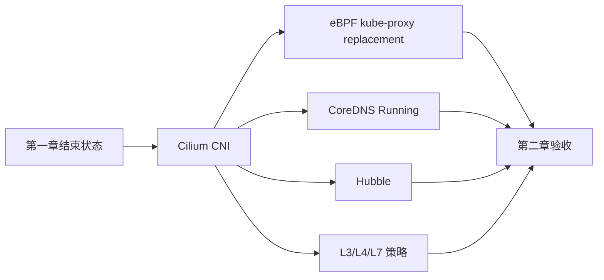

# 第二章总览：云原生网络与服务互联

## 本章目标

本章的目标是把第一章已经完成控制平面初始化、但尚未安装 CNI 的集群，推进到 **东西向网络完全可用** 的状态。

本章结束后，应该达到下面的状态：

- 所有节点从 `NotReady` 变为 `Ready`
- `CoreDNS` 从 `Pending` 变为 `Running`
- `Cilium` 已接管集群 CNI，并启用 `eBPF kube-proxy replacement`
- `Pod IP`、`Service`、`CoreDNS`、`Service Discovery` 可以完整演示
- `Hubble` 可以观察东西向流量
- `L3/L4` 与 `L7` 策略都可以演示
- 第二章重点体现东西向网络、eBPF 数据平面、服务发现与策略控制能力

---

## 问题背景

第一章结束时，集群已经具备：

- 控制平面
- Worker 节点
- Harbor
- API 高可用入口

但此时仍然缺少：

- CNI
- Pod 网络
- Service 与 DNS 的完整运行平面
- 东西向流量观测能力

因此，第二章不是在“重建集群”，而是在第一章基础上补齐网络平面。

---

## 理论导读

正式进入操作前，可先阅读：

- `docs/00_cilium_hubble_theory.md`

这份文档不属于执行步骤，也不要求执行命令，它负责解决第二章最核心的理论问题：

- 为什么本章选 `Cilium`
- `Cilium` 和 `Hubble` 分别负责什么

---

## 本章重点边界

第二章主打 **东西向流量** 与 **eBPF 高级能力**，不提前展开第三章的南北向入口设计。

本章重点包括：

- `Cilium`
- `eBPF kube-proxy replacement`
- `native routing`
- `Hubble`
- `L3/L4` 与 `L7` 策略

第三章再集中处理：

- `LoadBalancer VIP`
- `Ingress`
- `Gateway API`
- 北向 `L4 / L7` 入口控制

---

## 本章总关系图

这张图表达了第二章的完整主线：

- 从第一章结束状态出发
- 先由 `Cilium` 接管 CNI
- 再逐步补齐 `eBPF`、DNS、观测与策略能力
- 最终形成第二章验收结果

---

## 本章学习方式

第二章继续采用“文档主导 + 小脚本辅助 + YAML 独立发布”的方式进行。

执行方式固定为：

1. 登录 `ops`
2. 按文档顺序逐步执行
3. 每执行一步，都先验证，再继续下一步
4. 较长命令或批量动作由 Bash 脚本完成
5. 所有 YAML 继续通过 `http://ops:9000/` 发布

---

## 执行标记说明

为便于在 `ops` 上统一执行命令，本章对每个脚本都做执行标记：

- **必须执行**：从第二章标准起点开始时，默认需要实际执行
- **条件执行**：是否执行取决于你是否保留了上一轮产物
- **只读验证**：这一项主要用于检查结果，不会改配置

---

## 本章脚本执行矩阵

| 步骤 | 文档 | 脚本 | 执行标记 | 说明 |
| :--- | :--- | :--- | :--- | :--- |
| 1 | `02_prepare_cilium_artifacts.md` | `scripts/01_prepare_cilium_artifacts.sh` | 必须执行 | 预热 Cilium / Hubble / Helm chart / CLI / 镜像到 Harbor 与 `ops HTTP` |
| 2 | `03_install_cilium.md` | `scripts/02_install_cilium.sh` | 必须执行 | 清理 kube-proxy，安装并验收启用 `native routing` 与 `kube-proxy replacement` 的 Cilium |
| 3 | `04_service_discovery.md` | `scripts/03_apply_service_discovery_demo.sh` | 必须执行 | 演示 Pod、Service、DNS 与 Service Discovery |
| 4 | `05_enable_hubble.md` | `scripts/04_enable_hubble.sh` | 必须执行 | 启用 Hubble 并观测东西向流量 |
| 5 | `06_l7_policy.md` | `scripts/05_apply_l7_policy_demo.sh` | 必须执行 | 演示 `L3/L4` 与 `L7` 策略 |
| 6 | `07_verify.md` | 无 | 只读验证 | 本章最终验收，不改配置 |

---

## 本章执行顺序

请严格按照下面顺序执行：

1. `02_prepare_cilium_artifacts.md`
2. `03_install_cilium.md`
3. `04_service_discovery.md`
4. `05_enable_hubble.md`
5. `06_l7_policy.md`
6. `07_verify.md`

---

## 第二章起点状态

第二章开始前，集群应满足下面这些前提：

- 第一章已经完成
- Kubernetes 版本固定为 `v1.33.9`
- 当前节点整体为 `NotReady`
- `CoreDNS` 当前为 `Pending`
- `ops` 已具备 `kubectl`
- `ops` 已具备 nginx 文件发布服务：`http://ops:9000/`
- `Harbor` 已可用，且第一章核心镜像已经在 `harbor.qytk8s.com`

---

## 版本冻结

为了确保课程的可复现性和兼容性，第二章统一冻结以下版本：

- Kubernetes：`v1.33.9`
- Cilium：`1.19.1`
- Helm Chart：`1.19.1`

---

## 下一步

先进入第 1 步，准备第二章所需制品：

- `docs/02_prepare_cilium_artifacts.md`

---

## 第二章网络设计要点

本章继续沿用第一章已经冻结的地址设计：

- 宿主机网络：`10.1.1.0/24`
- API VIP：`10.1.1.10`
- Service CIDR：`10.96.0.0/12`
- Pod CIDR：`10.244.0.0/16`

本章中 Cilium 采用：

- `native routing`
- `eBPF kube-proxy replacement`
- 与第一章一致的 `Pod CIDR`

---

## 第二章网络设计要点补充

本章重点讲：

- 为什么 `Cilium` 不只是 CNI
- 为什么 `eBPF` 不只是“转发更快”
- 为什么 `native routing + kube-proxy replacement + Hubble + L7 policy` 能组成完整的东西向网络主线

---

## 课程文件 HTTP 服务

第二章继续沿用 `ops` 节点上的 nginx 文件服务：

- 服务地址：`http://ops:9000/`
- 根目录：`/docker_k8s_2026/k8s/`
- 本章所有 YAML 文件统一放在 `manifests/`

后续章节中凡是涉及：

- Helm values
- Kubernetes YAML
- 演示工作负载清单

都通过 `http://ops:9000/02-cloud-native-networking/...` 发布和引用。
