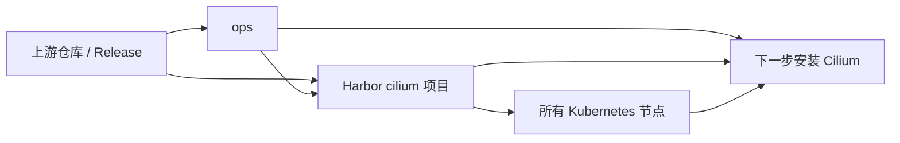

# 第 1 步：预热 Cilium 制品到 Harbor 与 ops HTTP

## 本步目标

在正式安装 `Cilium` 之前，先把第二章所需的关键制品准备到本地环境中。

本步完成后，应达到下面状态：

- `Cilium 1.19.1` Helm chart 已下载到 `ops`
- `cilium CLI` 与 `hubble CLI` 已安装到 `ops`
- Harbor 中已经存在公共项目 `cilium`
- `Cilium`、`Hubble` 与第二章 demo 镜像已经推送到 `harbor.qytk8s.com/cilium`
- 第二章所需文件已在 `ops` 本地准备好，后续安装尽量不依赖公网

## 执行标记

- **执行标记：必须执行**

说明：

- 第二章后续安装依赖本步准备的 chart、CLI 和镜像
- 本步的目标不是“安装 Cilium”，而是“把安装 Cilium 所需的制品准备完整”

## 问题背景

第二章的正式安装动作主要发生在下一步，但如果不先做制品预热，课堂或重刷过程中会遇到下面这些不确定性：

- 运行到安装步骤时才临时下载 Helm chart
- 运行到验证步骤时才发现 `cilium` CLI 不存在
- 节点首次拉取镜像时受公网波动影响
- Harbor 中还没有第二章所需项目和镜像

因此，本步要先把下面这些对象准备完整：

1. `Helm chart`
2. `cilium CLI`
3. `hubble CLI`
4. `Cilium` 主线镜像
5. 第二章 demo 镜像

## 理论说明

### 为什么第二章要先做制品预热

第二章是第一章之后的第一个“网络平面切换章”。

这里的目标不是只让某个 YAML 跑起来，而是要完成：

- CNI 接管
- `eBPF kube-proxy replacement`
- `Hubble`
- 观测与策略演示

这类章节如果把所有下载、拉取、推送动作都留到安装当下，会把教学主线打散。

因此，本步先把制品准备完整，后续安装页才可以把重点集中到：

- Cilium 为什么这样安装
- 配置为什么这样写
- 验证结果应该看什么

### 本步制品关系图



这张图说明：

- `ops` 负责准备 Helm chart 和 CLI
- `harbor` 负责承载第二章镜像
- 所有 Kubernetes 节点提前预拉关键镜像
- 下一步安装真正依赖的是本步准备好的本地制品

### 第二章制品分层

本步涉及的制品可以按下面三层理解：

#### 1. `ops` 本地工具层

包括：

- `helm`
- `cilium CLI`
- `hubble CLI`

这一层解决的是：

- 后续安装和验证命令能否直接在 `ops` 上执行

#### 2. `ops` 本地文件层

包括：

- `artifacts/cilium-1.19.1.tgz`
- 第二章后续会使用的 `manifests/` 与本地 values 文件

这一层解决的是：

- 安装所需文件是否已在 Git 项目和 `ops` 本地准备好

#### 3. Harbor 与节点镜像层

包括：

- Harbor 项目 `cilium`
- `Cilium` / `Hubble` / demo 镜像
- 各节点的预拉镜像缓存

这一层解决的是：

- 安装时是否能够优先走本地 Harbor，而不是临时依赖公网

## 本步固定版本

本课程第二章统一冻结：

- Cilium：`1.19.1`
- Helm Chart：`1.19.1`
- `cilium CLI`：`v0.19.1`
- `hubble CLI`：`v1.18.6`

## Harbor 项目规划

第二章统一使用 Harbor 公共项目：

- 项目名称：`cilium`
- Harbor 地址：`harbor.qytk8s.com`

第二章中涉及的核心镜像和 demo 镜像统一推送到：

```text
harbor.qytk8s.com/cilium
```

## 对应脚本

本步对应脚本：

- `k8s/02-cloud-native-networking/scripts/01_prepare_cilium_artifacts.sh`

本步不会把 Helm values、Kubernetes YAML 等配置直接写进脚本中。

第二章中真正用于安装和演示的配置文件仍然保留在项目目录中，例如：

- `artifacts/cilium-1.19.1.tgz`
- `manifests/cilium-values.yaml`
- 后续 demo YAML 文件

这符合课程中“制品、配置、脚本职责分离”的原则：

- 脚本负责下载、安装、下发、预热
- 原始配置和 manifests 保留在项目目录中

## 脚本内部在做什么

### 脚本执行主线

如果把 `01_prepare_cilium_artifacts.sh` 看作一个制品预热器，它的主线如下：

1. 准备本地目录
2. 安装 Helm
3. 创建 Harbor 项目
4. 下载 Helm chart
5. 安装 `cilium CLI`
6. 安装 `hubble CLI`
7. 在 `harbor` 节点拉取并推送镜像
8. 在所有 Kubernetes 节点预拉镜像
9. 在 `ops` 上做本地制品检查

### 重要任务 1：准备本地目录

脚本原始代码：

```bash
prepare_local_dirs() {
  mkdir -p "${ARTIFACTS_DIR}" "${TMP_DIR}" "${ARTIFACTS_DIR}/bin"
}
```

这一段的作用是：

- 为第二章的 `artifacts/`、`tmp/`、`bin/` 提前建好目录
- 让后续 chart、CLI 压缩包和二进制文件都有稳定存放位置

### 重要任务 2：安装 Helm

脚本原始代码：

```bash
install_helm() {
  if command -v helm &>/dev/null; then
    echo "Helm 已安装: $(helm version --short)"
    return 0
  fi
  echo "正在安装 Helm …"
  curl -fsSL https://raw.githubusercontent.com/helm/helm/main/scripts/get-helm-3 | bash
  helm version --short
}
```

这一段解决的是：

- `ops` 上后续是否具备 `helm upgrade --install` 的执行能力

### 重要任务 3：创建 Harbor 项目

脚本原始代码：

```bash
create_harbor_project() {
  local http_code

  http_code=$(curl -k -s -o /tmp/harbor_cilium_project_create.json -w '%{http_code}' \
    -u "${HARBOR_USERNAME}:${HARBOR_PASSWORD}" \
    -H 'Content-Type: application/json' \
    -X POST \
    "https://${HARBOR_DOMAIN}/api/v2.0/projects" \
    -d "{\"project_name\":\"${HARBOR_PROJECT}\",\"public\":true}")

  if [[ "${http_code}" == "201" || "${http_code}" == "409" ]]; then
    echo "Harbor 项目 ${HARBOR_PROJECT} 已就绪"
  else
    echo "创建 Harbor 项目失败，HTTP 状态码：${http_code}"
    sed -n '1,120p' /tmp/harbor_cilium_project_create.json || true
    exit 1
  fi
}
```

这一段的作用是：

- 通过 Harbor API 创建第二章专用项目 `cilium`
- 若项目已存在，则把它当作正常状态继续执行

### 重要任务 4：下载 Helm chart

脚本原始代码：

```bash
download_helm_chart() {
  if [[ ! -f "${ARTIFACTS_DIR}/cilium-${CILIUM_VERSION}.tgz" ]]; then
    helm repo add cilium https://helm.cilium.io/ >/dev/null 2>&1 || true
    helm repo update >/dev/null
    helm pull cilium/cilium --version "${CILIUM_VERSION}" --destination "${ARTIFACTS_DIR}"
  fi
}
```

这一段的作用是：

- 将固定版本的 `Cilium` Helm chart 下载到本地 `artifacts/`
- 让下一步安装不再依赖现场联网拉 chart

### 重要任务 5：安装 `cilium CLI`

脚本原始代码：

```bash
install_cilium_cli() {
  if [[ ! -x /usr/local/bin/cilium ]]; then
    curl -fsSL \
      "https://github.com/cilium/cilium-cli/releases/download/${CILIUM_CLI_VERSION}/cilium-linux-${ARCH}.tar.gz" \
      -o "${ARTIFACTS_DIR}/bin/cilium-linux-${ARCH}.tar.gz"
    tar -xzf "${ARTIFACTS_DIR}/bin/cilium-linux-${ARCH}.tar.gz" -C "${ARTIFACTS_DIR}/bin" cilium
    install -m 0755 "${ARTIFACTS_DIR}/bin/cilium" /usr/local/bin/cilium
  fi
}
```

这一段解决的是：

- 后续 `cilium status`、`cilium connectivity` 等命令是否能直接在 `ops` 上执行

### 重要任务 6：安装 `hubble CLI`

脚本原始代码：

```bash
install_hubble_cli() {
  if [[ ! -x /usr/local/bin/hubble ]]; then
    curl -fsSL \
      "https://github.com/cilium/hubble/releases/download/${HUBBLE_CLI_VERSION}/hubble-linux-${ARCH}.tar.gz" \
      -o "${ARTIFACTS_DIR}/bin/hubble-linux-${ARCH}.tar.gz"
    tar -xzf "${ARTIFACTS_DIR}/bin/hubble-linux-${ARCH}.tar.gz" -C "${ARTIFACTS_DIR}/bin" hubble
    install -m 0755 "${ARTIFACTS_DIR}/bin/hubble" /usr/local/bin/hubble
  fi
}
```

这一段解决的是：

- 后续 `hubble observe` 等命令是否可直接使用

### 重要任务 7：在 Harbor 节点拉取并推送镜像

脚本原始代码：

```bash
SOURCE_IMAGES=(
  "quay.io/cilium/cilium:v1.19.1"
  "quay.io/cilium/operator-generic:v1.19.1"
  "quay.io/cilium/hubble-relay:v1.19.1"
  "quay.io/cilium/hubble-ui-backend:v0.13.3"
  "quay.io/cilium/hubble-ui:v0.13.3"
  "quay.io/cilium/certgen:v0.3.2"
  "docker.io/traefik/whoami:v1.10.3"
  "docker.io/curlimages/curl:8.12.1"
)

TARGET_IMAGES=(
  "harbor.qytk8s.com/cilium/cilium:v1.19.1"
  "harbor.qytk8s.com/cilium/operator-generic:v1.19.1"
  "harbor.qytk8s.com/cilium/hubble-relay:v1.19.1"
  "harbor.qytk8s.com/cilium/hubble-ui-backend:v0.13.3"
  "harbor.qytk8s.com/cilium/hubble-ui:v0.13.3"
  "harbor.qytk8s.com/cilium/certgen:v0.3.2"
  "harbor.qytk8s.com/cilium/whoami:v1.10.3"
  "harbor.qytk8s.com/cilium/curl:8.12.1"
)
```

以及：

```bash
for index in "${!SOURCE_IMAGES[@]}"; do
  src="${SOURCE_IMAGES[$index]}"
  dst="${TARGET_IMAGES[$index]}"

  docker pull "${src}"
  docker tag "${src}" "${dst}"
  docker push "${dst}"
done
```

这一段完成的是：

- 从上游拉取第二章核心镜像和 demo 镜像
- 重新打标签
- 推送到 `harbor.qytk8s.com/cilium`

### 重要任务 8：在所有节点预拉镜像

脚本原始代码：

```bash
for image in "${IMAGES[@]}"; do
  echo "预拉镜像：${image}"
  crictl --runtime-endpoint unix:///run/containerd/containerd.sock pull "${image}"
done
```

这一段的作用是：

- 在所有 Kubernetes 节点提前缓存第二章关键镜像
- 减少下一步正式安装时的首次拉取等待

### 重要任务 9：本地制品检查

脚本原始代码：

```bash
verify_local_artifacts() {
  ls -lh "${ARTIFACTS_DIR}/cilium-${CILIUM_VERSION}.tgz"
  cilium version --client
  hubble version
}
```

这一段用于在 `ops` 上立即确认：

- chart 已存在
- `cilium CLI` 已可用
- `hubble CLI` 已可用

## 执行命令

先给脚本增加执行权限：

```bash
chmod +x /docker_k8s_2026/k8s/02-cloud-native-networking/scripts/01_prepare_cilium_artifacts.sh
```

然后执行：

```bash
bash /docker_k8s_2026/k8s/02-cloud-native-networking/scripts/01_prepare_cilium_artifacts.sh
```

## 验证方法

### 验证 1：检查 Harbor 项目

```bash
curl -k -s -u 'admin:Harbor12345' https://harbor.qytk8s.com/api/v2.0/projects | jq -r '.[] | select(.name=="cilium") | .name'
```

预期结果：

```text
cilium
```

### 验证 2：检查镜像仓库列表

```bash
curl -k -s -u 'admin:Harbor12345' \
  "https://harbor.qytk8s.com/api/v2.0/projects/cilium/repositories?page=1&page_size=30" | jq -r '.[].name'
```

预期结果：

- 输出中应包含：
  - `cilium/cilium`
  - `cilium/operator-generic`
  - `cilium/hubble-relay`
  - `cilium/hubble-ui`
  - `cilium/hubble-ui-backend`
  - `cilium/certgen`
  - `cilium/whoami`
  - `cilium/curl`

关键看点：

- 只看仓库名列表，不需要阅读完整 JSON

### 验证 3：检查 Helm chart 文件

```bash
ls -lh /docker_k8s_2026/k8s/02-cloud-native-networking/artifacts/cilium-1.19.1.tgz
```

预期结果：

- 文件存在
- 文件大小正常显示

### 验证 4：检查 `cilium CLI`

```bash
cilium version --client
```

预期结果：

- 输出中应包含 `v0.19.1`

### 验证 5：检查 `hubble CLI`

```bash
hubble version
```

预期结果：

- 输出中应包含 `v1.18.6`

### 验证 6：检查节点已缓存 Cilium 主镜像

```bash
for node in cp01 cp02 cp03 wk-app01 wk-app02 wk-edge01 wk-obs01; do
  echo "===== ${node} ====="
  ssh root@${node} "crictl --runtime-endpoint unix:///run/containerd/containerd.sock images | grep 'harbor.qytk8s.com/cilium/cilium'"
done
```

预期结果：

- 每台节点都能看到：

```text
harbor.qytk8s.com/cilium/cilium:v1.19.1
```

关键看点：

- 这里只验证关键主镜像是否已缓存
- 不要求把全部镜像逐个人工核对

## 通过标准

满足下面条件即可进入下一步：

- Harbor 项目 `cilium` 已创建
- 第二章所需镜像已推送到 Harbor
- 各 Kubernetes 节点已预拉关键镜像
- Helm chart 已在 `ops` 本地保存
- `cilium CLI` 与 `hubble CLI` 已可直接使用

## 下一步

下一步进入 `Cilium` 安装：

- `docs/03_install_cilium.md`
