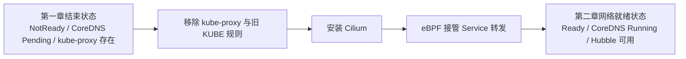
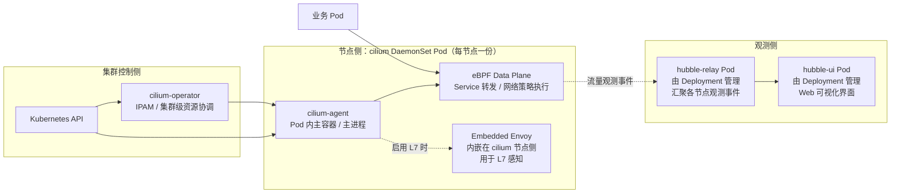
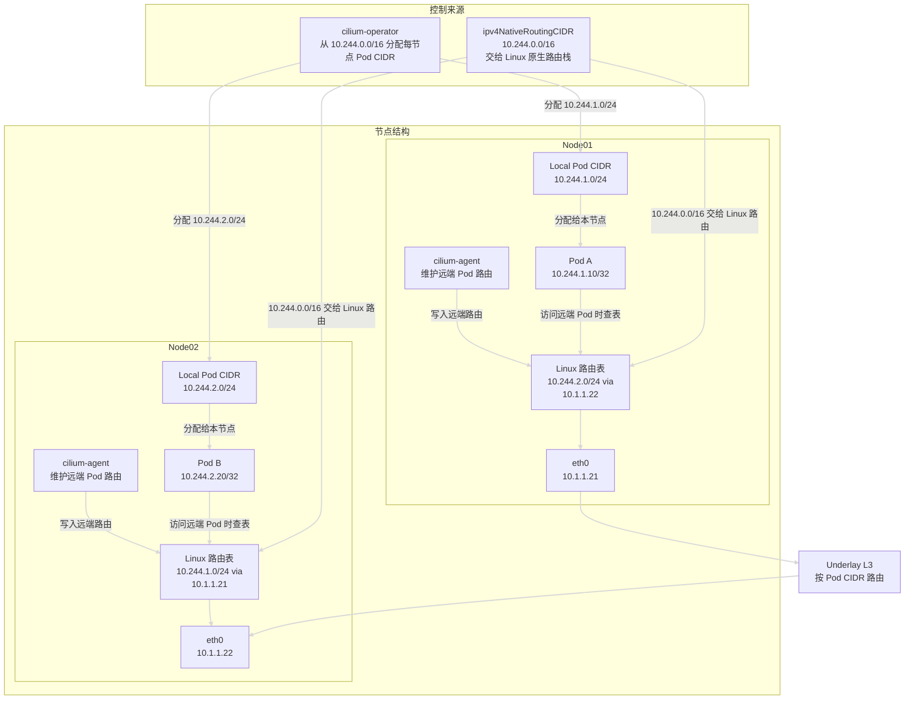
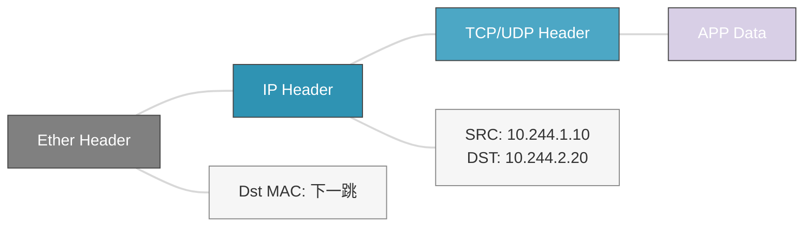
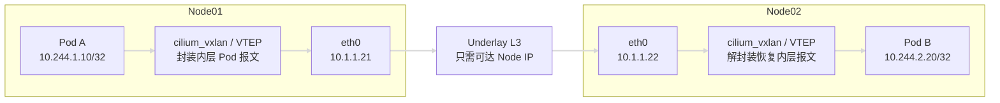
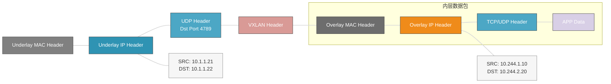

# 第 2 步：安装并验收 Cilium 网络平面

## 本步目标

将第一章尚未安装 CNI 的集群切换到 `Cilium`，并直接启用：

- `native routing`
- `eBPF kube-proxy replacement`
- `Hubble`

本步完成后，应达到下面状态：

- `Cilium` 已在所有节点运行
- `kube-proxy` 已退出集群
- 所有节点从 `NotReady` 进入 `Ready`
- `CoreDNS` 已从 `Pending` 进入 `Running`
- `Hubble Relay` 与 `Hubble UI` 已运行

---

## 执行标记

- **执行标记：必须执行**

本步完成后，集群会从“网络未完成”切换为“网络平面可用”。

---

## 理论说明

### 安装前后的状态变化



这一步不是“再加一个网络组件”，而是补齐网络平面，并让 `eBPF` 接管 Service 转发。

### `Cilium` 与 `Hubble` 组件关系图



这里需要区分“Pod 名称”和“内部角色”：

- `cilium` 是节点上的 `DaemonSet Pod`
- `cilium-agent` 是这个 Pod 内的主容器 / 主进程，负责网络接入、策略管理、`eBPF` 程序挂载和事件上报
- `Embedded Envoy` 不是独立 `DaemonSet`，也不是注入业务 Pod 的 sidecar；当前是内嵌在 `cilium` 节点侧能力中，只在启用 `L7` 时参与路径
- `hubble-relay` 和 `hubble-ui` 在图中画成 Pod，是因为实际看到的运行对象就是它们各自的 Pod

`cilium status --wait` 中几类组件的分工如下：

- `cilium`：以 `DaemonSet` 方式运行在每个节点上，负责网络接入、`eBPF` 程序挂载、策略执行和事件上报
- `cilium-operator`：负责 `IPAM` 和集群级资源协调
- `hubble-relay`：以 `Deployment` 方式运行，当前通常看到 1 个 `hubble-relay` Pod，作为统一查询入口
- `hubble-ui`：以 `Deployment` 方式运行，当前通常看到 1 个 `hubble-ui` Pod，通过 `relay` 展示 Web 可视化结果
- `Embedded Envoy`：只在启用 `L7` 感知时参与路径；当前配置 `envoy.enabled: false`，因此不会看到单独的 `cilium-envoy` DaemonSet

### 为什么这一步必须先清理 `kube-proxy`

集群默认已经安装 `kube-proxy`。本步要让 `Cilium` 通过 `eBPF` 接管 Service 转发，因此安装前必须先完成：

1. 删除 `kube-proxy` DaemonSet 与 ConfigMap
2. 清理各节点中遗留的 `KUBE-*` iptables 规则

否则旧规则仍可能影响转发路径，并与 `Cilium` 产生角色重叠。

### 为什么这里使用 `native routing`

本章主线使用：

```text
routingMode: native
```

这样更适合直接观察 `Pod CIDR`、跨节点路由和 Service 转发路径。

#### `routingMode: native` 路径图



上图按对称结构展示两个节点；若以本节示例流量理解，就是 `Pod A (Node01) -> Pod B (Node02)`。

#### `routingMode: native` 线上数据包层次



图中已经把 `native routing` 的三个关键来源合在一起：

- `cilium-operator` 负责给每个节点分配 `Pod CIDR`
- 每个节点上的 `cilium-agent` 按 `autoDirectNodeRoutes: true` 写入远端 `Pod CIDR -> Node IP` 路由
- `ipv4NativeRoutingCIDR: 10.244.0.0/16` 表示这段流量交给 Linux 原生路由栈处理

前提条件是：底层网络必须能够到达对端 `Node IP`；如果底层本身不通，还需要静态路由、`BGP` 或其他 underlay 路由机制配合。

如果要切到 `VXLAN`，常见写法是：

```text
routingMode: tunnel
tunnelProtocol: vxlan
```

这表示跨节点 Pod 流量会先封装进 `VXLAN`。如需切换，应在 `manifests/cilium-values.yaml` 中调整，而不是在脚本里临时改参数。

#### `routingMode: tunnel` + `tunnelProtocol: vxlan` 路径图



#### `routingMode: tunnel` + `tunnelProtocol: vxlan` 线上数据包层次



上面两图只画跨节点 `Pod -> Pod` 流量；若访问公网，通常仍由宿主机出口执行 `SNAT`，这与是否使用 `native routing` 或 `VXLAN` 是两个不同维度的问题。

### 为什么这里要显式指定 `k8sServiceHost` 和 `k8sServicePort`

这两个字段写在 `manifests/cilium-values.yaml` 中，用来告诉 `Cilium` 安装和启动时应该连接哪个 Kubernetes API 地址。

当前固定为：

- `k8sServiceHost: 10.1.1.10`
- `k8sServicePort: 6443`

也就是通过 API VIP `10.1.1.10:6443` 访问 Kubernetes API Server。这样可以：

- 三台控制平面后面只暴露一个统一入口
- `Cilium` 不需要绑定某一台单独控制平面节点
- 后续即使控制平面发生切换，`Cilium` 访问 API 的目标也不需要改

### 本步核心 values 关键字段示意

安装使用的核心配置位于 `manifests/cilium-values.yaml`。

其中最关键的字段如下：

```yaml
k8sServiceHost: "10.1.1.10"
k8sServicePort: 6443

routingMode: "native"
autoDirectNodeRoutes: true
ipv4NativeRoutingCIDR: "10.244.0.0/16"

kubeProxyReplacement: true

hubble:
  enabled: true
```

- `k8sServiceHost` / `k8sServicePort`
  - 让 `Cilium` 直接访问 API VIP
- `routingMode: native`
  - 明确本章使用原生路由模式
- `ipv4NativeRoutingCIDR`
  - 固定原生路由下的 Pod 网段
- `kubeProxyReplacement: true`
  - 启用 `eBPF` 接管 Service 转发
- `hubble.enabled: true`
  - 同步启用第二章需要的可观测能力

`Hubble UI` 前后端镜像也已在这份 values 中固定到课程统一标签：

- `harbor.qytk8s.com/cilium/hubble-ui:v0.13.3-qyfix`
- `harbor.qytk8s.com/cilium/hubble-ui-backend:v0.13.3-qyfix`

---

## 对应脚本

本步对应脚本：

- `k8s/02-cloud-native-networking/scripts/02_install_cilium.sh`

本步直接依赖下面两个本地文件：

- Helm chart：`artifacts/cilium-1.19.1.tgz`
- values 文件：`manifests/cilium-values.yaml`

---

## 脚本内部在做什么

### 脚本执行主线

1. 删除 `kube-proxy`
2. 清理所有节点上的 `KUBE-*` iptables 规则
3. 通过 Helm 安装 `Cilium`
4. 等待关键组件就绪
5. 输出节点与 `kube-system` 组件状态

### 重要任务 1：删除 `kube-proxy`

脚本原始代码：

```bash
cleanup_kube_proxy() {
  echo "[1/5] 删除 kube-proxy DaemonSet 与 ConfigMap"
  kubectl -n kube-system delete ds kube-proxy --ignore-not-found
  kubectl -n kube-system delete cm kube-proxy --ignore-not-found
}
```

- 先把第一章遗留的 `kube-proxy` 组件移出集群

### 重要任务 2：清理各节点上的 `KUBE-*` iptables 规则

脚本原始代码：

```bash
echo "[iptables 1/2] 清理 IPv4 中的 KUBE 规则"
iptables-save | grep -v 'KUBE' | iptables-restore

echo "[iptables 2/2] 清理 IPv6 中的 KUBE 规则"
ip6tables-save | grep -v 'KUBE' | ip6tables-restore || true
```

- 清除第一章 `kube-proxy` 留下的规则痕迹
- 为 `Cilium` 接管 Service 转发清出干净环境

### 重要任务 3：通过 Helm 安装 `Cilium`

脚本原始代码：

```bash
install_cilium() {
  echo "[3/5] 通过 Helm 安装 Cilium"
  helm upgrade --install cilium "${CHART_FILE}" \
    --namespace kube-system \
    --values "${VALUES_FILE}"
}
```

- 使用本地 chart 和本地 values 安装 `Cilium`
- 不在安装时临时拉取远端 chart

### 重要任务 4：等待关键组件就绪

脚本原始代码：

```bash
wait_for_cilium() {
  echo "[4/5] 等待 Cilium 组件就绪"
  kubectl -n kube-system rollout status ds/cilium --timeout=10m
  kubectl -n kube-system rollout status deploy/cilium-operator --timeout=10m
  kubectl -n kube-system rollout status deploy/hubble-relay --timeout=10m
  kubectl -n kube-system rollout status deploy/hubble-ui --timeout=10m
  cilium status --wait
}
```

- 等待 `cilium`
- 等待 `cilium-operator`
- 等待 `hubble-relay`
- 等待 `hubble-ui`
- 最后再通过 `cilium status --wait` 做统一状态确认

### 重要任务 5：输出安装后的首轮验收结果

脚本原始代码：

```bash
verify_basic_state() {
  echo "[5/5] 查看节点与 kube-system 组件状态"
  kubectl get nodes -o wide
  kubectl get pods -n kube-system -o wide
}
```

- 让安装完成后立即能看到节点状态变化
- 让 `CoreDNS`、`Cilium`、`Hubble` 的基本状态直接可见

---

## 执行命令

先给脚本增加执行权限：

```bash
chmod +x /docker_k8s_2026/k8s/02-cloud-native-networking/scripts/02_install_cilium.sh
```

然后执行：

```bash
bash /docker_k8s_2026/k8s/02-cloud-native-networking/scripts/02_install_cilium.sh
```

---

## 验证方法

### 验证 1：查看 `Cilium` 总体状态

```bash
cilium status --wait
```

示例输出：

```text
    /¯¯\
 /¯¯\__/¯¯\    Cilium:             OK
 \__/¯¯\__/    Operator:           OK
 /¯¯\__/¯¯\    Envoy DaemonSet:    disabled (using embedded mode)
 \__/¯¯\__/    Hubble Relay:       OK
    \__/       ClusterMesh:        disabled

DaemonSet              cilium                   Desired: 7, Ready: 7/7, Available: 7/7
Deployment             cilium-operator          Desired: 2, Ready: 2/2, Available: 2/2
Deployment             hubble-relay             Desired: 1, Ready: 1/1, Available: 1/1
Deployment             hubble-ui                Desired: 1, Ready: 1/1, Available: 1/1
Containers:            cilium                   Running: 7
                       cilium-operator          Running: 2
                       clustermesh-apiserver
                       hubble-relay             Running: 1
                       hubble-ui                Running: 1
Cluster Pods:          4/4 managed by Cilium
Helm chart version:    1.19.1
Image versions         cilium             harbor.qytk8s.com/cilium/cilium:v1.19.1: 7
                       cilium-operator    harbor.qytk8s.com/cilium/operator-generic:v1.19.1: 2
                       hubble-relay       harbor.qytk8s.com/cilium/hubble-relay:v1.19.1: 1
                       hubble-ui          harbor.qytk8s.com/cilium/hubble-ui-backend:v0.13.3-qyfix: 1
                       hubble-ui          harbor.qytk8s.com/cilium/hubble-ui:v0.13.3-qyfix: 1
```

预期结果：

- `Cilium` 为 `OK`
- `Operator` 为 `OK`
- `Hubble Relay` 为 `OK`
- `DaemonSet cilium` 为 `7/7`
- `hubble-ui` 与 `hubble-relay` 均已启动

关键看点：

- 先看最上面 3 行：
  - `Cilium: OK`
  - `Operator: OK`
  - `Hubble Relay: OK`
- 再看 `DaemonSet cilium` 是否为 `7/7`
- 再看 `Image versions` 是否已经统一来自：
  - `harbor.qytk8s.com/cilium/...`
- `Envoy DaemonSet: disabled (using embedded mode)` 在当前课程配置里是正常现象
- `ClusterMesh: disabled` 也是正常现象，因为第二章并未启用多集群互联

### 验证 2：查看节点状态

```bash
kubectl get nodes -o wide
```

预期结果：

- `cp01`、`cp02`、`cp03` 为 `Ready`
- `wk-app01`、`wk-app02`、`wk-edge01`、`wk-obs01` 为 `Ready`

### 验证 3：查看 `kube-system` Pod

```bash
kubectl get pods -n kube-system -o wide
```

预期结果：

- `cilium` DaemonSet 已运行
- `cilium-operator` 已运行
- `hubble-relay` 已运行
- `hubble-ui` 已运行
- `coredns` 已从 `Pending` 进入 `Running`
- `kube-proxy` 已不再存在

关键看点：

- `cilium-*`
- `hubble-*`
- `coredns`
- 不应再看到 `kube-proxy`

### 验证 4：查看 `Hubble` Service

```bash
kubectl get svc -n kube-system hubble-relay hubble-ui
```

预期结果：

- 可以看到 `hubble-relay`
- 可以看到 `hubble-ui`

---

## 通过标准

满足下面条件即可进入下一步：

- `Cilium` 已在所有节点成功运行
- `kube-proxy` 已从集群移除
- 全部节点已变为 `Ready`
- `CoreDNS` 已恢复为 `Running`
- `Cilium` 与 `Hubble` 关键组件正常

---

## 下一步

下一步进入第一个应用层演示：

- `docs/04_service_discovery.md`
