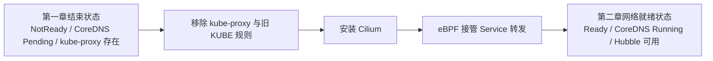

# 第 2 步：安装并验收 Cilium 网络平面

## 本步目标

将第一章尚未安装 CNI 的集群切换到 `Cilium`，并直接启用：

- `native routing`
- `eBPF kube-proxy replacement`
- `Hubble`
- `BGP Control Plane`

本步完成后，应达到下面状态：

- `Cilium` 已在所有节点运行
- `kube-proxy` 已退出集群
- 所有节点从 `NotReady` 进入 `Ready`
- `CoreDNS` 已从 `Pending` 进入 `Running`
- `Hubble Relay` 与 `Hubble UI` 已运行

## 执行标记

- **执行标记：必须执行**

说明：

- 这是第二章最核心的一步
- 本步完成后，第一章的“控制平面已建立、网络尚未完成”状态会正式切换为“网络平面可用”

## 问题背景

第一章结束时，集群已经具备：

- 控制平面
- Worker 节点
- Harbor
- API 高可用入口

但还没有具备：

- CNI
- Pod 网络
- Service 转发能力
- CoreDNS 正常运行所需的网络基础

第二章的第一性目标，就是让这一套集群真正拥有可用的网络平面。

## 理论说明

### 安装前后的状态变化



这张图说明：

- 安装 `Cilium` 不是“再加一个网络组件”
- 而是把第一章未完成的网络平面正式补齐，并让 `eBPF` 接管关键数据路径

### 为什么这一步必须先清理 `kube-proxy`

第一章的集群是通过 `kubeadm` 初始化的，因此默认已经安装了 `kube-proxy`。

而第二章的目标不是继续沿用传统 `iptables/ipvs` 风格的 Service 转发，而是让 `Cilium` 通过 `eBPF` 直接接管这部分能力。

因此在安装 `Cilium` 之前，必须先完成下面两件事：

1. 删除 `kube-proxy` DaemonSet 与 ConfigMap
2. 清理各节点中遗留的 `KUBE-*` iptables 规则

如果不先清理，容易导致：

- 旧的 `kube-proxy` 规则继续影响转发路径
- `Cilium` 与 `kube-proxy` 对 Service 转发产生角色重叠

### 为什么这里使用 `native routing`

第二章不仅要把 CNI 跑通，还要把下面这些内容讲清楚：

- `Pod CIDR`
- 东西向路由可达性
- `BGP`
- `Route Reflector`

因此本章不采用 tunnel 模式，而是采用：

```text
routingMode: native
```

这样后面讲 `VyOS Route Reflector` 和 `Cilium BGP Control Plane` 时，控制面主线会更清晰。

### 为什么这里要显式指定 `k8sServiceHost` 和 `k8sServicePort`

启用 `kube-proxy replacement` 后，`Cilium` 不再依赖传统 `kube-proxy` 提供 Kubernetes Service 访问路径。

因此必须显式指定：

- `k8sServiceHost: 10.1.1.10`
- `k8sServicePort: 6443`

也就是让 `Cilium` 直接通过 API VIP 去访问 Kubernetes API Server。

### 本步核心 values 关键字段示意

第二章安装使用的核心配置位于：

- `manifests/cilium-values.yaml`

其中最关键的字段如下：

```yaml
k8sServiceHost: "10.1.1.10"
k8sServicePort: 6443

routingMode: "native"
autoDirectNodeRoutes: true
ipv4NativeRoutingCIDR: "10.244.0.0/16"

kubeProxyReplacement: true
bgpControlPlane:
  enabled: true

hubble:
  enabled: true
```

关键字段说明：

- `k8sServiceHost` / `k8sServicePort`
  - 让 `Cilium` 直接访问 API VIP
- `routingMode: native`
  - 明确本章使用原生路由模式
- `ipv4NativeRoutingCIDR`
  - 固定原生路由下的 Pod 网段
- `kubeProxyReplacement: true`
  - 启用 `eBPF` 接管 Service 转发
- `bgpControlPlane.enabled: true`
  - 提前为第二章后半段 BGP 演示打开控制面能力
- `hubble.enabled: true`
  - 同步启用第二章需要的可观测能力

## 对应脚本

本步对应脚本：

- `k8s/02-cloud-native-networking/scripts/02_install_cilium.sh`

本步直接依赖下面两个本地文件：

- Helm chart：`artifacts/cilium-1.19.1.tgz`
- values 文件：`manifests/cilium-values.yaml`

## 脚本内部在做什么

### 脚本执行主线

脚本整体分为 5 个阶段：

1. 删除 `kube-proxy`
2. 清理所有节点上的 `KUBE-*` iptables 规则
3. 通过 Helm 安装 `Cilium`
4. 等待关键组件就绪
5. 输出节点与 `kube-system` 组件状态

### 重要任务 1：删除 `kube-proxy`

脚本原始代码：

```bash
cleanup_kube_proxy() {
  echo "[1/5] 删除 kube-proxy DaemonSet 与 ConfigMap"
  kubectl -n kube-system delete ds kube-proxy --ignore-not-found
  kubectl -n kube-system delete cm kube-proxy --ignore-not-found
}
```

这一段的作用是：

- 先把第一章遗留的 `kube-proxy` 组件移出集群

### 重要任务 2：清理各节点上的 `KUBE-*` iptables 规则

脚本原始代码：

```bash
echo "[iptables 1/2] 清理 IPv4 中的 KUBE 规则"
iptables-save | grep -v 'KUBE' | iptables-restore

echo "[iptables 2/2] 清理 IPv6 中的 KUBE 规则"
ip6tables-save | grep -v 'KUBE' | ip6tables-restore || true
```

这一段的作用是：

- 清除第一章 `kube-proxy` 留下的规则痕迹
- 为 `Cilium` 接管 Service 转发清出干净环境

### 重要任务 3：通过 Helm 安装 `Cilium`

脚本原始代码：

```bash
install_cilium() {
  echo "[3/5] 通过 Helm 安装 Cilium"
  helm upgrade --install cilium "${CHART_FILE}" \
    --namespace kube-system \
    --values "${VALUES_FILE}"
}
```

这一段的作用是：

- 使用本地 chart 和本地 values 安装 `Cilium`
- 不在安装时临时拉取远端 chart

### 重要任务 4：等待关键组件就绪

脚本原始代码：

```bash
wait_for_cilium() {
  echo "[4/5] 等待 Cilium 组件就绪"
  kubectl -n kube-system rollout status ds/cilium --timeout=10m
  kubectl -n kube-system rollout status deploy/cilium-operator --timeout=10m
  kubectl -n kube-system rollout status deploy/hubble-relay --timeout=10m
  kubectl -n kube-system rollout status deploy/hubble-ui --timeout=10m
  cilium status --wait
}
```

这一段的作用是：

- 等待 `cilium`
- 等待 `cilium-operator`
- 等待 `hubble-relay`
- 等待 `hubble-ui`
- 最后再通过 `cilium status --wait` 做统一状态确认

### 重要任务 5：输出安装后的首轮验收结果

脚本原始代码：

```bash
verify_basic_state() {
  echo "[5/5] 查看节点与 kube-system 组件状态"
  kubectl get nodes -o wide
  kubectl get pods -n kube-system -o wide
}
```

这一段的作用是：

- 让安装完成后立即能看到节点状态变化
- 让 `CoreDNS`、`Cilium`、`Hubble` 的基本状态直接可见

## 执行命令

先给脚本增加执行权限：

```bash
chmod +x /docker_k8s_2026/k8s/02-cloud-native-networking/scripts/02_install_cilium.sh
```

然后执行：

```bash
bash /docker_k8s_2026/k8s/02-cloud-native-networking/scripts/02_install_cilium.sh
```

## 验证方法

### 验证 1：查看 `Cilium` 总体状态

```bash
cilium status --wait
```

预期结果：

- `Cilium` 为 `OK`
- `Operator` 为 `OK`
- `Hubble Relay` 为 `OK`

关键看点：

- 不需要人工通读所有字段
- 重点确认 `Cilium`、`Operator`、`Hubble Relay` 的总体状态

### 验证 2：查看节点状态

```bash
kubectl get nodes -o wide
```

预期结果：

- `cp01`、`cp02`、`cp03` 为 `Ready`
- `wk-app01`、`wk-app02`、`wk-edge01`、`wk-obs01` 为 `Ready`

这一步的含义是：

- 第一章遗留的 `NotReady` 状态已被网络平面修复

### 验证 3：查看 `kube-system` Pod

```bash
kubectl get pods -n kube-system -o wide
```

预期结果：

- `cilium` DaemonSet 已运行
- `cilium-operator` 已运行
- `hubble-relay` 已运行
- `hubble-ui` 已运行
- `coredns` 已从 `Pending` 进入 `Running`
- `kube-proxy` 已不再存在

关键看点：

- `cilium-*`
- `hubble-*`
- `coredns`
- 不应再看到 `kube-proxy`

### 验证 4：查看 `Hubble` Service

```bash
kubectl get svc -n kube-system hubble-relay hubble-ui
```

预期结果：

- 可以看到 `hubble-relay`
- 可以看到 `hubble-ui`

## 通过标准

满足下面条件即可进入下一步：

- `Cilium` 已在所有节点成功运行
- `kube-proxy` 已从集群移除
- 全部节点已变为 `Ready`
- `CoreDNS` 已恢复为 `Running`
- `Cilium` 与 `Hubble` 关键组件正常

## 下一步

下一步进入第一个应用层演示：

- `docs/04_service_discovery.md`
