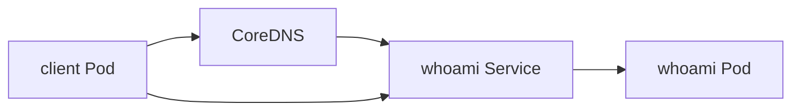
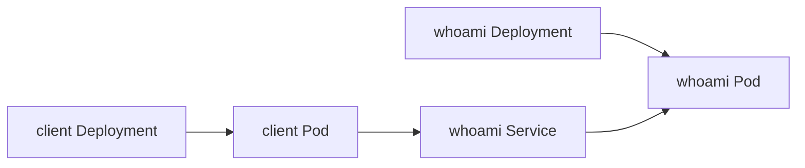

# 第 3 步：演示 Pod、Service、DNS 与 Service Discovery

## 测试目标

在第二章前半段网络恢复之后，用一个最小化应用演示下面 4 件事情已经打通：

- Pod 已经可以正常创建
- Service 已经可以正常分发
- 集群内 DNS 已经可以解析 Service 名称
- 业务 Pod 可以通过 Service 名称访问目标服务

## 执行标记

- **执行标记：必须执行**

说明：

- 本步是第二章安装 Cilium 后的第一个业务层验证
- 它不再验证“组件是否安装成功”，而是验证“网络能力是否真的能被业务访问使用”

## 理论说明

### 本步演示拓扑

本步使用两个工作负载：

- `whoami`
  - 提供 HTTP 响应
- `client`
  - 在 Pod 内发起访问请求

命名空间统一使用：

- `net-demo`

### Service Discovery 关系图



这张图表达了本步要验证的完整链路：

1. `client` 发起请求
2. 通过 `CoreDNS` 解析 `whoami`
3. 解析结果落到 `whoami Service`
4. `Service` 再把流量转发到后端 `whoami Pod`

### 先理解 3 个基础对象

这是第二章第一次正式接触 Kubernetes 业务对象，因此这里先把最基础的 3 个概念讲清楚：

- `Namespace`
  - 用来做资源隔离
- `Deployment`
  - 用来声明“我要几个 Pod、Pod 里跑什么容器”
- `Service`
  - 用来给一组 Pod 提供稳定入口

这一页中：

- `net-demo` 是演示专用命名空间
- `whoami Deployment` 负责创建服务端 Pod
- `whoami Service` 负责给服务端 Pod 提供稳定访问名
- `client Deployment` 负责创建客户端 Pod，用来发起访问请求

### `Deployment`、`Service` 与 Pod 关系图



这张图强调的是：

- `Deployment` 负责创建 Pod
- `Service` 不创建 Pod
- `Service` 只是根据标签选中后端 Pod，并提供稳定访问入口

### 为什么这一页必须同时讲短名和 FQDN

在 Kubernetes 集群内，Service 通常既可以通过短名访问：

```text
whoami
```

也可以通过完整域名访问：

```text
whoami.net-demo.svc.cluster.local
```

这两种访问方式分别对应：

- 短名访问
  - 便于日常业务调用
- FQDN 访问
  - 更适合解释完整 DNS 解析链路

因此本步必须同时验证二者。

### 本步清单原文与关键内容

本步会使用下面 3 份清单：

- `manifests/00_net-demo_namespace.yaml`
- `manifests/10_whoami.yaml`
- `manifests/20_client.yaml`

#### 清单 1：命名空间

```yaml
apiVersion: v1
kind: Namespace
metadata:
  name: net-demo
```

关键看点：

- `kind: Namespace`
  - 说明这是一个命名空间对象
- `name: net-demo`
  - 第二章这组演示统一放在这个隔离空间里

#### 清单 2：`whoami` Deployment 与 Service

```yaml
apiVersion: apps/v1
kind: Deployment
metadata:
  name: whoami
  namespace: net-demo
spec:
  replicas: 1
  selector:
    matchLabels:
      app: whoami
  template:
    metadata:
      labels:
        app: whoami
    spec:
      containers:
        - name: whoami
          image: harbor.qytk8s.com/cilium/whoami:v1.10.3
          imagePullPolicy: IfNotPresent
          ports:
            - containerPort: 80
---
apiVersion: v1
kind: Service
metadata:
  name: whoami
  namespace: net-demo
spec:
  selector:
    app: whoami
  ports:
    - name: http
      port: 80
      targetPort: 80
```

关键看点：

- `kind: Deployment`
  - 表示这里先创建的是工作负载控制器，不是单独手搓一个 Pod
- `replicas: 1`
  - 主线先保留 1 个服务端 Pod，先把 `Deployment`、`Service`、DNS 三件事讲清楚
- `template.metadata.labels.app: whoami`
  - 这是 Pod 身上的标签
- `Service.spec.selector.app: whoami`
  - 这是 Service 选择后端 Pod 的条件
- `port: 80`
  - 这是 Service 对外暴露的端口
- `targetPort: 80`
  - 这是 Service 转发到容器里的端口

这里最关键的一层关系是：

- Pod 身上打了 `app: whoami`
- Service 用 `selector: app: whoami` 去选中它

因此 `whoami Service` 才知道应该把流量转发给哪个 Pod。

另外，`whoami` 镜像返回的页面中会带出当前处理请求的主机名。

在 Kubernetes 里，这个主机名通常就是 Pod 名称。因此后面如果把 `whoami` 临时扩成多个副本，就可以通过返回内容直接观察请求是否被分发到了不同 Pod。

#### 清单 3：`client` Deployment

```yaml
apiVersion: apps/v1
kind: Deployment
metadata:
  name: client
  namespace: net-demo
spec:
  replicas: 1
  selector:
    matchLabels:
      app: client
  template:
    metadata:
      labels:
        app: client
    spec:
      containers:
        - name: client
          image: harbor.qytk8s.com/cilium/curl:8.12.1
          imagePullPolicy: IfNotPresent
          command:
            - sh
            - -c
            - sleep infinity
```

关键看点：

- `kind: Deployment`
  - `client` 也是通过 Deployment 创建出来的 Pod
- `image: harbor.qytk8s.com/cilium/curl:8.12.1`
  - 这里使用的是一个带 `curl` 的轻量客户端镜像
- `sleep infinity`
  - 让 Pod 保持常驻，便于后续反复进入容器执行 `curl`

可以把 `client` 理解成：

- 一个专门放在集群里的“测试终端”
- 后面所有 Service Discovery 测试都从它里面发起

## 对应脚本

本步使用的原始清单文件仍然保存在项目目录中，而不是嵌入脚本：

- `manifests/00_net-demo_namespace.yaml`
- `manifests/10_whoami.yaml`
- `manifests/20_client.yaml`

说明：

- 本页主线按“手动逐条执行”展开
- `k8s/02-cloud-native-networking/scripts/03_apply_service_discovery_demo.sh` 只是把下面这些命令串起来的一把梭脚本
- 教材主线不依赖这个脚本

## 测试过程与关键看点

### 步骤 1：创建演示命名空间与工作负载

执行命令：

```bash
kubectl apply -f http://ops:9000/02-cloud-native-networking/manifests/00_net-demo_namespace.yaml
kubectl apply -f http://ops:9000/02-cloud-native-networking/manifests/10_whoami.yaml
kubectl apply -f http://ops:9000/02-cloud-native-networking/manifests/20_client.yaml
```

本步在做什么：

- 创建 `net-demo` 命名空间
- 创建 `whoami Deployment`
- 创建 `whoami Service`
- 创建 `client Deployment`

结果看点：

- 输出应为 `created` 或 `configured`
- 这一步只是把对象提交进集群，还不能说明 `Service Discovery` 已经成功

### 步骤 2：等待工作负载进入可用状态

执行命令：

```bash
kubectl rollout status deployment/whoami -n net-demo --timeout=5m
kubectl rollout status deployment/client -n net-demo --timeout=5m
```

本步在做什么：

- 等待 `whoami` 与 `client` 都进入 `Available`

结果看点：

- 应出现 `deployment "whoami" successfully rolled out`
- 应出现 `deployment "client" successfully rolled out`

### 步骤 3：查看 Pod 与 Service 当前状态

执行命令：

```bash
kubectl get pods -n net-demo -o wide
kubectl get svc -n net-demo
```

本步在做什么：

- 观察 `whoami` 与 `client` Pod 是否已经 `Running`
- 观察 `whoami Service` 是否已经创建完成

结果看点：

- `whoami` 与 `client` 应为 `Running`
- `whoami` Service 应存在
- `CLUSTER-IP` 应已经分配

这里可以这样理解：

- Pod 是真正运行容器的地方
- `CLUSTER-IP` 是 Service 在集群内部拿到的稳定访问地址
- 后面 `client` 访问 `whoami` 时，先访问的是 Service，而不是直接访问 Pod IP

### 步骤 4：从 `client` 测试短名访问

执行命令：

```bash
kubectl exec -n net-demo deployment/client -- curl -sS http://whoami
```

本步在做什么：

- 从业务 Pod 内通过短名访问 `whoami Service`

结果看点：

- 应返回 `whoami` 页面内容
- 这说明 `client Pod -> whoami Service -> whoami Pod` 的调用链已经打通

### 步骤 5：从 `client` 测试 FQDN 访问

执行命令：

```bash
kubectl exec -n net-demo deployment/client -- curl -sS http://whoami.net-demo.svc.cluster.local
```

本步在做什么：

- 用完整域名验证 Kubernetes 集群内 DNS 解析链路

结果看点：

- 返回结果应与短名访问一致
- 这说明完整 FQDN 也能正确落到 `whoami Service`

### 步骤 6：在 Pod 内查看解析结果

执行命令：

```bash
kubectl exec -n net-demo deployment/client -- sh -c 'getent hosts whoami'
```

本步在做什么：

- 直接在 `client` Pod 内查看 `whoami` 的解析结果

结果看点：

- 输出中应出现一个 `ClusterIP`
- 该地址应对应 `whoami Service`

## 扩展实验：把 `whoami` 扩成 2 个副本并观察基础负载分发

这一组扩展实验不改变本页主线通过标准，但它更有利于后面配合 `Hubble` 观察多条业务流量。

### 扩展步骤 1：把 `whoami` 扩容到 2 个副本

执行命令：

```bash
kubectl scale deployment whoami -n net-demo --replicas=2
kubectl rollout status deployment/whoami -n net-demo --timeout=5m
kubectl get pods -n net-demo -l app=whoami -o wide
```

结果看点：

- 应看到 `2` 个 `whoami` Pod 都已进入 `Running`
- 两个 Pod 名应不同

### 扩展步骤 2：连续多次访问 `whoami Service`

执行命令：

```bash
kubectl exec -n net-demo deployment/client -- sh -c 'for i in 1 2 3 4 5 6 7 8; do curl -sS http://whoami | grep Hostname; done'
```

结果看点：

- 输出中应出现 `Hostname`
- 如果 Service 已经在多个后端之间分发流量，`Hostname` 会在两个不同的 Pod 名之间切换

本步的判断标准不是“严格轮询”，而是：

- 是否出现了不止一个后端 Pod 名

### 扩展步骤 3：恢复主线环境

执行命令：

```bash
kubectl scale deployment whoami -n net-demo --replicas=1
kubectl rollout status deployment/whoami -n net-demo --timeout=5m
```

结果看点：

- `whoami` 恢复为 `1` 个副本
- 环境重新回到主线状态

## 通过标准

满足下面条件后，可进入下一步：

- Pod 创建正常
- Service 创建正常
- DNS 解析正常
- 业务 Pod 可通过短名与 FQDN 正常访问目标服务

## 下一步

下一步进入 Hubble 可观测性演示：

- `docs/05_enable_hubble.md`
