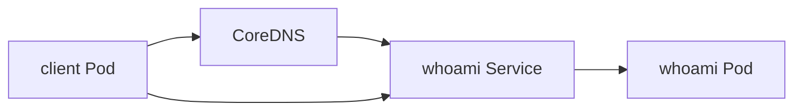

# 第 3 步：演示 Pod、Service、DNS 与 Service Discovery

## 测试目标

在第二章前半段网络恢复之后，用一个最小化应用演示下面 4 件事情已经打通：

- Pod 已经可以正常创建
- Service 已经可以正常分发
- 集群内 DNS 已经可以解析 Service 名称
- 业务 Pod 可以通过 Service 名称访问目标服务

## 执行标记

- **执行标记：必须执行**

说明：

- 本步是第二章安装 Cilium 后的第一个业务层验证
- 它不再验证“组件是否安装成功”，而是验证“网络能力是否真的能被业务访问使用”

## 理论说明

### 本步演示拓扑

本步使用两个工作负载：

- `whoami`
  - 提供 HTTP 响应
- `client`
  - 在 Pod 内发起访问请求

命名空间统一使用：

- `net-demo`

### Service Discovery 关系图



这张图表达了本步要验证的完整链路：

1. `client` 发起请求
2. 通过 `CoreDNS` 解析 `whoami`
3. 解析结果落到 `whoami Service`
4. `Service` 再把流量转发到后端 `whoami Pod`

### 为什么这一页必须同时讲短名和 FQDN

在 Kubernetes 集群内，Service 通常既可以通过短名访问：

```text
whoami
```

也可以通过完整域名访问：

```text
whoami.net-demo.svc.cluster.local
```

这两种访问方式分别对应：

- 短名访问
  - 便于日常业务调用
- FQDN 访问
  - 更适合解释完整 DNS 解析链路

因此本步必须同时验证二者。

### 本步清单关键对象示意

本步会使用下面 3 份清单：

- `manifests/00_net-demo_namespace.yaml`
- `manifests/10_whoami.yaml`
- `manifests/20_client.yaml`

其中最关键的字段如下：

#### `whoami` Deployment + Service

```yaml
metadata:
  name: whoami
  namespace: net-demo
spec:
  selector:
    app: whoami
```

以及：

```yaml
spec:
  selector:
    app: whoami
  ports:
    - port: 80
      targetPort: 80
```

关键字段说明：

- `namespace: net-demo`
  - 把演示环境隔离在第二章专用命名空间中
- `selector: app: whoami`
  - 让 Service 选择到 `whoami Pod`
- `port: 80 / targetPort: 80`
  - 表示 Service 对外暴露 80，并转发到 Pod 的 80

#### `client` Deployment

```yaml
containers:
  - name: client
    image: harbor.qytk8s.com/cilium/curl:8.12.1
    command:
      - sh
      - -c
      - sleep infinity
```

关键字段说明：

- 使用 `curl` 镜像作为主动发起访问的客户端
- `sleep infinity`
  - 让 Pod 保持常驻，便于后续反复执行 `kubectl exec`

## 对应脚本

本步使用的原始清单文件仍然保存在项目目录中，而不是嵌入脚本：

- `manifests/00_net-demo_namespace.yaml`
- `manifests/10_whoami.yaml`
- `manifests/20_client.yaml`

说明：

- 本页主线按“手动逐条执行”展开
- `k8s/02-cloud-native-networking/scripts/03_apply_service_discovery_demo.sh` 只是把下面这些命令串起来的一把梭脚本
- 教材主线不依赖这个脚本

## 测试过程与关键看点

### 步骤 1：创建演示命名空间与工作负载

执行命令：

```bash
kubectl apply -f http://ops:9000/02-cloud-native-networking/manifests/00_net-demo_namespace.yaml
kubectl apply -f http://ops:9000/02-cloud-native-networking/manifests/10_whoami.yaml
kubectl apply -f http://ops:9000/02-cloud-native-networking/manifests/20_client.yaml
```

本步在做什么：

- 创建 `net-demo` 命名空间
- 创建 `whoami` 服务端工作负载
- 创建 `client` 客户端工作负载

结果看点：

- 输出应为 `created` 或 `configured`
- 这一步只是下发资源，还不能证明业务已经可访问

### 步骤 2：等待工作负载进入可用状态

执行命令：

```bash
kubectl rollout status deployment/whoami -n net-demo --timeout=5m
kubectl rollout status deployment/client -n net-demo --timeout=5m
```

本步在做什么：

- 等待 `whoami` 与 `client` 都进入 `Available`

结果看点：

- 应出现 `deployment "whoami" successfully rolled out`
- 应出现 `deployment "client" successfully rolled out`

### 步骤 3：查看 Pod 与 Service 当前状态

执行命令：

```bash
kubectl get pods -n net-demo -o wide
kubectl get svc -n net-demo
```

本步在做什么：

- 观察 `whoami` 与 `client` Pod 是否已经 `Running`
- 观察 `whoami` Service 是否已经创建完成

结果看点：

- `whoami` 与 `client` 应为 `Running`
- `whoami` Service 应存在
- `CLUSTER-IP` 应已经分配

### 步骤 4：从 `client` 测试短名访问

执行命令：

```bash
kubectl exec -n net-demo deployment/client -- curl -sS http://whoami
```

本步在做什么：

- 从业务 Pod 内通过短名访问 `whoami Service`

结果看点：

- 应返回 `whoami` 页面内容
- 这说明 Pod 到 Service 的调用链已经打通

### 步骤 5：从 `client` 测试 FQDN 访问

执行命令：

```bash
kubectl exec -n net-demo deployment/client -- curl -sS http://whoami.net-demo.svc.cluster.local
```

本步在做什么：

- 用完整域名验证 Kubernetes 集群内 DNS 解析链路

结果看点：

- 返回结果应与短名访问一致
- 这说明完整 FQDN 也能正确落到 `whoami Service`

### 步骤 6：在 Pod 内查看解析结果

执行命令：

```bash
kubectl exec -n net-demo deployment/client -- sh -c 'getent hosts whoami'
```

本步在做什么：

- 直接在 `client` Pod 内查看 `whoami` 的解析结果

结果看点：

- 输出中应出现一个 `ClusterIP`
- 该地址应对应 `whoami Service`

## 通过标准

满足下面条件后，可进入下一步：

- Pod 创建正常
- Service 创建正常
- DNS 解析正常
- 业务 Pod 可通过短名与 FQDN 正常访问目标服务

## 下一步

下一步进入 Hubble 可观测性演示：

- `docs/05_enable_hubble.md`
