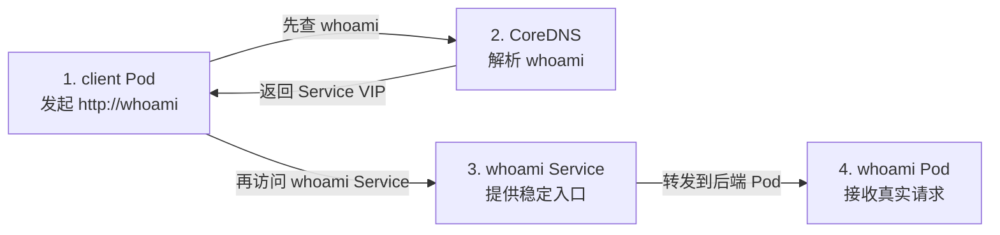
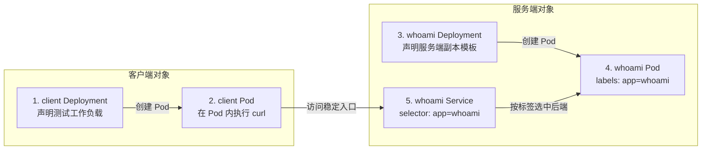

# 第 3 步：演示 Pod、Service、DNS 与 Service Discovery

## 本步目标

用一个最小化应用验证下面 4 件事情已经打通：

- Pod 已经可以正常创建
- Service 已经可以正常分发
- 集群内 DNS 已经可以解析 Service 名称
- 业务 Pod 可以通过 Service 名称访问目标服务

---

## 执行标记

- **执行标记：必须执行**
- 安装 Cilium 后的第一组业务验证

---

## 理论说明

### 本步演示拓扑

本步使用两个工作负载：

- `whoami`：提供 HTTP 响应
- `client`：在 Pod 内发起访问请求

命名空间统一使用 `net-demo`。

### Service Discovery 关系图



完整链路是：`client` 先经 `CoreDNS` 解析 `whoami`，再访问 `whoami Service`，最后由 `Service` 转发到后端 `Pod`。

### 先理解 3 个基础对象

本节先用 3 个基础对象串起最小业务链路：

- `Namespace`
  - 用来做资源隔离
- `Deployment`
  - 用来声明“我要几个 Pod、Pod 里跑什么容器”
- `Service`
  - 用来给一组 Pod 提供稳定入口

本步中：

- `net-demo` 是演示专用命名空间
- `whoami Deployment` 负责创建服务端 Pod
- `whoami Service` 负责给服务端 Pod 提供稳定访问名
- `client Deployment` 负责创建客户端 Pod，用来发起访问请求

### `Deployment`、`Service` 与 Pod 关系图



图中强调三层关系：`Deployment` 创建 Pod，`Service` 通过 `selector` 选中后端 Pod，`client Pod` 通过 `Service` 访问服务端。

### 为什么同时验证短名和 FQDN

在 Kubernetes 集群内，Service 通常既可以通过短名访问：

```text
whoami
```

也可以通过完整域名访问：

```text
whoami.net-demo.svc.cluster.local
```

短名适合日常调用，FQDN 更便于理解完整 DNS 链路，因此本步同时验证二者。

### 本步清单原文与关键内容

本步使用下面 3 份清单：

- `manifests/00_net-demo_namespace.yaml`
- `manifests/10_whoami.yaml`
- `manifests/20_client.yaml`

#### 清单 1：命名空间

```yaml
apiVersion: v1
kind: Namespace
metadata:
  name: net-demo
```

关键看点：

- `kind: Namespace`
  - 说明这是一个命名空间对象
- `name: net-demo`
  - 第二章这组演示统一放在这个隔离空间里

#### 清单 2：`whoami` Deployment 与 Service

```yaml
apiVersion: apps/v1
kind: Deployment
metadata:
  name: whoami
  namespace: net-demo
spec:
  replicas: 1
  selector:
    matchLabels:
      app: whoami
  template:
    metadata:
      labels:
        app: whoami
    spec:
      containers:
        - name: whoami
          image: harbor.qytk8s.com/cilium/whoami:v1.10.3
          imagePullPolicy: IfNotPresent
          ports:
            - containerPort: 80
---
apiVersion: v1
kind: Service
metadata:
  name: whoami
  namespace: net-demo
spec:
  selector:
    app: whoami
  ports:
    - name: http
      port: 80
      targetPort: 80
```

关键看点：

- `kind: Deployment`
  - 创建的是工作负载控制器
- `replicas: 1`
  - 主线先保留 `1` 个服务端 Pod
- `template.metadata.labels.app: whoami`
  - 这是 Pod 身上的标签
- `Service.spec.selector.app: whoami`
  - 这是 Service 选择后端 Pod 的条件
- `port: 80`
  - 这是 Service 对外暴露的端口
- `targetPort: 80`
  - 这是 Service 转发到容器里的端口

最关键的关系是：Pod 带有 `app: whoami` 标签，`whoami Service` 用 `selector: app: whoami` 选中它。

`whoami` 页面还会返回当前 Pod 主机名，后面扩容到多个副本时可以直接观察流量分发结果。

#### 清单 3：`client` Deployment

```yaml
apiVersion: apps/v1
kind: Deployment
metadata:
  name: client
  namespace: net-demo
spec:
  replicas: 1
  selector:
    matchLabels:
      app: client
  template:
    metadata:
      labels:
        app: client
    spec:
      containers:
        - name: client
          image: harbor.qytk8s.com/cilium/curl:8.12.1
          imagePullPolicy: IfNotPresent
          command:
            - sh
            - -c
            - sleep infinity
```

关键看点：

- `kind: Deployment`
  - `client` 也通过 Deployment 创建
- `image: harbor.qytk8s.com/cilium/curl:8.12.1`
  - 使用带 `curl` 的轻量客户端镜像
- `sleep infinity`
  - 让 Pod 保持常驻，便于后续反复进入容器执行 `curl`

---

## 对应脚本

原始清单文件保存在项目目录中：

- `manifests/00_net-demo_namespace.yaml`
- `manifests/10_whoami.yaml`
- `manifests/20_client.yaml`

文档按手工命令展开；`k8s/02-cloud-native-networking/scripts/03_apply_service_discovery_demo.sh` 只是把这些命令串联起来。

---

## 执行过程与关键看点

### 步骤 1：创建演示命名空间与工作负载

执行命令：

```bash
kubectl apply -f http://ops:9000/02-cloud-native-networking/manifests/00_net-demo_namespace.yaml
kubectl apply -f http://ops:9000/02-cloud-native-networking/manifests/10_whoami.yaml
kubectl apply -f http://ops:9000/02-cloud-native-networking/manifests/20_client.yaml
```

关键看点：

- 输出应为 `created` 或 `configured`
- 这一步只表示对象已提交到集群

### 步骤 2：等待工作负载进入可用状态

执行命令：

```bash
kubectl rollout status deployment/whoami -n net-demo --timeout=5m
kubectl rollout status deployment/client -n net-demo --timeout=5m
```

关键看点：

- 应出现 `deployment "whoami" successfully rolled out`
- 应出现 `deployment "client" successfully rolled out`

### 步骤 3：查看 Pod 与 Service 当前状态

执行命令：

```bash
kubectl get pods -n net-demo -o wide
kubectl get svc -n net-demo
```

关键看点：

- `whoami` 与 `client` 应为 `Running`
- `whoami` Service 应存在
- `CLUSTER-IP` 应已经分配

### 步骤 4：从 `client` 测试短名访问

执行命令：

```bash
kubectl exec -n net-demo deployment/client -- curl -sS http://whoami
```

关键看点：

- 应返回 `whoami` 页面内容
- 这说明 `client Pod -> whoami Service -> whoami Pod` 的调用链已经打通

### 步骤 5：从 `client` 测试 FQDN 访问

执行命令：

```bash
kubectl exec -n net-demo deployment/client -- curl -sS http://whoami.net-demo.svc.cluster.local
```

关键看点：

- 返回结果应与短名访问一致
- 这说明完整 FQDN 也能正确落到 `whoami Service`

### 步骤 6：在 Pod 内查看解析结果

执行命令：

```bash
kubectl exec -n net-demo deployment/client -- sh -c 'getent hosts whoami'
```

关键看点：

- 输出中应出现一个 `ClusterIP`
- 该地址应对应 `whoami Service`

---

## 扩展实验：把 `whoami` 扩成 2 个副本并观察基础负载分发

本组扩展实验用于观察 `Service` 对多个后端 Pod 的基础分发，不影响本页通过标准。

### 扩展步骤 1：把 `whoami` 扩容到 2 个副本

执行命令：

```bash
kubectl scale deployment whoami -n net-demo --replicas=2
kubectl rollout status deployment/whoami -n net-demo --timeout=5m
kubectl get pods -n net-demo -l app=whoami -o wide
```

结果看点：

- 应看到 `2` 个 `whoami` Pod 都已进入 `Running`
- 两个 Pod 名应不同

### 扩展步骤 2：连续多次访问 `whoami Service`

执行命令：

```bash
kubectl exec -n net-demo deployment/client -- sh -c 'for i in 1 2 3 4 5 6 7 8; do curl -sS http://whoami | grep Hostname; done'
```

结果看点：

- 输出中应出现 `Hostname`
- 如果 Service 已经在多个后端之间分发流量，`Hostname` 会在两个不同的 Pod 名之间切换
- 判断标准不是严格轮询，而是是否出现了不止一个后端 Pod 名

### 扩展步骤 3：恢复主线环境

执行命令：

```bash
kubectl scale deployment whoami -n net-demo --replicas=1
kubectl rollout status deployment/whoami -n net-demo --timeout=5m
```

结果看点：

- `whoami` 恢复为 `1` 个副本
- 环境重新回到主线状态

---

## 通过标准

满足下面条件后，可进入下一步：

- Pod 创建正常
- Service 创建正常
- DNS 解析正常
- 业务 Pod 可通过短名与 FQDN 正常访问目标服务

---

## 下一步

下一步进入 Hubble 可观测性演示：

- `docs/05_enable_hubble.md`
