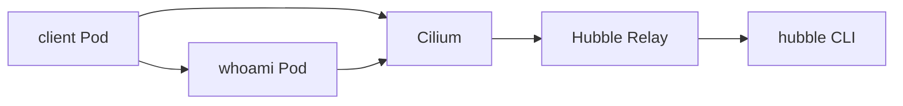

# 第 4 步：使用 Hubble 观察东西向流量

## 本步目标

在 `Cilium` 已经接管网络平面后，通过 `Hubble` 直接观察集群中的东西向流量。

本步重点不是“看一个界面”，而是确认下面这些能力已经成立：

- Pod 到 Pod 的访问路径可以被观察
- `client -> whoami` 的实际业务流量可以被观察
- `Cilium + eBPF` 已经能够对业务流量做可视化观测

## 执行标记

- **执行标记：必须执行**

说明：

- 本步是第二章观测主线的起点
- 它验证的不是“网络能不能通”，而是“流量是否已经可见”

## 问题背景

前两步已经完成：

- `Cilium` 安装
- Service Discovery 演示

这意味着业务流量已经存在，但如果不能观测流量，第二章就还没有把“可观测网络平面”这条主线真正建立起来。

因此，本步要进一步回答：

- 哪个 Pod 在访问哪个 Pod
- 流量是否被放行
- 这些结果能否通过 `Hubble` 直接观察到

## 理论说明

### `Hubble` 在第二章中的位置

`Hubble` 是 `Cilium` 的流量观测窗口。

它并不负责转发流量，而是负责把 `Cilium` 已经处理过的流量结果可视化地呈现出来。

### Hubble 观察关系图



这张图说明：

- 业务流量先由 `Cilium` 处理
- `Hubble Relay` 负责把流量观测能力汇聚起来
- `hubble CLI` 再从 Relay 侧读取观测结果

### 为什么第二章主线优先使用 CLI 而不是 UI

第二章要强调的是**东西向流量观测本身**。

因此本章主线优先使用：

- `hubble status`
- `hubble observe`

原因是：

- CLI 更适合精确观察流量
- CLI 更容易和 `client -> whoami` 这类实验步骤形成一一对应
- 不依赖额外的北向发布动作

`Hubble UI` 可以作为补充演示，但不应成为第二章主线验收标准。

## 对应脚本

本步对应脚本：

- `k8s/02-cloud-native-networking/scripts/04_enable_hubble.sh`

## 脚本内部在做什么

### 脚本执行主线

脚本整体分为 4 个阶段：

1. 检查 `Hubble Relay`
2. 建立本地端口转发
3. 生成演示流量
4. 观察 `net-demo` 命名空间中的流量

### 重要任务 1：检查 `Hubble Relay`

脚本原始代码：

```bash
kubectl get pods -n kube-system -l k8s-app=hubble-relay -o wide
```

这一段的作用是：

- 先确认 `hubble-relay` Pod 已存在

### 重要任务 2：建立本地端口转发

脚本原始代码：

```bash
kubectl -n kube-system port-forward svc/hubble-relay 4245:80 >/tmp/hubble-port-forward.log 2>&1 &
PORT_FORWARD_PID=$!
wait_for_hubble_relay
hubble status --server localhost:4245
```

这一段完成的是：

- 把 `hubble-relay` 暂时映射到 `ops` 本机的 `4245`
- 确认 `hubble` CLI 能与 Relay 建立连接

### 重要任务 3：生成演示流量

脚本原始代码：

```bash
kubectl exec -n net-demo deployment/client -- sh -c 'for i in 1 2 3; do curl -sS http://whoami >/dev/null; sleep 1; done'
```

这一段的作用是：

- 在集群中主动制造 `client -> whoami` 的业务流量

### 重要任务 4：观察 `net-demo` 流量

脚本原始代码：

```bash
hubble observe --server localhost:4245 --last 50 | grep -E 'net-demo/(client|whoami)'
```

这一段的作用是：

- 从最近的观测记录中筛选出 `net-demo` 命名空间内的业务流量

## 执行命令

先给脚本增加执行权限：

```bash
chmod +x /docker_k8s_2026/k8s/02-cloud-native-networking/scripts/04_enable_hubble.sh
```

然后执行：

```bash
bash /docker_k8s_2026/k8s/02-cloud-native-networking/scripts/04_enable_hubble.sh
```

## 关键看点

在 `Hubble` 输出中，优先看下面这些信息：

- 命名空间是否为 `net-demo`
- 源端是否为 `client`
- 目的端是否为 `whoami`
- verdict 是否为 `FORWARDED`

这比逐行阅读全部流量记录更重要。

## Hubble UI 补充说明

第二章主线验收以 CLI 为准，`Hubble UI` 仅作为补充展示。

如果需要临时查看图形界面，可在 `ops` 上执行：

```bash
kubectl -n kube-system port-forward --address 0.0.0.0 svc/hubble-ui 12000:80
```

然后从浏览器访问：

```text
http://10.1.1.201:12000
```

说明：

- 这属于临时课堂演示方式
- 不属于第二章主线验收项

## 通过标准

满足下面条件后，就可以进入下一步：

- `hubble status` 正常
- 能在观测结果中看到 `net-demo/client -> whoami` 的流量记录
- 流量 verdict 为 `FORWARDED`

## 下一步

下一步进入 `L3/L4` 与 `L7` 策略演示：

- `docs/06_l7_policy.md`
