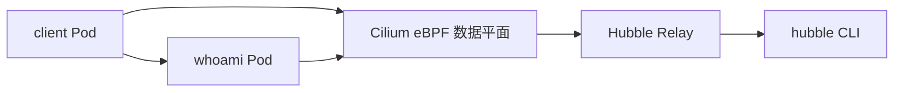
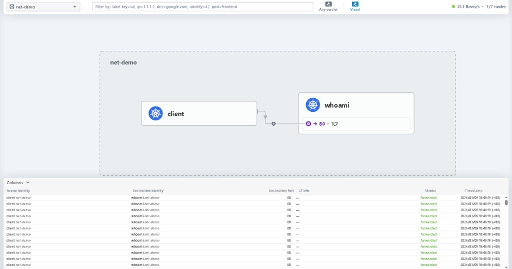

# 第 4 步：使用 Hubble 观察东西向流量

## 本步目标

在 `Cilium` 已经接管网络平面后，启用并接入 `Hubble` 观测入口，为后续观察流量做好准备。

本步先完成下面两件事：

- `ops` 可以通过端口转发访问 `hubble-relay`
- 后续章节需要时，可以继续通过 `CLI` 或 `UI` 观察流量

## 执行标记

- **执行标记：必须执行**

说明：

- 本步是第二章观测能力的准备步骤
- 主线重点是把 `Hubble` 接入到可用状态，而不是在这里做完整观测演示

## 问题背景

前两步已经完成：

- `Cilium` 安装
- Service Discovery 演示

这意味着业务流量已经存在，但在正式观察之前，还需要先把 `Hubble` 的访问入口接通。

因此，本步先回答下面两个问题：

- `hubble-relay` 是否已经就绪
- `ops` 是否已经可以接入 `Hubble`

## 理论说明

### `Hubble` 在第二章中的位置

`Hubble` 是 `Cilium` 的观测窗口，不负责转发流量。

它负责把 `Cilium` 已经在数据平面里看到的连接、方向、协议和 verdict 展示出来，因此这一步更接近“观察实验结果”，而不是再次部署网络组件。

### 观察链路关系图



这张图说明：

- 真正承载业务请求的是 `client -> whoami`
- `Cilium` 在数据平面记录这条连接
- `Hubble Relay` 汇聚观测能力
- `hubble` CLI 从 Relay 读取并展示结果

### 为什么第二章主线优先使用 CLI 而不是 UI

第二章要强调的是**东西向流量观测本身**。

因此本章主线优先使用：

- `hubble status`
- `hubble observe`

原因是：

- CLI 更适合精确观察流量
- CLI 更容易和 `client -> whoami` 这类实验步骤形成一一对应
- 不依赖额外的北向发布动作

`Hubble UI` 可以作为补充演示，但不应成为第二章主线验收标准。

### Hubble UI 参考图

下图是选择 `net-demo` 命名空间后的界面参考：



## 对应脚本

本步对应脚本：

- `k8s/02-cloud-native-networking/scripts/04_enable_hubble.sh`

## 脚本内部在做什么

### 脚本执行主线

脚本整体分为 4 个阶段：

1. 检查 `Hubble Relay`
2. 建立本地端口转发
3. 检查 `hubble` CLI 是否已经连通
4. 预留后续观测入口

## 执行命令

### 1. 先确认 `Hubble Relay` 已正常运行

```bash
kubectl get pods -n kube-system -l k8s-app=hubble-relay -o wide
```

关键看点：

- 至少看到 1 个 `hubble-relay` Pod
- `STATUS` 应为 `Running`
- 这一步只是在确认观测后端已就绪，不是在重新安装 `Hubble`

### 2. 在 `ops` 本机建立临时端口转发

```bash
kubectl -n kube-system port-forward svc/hubble-relay 4245:80 >/tmp/hubble-port-forward.log 2>&1
```

请保留这个终端窗口，不要关闭。

关键看点：

- 这一步只是把集群内的 `hubble-relay` 暂时映射到 `ops:4245`
- 它是课堂观察动作，不会修改集群状态

### 3. 在另一个终端确认 `hubble` CLI 已连通

```bash
hubble status --server localhost:4245
```

关键看点：

- 重点看 `Healthcheck (via localhost:4245): Ok`
- 看到 server 正常响应，就说明后面的 `observe` 可以使用

### 4. 完成接入后，保留后续观测入口

```bash
hubble status --server localhost:4245
```

关键看点：

- 重点看 `Healthcheck (via localhost:4245): Ok`
- 这说明 `ops` 已经具备后续观察流量的入口

### 5. 可选补充：临时查看 `Hubble UI`

如果课堂上需要补充图形化演示，可在 `ops` 上执行：

```bash
kubectl -n kube-system port-forward --address 0.0.0.0 svc/hubble-ui 12000:80
```

然后从浏览器访问：

```text
http://10.1.1.201:12000
```

关键看点：

- 这属于临时课堂演示方式
- 不属于第二章主线验收项

## 通过标准

满足下面条件后，就可以进入下一步：

- `hubble status --server localhost:4245` 返回正常
- `ops` 已能通过端口转发接入 `hubble-relay`
- 如需图形演示，`Hubble UI` 临时入口可打开

## 下一步

下一步进入 `L3/L4` 与 `L7` 策略演示：

- `docs/06_l7_policy.md`
