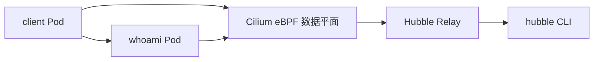

# 第 4 步：使用 Hubble 观察东西向流量

## 本步目标

在 `Cilium` 已经接管网络平面后，启用并接入 `Hubble` 观测入口，为后续观察流量做好准备。

本步先完成下面两件事：

- `ops` 可以通过临时端口转发接入 `hubble-relay`
- 为第二章后续的 `hubble` CLI 观察准备入口

## 执行标记

- **执行标记：必须执行**

说明：

- 本步是第二章观测能力的准备步骤
- 主线重点是把 `Hubble` 接入到可用状态，而不是在这里做完整观测演示
- 这一页使用的 `port-forward` 只是临时观察手段

## 问题背景

前两步已经完成：

- `Cilium` 安装
- Service Discovery 演示

这意味着业务流量已经存在，但在正式观察之前，还需要先把 `Hubble` 的访问入口接通。

因此，本步先回答下面两个问题：

- `hubble-relay` 是否已经就绪
- `ops` 是否已经可以接入 `Hubble`

## 理论说明

### `Hubble` 在第二章中的位置

`Hubble` 是 `Cilium` 的观测窗口，不负责转发流量。

它负责把 `Cilium` 已经在数据平面里看到的连接、方向、协议和 verdict 展示出来，因此这一步更接近“观察实验结果”，而不是再次部署网络组件。

### 观察链路关系图



这张图说明：

- 真正承载业务请求的是 `client -> whoami`
- `Cilium` 在数据平面记录这条连接
- `Hubble Relay` 汇聚观测能力
- `hubble` CLI 从 Relay 读取并展示结果

### 为什么第二章主线优先使用 CLI 而不是 UI

第二章要强调的是**东西向流量观测本身**。

因此本章主线优先使用：

- `hubble status`
- `hubble observe`

原因是：

- CLI 更适合精确观察流量
- CLI 更容易和 `client -> whoami` 这类实验步骤形成一一对应
- 不依赖额外的北向发布动作

### 为什么这里仍然使用 `port-forward`

第二章的重点是先证明：

- 流量已经能被 `Hubble` 观察到
- `hubble` CLI 已经可以使用

因此这里采用的是最直接的临时接入方式：

- `kubectl port-forward`

它的定位只是：

- 第二章的临时观察入口

## 对应脚本

本步对应脚本：

- `k8s/02-cloud-native-networking/scripts/04_enable_hubble.sh`

如果课堂上希望直接一把完成这一步，可以执行：

```bash
chmod +x /docker_k8s_2026/k8s/02-cloud-native-networking/scripts/04_enable_hubble.sh
bash /docker_k8s_2026/k8s/02-cloud-native-networking/scripts/04_enable_hubble.sh
```

这份脚本会连续完成下面几件事：

- 检查 `hubble-relay`
- 在 `ops` 上建立临时端口转发
- 生成一小段 `net-demo` 演示流量
- 只输出最关键的 4 类观测记录

但教材主线仍然建议按下面的手动步骤来理解每一个观察动作。

## 脚本内部在做什么

### 脚本执行主线

脚本整体分为 4 个阶段：

1. 检查 `Hubble Relay`
2. 建立本地端口转发
3. 检查 `hubble` CLI 是否已经连通
4. 输出关键 Hubble 观测记录

## 执行命令

### 1. 先确认 `Hubble Relay` 已正常运行

```bash
kubectl get pods -n kube-system -l k8s-app=hubble-relay -o wide
```

关键看点：

- 至少看到 1 个 `hubble-relay` Pod
- `STATUS` 应为 `Running`
- 这一步只是在确认观测后端已就绪，不是在重新安装 `Hubble`

### 2. 在 `ops` 本机建立临时端口转发

```bash
kubectl -n kube-system port-forward svc/hubble-relay 4245:80 >/tmp/hubble-port-forward.log 2>&1 &
echo $! > /tmp/hubble-port-forward.pid
```

关键看点：

- 这一步只是把集群内的 `hubble-relay` 暂时映射到 `ops:4245`
- 它是课堂观察动作，不会修改集群状态
- 建议使用后台方式启动，否则当前终端结束后，`4245` 监听也会一起消失

### 3. 在另一个终端确认 `hubble` CLI 已连通

```bash
hubble status --server localhost:4245
```

关键看点：

- 重点看 `Healthcheck (via localhost:4245): Ok`
- 看到 server 正常响应，就说明后面的 `observe` 可以使用

### 4. 手动触发一小段 `net-demo` 演示流量

```bash
kubectl exec -n net-demo deployment/client -- sh -c 'for i in 1 2 3; do curl -sS http://whoami >/dev/null; sleep 1; done'
```

关键看点：

- 这一步会从 `client` 连续访问 `whoami` 3 次
- 如果不先触发流量，后面的 `hubble observe` 可能看不到刚发生的演示记录

### 5. 观察一段关键的 `net-demo` 流量记录

执行命令：

```bash
hubble observe --server localhost:4245 --since 20s --last 100 | awk '
  /net-demo\/client-.*kube-system\/coredns-.*:53/ && !dns++ { print; next }
  /net-demo\/client-.*<> net-demo\/whoami:80/ && !svc++ { print; next }
  /net-demo\/client-.*-> net-demo\/whoami-[^ ]*:80/ && !backend++ { print; next }
  /net-demo\/client-.*<- net-demo\/whoami-[^ ]*:80/ && !reply++ { print; next }
'
```

示例输出：

```text
Mar 13 12:40:59.817: net-demo/client-5d75665b4d-c8th2:39222 (ID:48824) -> net-demo/whoami-578dd87854-j4hpd:80 (ID:6426) to-endpoint FORWARDED (TCP Flags: SYN)
Mar 13 12:40:59.817: net-demo/client-5d75665b4d-c8th2:39222 (ID:48824) <- net-demo/whoami-578dd87854-j4hpd:80 (ID:6426) to-stack FORWARDED (TCP Flags: SYN, ACK)
Mar 13 12:40:59.830: net-demo/client-5d75665b4d-c8th2:41760 (ID:48824) -> kube-system/coredns-5846f85477-2hk6h:53 (ID:54959) to-stack FORWARDED (UDP)
Mar 13 12:40:59.832: net-demo/client-5d75665b4d-c8th2 (ID:48824) <> net-demo/whoami:80 (world) pre-xlate-fwd TRACED (TCP)
```

说明：

- 上面这组记录保留的是本轮真实观察结果
- 这些记录可以帮助理解 `Hubble` 能看到哪些层次
- 但它们不适合被理解成一条严格按教学顺序展开的时间线

在教学上，更容易理解的完整请求过程通常是：

1. 先做 DNS 解析
2. 再命中 `whoami Service`
3. 然后转发到具体 `whoami Pod`
4. 最后建立 TCP 连接并返回响应

而 `hubble observe` 展示的是最近一批关键流量切片，因此显示顺序不一定和讲课时的理想顺序完全一致。

关键看点：

按正常请求路径来理解，这组记录分别说明：

1. 先进行 DNS 解析
   - `client -> coredns:53`
   - `FORWARDED (UDP)`
   - 说明 `client` 真实发起了对 `whoami` 的 DNS 查询

2. 再命中 `whoami Service`
   - `client <> whoami:80 pre-xlate-fwd TRACED`
   - 说明 Hubble 记录到了 `Service` 这一层
   - 也就是请求先落到了 `whoami Service`

3. 然后转发到具体后端 Pod
   - `client -> whoami-...:80`
   - `TCP Flags: SYN`
   - 说明流量已经从 `Service` 落到了具体 `whoami Pod`，并开始建立 TCP 连接

4. 最后由后端 Pod 返回连接确认
   - `client <- whoami-...:80`
   - `TCP Flags: SYN, ACK`
   - 说明后端 Pod 已收到连接请求，并返回确认响应

- `FORWARDED`
  - 表示这条流量被放行并成功转发
- `TRACED`
  - 表示 Hubble 在这一层记录到了 Service 相关的转发过程

这组输出最值得教学上强调的地方是：

- 可以同时看到：
  - DNS 请求
  - `Service` 这一层的转发记录
  - Pod 之间的建连过程

### 6. 观察完成后关闭临时端口转发

```bash
kill "$(cat /tmp/hubble-port-forward.pid)"
rm -f /tmp/hubble-port-forward.pid
```

关键看点：

- 这一步只是回收本机临时监听端口
- 不会影响集群中的 `hubble-relay` Pod

也就是说，`Hubble` 在这一页里不只是“看见有流量”，而是把 Pod、DNS 和 Service 几层动作都展示出来了。

## 通过标准

满足下面条件后，就可以进入下一步：

- `hubble status --server localhost:4245` 返回正常
- `ops` 已能通过端口转发接入 `hubble-relay`
- 第二章已经具备后续继续观察东西向流量的 CLI 入口

## 下一步

下一步进入 `L3/L4` 与 `L7` 策略演示：

- `docs/06_l7_policy.md`
