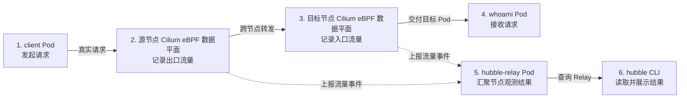
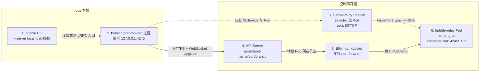
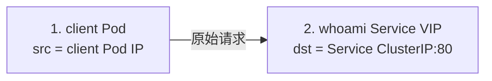
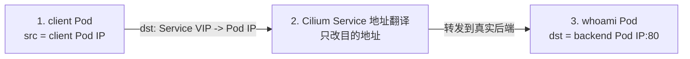

# 第 4 步：使用 Hubble 观察东西向流量

## 本步目标

接通 `Hubble` CLI 观察入口，为后续东西向流量观测做好准备。

本步完成下面两件事：

- `ops` 可以通过临时端口转发接入 `hubble-relay`
- 为第二章后续的 `hubble` CLI 观察准备入口

---

## 执行标记

- **执行标记：必须执行**
- 第二章观测入口准备步骤

---

## 理论说明

### 什么是 `Hubble`

`Hubble` 是 `Cilium` 的可观测层，不负责转发流量。

它负责把 `Cilium` 在数据平面里看到的连接、方向、协议和 `verdict` 展示出来。

官方入口：

- 官方文档：https://docs.cilium.io/en/stable/observability/hubble/index.html
- 安装与 CLI 说明：https://docs.cilium.io/en/stable/observability/hubble/setup/
- GitHub：https://github.com/cilium/hubble

### 观察链路关系图



图中要点是：业务流量经过源节点和目标节点的 `Cilium eBPF` 数据平面；`Hubble` 通过这些节点侧事件汇聚出观测结果。

### 为什么第二章主线优先使用 CLI 而不是 UI

第二章要强调的是东西向流量观测本身，因此主线优先使用：

- `hubble status`
- `hubble observe`

原因：

- CLI 更适合精确观察流量
- CLI 更容易和 `client -> whoami` 这类实验步骤一一对应
- 不依赖额外的北向发布动作

### 为什么这里仍然使用 `port-forward`

本章先证明两件事：

- 流量已经能被 `Hubble` 观察到
- `hubble` CLI 已经可以使用

因此这里使用最直接的临时接入方式：`kubectl port-forward`。

---

## 对应脚本

本步对应脚本：

- `k8s/02-cloud-native-networking/scripts/04_enable_hubble.sh`

如需一次完成本步，可执行：

```bash
chmod +x /docker_k8s_2026/k8s/02-cloud-native-networking/scripts/04_enable_hubble.sh
bash /docker_k8s_2026/k8s/02-cloud-native-networking/scripts/04_enable_hubble.sh
```

脚本会检查 `hubble-relay`、建立临时端口转发、生成一小段 `net-demo` 流量，并输出关键观测记录。

---

## 执行命令

### 1. 先确认 `Hubble Relay` 已正常运行

```bash
kubectl get pods -n kube-system -l k8s-app=hubble-relay -o wide
```

关键看点：

- 至少看到 1 个 `hubble-relay` Pod
- `STATUS` 应为 `Running`

### 2. 在 `ops` 本机建立临时端口转发

```bash
kubectl -n kube-system port-forward svc/hubble-relay 4245:80 >/tmp/hubble-port-forward.log 2>&1 &
echo $! > /tmp/hubble-port-forward.pid
```

临时端口转发关系图：



含义：`Service` 只负责帮助 `kubectl` 选中后端 Pod 和解析 `targetPort`；真正的隧道是 `kubectl -> API Server -> kubelet -> hubble-relay Pod:4245`。

关键看点：

- `1 -> 2`：`hubble CLI` 访问 `localhost:4245`，由 `kubectl port-forward` 在 `ops` 本机监听
- `2 -> 3`：`kubectl` 先查询 `service/hubble-relay`，用它来选 Pod 和解析 `targetPort`
- `2 -> 4`：真正建立隧道时，`kubectl` 先连接 `API Server`
- `4 -> 5`：`API Server` 再把 `port-forward` 转给目标节点上的 `kubelet`
- `5 -> 6`：最终流量进入选中的 `hubble-relay Pod:4245`
- 当前隧道建立过程是 `HTTPS` 连接升级为 `portforward.k8s.io` 会话
- 这属于临时观察入口，不会修改集群状态
- 使用后台方式启动更稳定，否则当前终端结束后，`4245` 监听也会一起消失

### 3. 在新的 shell 会话中确认 `hubble` CLI 已连通

```bash
hubble status --server localhost:4245
```

关键看点：

- 重点看 `Healthcheck (via localhost:4245): Ok`
- 看到 server 正常响应，就说明后面的 `observe` 可以使用

### 4. 手动触发一小段 `net-demo` 演示流量

```bash
kubectl exec -n net-demo deployment/client -- sh -c 'for i in 1 2 3; do curl -sS http://whoami >/dev/null; sleep 1; done'
```

关键看点：

- 这一步会从 `client` 连续访问 `whoami` 3 次
- 如果不先触发流量，后面的 `hubble observe` 可能看不到刚发生的演示记录

### 5. 观察一段关键的 `net-demo` 流量记录

执行命令：

```bash
hubble observe --server localhost:4245 --since 20s --last 100 | awk '
  /net-demo\/client-.*kube-system\/coredns-.*:53/ && !dns++ { print; next }
  /net-demo\/client-.*<> net-demo\/whoami:80/ && !svc++ { print; next }
  /net-demo\/client-.*-> net-demo\/whoami-[^ ]*:80/ && !backend++ { print; next }
  /net-demo\/client-.*<- net-demo\/whoami-[^ ]*:80/ && !reply++ { print; next }
'
```

示例输出：

```text
Mar 13 12:40:59.817: net-demo/client-5d75665b4d-c8th2:39222 (ID:48824) -> net-demo/whoami-578dd87854-j4hpd:80 (ID:6426) to-endpoint FORWARDED (TCP Flags: SYN)
Mar 13 12:40:59.817: net-demo/client-5d75665b4d-c8th2:39222 (ID:48824) <- net-demo/whoami-578dd87854-j4hpd:80 (ID:6426) to-stack FORWARDED (TCP Flags: SYN, ACK)
Mar 13 12:40:59.830: net-demo/client-5d75665b4d-c8th2:41760 (ID:48824) -> kube-system/coredns-5846f85477-2hk6h:53 (ID:54959) to-stack FORWARDED (UDP)
Mar 13 12:40:59.832: net-demo/client-5d75665b4d-c8th2 (ID:48824) <> net-demo/whoami:80 (world) pre-xlate-fwd TRACED (TCP)
```

说明：`hubble observe` 展示的是最近一批关键流量切片，显示顺序不一定与教学顺序完全一致。

关键看点：

1. 先进行 DNS 解析
   - `client -> coredns:53`
   - `FORWARDED (UDP)`
2. 再命中 `whoami Service`
   - `client <> whoami:80 pre-xlate-fwd TRACED`
3. 然后转发到具体后端 Pod
   - `client -> whoami-...:80`
   - `TCP Flags: SYN`
4. 最后由后端 Pod 返回连接确认
   - `client <- whoami-...:80`
   - `TCP Flags: SYN, ACK`

目的地址转换前：



目的地址转换后：



这一步主线下没有插入额外代理地址，变化的主要是目的地址：`Service VIP -> 后端 Pod IP`；源地址通常仍然是 `client Pod IP`。

- `FORWARDED`
  - 表示这条流量被放行并成功转发
- `TRACED`
  - 表示 Hubble 在某个 trace point 观察到了这条流量；如 `pre-xlate-fwd TRACED`，表示在 Service 地址翻译之前先记录到这条请求，并不表示它已经成为最终转发结论

### 6. 观察完成后关闭临时端口转发

```bash
kill "$(cat /tmp/hubble-port-forward.pid)"
rm -f /tmp/hubble-port-forward.pid
```

关键看点：

- 这一步只是回收本机临时监听端口
- 不会影响集群中的 `hubble-relay` Pod

---

## 通过标准

满足下面条件后，就可以进入下一步：

- `hubble status --server localhost:4245` 返回正常
- `ops` 已能通过端口转发接入 `hubble-relay`
- 第二章已经具备后续继续观察东西向流量的 CLI 入口

---

## 下一步

下一步进入 `L3/L4` 与 `L7` 策略演示：

- `docs/06_l7_policy.md`
