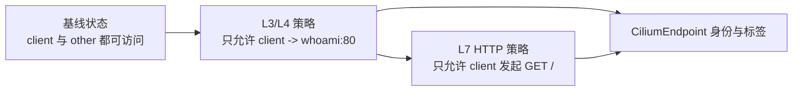

# 第 5 步：演示 L3/L4 与 L7 策略

## 测试目标

利用 `CiliumNetworkPolicy` 演示第二章最关键的东西向安全能力：

- `L3/L4` 级别的访问控制
- `L7` 级别的 HTTP 感知控制

本步使用 `whoami`、`client`、`other` 三个工作负载，依次验证下面 4 个状态：

1. 基线状态下，`client` 与 `other` 都可以访问 `whoami`
2. 应用 `L3/L4` 策略后，只允许 `client`
3. 切换为 `L7` 策略后，只允许 `client` 发起 `GET /`
4. 可以从 `CiliumNetworkPolicy` 与 `CiliumEndpoint` 侧看到策略对象已经生效

## 执行标记

- **执行标记：必须执行**

说明：

- 这一页不是在补充安装动作，而是在验证 `Cilium` 已经具备协议感知的安全控制能力
- 它是第二章从“网络已通”走向“网络可控”的关键一步

## 理论说明

### 策略收紧路径



这张图说明：

- 本步不是一上来就讲复杂的零信任体系
- 而是先从最容易理解的 3 层递进关系入手：
  - 默认全通
  - 先按工作负载身份控制
  - 再按 HTTP 行为控制

### `L3/L4` 与 `L7` 的区别

在 Kubernetes 网络策略里，常见的第一层控制是：

- 来源是谁
- 目标是谁
- 访问哪个端口

这就是这里的 `L3/L4` 控制。

例如本步第一份策略表达的是：

- 只有 `app=client` 的工作负载可以访问 `app=whoami`
- 只允许访问 TCP `80`

第二份策略进一步把规则收紧到 HTTP 层，表达的是：

- 依旧只允许 `client`
- 依旧只允许访问 `whoami:80`
- 但只允许 `GET /`

因此，本步最重要的教学结论是：

- `L3/L4` 解决“谁可以连过来”
- `L7` 解决“连过来以后允许做什么”

### 为什么这一页要引入 `other`

如果只有 `client` 和 `whoami` 两个工作负载，本步只能证明“访问是通的”，但不容易说明“控制是收紧的”。

因此额外引入：

- `other`

它的作用是成为一个对照组，用来明确说明：

- 基线下可以访问
- 加 `L3/L4` 规则后不再允许

这样策略效果会更直观。

### 本步策略清单关键字段示意

本步会使用下面 3 份清单：

- `manifests/21_other.yaml`
- `manifests/30_cnp_l3l4_allow_client.yaml`
- `manifests/31_cnp_l7_allow_get.yaml`

#### `L3/L4` 策略关键字段

下面这段内容来自：

- `manifests/30_cnp_l3l4_allow_client.yaml`

```yaml
spec:
  endpointSelector:
    matchLabels:
      app: whoami
  ingress:
    - fromEndpoints:
        - matchLabels:
            app: client
      toPorts:
        - ports:
            - port: "80"
              protocol: TCP
```

关键字段说明：

- `endpointSelector`
  - 策略作用对象是 `whoami`
- `fromEndpoints`
  - 只允许带有 `app=client` 标签的源端点
- `toPorts`
  - 只允许访问 TCP `80`

#### `L7 HTTP` 策略关键字段

下面这段内容来自：

- `manifests/31_cnp_l7_allow_get.yaml`

```yaml
spec:
  endpointSelector:
    matchLabels:
      app: whoami
  ingress:
    - fromEndpoints:
        - matchLabels:
            app: client
      toPorts:
        - ports:
            - port: "80"
              protocol: TCP
          rules:
            http:
              - method: "GET"
                path: "/"
```

关键字段说明：

- `rules.http`
  - 进一步把允许行为收紧到 HTTP 请求层
- `method: "GET"`
  - 只允许 `GET`
- `path: "/"`
  - 只允许访问根路径

## 对应脚本

本步对应脚本：

- `k8s/02-cloud-native-networking/scripts/05_apply_l7_policy_demo.sh`

本步使用的原始清单仍然独立保存在项目目录中，而不是写死在脚本里：

- `manifests/21_other.yaml`
- `manifests/30_cnp_l3l4_allow_client.yaml`
- `manifests/31_cnp_l7_allow_get.yaml`

说明：

- `k8s/02-cloud-native-networking/scripts/05_apply_l7_policy_demo.sh` 只是把下面这些测试动作串起来的一把梭脚本
- 教材主线按手动测试展开

## 测试过程与关键看点

### 步骤 1：创建 `other` 并清理旧策略

执行命令：

```bash
kubectl apply -f http://ops:9000/02-cloud-native-networking/manifests/21_other.yaml
kubectl delete cnp -n net-demo whoami-l3l4-allow-client --ignore-not-found
kubectl delete cnp -n net-demo whoami-l7-allow-get --ignore-not-found
kubectl rollout status deployment/other -n net-demo --timeout=5m
```

然后立刻查看当前 Pod 状态：

```bash
kubectl get pod -n net-demo
```

示例输出：

```text
NAME                      READY   STATUS    RESTARTS   AGE
client-5d75665b4d-c8th2   1/1     Running   0          57m
other-56dbc7b4cb-wcrj2    1/1     Running   0          41s
whoami-578dd87854-j4hpd   1/1     Running   0          57m
```

结果看点：

- `other` 应成功进入 `Running`
- 删除旧策略时显示 `deleted` 或 `not found` 都是正常现象
- 此时 `net-demo` 中应能同时看到：
  - `client`
  - `other`
  - `whoami`
- 这一步的意义是先把“对照组”准备好，后面策略收紧时才能直观看出谁被允许、谁被拒绝

### 步骤 2：验证基线状态

执行命令：

```bash
kubectl exec -n net-demo deployment/client -- \
  sh -c "curl -sS -o /dev/null -w '%{http_code}\n' --max-time 5 http://whoami/"
kubectl exec -n net-demo deployment/other -- \
  sh -c "curl -sS -o /dev/null -w '%{http_code}\n' --max-time 5 http://whoami/"
```

结果看点：

- `client` 与 `other` 都应能访问 `whoami`
- 两个 HTTP 返回码都应为 `200`
- 这一步的价值是先建立“默认全通”的基线

### 步骤 3：应用 `L3/L4` 策略并观察结果

执行命令：

```bash
kubectl apply -f http://ops:9000/02-cloud-native-networking/manifests/30_cnp_l3l4_allow_client.yaml
sleep 5
kubectl exec -n net-demo deployment/client -- \
  sh -c "curl -sS -o /dev/null -w '%{http_code}\n' --max-time 5 http://whoami/"
kubectl exec -n net-demo deployment/other -- \
  sh -c "curl -sS -o /dev/null -w '%{http_code}\n' --max-time 5 http://whoami/"
```

结果看点：

- `client` 应继续返回 `200`
- `other` 应不再返回 `200`
- 这一步说明策略已经能按工作负载身份收紧访问范围

### 步骤 4：切换为 `L7 GET-only` 策略并观察结果

执行命令：

```bash
kubectl delete -f http://ops:9000/02-cloud-native-networking/manifests/30_cnp_l3l4_allow_client.yaml
kubectl apply -f http://ops:9000/02-cloud-native-networking/manifests/31_cnp_l7_allow_get.yaml
sleep 5
kubectl exec -n net-demo deployment/client -- \
  sh -c "curl -sS -o /dev/null -w '%{http_code}\n' --max-time 5 http://whoami/"
kubectl exec -n net-demo deployment/client -- \
  sh -c "curl -sS -o /dev/null -w '%{http_code}\n' --max-time 5 -X POST http://whoami/"
```

结果看点：

- `GET /` 应返回 `200`
- `POST /` 应返回非 `200`
- 常见拒绝结果为 `403`
- 这一步说明策略已经从“能不能访问”继续收紧到“允许什么 HTTP 行为”

### 步骤 5：查看当前策略对象与端点对象

执行命令：

```bash
kubectl get cnp -n net-demo
kubectl get cep -n net-demo
```

这里的两个缩写分别表示：

- `cnp`
  - `CiliumNetworkPolicy`
  - 用来查看当前命名空间中的 Cilium 策略对象
- `cep`
  - `CiliumEndpoint`
  - 用来查看 Cilium 为每个 Pod 维护的端点对象

可以先把它们简单理解成：

- `cnp`：规则本身
- `cep`：被规则作用的端点对象

结果看点：

- 当前通常会看到 `whoami-l7-allow-get`
- 能看到 `whoami`、`client`、`other` 对应的 `CiliumEndpoint`
- 这一步的意义是把“策略对象”和“端点身份”也展示出来，方便上课解释

## 关键看点

本步不要只看“通不通”，要优先观察下面 3 件事：

- 基线阶段，`client` 与 `other` 都应返回 `200`
- `L3/L4` 阶段，`client` 继续 `200`，`other` 不再 `200`
- `L7` 阶段，同一个 `client` 对 `GET /` 与 `POST /` 会得到不同结果

## 通过标准

满足下面条件后，就可以进入下一步：

- `other` 工作负载已创建成功
- `L3/L4` 策略演示成功
- `L7 GET-only` 策略演示成功
- `CiliumNetworkPolicy` 与 `CiliumEndpoint` 可以被正确观察

## 下一步

下一步进入第二章最终验收：

- `docs/07_verify.md`
