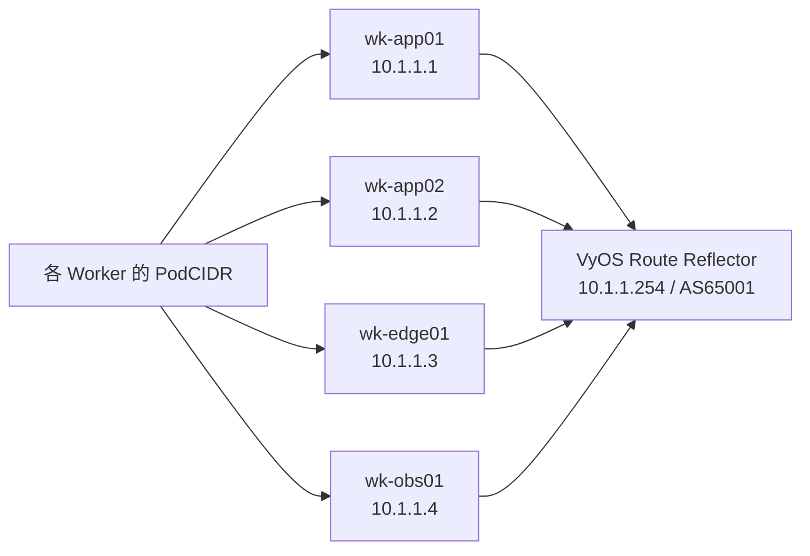

# 第 6 步：接入 VyOS Route Reflector 与 Cilium BGP

## 本步目标

把第二章的控制面能力补齐，让 4 台 Worker 通过 `iBGP` 接入 `VyOS Route Reflector`：

- `VyOS(10.1.1.254)` 作为 `Route Reflector`
- `wk-app01`、`wk-app02`、`wk-edge01`、`wk-obs01` 作为 `iBGP client`
- 统一使用 `AS65001`
- 由 `Cilium BGP Control Plane` 向 `VyOS` 广告各 Worker 的 `PodCIDR`

本步完成后，第二章不再只是“集群内部网络可用”，而是进一步具备：

- Worker 对外发布 `PodCIDR` 的控制面能力
- 从 Kubernetes 侧到网络设备侧的 BGP 对接能力

## 执行标记

- **执行标记：必须执行**

说明：

- 这一页是第二章网络控制面的收口步骤
- 它不是为了替代集群内部转发，而是为了把 Kubernetes 网络与外部网络设备正式接起来

## 问题背景

前面几步已经完成：

- `Cilium` 接管数据平面
- `Hubble` 可以观察东西向流量
- `CiliumNetworkPolicy` 可以控制访问行为

但如果课程要面向网络工程与平台工程的完整闭环，还需要进一步回答：

- Worker 的 `PodCIDR` 如何被外部网络设备感知
- 多个 Worker 为什么不应该彼此做 `full-mesh`
- 为什么需要 `Route Reflector`

因此本步通过 `VyOS RR + Cilium BGP Control Plane`，补齐第二章的网络控制面主线。

## 理论说明

### BGP 关系图



这张图说明：

- 4 台 Worker 不直接彼此建立 `full-mesh`
- 而是统一和 `VyOS` 建立 `iBGP` 邻居
- `VyOS` 作为 `Route Reflector` 汇聚路由关系

### 为什么需要 `Route Reflector`

如果 4 台 Worker 彼此做 `full-mesh`，邻居关系虽然还能管理，但随着节点数量增长，维护复杂度会快速上升。

引入 `Route Reflector` 后，拓扑会更清晰：

- Worker 只需要向 `VyOS` 建立邻居
- `VyOS` 统一承担反射角色
- 外部网络设备侧也更容易观察与汇聚路由

因此，本步最重要的教学目标之一是让学员形成下面这个认知：

- `BGP` 不是为了替代 `CNI`
- `BGP` 是为了解决路由发布与控制面协同问题

### 为什么本章广告的是 `PodCIDR`

这一章的目标是先把“节点负责哪些 Pod 网段”讲清楚，所以这里使用：

- `advertisementType: PodCIDR`

这意味着：

- 每台 Worker 会向 `VyOS` 广告自己承载的 Pod 网段
- `VyOS` 会学习到这些 `10.244.x.0/24` 路由

这比一开始就讲 `Service VIP` 或更复杂的广告策略更适合作为第二章教材主线。

### 为什么这里统一使用 `AS65001`

本步使用的是最容易建立理解的 `iBGP` 模型：

- `VyOS` 与 4 台 Worker 都在 `AS65001`

这样可以把教学重点放在：

- `Route Reflector`
- 邻居建立
- `PodCIDR` 广告

而不是把难点分散到 `eBGP` 与多 `ASN` 设计上。

### 本步 3 份清单关键字段示意

本步会使用下面 3 份清单：

- `manifests/40_cilium_bgp_peer_config.yaml`
- `manifests/41_cilium_bgp_advertisement_podcidr.yaml`
- `manifests/42_cilium_bgp_cluster_config_rr.yaml`

#### `CiliumBGPPeerConfig`

```yaml
kind: CiliumBGPPeerConfig
metadata:
  name: vyos-rr-peer
spec:
  timers:
    connectRetryTimeSeconds: 5
    holdTimeSeconds: 9
    keepAliveTimeSeconds: 3
```

关键字段说明：

- `vyos-rr-peer`
  - 统一定义和 `VyOS` 建立会话时的邻居参数
- `timers`
  - 控制重试、保活与会话保持节奏

#### `CiliumBGPAdvertisement`

```yaml
kind: CiliumBGPAdvertisement
metadata:
  name: worker-podcidr
  labels:
    advertise: bgp
spec:
  advertisements:
    - advertisementType: PodCIDR
```

关键字段说明：

- `advertisementType: PodCIDR`
  - 明确广告对象是 Worker 的 Pod 网段
- `labels.advertise: bgp`
  - 供 peer config 中的 families 规则引用

#### `CiliumBGPClusterConfig`

```yaml
kind: CiliumBGPClusterConfig
metadata:
  name: workers-to-vyos-rr
spec:
  nodeSelector:
    matchExpressions:
      - key: node-role.kubernetes.io/control-plane
        operator: DoesNotExist
  bgpInstances:
    - name: worker-as65001
      localASN: 65001
      peers:
        - name: vyos-rr
          peerASN: 65001
          peerAddress: 10.1.1.254
```

关键字段说明：

- `nodeSelector`
  - 只让 Worker 节点参与 BGP
- `localASN: 65001`
  - Worker 统一使用 `AS65001`
- `peerAddress: 10.1.1.254`
  - 指向 `VyOS Route Reflector`

## 对应脚本

本步对应脚本：

- `k8s/02-cloud-native-networking/scripts/06_configure_bgp_rr.sh`

本步使用的原始清单仍然独立保存在项目目录中，而不是写死在脚本里：

- `manifests/40_cilium_bgp_peer_config.yaml`
- `manifests/41_cilium_bgp_advertisement_podcidr.yaml`
- `manifests/42_cilium_bgp_cluster_config_rr.yaml`

## 脚本内部在做什么

### 脚本执行主线

脚本整体分为 5 个阶段：

1. 登录 `VyOS` 并配置为 `Route Reflector`
2. 应用 3 份 `Cilium BGP` 清单
3. 等待 4 台 Worker 与 `VyOS` 建立 BGP 邻居
4. 查看 `Cilium` 侧 BGP 对象
5. 查看 `VyOS` 侧 BGP 状态与路由

### 重要任务 1：在 `VyOS` 上创建 `peer-group CILIUM`

脚本原始代码：

```bash
commands+=("set protocols bgp system-as '${LOCAL_ASN}'")
commands+=("set protocols bgp parameters router-id '${VYOS_ROUTER_ID}'")
commands+=("set protocols bgp parameters cluster-id '${VYOS_ROUTER_ID}'")
commands+=("delete protocols bgp peer-group 'CILIUM'")
commands+=("set protocols bgp peer-group 'CILIUM' remote-as '${LOCAL_ASN}'")
commands+=("set protocols bgp peer-group 'CILIUM' address-family ipv4-unicast")
commands+=("set protocols bgp peer-group 'CILIUM' address-family ipv4-unicast route-reflector-client")
```

这一段的作用是：

- 把 `VyOS` 定义为 `AS65001`
- 设置 `router-id` 与 `cluster-id`
- 使用 `peer-group CILIUM` 统一承载 4 个 Worker 邻居配置
- 在 `peer-group` 上启用 `route-reflector-client`

### 重要任务 2：把 4 台 Worker 绑定到 `peer-group`

脚本原始代码：

```bash
for entry in "${WORKER_NODES[@]}"; do
  node_name="${entry%%:*}"
  node_ip="${entry##*:}"
  commands+=("delete protocols bgp neighbor '${node_ip}'")
  commands+=("set protocols bgp neighbor '${node_ip}' description 'cilium-${node_name}'")
  commands+=("set protocols bgp neighbor '${node_ip}' peer-group 'CILIUM'")
done
```

这一段的作用是：

- 为 `wk-app01`、`wk-app02`、`wk-edge01`、`wk-obs01` 创建邻居
- 把它们统一挂到 `peer-group CILIUM` 下

### 重要任务 3：应用 `Cilium BGP` 三份清单

脚本原始代码：

```bash
kubectl apply -f "${BASE_URL}/40_cilium_bgp_peer_config.yaml"
kubectl apply -f "${BASE_URL}/41_cilium_bgp_advertisement_podcidr.yaml"
kubectl apply -f "${BASE_URL}/42_cilium_bgp_cluster_config_rr.yaml"
```

这一段的作用是：

- 让 Kubernetes 侧开始声明：
  - 邻居参数
  - 广告对象
  - 哪些节点参与 BGP

### 重要任务 4：等待 4 个邻居全部建立

脚本原始代码：

```bash
for attempt in $(seq 1 24); do
  output="$(cilium bgp peers --output summary || true)"
  echo "${output}"
  established_count="$(
    printf '%s\n' "${output}" | awk '/10\.1\.1\.254/ && /established/ {count++} END {print count+0}'
  )"
  if [[ "${established_count}" -eq 4 ]]; then
    echo "已确认 4 个 Worker 与 VyOS 建立 BGP 邻居"
    return 0
  fi
  echo "当前仅发现 ${established_count}/4 个已建立邻居，5 秒后重试"
  sleep 5
done
```

这一段的作用是：

- 循环观察 `cilium bgp peers`
- 直到 4 台 Worker 对 `10.1.1.254` 的会话全部进入 `established`

### 重要任务 5：同时查看 `Cilium` 与 `VyOS` 两侧状态

脚本原始代码：

```bash
kubectl get cbgppeer,cbgpadvert,cbgpcluster
kubectl get cbgpnode
show_vyos_bgp_state
```

这一段的作用是：

- 从 Kubernetes 侧确认 BGP CRD 已正确创建
- 从 `VyOS` 侧确认邻居与路由都已建立

## VyOS 实施说明

在 `VyOS 1.4.3` 上，直接对单个 neighbor 配置 `route-reflector-client` 会触发配置脚本异常。

因此本课程采用更稳的写法：

- 先创建 `peer-group CILIUM`
- 在 `peer-group` 上配置 `route-reflector-client`
- 再把 4 个 Worker neighbor 绑定到该 `peer-group`

这既是更稳定的实现方式，也更符合网络工程中常见的批量邻居建模习惯。

## 执行命令

先给脚本增加执行权限：

```bash
chmod +x /docker_k8s_2026/k8s/02-cloud-native-networking/scripts/06_configure_bgp_rr.sh
```

然后执行：

```bash
bash /docker_k8s_2026/k8s/02-cloud-native-networking/scripts/06_configure_bgp_rr.sh
```

## 验证方法

### 验证 1：查看 `Cilium` 邻居状态

```bash
cilium bgp peers
```

预期结果：

- 4 台 Worker 都指向 `10.1.1.254`
- `Session State` 为 `established`

### 验证 2：查看 Kubernetes 侧 BGP 资源

```bash
kubectl get cbgppeer,cbgpadvert,cbgpcluster
kubectl get cbgpnode
```

预期结果：

- `vyos-rr-peer` 存在
- `worker-podcidr` 存在
- `workers-to-vyos-rr` 存在
- `cbgpnode` 中有 4 台 Worker

### 验证 3：查看 `VyOS` 邻居摘要

```bash
python3 - <<'PY'
import pexpect

shell_prompt = r"vyos@[^\r\n]*\$ "
child = pexpect.spawn(
    "ssh -tt -o StrictHostKeyChecking=no -o UserKnownHostsFile=/dev/null vyos@10.1.1.254",
    encoding="utf-8",
    timeout=20,
)
child.expect("password:")
child.sendline("vyos")
while True:
    idx = child.expect([r"Press RETURN to continue", shell_prompt], timeout=20)
    if idx == 0:
        child.sendline("")
        continue
    break
child.sendline("set terminal length 0")
child.expect(shell_prompt, timeout=20)
child.sendline("show ip bgp summary")
while True:
    idx = child.expect([r"Press RETURN to continue", shell_prompt], timeout=20)
    if idx == 0:
        child.sendline("")
        continue
    break
print(child.before)
child.sendline("exit")
child.expect(pexpect.EOF, timeout=10)
PY
```

预期结果：

- 4 个邻居均为 `Established`

### 验证 4：查看 `VyOS` 学到的 `PodCIDR` 路由

```bash
python3 - <<'PY'
import pexpect

shell_prompt = r"vyos@[^\r\n]*\$ "
child = pexpect.spawn(
    "ssh -tt -o StrictHostKeyChecking=no -o UserKnownHostsFile=/dev/null vyos@10.1.1.254",
    encoding="utf-8",
    timeout=20,
)
child.expect("password:")
child.sendline("vyos")
while True:
    idx = child.expect([r"Press RETURN to continue", shell_prompt], timeout=20)
    if idx == 0:
        child.sendline("")
        continue
    break
child.sendline("set terminal length 0")
child.expect(shell_prompt, timeout=20)
child.sendline("show ip route bgp")
while True:
    idx = child.expect([r"Press RETURN to continue", shell_prompt], timeout=20)
    if idx == 0:
        child.sendline("")
        continue
    break
print(child.before)
child.sendline("exit")
child.expect(pexpect.EOF, timeout=10)
PY
```

预期结果：

- 出现 `10.244.x.0/24` 形式的 Pod 路由
- 当前环境中通常可以看到：
  - `10.244.0.0/24`
  - `10.244.1.0/24`
  - `10.244.2.0/24`
  - `10.244.5.0/24`

## 关键看点

这一页不要试图逐行读完所有 BGP 输出，优先观察下面 3 件事：

- `cilium bgp peers` 中是否已经有 4 个 `established`
- `show ip bgp summary` 中 4 个邻居是否都为 `Established`
- `show ip route bgp` 中是否已经出现 `10.244.x.0/24` Pod 路由

## 通过标准

满足下面条件后，就可以进入第二章最终验收：

- 4 台 Worker 与 `VyOS` 邻居建立成功
- `VyOS` 成功接收 Worker 的 `PodCIDR`
- 你能够从 `Cilium` 和 `VyOS` 两侧同时观察到 BGP 状态

## 下一步

下一步进入第二章最终验收：

- `docs/08_verify.md`
