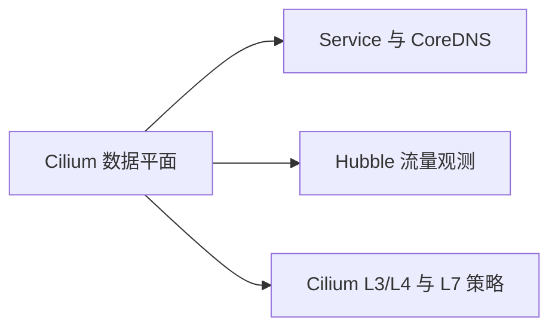

# 第 6 步：第二章最终验收

## 本步目标

对第二章做一次只读验收，确认这条主线已经完整闭环：

- `Cilium` 已接管网络平面
- `Service Discovery` 正常
- `Hubble` 可以观察东西向流量
- `L3/L4` 与 `L7` 策略可以演示

本步不改配置，只做验收。

---

## 执行标记

- **执行标记：只读验证**
- 用于确认第二章是否达到标准结束状态

---

## 理论说明

### 第二章闭环关系图



本页按“底座 -> 应用 -> 观测 -> 策略”的顺序验收。

---

## 验收顺序

1. 集群基础状态
2. `net-demo` 演示应用
3. `Hubble`
4. `CiliumNetworkPolicy`

---

## 验证方法

### 验证 1：节点与系统组件

```bash
kubectl get nodes -o wide
kubectl get pods -n kube-system -o wide
cilium status --wait
```

预期结果：

- 所有节点均为 `Ready`
- `cilium`、`cilium-operator`、`hubble-relay`、`hubble-ui`、`coredns` 正常
- `Cilium: OK`

关键看点：

- `Ready` 节点数量是否正确
- `kube-system` 中是否已经没有 `kube-proxy`
- `cilium status --wait` 是否给出整体 `OK`

### 验证 2：`net-demo` 演示应用

```bash
kubectl get pods -n net-demo -o wide
kubectl get svc -n net-demo
kubectl exec -n net-demo deployment/client -- curl -sS http://whoami
```

预期结果：

- `client`、`other`、`whoami` 均为 `Running`
- `whoami` Service 存在
- `curl` 返回 `whoami` 输出

关键看点：

- 要确认 `client` 能通过 Service 名称访问 `whoami`

### 验证 3：Hubble 可观测性

在一个终端执行：

```bash
kubectl -n kube-system port-forward svc/hubble-relay 4245:80
```

另开一个终端执行：

```bash
hubble status --server localhost:4245
hubble observe --server localhost:4245 --last 20
```

预期结果：

- `Healthcheck: Ok`
- 能看到最近的东西向流量

关键看点：

- 输出中是否能看到 `net-demo`
- 是否能看到 `client` 与 `whoami`
- 是否能看到 `FORWARDED`

### 验证 4：`L3/L4` 与 `L7` 策略

```bash
kubectl get cnp -n net-demo
kubectl exec -n net-demo deployment/client -- sh -c "curl -sS -o /dev/null -w '%{http_code}\n' --max-time 5 http://whoami/"
kubectl exec -n net-demo deployment/client -- sh -c "curl -sS -o /dev/null -w '%{http_code}\n' --max-time 5 -X POST http://whoami/"
```

预期结果：

- 当前存在 `whoami-l7-allow-get`
- `GET /` 返回 `200`
- `POST /` 返回非 `200`

关键看点：

- 同一个 `client` 对不同 HTTP 方法是否得到不同结果
- 这说明策略已经进入协议感知层

---

## 通过标准

满足下面条件后，第二章即可视为完成：

- `Cilium` 与 `Hubble` 正常
- `Service Discovery` 正常
- `L3/L4` 与 `L7` 策略正常

---

## 下一步

下一步进入第三章：南北向流量、`LoadBalancer VIP`、`Gateway API`、域名与 `HTTPS`。
