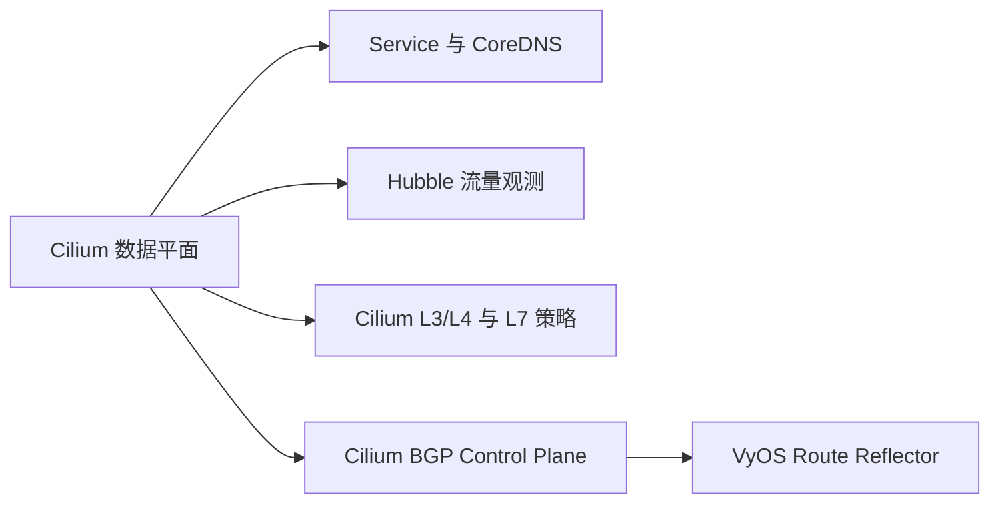

# 第 7 步：第二章最终验收

## 本步目标

对第二章做一次只读验收，确认这条主线已经完整闭环：

- `Cilium` 已接管网络平面
- `Service Discovery` 正常
- `Hubble` 可以观察东西向流量
- `L3/L4` 与 `L7` 策略可以演示
- `VyOS RR + Cilium BGP` 已建立

本步不改配置，只做验收。

## 执行标记

- **执行标记：只读验证**

说明：

- 这一页的目标不是重新执行每一步，而是确认第二章是否已经达到标准结束状态

## 问题背景

第二章从第一章的“控制平面已建好、网络仍未完成”起步，依次补齐了：

- `Cilium` 数据平面
- `Service` 与 DNS 访问链路
- `Hubble` 流量观测
- `CiliumNetworkPolicy`
- `VyOS Route Reflector + Cilium BGP Control Plane`

因此最终验收要回答的问题也很明确：

- 集群网络现在是否已经稳定可用
- 业务流量是否可解析、可访问、可观察、可控制
- Kubernetes 是否已经和外部网络设备建立了明确的 BGP 控制面关系

## 理论说明

### 第二章闭环关系图



这张图说明：

- 第二章所有实验并不是分散的独立小点
- 它们共同围绕同一个目标展开：
  - 用 `Cilium` 建立 Kubernetes 的数据平面、观测能力、安全控制能力和对外路由控制能力

### 本页为什么按“从底座到控制面”的顺序验收

本页采用下面的顺序：

1. 集群基础状态
2. `net-demo` 演示应用
3. `Hubble`
4. `CiliumNetworkPolicy`
5. `BGP`

这样安排的原因是：

- 先确认底座是否稳定
- 再确认业务访问是否成立
- 再确认观测与策略是否成立
- 最后确认外部网络控制面是否成立

这比把所有命令杂糅在一起更适合作为教材验收路径。

## 验收顺序

请按下面顺序检查：

1. 集群基础状态
2. `net-demo` 演示应用
3. `Hubble`
4. `CiliumNetworkPolicy`
5. `BGP`

## 验证方法

### 验证 1：节点与系统组件

```bash
kubectl get nodes -o wide
kubectl get pods -n kube-system -o wide
cilium status --wait
```

预期结果：

- 所有节点均为 `Ready`
- `cilium`、`cilium-operator`、`hubble-relay`、`hubble-ui`、`coredns` 正常
- `Cilium: OK`

关键看点：

- `Ready` 节点数量是否正确
- `kube-system` 中是否已经没有 `kube-proxy`
- `cilium status --wait` 是否给出整体 `OK`

### 验证 2：`net-demo` 演示应用

```bash
kubectl get pods -n net-demo -o wide
kubectl get svc -n net-demo
kubectl exec -n net-demo deployment/client -- curl -sS http://whoami
```

预期结果：

- `client`、`other`、`whoami` 均为 `Running`
- `whoami` Service 存在
- `curl` 返回 `whoami` 输出

关键看点：

- 不是只看 Pod 在不在，而是要确认 `client` 能通过 Service 名称访问 `whoami`

### 验证 3：Hubble 可观测性

在一个终端执行：

```bash
kubectl -n kube-system port-forward svc/hubble-relay 4245:80
```

另开一个终端执行：

```bash
hubble status --server localhost:4245
hubble observe --server localhost:4245 --last 20
```

预期结果：

- `Healthcheck: Ok`
- 能看到最近的东西向流量

关键看点：

- 输出中是否能看到 `net-demo`
- 是否能看到 `client` 与 `whoami`
- 是否能看到 `FORWARDED`

### 验证 4：`L3/L4` 与 `L7` 策略

```bash
kubectl get cnp -n net-demo
kubectl exec -n net-demo deployment/client -- sh -c "curl -sS -o /dev/null -w '%{http_code}\n' --max-time 5 http://whoami/"
kubectl exec -n net-demo deployment/client -- sh -c "curl -sS -o /dev/null -w '%{http_code}\n' --max-time 5 -X POST http://whoami/"
```

预期结果：

- 当前存在 `whoami-l7-allow-get`
- `GET /` 返回 `200`
- `POST /` 返回非 `200`

关键看点：

- 同一个 `client` 对不同 HTTP 方法是否得到不同结果
- 这说明当前策略已经进入协议感知层，而不只是简单的端口放行

### 验证 5：BGP 邻居与路由

```bash
cilium bgp peers
```

预期结果：

- 4 台 Worker 都连接到 `10.1.1.254`
- `Session State` 为 `established`

然后查看 `VyOS`：

```bash
python3 - <<'PY'
import pexpect

shell_prompt = r"vyos@[^\r\n]*\$ "
child = pexpect.spawn(
    "ssh -tt -o StrictHostKeyChecking=no -o UserKnownHostsFile=/dev/null vyos@10.1.1.254",
    encoding="utf-8",
    timeout=20,
)
child.expect("password:")
child.sendline("vyos")
while True:
    idx = child.expect([r"Press RETURN to continue", shell_prompt], timeout=20)
    if idx == 0:
        child.sendline("")
        continue
    break
child.sendline("set terminal length 0")
child.expect(shell_prompt, timeout=20)
child.sendline("show ip bgp summary")
while True:
    idx = child.expect([r"Press RETURN to continue", shell_prompt], timeout=20)
    if idx == 0:
        child.sendline("")
        continue
    break
print(child.before)
child.sendline("show ip route bgp")
while True:
    idx = child.expect([r"Press RETURN to continue", shell_prompt], timeout=20)
    if idx == 0:
        child.sendline("")
        continue
    break
print(child.before)
child.sendline("exit")
child.expect(pexpect.EOF, timeout=10)
PY
```

预期结果：

- 4 个邻居为 `Established`
- `show ip route bgp` 中能看到 `10.244.x.0/24` Pod 路由

关键看点：

- Kubernetes 侧和 `VyOS` 侧看到的邻居数量应一致
- `VyOS` 侧应确实学到了 Worker 的 `PodCIDR`

## 通过标准

满足下面条件后，第二章即可视为完成：

- `Cilium` 与 `Hubble` 正常
- `Service Discovery` 正常
- `L3/L4` 与 `L7` 策略正常
- `VyOS RR + Cilium BGP` 正常

## 下一步

下一步进入第三章：南北向流量、`LoadBalancer VIP`、`Gateway API`、域名与 `HTTPS`。
