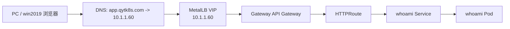
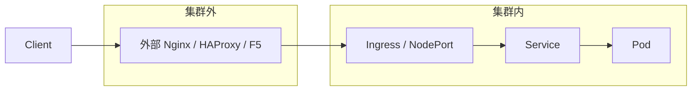
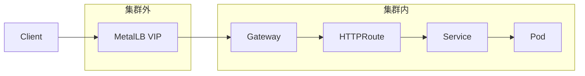

# 第三章理论导读：南北向入口、MetalLB 与 Gateway API

## 本步目标

正式进入第三章之前，先建立 4 个关键认识：

- 第二章解决的是东西向，第三章解决的是南北向
- `MetalLB` 负责补齐裸机集群的 `LoadBalancer VIP`
- `Gateway API` 负责定义北向入口与路由模型
- 第三章开始统一走 `域名 + HTTPS`

---

## 问题背景

第二章已经解决集群内部网络：

- `Cilium` 数据平面
- `Service` 与 DNS
- `Hubble` 可观测性
- `L3/L4` 与 `L7` 策略

第三章继续解决集群外部访问：

- 集群外部用户如何访问集群内服务
- 裸机 Kubernetes 为什么没有天然的 `LoadBalancer`
- 谁来分配业务 VIP
- 谁来监听 `80/443`
- 谁来根据域名把流量转发到后端服务
- 为什么从这里开始统一使用 HTTPS

---

## 理论说明

### 第三章总关系图



第三章主线就是：`DNS -> MetalLB VIP -> Gateway -> HTTPRoute -> Service -> Pod`。

### 第二章和第三章的分工

前两章可直接记成：

- 第二章：`Pod -> Pod`、`Pod -> Service`
- 第三章：`Browser / Client -> Gateway -> Service`

第三章不是替代第二章，而是在已有内部网络能力上补齐外部访问入口。

### 为什么第三章主线选 `MetalLB`

在云厂商环境里，`Service type=LoadBalancer` 往往会自动得到一个公网或内网负载均衡器；但在裸机环境里，Kubernetes 不会自动替你：

- 分配 VIP
- 在二层网络里通告这个 VIP

所以如果没有 `MetalLB`，很多 `LoadBalancer Service` 最终会停在：

```text
EXTERNAL-IP   <pending>
```

在第三章里，`MetalLB` 的角色很明确：

- 它不是七层网关
- 它是裸机 Kubernetes 的 VIP 分配器和对外通告器

### `MetalLB` 在这一章里的底层工作方式

第三章当前实验用的是：

- `IPAddressPool`
- `L2Advertisement`

本章的 `MetalLB` 主要工作在二层通告模式。先把握 3 个动作即可：

1. `IPAddressPool` 提供可分配的 VIP 地址池
2. `L2Advertisement` 决定哪些节点可以对外通告这组 VIP
3. `Gateway` 再从地址池中申请并固定使用业务 VIP

对应 YAML 会在后面的 `03_install_metallb.md` 和 `06_publish_gateway_demo.md` 中再展开。

这里要区分两层：

- `MetalLB` 负责 **VIP 分配与对外可达**
- 七层转发与后端分发仍由 `Gateway API`、Service 和数据平面完成

### `MetalLB` 和“外部 Nginx 做 LB，再转 Ingress”有什么区别

你以前常见的做法是：



这条路径成立，但和第三章当前主线不是同一层方案：



核心区别：

1. 外部 Nginx 方案  
   入口负载均衡器在集群外，自己承担监听、转发、证书终止和健康检查。

2. `MetalLB + Gateway API` 方案  
   `MetalLB` 只负责让 VIP 进入集群；真正的入口逻辑在集群内由 `Gateway`、`HTTPRoute`、Service 和数据平面完成。

可以概括成：

- 外部 Nginx：更像“集群外先放一个独立入口设备”
- `MetalLB + Gateway API`：更像“把入口模型收回 Kubernetes 自己来表达”

上面这组对比先用于区分“集群外独立入口设备”和“集群内入口对象模型”。

### 传统 `Ingress` 和 `Gateway API` 有什么区别

下面比较 Kubernetes 里的两套北向入口对象模型：

| 对比项 | 传统 `Ingress` | `Gateway API` |
| --- | --- | --- |
| 入口对象模型 | 主要围绕单个 `Ingress` 对象展开 | 拆成 `GatewayClass`、`Gateway`、`HTTPRoute` 等对象 |
| 角色边界 | 入口设施与转发规则常写在一起 | 入口设施与路由规则明确分开 |
| 规则表达方式 | 够用，但复杂能力常依赖 annotation | 路由、监听、TLS 等能力表达更清楚 |
| 与实现绑定程度 | 更容易和某个 Ingress Controller 的私有写法绑定 | 更强调标准化对象和可扩展性 |
| 教学上的感受 | 上手快，但容易把职责讲混 | 更适合把 VIP、监听、路由、TLS 分层讲清楚 |

> `Ingress` 更像“单对象入口声明”，`Gateway API` 更像“拆分角色后的新一代入口模型”。

### YAML 对比示意

如果把“`app.qytk8s.com` 通过 `HTTPS` 发布到 `whoami:80`”写成传统 `Ingress`，常见会是下面这种单对象写法：

```yaml
apiVersion: networking.k8s.io/v1
kind: Ingress
metadata:
  name: app
  namespace: gateway-demo
spec:
  # 指定由哪个 Ingress Controller 实现这个入口
  ingressClassName: cilium
  tls:
    - hosts:
        # 这张证书对哪个域名生效
        - app.qytk8s.com
      # 证书 Secret 直接挂在同一个 Ingress 对象上
      secretName: app-qytk8s-com-tls
  rules:
    # Host 匹配规则也写在同一个对象里
    - host: app.qytk8s.com
      http:
        paths:
          # Path 匹配规则继续写在同一个对象里
          - path: /
            pathType: Prefix
            backend:
              service:
                # 最终转发到哪个后端 Service，也继续写在同一个对象里
                name: whoami
                port:
                  # 转发到 Service 的 80 端口
                  number: 80
```

如果写成 `Gateway API`，同一件事会拆成 `Gateway` 和 `HTTPRoute` 两个对象：

```yaml
apiVersion: gateway.networking.k8s.io/v1
kind: Gateway
metadata:
  name: app-gateway
  namespace: gateway-demo
spec:
  # 入口设施由谁实现，例如这里由 Cilium 提供 Gateway 数据面
  gatewayClassName: cilium
  listeners:
    # listener 用来声明“这个入口实例监听什么域名、端口、协议”
    - name: https
      hostname: app.qytk8s.com
      port: 443
      protocol: HTTPS
      tls:
        # TLS 终止放在 Gateway listener 上，而不是放在路由对象里
        mode: Terminate
        certificateRefs:
          # 这里引用已经准备好的证书 Secret
          - kind: Secret
            name: app-qytk8s-com-tls
---
apiVersion: gateway.networking.k8s.io/v1
kind: HTTPRoute
metadata:
  name: app-route
  namespace: gateway-demo
spec:
  parentRefs:
    # 这条路由挂到哪个 Gateway / listener
    - name: app-gateway
      sectionName: https
  hostnames:
    # 这条路由处理哪个域名
    - app.qytk8s.com
  rules:
    - matches:
        # 路由匹配条件单独写在 HTTPRoute 里
        - path:
            type: PathPrefix
            value: /
      backendRefs:
        # 后端 Service 单独放在 HTTPRoute 里，不再和入口设施写在一起
        - name: whoami
          # 最终转发到 Service 的 80 端口
          port: 80
```

这组对比只看 3 个区别：

- `Ingress` 把入口类、TLS、Host、Path、Backend 基本都写在一个对象里
- `Gateway API` 把“入口设施”和“转发规则”拆成了 `Gateway` 与 `HTTPRoute`
- 第三章后续实操会详细展开 `Gateway` / `HTTPRoute` 的 YAML，不再单独展开 `Ingress` 写法

第三章主线选择 `Gateway API + HTTPS`，核心就是把入口设施、路由规则、域名和证书一次放进同一套对象模型里讲清楚。

证书也继续复用现有 `Harbor CA`，不再额外引入第二套证书体系。第一章已经为 `harbor.qytk8s.com` 生成了：

- `harbor-ca.key`
- `harbor-ca.crt`

所以第三章的 `app.qytk8s.com` 不是孤立地签一张证书，而是放进整门课统一的内部 CA 体系里。

---

## 下一步

进入第三章总览：

- `docs/01_chapter_guide.md`
