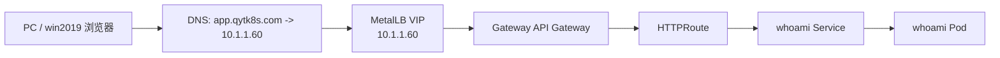
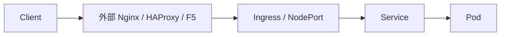
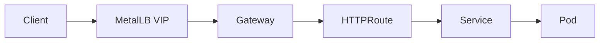
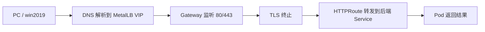

# 第三章理论导读：南北向入口、MetalLB 与 Gateway API

## 本步目标

正式进入第三章之前，先建立 4 个关键认识：

- 第二章解决的是东西向，第三章解决的是南北向
- `MetalLB` 负责补齐裸机集群的 `LoadBalancer VIP`
- `Gateway API` 负责定义北向入口与路由模型
- 第三章开始统一走 `域名 + HTTPS`

---

## 问题背景

第二章结束后，集群已经具备：

- `Cilium` 数据平面
- `Service` 与 DNS
- `Hubble` 可观测性
- `L3/L4` 与 `L7` 策略

但这些能力基本都发生在集群内部。

第三章要补上的问题是：

- 集群外部用户如何访问集群内服务
- 裸机 Kubernetes 为什么没有天然的 `LoadBalancer`
- 谁来分配业务 VIP
- 谁来监听 `80/443`
- 谁来根据域名把流量转发到后端服务
- 为什么要从这里开始统一使用 HTTPS

---

## 理论说明

### 第三章总关系图



这张图就是第三章要讲清楚的完整链路：

- 浏览器先通过 DNS 找到业务 VIP
- `MetalLB` 负责让这个 VIP 在裸机网络里真的可达
- `Gateway` 负责监听 `80/443`
- `HTTPRoute` 负责把请求送到目标 `Service`
- `Service` 再把流量转到后端 Pod

### 第二章和第三章的分工

可以把前两章简单理解成：

- 第二章：把集群内部网络打通
- 第三章：把集群内服务正式发布给外部用户

更具体一点：

- 第二章关注 `Pod -> Pod`、`Pod -> Service`
- 第三章关注 `Browser / Client -> Gateway -> Service`

因此第三章不是在替代第二章，而是在第二章已经具备内部网络能力的前提上，继续补齐外部访问入口。

### 为什么第三章主线选 `MetalLB`

在云厂商环境里，`Service type=LoadBalancer` 往往会自动得到一个公网或内网负载均衡器。

但在裸机环境里，Kubernetes 只知道你“想要一个 LoadBalancer”，并不会自动替你：

- 分配 VIP
- 在二层网络里通告这个 VIP

所以如果没有 `MetalLB`，很多 `LoadBalancer Service` 最终会停在：

```text
EXTERNAL-IP   <pending>
```

因此第三章里 `MetalLB` 的角色非常明确：

- 它不是七层网关
- 它是裸机 Kubernetes 的 VIP 分配器和对外通告器

一句话总结：

> `MetalLB` 解决的是“谁来给裸机集群分配和通告业务 VIP”。

### `MetalLB` 在这一章里的底层工作方式

第三章当前实验用的是：

- `IPAddressPool`
- `L2Advertisement`

这意味着本章的 `MetalLB` 主要工作在二层通告模式。

在这个模式下，可以把它理解成下面 3 个动作：

1. `MetalLB controller` 为 `LoadBalancer Service` 选一个 VIP  
   例如第三章固定选择：
   - `10.1.1.60`

2. `speaker` 在指定节点上对外“宣告这个 VIP 现在在我这里”  
   在本章里，这个角色被收敛到：
   - `wk-edge01`

3. 外部主机把发往这个 VIP 的流量先送到该节点  
   然后再由 Kubernetes / `Cilium Gateway` / Service 转发链路把流量送到真正的后端

也就是说，这里要特别强调一个容易混淆的点：

- `MetalLB` 负责的是 **VIP 分配与对外可达**
- 真正的七层转发与后端分发，仍然是后面的 `Gateway API`、Service 和数据平面在做

换句话说：

> `MetalLB` 不是七层负载均衡器，它只是先把“请求怎么进集群”这件事解决掉。

### `MetalLB` 和“外部 Nginx 做 LB，再转 Ingress”有什么区别

你以前常见的做法是：



这条路径当然是成立的，而且在很多企业网络里非常常见。

但它和第三章现在这条路径并不是同一层的方案：



二者最核心的区别在于：

1. 外部 Nginx 方案  
   入口负载均衡器在集群外。
   它通常自己承担：
   - 对外监听
   - 四层或七层转发
   - 证书终止
   - 上游健康检查

2. `MetalLB + Gateway API` 方案  
   `MetalLB` 只负责让 VIP 进入集群。  
   真正的入口逻辑在集群内，由：
   - `Gateway`
   - `HTTPRoute`
   - Service
   - Cilium 数据平面
   共同完成。

所以可以把这两种方案概括成：

- 外部 Nginx：更像“集群外先放一个独立入口设备”
- `MetalLB + Gateway API`：更像“把入口模型收回 Kubernetes 自己来表达”

### 这一章为什么不先讲“外部 Nginx + Ingress”

不是因为那个方案不对，而是因为第三章的教学目标更偏：

- 让学员先看清 Kubernetes 自己的北向暴露模型
- 让 `VIP`、`Gateway`、`Route`、TLS 的关系在同一套对象模型里闭环

如果一上来就先放一个外部 Nginx，课堂上很容易把两个层面混在一起：

- 到底是谁在分配 VIP
- 到底是谁在做 TLS
- 到底是谁在做域名路由

而第三章现在的设计是刻意把它们拆干净：

- `MetalLB` 解决 VIP
- `Gateway` 解决监听入口
- `HTTPRoute` 解决路由规则
- TLS Secret 解决证书

这样后面再回头对比“外部 LB + Ingress”，学员会更容易理解两者边界。

### 传统 `Ingress` 和 `Gateway API` 有什么区别

这里比较的是 Kubernetes 里的两套北向入口对象模型：

- `Ingress`
- `Gateway API`

它们的区别可以先用下面这张表抓住：

| 对比项 | 传统 `Ingress` | `Gateway API` |
| --- | --- | --- |
| 入口对象模型 | 主要围绕单个 `Ingress` 对象展开 | 拆成 `GatewayClass`、`Gateway`、`HTTPRoute` 等对象 |
| 角色边界 | 入口设施与转发规则常写在一起 | 入口设施与路由规则明确分开 |
| 规则表达方式 | 够用，但复杂能力常依赖 annotation | 路由、监听、TLS 等能力表达更清楚 |
| 与实现绑定程度 | 更容易和某个 Ingress Controller 的私有写法绑定 | 更强调标准化对象和可扩展性 |
| 教学上的感受 | 上手快，但容易把职责讲混 | 更适合把 VIP、监听、路由、TLS 分层讲清楚 |

如果只记一句话，可以先记成：

> `Ingress` 更像“单对象入口声明”，`Gateway API` 更像“拆分角色后的新一代入口模型”。

### 为什么第三章主线选 `Gateway API`

第三章没有继续把重点放在传统 `NodePort` 或单一 `Ingress` 对象上，而是转向：

- `GatewayClass`
- `Gateway`
- `HTTPRoute`

这样设计的原因是：

- 角色边界更清楚
- 模型更现代
- 更适合和后续安全、治理、策略衔接

第三章只需要先抓住一个核心认识：

- `Gateway` 负责“入口设施”
- `HTTPRoute` 负责“转发规则”

一句话总结：

> `Gateway API` 更像新一代北向入口模型，而不只是一个单独的入口对象。

### 第三章里的 HTTPS 放在哪里

这次我们不再先用：

- `NodeIP:NodePort`
- `http://IP`
- 临时自签一个和课程主线无关的证书

而是直接把下面这件事纳入第三章主线：

- 域名
- 证书
- 北向 HTTPS

这更符合真实工程顺序：

- 先把服务正式、安全地发布出来
- 后续再继续补认证、授权、`mTLS` 等更细粒度的安全能力

### 为什么复用 Harbor CA

第一章已经为 `harbor.qytk8s.com` 生成了：

- `harbor-ca.key`
- `harbor-ca.crt`

这说明实验环境里已经存在一套内部 CA。

第三章继续复用它，有三个直接好处：

1. 不需要再造第二套证书体系
2. 学员更容易理解“内部 CA 可以给多个内部域名签证书”
3. 后续其他内部域名也可以继续复用这套根信任

所以第三章的 `app.qytk8s.com`，并不是孤立地签一张证书，而是放进整门课统一的内部 CA 体系里。

---

## 通过标准

读完这一页后，你应能解释清楚下面这条链路：



---

## 下一步

进入第三章总览：

- `docs/01_chapter_guide.md`
