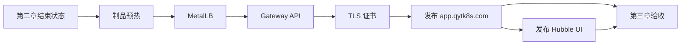

# 第三章总览：南北向入口、域名与 HTTPS 发布

## 本章目标

第三章的目标是把第二章已经具备东西向能力的集群，推进到**对外正式发布**的状态。

本章结束后，应达到下面状态：

- `MetalLB` 已为裸机集群补齐 `LoadBalancer VIP`
- `Cilium Gateway API` 已启用
- 演示服务可以通过 `app.qytk8s.com` 从集群外访问
- `Hubble UI` 可以通过 `hubble.qytk8s.com` 从集群外访问
- 访问方式统一为 `HTTPS`
- 证书由现有 `Harbor CA` 签发

## 问题背景

第二章已经解决：

- 集群内部网络
- Service Discovery
- 可观测性
- 网络策略
- BGP 控制面

第三章要继续解决：

- 集群外部如何访问内部服务
- 谁来分配业务 VIP
- 谁来监听北向 `80/443`
- 谁来处理域名、证书和 HTTPS

因此第三章的重心不是“再装一套网络”，而是“把已经能在集群内运行的服务正式发布出去”。

## 课前理论导读

正式操作前，建议先阅读：

- `docs/00_north_south_theory.md`

这页负责先讲清：

- `MetalLB` 做什么，不做什么
- `Gateway API` 为什么是第三章主线
- 为什么从这一章开始统一走 `域名 + HTTPS`
- 为什么继续复用 `Harbor CA`

## 本章重点边界

第三章只聚焦：

- `LoadBalancer VIP`
- `MetalLB`
- `Gateway API`
- `域名 + HTTPS`

暂不展开：

- JWT
- `mTLS`
- `Istio Ambient`
- 更细粒度服务授权

这些内容放到后续安全章节。

## 本章总关系图

这张图表达了第三章的完整主线：

- 先准备第三章用到的 YAML、镜像和 CRD
- 再补齐裸机 VIP 能力
- 然后为现有 `Cilium` 打开 `Gateway API`
- 再准备域名证书
- 最后把演示服务正式发布出来
- 再把 `Hubble UI` 作为正式 Web UI 发布并观察北向流量

## 本章学习方式

第三章继续采用“文档主导 + 脚本辅助 + YAML 独立发布”的方式：

1. 登录 `ops`
2. 先看文档，再执行步骤
3. 所有 YAML 继续通过 `http://ops:9000/` 发布
4. 所有镜像继续统一走 `harbor.qytk8s.com`

## 执行标记说明

为了便于在 `ops` 上直接执行，本章对步骤继续采用统一执行标记：

- **必须执行**：从第三章标准起点开始时，默认需要实际执行
- **只读验证**：这一项主要用于检查结果，不会改配置

## 本章脚本执行矩阵

| 步骤 | 文档 | 脚本 | 执行标记 | 说明 |
| :--- | :--- | :--- | :--- | :--- |
| 1 | `02_prepare_north_south_artifacts.md` | `scripts/01_prepare_north_south_artifacts.sh` | 必须执行 | 预热 `MetalLB` / `Gateway API` / 演示镜像 |
| 2 | `03_install_metallb.md` | `scripts/02_install_metallb.sh` | 必须执行 | 安装 `MetalLB`，配置业务 VIP 地址池 |
| 3 | `04_enable_gateway_api.md` | `scripts/03_enable_gateway_api.sh` | 必须执行 | 为现有 `Cilium` 开启 `Gateway API` |
| 4 | `05_issue_tls_certs.md` | `scripts/04_issue_tls_certs.sh` | 必须执行 | 复用 `Harbor CA` 为 `app.qytk8s.com` 签证书 |
| 5 | `06_publish_gateway_demo.md` | `scripts/05_publish_gateway_demo.sh` | 必须执行 | 发布通过 `HTTPS` 访问的演示应用 |
| 6 | `07_publish_hubble_ui.md` | `scripts/06_publish_hubble_ui.sh` / `scripts/07_trigger_north_south_traffic.sh` | 必须执行 | 发布 Hubble UI，并触发第三章北向流量供 UI 观察 |
| 7 | `08_verify.md` | 无 | 只读验证 | 第三章最终验收 |

## 本章执行顺序

请严格按下面顺序执行：

1. `02_prepare_north_south_artifacts.md`
2. `03_install_metallb.md`
3. `04_enable_gateway_api.md`
4. `05_issue_tls_certs.md`
5. `06_publish_gateway_demo.md`
6. `07_publish_hubble_ui.md`
7. `08_verify.md`

## 第三章起点状态

第三章开始前，默认你已经完成第二章，并满足下面这些条件：

- 所有节点均为 `Ready`
- `Cilium`、`Hubble` 正常
- 第二章最终验收已经通过
- `ops` 已具备 `kubectl`、`helm`
- `ops` 已提供 `http://ops:9000/`
- `Harbor` 可用且镜像仓库保留

## 版本冻结

- Kubernetes：`v1.33.9`
- Cilium：`1.19.1`
- MetalLB：`v0.15.3`
- Gateway API 标准 CRD：`v1.4.1`
- 域名后缀：`qytk8s.com`
- 业务演示域名：`app.qytk8s.com`
- 业务演示 VIP：`10.1.1.60`
- Hubble UI 域名：`hubble.qytk8s.com`
- Hubble UI VIP：`10.1.1.61`

## 关键设计冻结

- API 平面继续走 `lb01/lb02 + 10.1.1.10`
- 业务平面改走 `MetalLB VIP`
- 第三章主线只讲 `Gateway API`
- HTTPS 统一由 `Harbor CA` 签发并校验

## 下一步

先进入第 1 步，准备第三章所需制品：

- `docs/02_prepare_north_south_artifacts.md`
