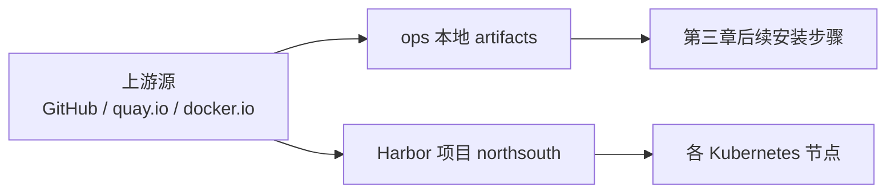

# 第 1 步：预热第三章北向入口制品

## 本步目标

在正式安装 `MetalLB` 和启用 `Gateway API` 之前，先把第三章需要的关键制品准备到本地：

- `MetalLB` 原始安装清单
- `Gateway API` 标准 CRD
- `MetalLB` 镜像
- 北向演示应用镜像

> 说明：`CRD` 是 `CustomResourceDefinition` 的缩写，可以理解为“给 Kubernetes 扩展一种新的资源类型定义”。安装了 `Gateway API` 的 CRD 之后，集群才认识 `GatewayClass`、`Gateway`、`HTTPRoute` 这些对象；否则后续直接 `apply` 相关 YAML 时，Kubernetes 会因为“不认识这种资源”而报错。

## 执行标记

- **执行标记：必须执行**

说明：

- 这是第三章的制品预热步骤
- 本步完成后，后续安装过程尽量不再依赖公网临时下载

## 问题背景

第三章开始后，要连续完成：

- 安装 `MetalLB`
- 安装 `Gateway API` CRD
- 启用 `Cilium Gateway API`
- 发布 `whoami` 北向演示服务

如果每一步都临时去公网拉取 YAML、镜像或 CRD，课堂演示很容易受外网抖动影响。

因此这一页的意义很明确：

- 先把第三章会用到的 YAML 和镜像预热到本地与 Harbor
- 把后续部署步骤变成“拿本地制品安装”

## 理论说明

### 制品流转图



这张图说明：

- YAML 与 CRD 固化到 `ops` 本地 `artifacts/`
- 镜像统一进入 Harbor 的 `northsouth` 项目
- 节点提前从 Harbor 预拉镜像
- 后续安装步骤优先消费本地制品，而不是再次访问上游源

### 为什么第三章仍然坚持“制品、配置、脚本职责分离”

第三章依然遵守整门课的一个重要规则：

- 脚本负责下载、推送、预拉、安装
- 原始 YAML 与配置文件仍然独立保存在项目目录中

这样做有两个直接好处：

1. 课堂上可以单独讲清每份 YAML 是干什么的
2. 后续维护时，不需要去脚本里反向提取配置

### 第三章 Harbor 项目的角色

本章专门使用 Harbor 项目：

```text
harbor.qytk8s.com/northsouth
```

这样可以把第三章的镜像与前两章清晰隔离：

- 第一章：`k8s`
- 第二章：`cilium`
- 第三章：`northsouth`

这更适合教材化，也更适合后续回看每章产物。

### 本步涉及的 YAML 关键内容

这一页虽然主要是在“预热制品”，但后续真正会被使用的两个 YAML 仍然值得提前认识：

- `metallb-native-v0.15.3.yaml`
- `gateway-api-standard-install-v1.4.1.yaml`

#### `metallb-native-v0.15.3.yaml` 的关键意义

这份清单本质上是在安装：

- `controller`
- `speaker`

而且在本课程里，镜像地址已经被改写为 Harbor 地址。改写后的关键形态类似：

```yaml
image: harbor.qytk8s.com/northsouth/metallb-controller:v0.15.3
```

以及：

```yaml
image: harbor.qytk8s.com/northsouth/metallb-speaker:v0.15.3
```

关键字段说明：

- `metallb-controller`
  - 负责 VIP 分配等控制逻辑
- `metallb-speaker`
  - 负责把 VIP 以二层方式对外通告

#### `gateway-api-standard-install-v1.4.1.yaml` 的关键意义

这份清单安装的是第三章真正会用到的标准 CRD，例如：

```yaml
gatewayclasses.gateway.networking.k8s.io
gateways.gateway.networking.k8s.io
httproutes.gateway.networking.k8s.io
referencegrants.gateway.networking.k8s.io
```

关键字段说明：

- `GatewayClass`
  - 定义“由谁实现入口模型”
- `Gateway`
  - 定义具体入口实例
- `HTTPRoute`
  - 定义七层路由规则
- `ReferenceGrant`
  - 用于更复杂的跨命名空间引用授权

## 对应脚本

本步对应脚本：

- `k8s/03-north-south-traffic/scripts/01_prepare_north_south_artifacts.sh`

本步会生成或使用下面这些关键文件：

- `artifacts/metallb-native-v0.15.3.yaml`
- `artifacts/gateway-api-standard-install-v1.4.1.yaml`

## 脚本关键任务

### 关键任务 1：创建 Harbor 项目 `northsouth`

脚本原始代码：

```bash
http_code=$(curl -k -s -o /tmp/harbor_northsouth_project_create.json -w '%{http_code}' \
  -u "${HARBOR_USERNAME}:${HARBOR_PASSWORD}" \
  -H 'Content-Type: application/json' \
  -X POST \
  "https://${HARBOR_DOMAIN}/api/v2.0/projects" \
  -d "{\"project_name\":\"${HARBOR_PROJECT}\",\"public\":true}")
```

关键介绍：

- 第三章镜像统一进入 `northsouth` 项目
- 如果项目已存在，脚本会把它视为正常状态继续执行

### 关键任务 2：固化 `MetalLB` 原始清单并改写镜像地址

脚本原始代码：

```bash
curl -fsSL \
  "https://raw.githubusercontent.com/metallb/metallb/${METALLB_VERSION}/config/manifests/metallb-native.yaml" \
  -o "${src}"

sed \
  -e "s#quay.io/metallb/controller:${METALLB_VERSION}#${HARBOR_DOMAIN}/${HARBOR_PROJECT}/metallb-controller:${METALLB_VERSION}#g" \
  -e "s#quay.io/metallb/speaker:${METALLB_VERSION}#${HARBOR_DOMAIN}/${HARBOR_PROJECT}/metallb-speaker:${METALLB_VERSION}#g" \
  "${src}" >"${dst}"
```

关键介绍：

- 先拿到上游 `MetalLB` 原始安装清单
- 再把镜像地址改写成 Harbor 地址
- 后续安装时直接使用本地改写后的清单

### 关键任务 3：固化 `Gateway API` 标准 CRD

脚本原始代码：

```bash
curl -fsSL \
  "https://github.com/kubernetes-sigs/gateway-api/releases/download/${GATEWAY_API_VERSION}/standard-install.yaml" \
  -o "${dst}"
```

关键介绍：

- 第三章只需要标准 CRD
- 把 CRD 聚合清单提前落地到本地，后续步骤直接 `kubectl apply`

### 关键任务 4：推送镜像到 Harbor

脚本原始代码：

```bash
SOURCE_IMAGES=(
  "quay.io/metallb/controller:v0.15.3"
  "quay.io/metallb/speaker:v0.15.3"
  "docker.io/traefik/whoami:v1.10.3"
)

TARGET_IMAGES=(
  "harbor.qytk8s.com/northsouth/metallb-controller:v0.15.3"
  "harbor.qytk8s.com/northsouth/metallb-speaker:v0.15.3"
  "harbor.qytk8s.com/northsouth/whoami:v1.10.3"
)
```

关键介绍：

- 第三章真正依赖的镜像并不多
- 重点是把 `MetalLB` 和演示应用 `whoami` 统一搬运到 Harbor

### 关键任务 5：在所有节点预拉镜像

脚本原始代码：

```bash
IMAGES=(
  "harbor.qytk8s.com/northsouth/metallb-controller:v0.15.3"
  "harbor.qytk8s.com/northsouth/metallb-speaker:v0.15.3"
  "harbor.qytk8s.com/northsouth/whoami:v1.10.3"
)

for image in "${IMAGES[@]}"; do
  crictl --runtime-endpoint unix:///run/containerd/containerd.sock pull "${image}"
done
```

关键介绍：

- 让后续安装和演示时尽量不再发生现场拉镜像
- 降低课堂环境中的不确定性

## 执行命令

先给脚本增加执行权限：

```bash
chmod +x /docker_k8s_2026/k8s/03-north-south-traffic/scripts/01_prepare_north_south_artifacts.sh
```

然后执行：

```bash
bash /docker_k8s_2026/k8s/03-north-south-traffic/scripts/01_prepare_north_south_artifacts.sh
```

## 验证方法

### 验证 1：查看本地制品

```bash
ls -lh /docker_k8s_2026/k8s/03-north-south-traffic/artifacts/
```

预期结果：

- 本地存在 `metallb-native-v0.15.3.yaml`
- 本地存在 `gateway-api-standard-install-v1.4.1.yaml`

### 验证 2：验证 `ops HTTP` 可访问制品

```bash
curl -I http://ops:9000/03-north-south-traffic/artifacts/metallb-native-v0.15.3.yaml
curl -I http://ops:9000/03-north-south-traffic/artifacts/gateway-api-standard-install-v1.4.1.yaml
```

预期结果：

- 两个请求都返回 `200 OK`

### 验证 3：查看 Harbor 项目与仓库

```bash
curl -k -s -u 'admin:Harbor12345' \
  "https://harbor.qytk8s.com/api/v2.0/projects/northsouth/repositories?page=1&page_size=20" | jq -r '.[].name'
```

预期结果：

- 能看到 `northsouth/metallb-controller`
- 能看到 `northsouth/metallb-speaker`
- 能看到 `northsouth/whoami`

## 关键看点

这一页真正要确认的是下面 3 件事：

- 第三章安装用的 YAML 已经在本地固化完成
- 第三章镜像已经进入 Harbor 的 `northsouth` 项目
- 后续步骤不再依赖上游源现场下载

## 通过标准

满足下面条件后，就可以进入下一步：

- Harbor 项目 `northsouth` 已就绪
- 第三章 YAML 已落地到本地 `artifacts/`
- 所有节点已预拉本章所需镜像

## 下一步

进入第 2 步，安装 `MetalLB`：

- `docs/03_install_metallb.md`
