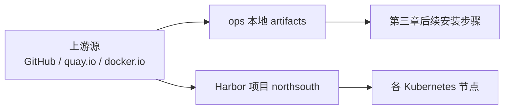

# 第 1 步：预热第三章北向入口制品

## 本步目标

在正式安装 `MetalLB` 和启用 `Gateway API` 之前，先把第三章需要的关键制品准备到本地：

- `MetalLB` 安装清单
- `Gateway API` 标准 CRD
- `MetalLB` 镜像
- 北向演示应用镜像

> 说明：`CRD` 是 `CustomResourceDefinition`，可以理解为“先把一种新的 Kubernetes 资源类型注册到集群里”。只有先安装 `Gateway API` 的 `CRD`，集群后续才认识 `GatewayClass`、`Gateway`、`HTTPRoute` 这些对象；否则直接 `kubectl apply` 相关 `YAML` 时，Kubernetes 会因为“不认识这种资源”而报错。

---

## 执行标记

- **执行标记：必须执行**
- 后续安装优先使用本地 `YAML`、`CRD` 和 Harbor 镜像

---

## 理论说明

### 制品流转图



图中就是本步顺序：先把安装清单固化到 `ops` 本地，其中一部分是普通 `YAML`，另一部分是 `CRD YAML`；再把镜像同步到 Harbor，并在节点预拉，后续安装优先使用这些本地制品。

### 第三章 Harbor 项目的角色

本章专门使用 Harbor 项目：

```text
harbor.qytk8s.com/northsouth
```

它和前两章分开管理：

- 第一章：`k8s`
- 第二章：`cilium`
- 第三章：`northsouth`

### 本步涉及的 YAML 关键内容

本步后续会直接使用两份关键 `YAML`：

- `metallb-native-v0.15.3.yaml`
- `gateway-api-standard-install-v1.4.1.yaml`

<div style="padding: 10px 14px; border: 1px solid #666; border-left: 4px solid #8ab4f8; border-radius: 6px; background: rgba(138,180,248,0.08); margin: 8px 0;">
<strong>YAML 文件：</strong><code>metallb-native-v0.15.3.yaml</code><br/>
<strong>作用：</strong>安装 <code>MetalLB</code> 的 <code>controller</code> 和 <code>speaker</code>
</div>

本课程里，镜像地址已经改写为 Harbor 地址，例如：

```yaml
image: harbor.qytk8s.com/northsouth/metallb-controller:v0.15.3
```

以及：

```yaml
image: harbor.qytk8s.com/northsouth/metallb-speaker:v0.15.3
```

- `metallb-controller`
  - 负责 VIP 分配等控制逻辑
- `metallb-speaker`
  - 负责把 VIP 以二层方式对外通告

<div style="padding: 10px 14px; border: 1px solid #666; border-left: 4px solid #7fd1b9; border-radius: 6px; background: rgba(127,209,185,0.08); margin: 8px 0;">
<strong>YAML 文件：</strong><code>gateway-api-standard-install-v1.4.1.yaml</code><br/>
<strong>作用：</strong>安装第三章会用到的标准 <code>Gateway API CRD</code>
</div>

例如：

```yaml
gatewayclasses.gateway.networking.k8s.io
gateways.gateway.networking.k8s.io
httproutes.gateway.networking.k8s.io
referencegrants.gateway.networking.k8s.io
```

- `GatewayClass`
  - 定义“由谁实现入口模型”
- `Gateway`
  - 定义具体入口实例
- `HTTPRoute`
  - 定义七层路由规则
- `ReferenceGrant`
  - 用于更复杂的跨命名空间引用授权

---

## 对应脚本

本步对应脚本：

- `k8s/03-north-south-traffic/scripts/01_prepare_north_south_artifacts.sh`

本步会生成或使用下面这些关键文件：

- `artifacts/metallb-native-v0.15.3.yaml`
- `artifacts/gateway-api-standard-install-v1.4.1.yaml`

---

## 脚本关键任务

### 关键任务 1：创建 Harbor 项目 `northsouth`

脚本原始代码：

```bash
http_code=$(curl -k -s -o /tmp/harbor_northsouth_project_create.json -w '%{http_code}' \
  -u "${HARBOR_USERNAME}:${HARBOR_PASSWORD}" \
  -H 'Content-Type: application/json' \
  -X POST \
  "https://${HARBOR_DOMAIN}/api/v2.0/projects" \
  -d "{\"project_name\":\"${HARBOR_PROJECT}\",\"public\":true}")
```

关键介绍：第三章镜像统一进入 `northsouth` 项目；如果项目已存在，脚本会直接继续。

### 关键任务 2：固化 `MetalLB` 原始清单并改写镜像地址

脚本原始代码：

```bash
curl -fsSL \
  "https://raw.githubusercontent.com/metallb/metallb/${METALLB_VERSION}/config/manifests/metallb-native.yaml" \
  -o "${src}"

sed \
  -e "s#quay.io/metallb/controller:${METALLB_VERSION}#${HARBOR_DOMAIN}/${HARBOR_PROJECT}/metallb-controller:${METALLB_VERSION}#g" \
  -e "s#quay.io/metallb/speaker:${METALLB_VERSION}#${HARBOR_DOMAIN}/${HARBOR_PROJECT}/metallb-speaker:${METALLB_VERSION}#g" \
  "${src}" >"${dst}"
```

关键介绍：先下载上游 `MetalLB` 清单，再把镜像地址改写成 Harbor 地址，后续安装直接使用本地版本。

### 关键任务 3：固化 `Gateway API` 标准 CRD

脚本原始代码：

```bash
curl -fsSL \
  "https://github.com/kubernetes-sigs/gateway-api/releases/download/${GATEWAY_API_VERSION}/standard-install.yaml" \
  -o "${dst}"
```

关键介绍：第三章这里只需要标准 `CRD`，先固化到本地，后续直接 `kubectl apply`。

### 关键任务 4：推送镜像到 Harbor

脚本原始代码：

```bash
SOURCE_IMAGES=(
  "quay.io/metallb/controller:v0.15.3"
  "quay.io/metallb/speaker:v0.15.3"
  "docker.io/traefik/whoami:v1.10.3"
)

TARGET_IMAGES=(
  "harbor.qytk8s.com/northsouth/metallb-controller:v0.15.3"
  "harbor.qytk8s.com/northsouth/metallb-speaker:v0.15.3"
  "harbor.qytk8s.com/northsouth/whoami:v1.10.3"
)
```

关键介绍：把 `MetalLB` 和演示应用 `whoami` 统一搬运到 Harbor。

### 关键任务 5：在所有节点预拉镜像

脚本原始代码：

```bash
IMAGES=(
  "harbor.qytk8s.com/northsouth/metallb-controller:v0.15.3"
  "harbor.qytk8s.com/northsouth/metallb-speaker:v0.15.3"
  "harbor.qytk8s.com/northsouth/whoami:v1.10.3"
)

for image in "${IMAGES[@]}"; do
  crictl --runtime-endpoint unix:///run/containerd/containerd.sock pull "${image}"
done
```

关键介绍：让后续安装和演示尽量不再发生现场拉镜像。

---

## 执行命令

先给脚本增加执行权限：

```bash
chmod +x /docker_k8s_2026/k8s/03-north-south-traffic/scripts/01_prepare_north_south_artifacts.sh
```

然后执行：

```bash
bash /docker_k8s_2026/k8s/03-north-south-traffic/scripts/01_prepare_north_south_artifacts.sh
```

---

## 验证方法

### 验证 1：查看本地制品

```bash
ls -lh /docker_k8s_2026/k8s/03-north-south-traffic/artifacts/
```

预期结果：

- 本地存在 `metallb-native-v0.15.3.yaml`
- 本地存在 `gateway-api-standard-install-v1.4.1.yaml`

### 验证 2：验证 `ops HTTP` 可访问制品

```bash
curl -I http://ops:9000/03-north-south-traffic/artifacts/metallb-native-v0.15.3.yaml
curl -I http://ops:9000/03-north-south-traffic/artifacts/gateway-api-standard-install-v1.4.1.yaml
```

预期结果：

- 两个请求都返回 `200 OK`

### 验证 3：查看 Harbor 项目与仓库

```bash
curl -k -s -u 'admin:Harbor12345' \
  "https://harbor.qytk8s.com/api/v2.0/projects/northsouth/repositories?page=1&page_size=20" | jq -r '.[].name'
```

预期结果：

- 能看到 `northsouth/metallb-controller`
- 能看到 `northsouth/metallb-speaker`
- 能看到 `northsouth/whoami`

---

## 关键看点

这一页主要确认 3 件事：

- 第三章安装用的 `YAML` 已经在本地固化完成
- 第三章镜像已经进入 Harbor 的 `northsouth` 项目
- 后续步骤不再依赖上游源现场下载

---

## 通过标准

满足下面条件后，就可以进入下一步：

- Harbor 项目 `northsouth` 已就绪
- 第三章 YAML 已落地到本地 `artifacts/`
- 所有节点已预拉本章所需镜像

---

## 下一步

进入第 2 步，安装 `MetalLB`：

- `docs/03_install_metallb.md`
