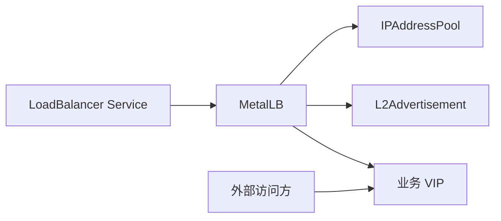

# 第 2 步：安装 MetalLB 并配置业务 VIP 地址池

## 本步目标

为裸机 Kubernetes 集群补齐 `LoadBalancer VIP` 能力。

本步完成后，应达到下面状态：

- `MetalLB` 已安装
- 业务地址池 `10.1.1.50-10.1.1.79` 已创建
- 该地址池只允许带有入口角色标签的节点对外通告

## 执行标记

- **执行标记：必须执行**

## 问题背景

在云厂商环境里，`LoadBalancer Service` 往往会自动获得一个负载均衡地址。

但在裸机环境里，如果没有额外组件，常见结果是：

```text
EXTERNAL-IP   <pending>
```

也就是说，Kubernetes 知道你要对外暴露服务，但不会替你分配和通告 VIP。第三章在这里引入 `MetalLB`，就是为了补齐这层能力。

## 理论说明

这一部分只回答 4 个问题：

- `MetalLB` 在第三章链路里处于哪一层
- `speaker` 和 `L2Advertisement` 分别控制什么
- 本步到底会落下哪两份关键 YAML
- 为什么当前实验先把入口收敛到单节点

### 关系图：`MetalLB` 在第三章中的位置



这张图只说明一件事：`MetalLB` 不负责七层转发，它负责给 `LoadBalancer Service` 分配 VIP，并通过 `L2Advertisement` 让 VIP 真正在网络里可达。

### 核心区分：`speaker` 和“谁在发布 VIP”不是一回事

这部分最容易混淆，可以拆成两件事：

1. 哪些节点上运行了 `speaker`
这是 `DaemonSet` 调度问题。

2. 某个 VIP 最终允许哪些节点去对外通告
这是 `L2Advertisement` 选择问题。

也就是说，`speaker` 在某个节点上运行，不等于这个节点就一定会对某个 VIP 发 ARP 通告。

真正决定第三章这组业务 VIP 由谁来发布的，是下面这段：

- 来源文件：`manifests/02_metallb_l2advertisement.yaml`
- 对象类型：`L2Advertisement`

```yaml
spec:
  ipAddressPools:
    - edge-pool
  nodeSelectors:
    - matchLabels:
        qytk8s.com/node-role: edge
```

它的含义是：

- `edge-pool` 里的 VIP
- 只允许带有 `qytk8s.com/node-role=edge` 标签的节点对外承担二层通告角色

可以先简单记成：

- `speaker` 决定“哪些节点安装通告进程”
- `L2Advertisement` 决定“哪些节点有资格通告这组 VIP”

`speaker` 的节点选择条件来源如下：

- 来源文件：第 1 步固化生成的 `artifacts/metallb-native-v0.15.3.yaml`
- 对象类型：`DaemonSet/speaker`

```yaml
spec:
  template:
    spec:
      nodeSelector:
        kubernetes.io/os: linux
        qytk8s.com/node-role: edge
```

在当前课程改造后的安装清单里，`speaker` 自己也被收敛到了入口标签节点，只会跑在同时满足下面两个条件的节点上：

- `kubernetes.io/os=linux`
- `qytk8s.com/node-role=edge`

这样 `speaker` 的部署范围与 `L2Advertisement` 的候选范围就统一到了同一组入口节点。

这里不直接用 `kubernetes.io/hostname`，而是单独设计入口角色标签，原因是：

- `hostname` 表达的是节点身份，不适合直接表达入口职责
- 当前先给 `wk-edge01` 打这个标签，入口仍然可以稳定收敛到单节点
- 后续如果把 `wk-obs01` 扩进来，只需要补同样的标签，不必修改选择模型

### 关键对象：本步会落下哪两份清单

本步会使用下面两份清单：

- `manifests/01_metallb_ipaddresspool.yaml`
- `manifests/02_metallb_l2advertisement.yaml`

#### `IPAddressPool`

- 来源文件：`manifests/01_metallb_ipaddresspool.yaml`
- 对象类型：`IPAddressPool`

```yaml
kind: IPAddressPool
metadata:
  name: edge-pool
spec:
  addresses:
    - 10.1.1.50-10.1.1.79
```

关键字段说明：

- `10.1.1.50-10.1.1.79`
  - 第三章业务入口可分配的 VIP 范围

#### `L2Advertisement`

- 来源文件：`manifests/02_metallb_l2advertisement.yaml`
- 对象类型：`L2Advertisement`

```yaml
kind: L2Advertisement
metadata:
  name: edge-pool-on-edge-nodes
spec:
  ipAddressPools:
    - edge-pool
  nodeSelectors:
    - matchLabels:
        qytk8s.com/node-role: edge
```

关键字段说明：

- `ipAddressPools: edge-pool`
  - 明确只通告这一组 VIP
- `nodeSelectors`
  - 只允许带有入口角色标签的节点对外承担通告角色
- `qytk8s.com/node-role: edge`
  - 表示该节点属于第三章北向入口节点集合

### 设计取舍：为什么当前先收敛到 `wk-edge01`

如果这里不把 `nodeSelectors` 收敛到入口角色标签，就不会再是“固定只有 edge 节点发布 VIP”，而会变成：

- 运行了 `speaker`
- 且满足这组地址池条件的节点

都可能进入候选集合。

这带来的问题是：

- 北向入口角色不稳定
- 课堂上不容易把“入口角色”固定收敛到 edge 节点集合

所以第三章当前阶段的做法是：

- 先只给 `wk-edge01` 打 `qytk8s.com/node-role=edge`

这样更容易建立稳定认知：

- 当前 `wk-edge01` = 唯一入口节点
- 后续再把同样标签补到其他节点，就能平滑扩容

### 顺序说明：为什么这里先讲地址池，再讲 Gateway

第三章这里的顺序是：

1. 先补齐裸机 VIP 能力
2. 再让 `Gateway` 这种北向入口对象去消费这个能力

如果不先装 `MetalLB`，后面的 `Gateway` 即使能生成 `LoadBalancer Service`，最终也很可能拿不到有效 `EXTERNAL-IP`。

## 对应脚本

本步对应脚本：

- `k8s/03-north-south-traffic/scripts/02_install_metallb.sh`

脚本里会直接用到下面 3 个 URL 变量：

```bash
METALLB_MANIFEST_URL="http://ops:9000/03-north-south-traffic/artifacts/metallb-native-v0.15.3.yaml"
POOL_URL="http://ops:9000/03-north-south-traffic/manifests/01_metallb_ipaddresspool.yaml"
ADV_URL="http://ops:9000/03-north-south-traffic/manifests/02_metallb_l2advertisement.yaml"
```

变量含义：

- `METALLB_MANIFEST_URL`
  - 指向第 1 步固化好的 `MetalLB` 安装清单
- `POOL_URL`
  - 指向业务 VIP 地址池清单
- `ADV_URL`
  - 指向 `L2Advertisement` 清单

## 脚本关键任务

这一部分按“脚本做什么 -> 用到哪个 YAML -> 看哪些关键字段”的顺序展开。

### 关键任务 1：预创建 `metallb-system` 并设置命名空间标签

脚本原始代码：

```bash
kubectl create namespace metallb-system --dry-run=client -o yaml | kubectl apply -f -
kubectl label namespace metallb-system \
  pod-security.kubernetes.io/enforce=privileged \
  pod-security.kubernetes.io/audit=privileged \
  pod-security.kubernetes.io/warn=privileged \
  --overwrite
```

关键介绍：

- 这里先把命名空间和相关安全标签准备好，保证组件能正常部署

### 关键任务 2：安装 `MetalLB` 原始组件

脚本原始代码：

```bash
kubectl apply -f "${METALLB_MANIFEST_URL}"
```

关键介绍：

- 使用的是第 1 步已经固化到本地并改写镜像地址的 `MetalLB` 安装清单
- 这里真正装进去的是 `controller` 和 `speaker`

对应 YAML 关键内容：

- 来源文件：第 1 步固化生成的 `artifacts/metallb-native-v0.15.3.yaml`
- 对象类型：`Deployment/controller` 与 `DaemonSet/speaker`

```yaml
image: harbor.qytk8s.com/northsouth/metallb-controller:v0.15.3
```

`speaker` 镜像与节点选择条件：

- 来源文件：第 1 步固化生成的 `artifacts/metallb-native-v0.15.3.yaml`
- 对象类型：`DaemonSet/speaker`

```yaml
image: harbor.qytk8s.com/northsouth/metallb-speaker:v0.15.3

nodeSelector:
  kubernetes.io/os: linux
  qytk8s.com/node-role: edge
```

### 关键任务 3：应用 VIP 地址池

脚本原始代码：

```bash
kubectl apply -f "${POOL_URL}"
```

关键介绍：

- 这一段定义第三章业务 VIP 的可分配范围
- `POOL_URL` 对应 `manifests/01_metallb_ipaddresspool.yaml`

对应 YAML 关键内容：

- 来源文件：`manifests/01_metallb_ipaddresspool.yaml`
- 对象类型：`IPAddressPool`

```yaml
kind: IPAddressPool
metadata:
  name: edge-pool
  namespace: metallb-system
spec:
  addresses:
    - 10.1.1.50-10.1.1.79
  autoAssign: true
```

关键字段说明：

- `name: edge-pool`
  - 后续 `Gateway` 会引用这组地址池
- `addresses`
  - 定义第三章允许分配的业务 VIP 范围
- `autoAssign: true`
  - 允许 `MetalLB` 从地址池里自动分配 VIP

### 关键任务 4：为 `wk-edge01` 打入口标签并应用 `L2Advertisement`

脚本原始代码：

```bash
kubectl label node wk-edge01 qytk8s.com/node-role=edge --overwrite
kubectl apply -f "${ADV_URL}"
```

关键介绍：

- 第三章初始阶段先只给 `wk-edge01` 打入口角色标签
- `L2Advertisement` 通过这个标签选出可对外通告 VIP 的节点
- 后续如果要把 `wk-obs01` 扩进来，只需要补同样的标签
- `ADV_URL` 对应 `manifests/02_metallb_l2advertisement.yaml`

对应 YAML 关键内容：

- 来源文件：`manifests/02_metallb_l2advertisement.yaml`
- 对象类型：`L2Advertisement`

```yaml
kind: L2Advertisement
metadata:
  name: edge-pool-on-edge-nodes
  namespace: metallb-system
spec:
  ipAddressPools:
    - edge-pool
  nodeSelectors:
    - matchLabels:
        qytk8s.com/node-role: edge
```

关键字段说明：

- `ipAddressPools: edge-pool`
  - 表示这条通告规则绑定的是 `edge-pool`
- `nodeSelectors`
  - 表示只有带有入口角色标签的节点能对这组 VIP 做二层通告
- `qytk8s.com/node-role: edge`
  - 第三章初始阶段实际只有 `wk-edge01` 带这个标签，因此入口仍然收敛在 `wk-edge01`

### 任务补充：怎么看 `speaker` 会跑到哪些节点

不用读整份 `DaemonSet` YAML，直接抓这 3 个字段即可：

```bash
kubectl -n metallb-system get ds speaker -o jsonpath='{.spec.template.spec.nodeSelector}{"\n"}{.spec.template.spec.affinity}{"\n"}{.spec.template.spec.tolerations}{"\n"}'
```

关键看点：

- `nodeSelector`
  - 决定哪些节点有资格运行 `speaker`
- `affinity`
  - 如果有节点亲和性，也会进一步限制节点范围
- `tolerations`
  - 决定它能不能跑到带污点的节点，例如 control-plane

当前实验里，典型结果是：

- `nodeSelector` 同时要求：
  - `kubernetes.io/os=linux`
  - `qytk8s.com/node-role=edge`
- `tolerations` 允许它容忍 control-plane 的 `NoSchedule`

这意味着：

- 当前如果只有 `wk-edge01` 带这个标签，`speaker` 就只会跑在 `wk-edge01`
- 后续如果 `wk-obs01` 也打上同样标签，`speaker` 会自动在 `wk-obs01` 新增一个 Pod

再次强调：哪些节点上“有 `speaker`”，和哪些节点“真的发布 `edge-pool` VIP”，不是同一个问题。

## 执行命令

先给脚本增加执行权限：

```bash
chmod +x /docker_k8s_2026/k8s/03-north-south-traffic/scripts/02_install_metallb.sh
```

然后执行：

```bash
bash /docker_k8s_2026/k8s/03-north-south-traffic/scripts/02_install_metallb.sh
```

## 验证方法

这一部分按“先看对象是否创建成功，再看调度范围，最后看运行时发布行为”的顺序检查。

### 验证 1：查看 `MetalLB` 组件状态

```bash
kubectl get pods -n metallb-system -o wide
```

预期结果：

- `controller` 正常运行
- `speaker` 以 `DaemonSet` 方式正常运行

### 验证 2：查看地址池与通告对象

```bash
kubectl get ipaddresspool,l2advertisement -n metallb-system
```

预期结果：

- `edge-pool` 存在
- `edge-pool-on-edge-nodes` 存在

### 验证 3：查看 VIP 地址池详细内容

```bash
kubectl get ipaddresspool -n metallb-system edge-pool -o yaml
kubectl get l2advertisement -n metallb-system edge-pool-on-edge-nodes -o yaml
```

预期结果：

- 地址池范围为 `10.1.1.50-10.1.1.79`
- `nodeSelectors` 中明确指向 `qytk8s.com/node-role=edge`

### 验证 4：只抽关键字段，判断 `speaker` 的运行范围

```bash
kubectl -n metallb-system get ds speaker -o jsonpath='{.spec.template.spec.nodeSelector}{"\n"}{.spec.template.spec.affinity}{"\n"}{.spec.template.spec.tolerations}{"\n"}'
```

关键看点：

- 如果 `nodeSelector` 同时看到 `kubernetes.io/os=linux` 和 `qytk8s.com/node-role=edge`
  - 表示只有带 edge 入口标签的 Linux 节点可能运行 `speaker`
- 如果 `tolerations` 里出现 control-plane 相关项
  - 表示控制平面节点也允许运行 `speaker`

预期结果：

- 读者能区分：
  - `speaker` 的部署范围
  - `edge-pool` 的实际 VIP 发布节点

## 关键看点

这一页真正要确认的是：

- `MetalLB` 组件已可用
- 集群已经具备为 `LoadBalancer Service` 分配 VIP 的能力
- `edge-pool` 与 `L2Advertisement` 已准备好
- 当前只有带 `qytk8s.com/node-role=edge` 标签的节点具备对外通告这组 VIP 的资格

## 通过标准

满足下面条件后，就可以进入下一步：

- `MetalLB` 正常运行
- 集群已经具备对 `LoadBalancer Service` 分配 VIP 的能力
- `edge-pool` 与 `edge-pool-on-edge-nodes` 已创建成功

## 下一步

进入第 3 步，为现有 `Cilium` 开启 `Gateway API`：

- `docs/04_enable_gateway_api.md`
