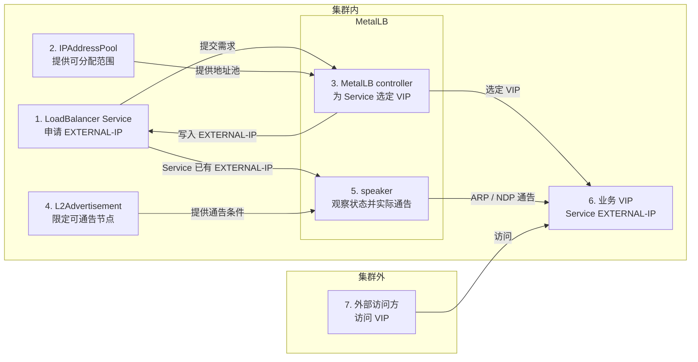

# 第 2 步：安装 MetalLB 并配置业务 VIP 地址池

## 本步目标

为裸机 Kubernetes 集群补齐 `LoadBalancer VIP` 能力。

本步完成后，应达到下面状态：

- `MetalLB` 已安装
- 业务地址池 `10.1.1.50-10.1.1.79` 已创建
- 该地址池只允许带有入口角色标签的节点对外通告

---

## 执行标记

- **执行标记：必须执行**

---

## 问题背景

在裸机环境里，如果没有额外组件，`LoadBalancer Service` 常见结果仍然是：

```text
EXTERNAL-IP   <pending>
```

也就是说，Kubernetes 知道你要对外暴露服务，但不会自动替你分配和通告 VIP。第三章在这里引入 `MetalLB`，补齐这层能力。

### 什么是 `MetalLB`

`MetalLB` 可以理解为裸机 Kubernetes 的 `LoadBalancer` 实现，用来给 `Service type=LoadBalancer` 分配地址，并让这个地址在网络里真正可达。

官方入口：

- 官网 / 文档：https://metallb.io/
- GitHub：https://github.com/metallb/metallb

---

## 理论说明

这一部分只说明 3 件事：

- `MetalLB` 在第三章链路里处于哪一层
- `speaker` 和 `L2Advertisement` 分别控制什么
- 本步关键 `YAML` 各自做什么

### 关系图：`MetalLB` 在第三章中的位置



图中编号说明：

1. `LoadBalancer Service` 先提出“我需要一个 `EXTERNAL-IP`”。
2. `IPAddressPool` 提供可分配的 `VIP` 范围。
3. `MetalLB controller` 从地址池中选定一个 `VIP`，并把它写入 `Service` 的 `EXTERNAL-IP`。
4. `L2Advertisement` 定义“哪些节点有资格对这组 `VIP` 做二层通告”。
5. 各节点上的 `speaker` 观察 `Service` 状态，再结合 `L2Advertisement` 和当前选举结果，决定谁来实际通告这个 `VIP`。
6. 这个 `VIP` 就是 `LoadBalancer Service` 对外暴露的入口地址，不是集群外独立设备。
7. 集群外访问方最终访问的就是这个 `VIP`。

这一段可以直接记成：`controller` 负责分配，`speaker` 负责通告，`L2Advertisement` 负责限制谁可以通告。

### 设计取舍：为什么用入口角色标签，并先收敛到 `wk-edge01`

这里不直接用 `kubernetes.io/hostname`，而是单独设计入口角色标签，原因是：

- `hostname` 表达的是节点身份，不适合直接表达入口职责
- 当前只给 `wk-edge01` 打 `qytk8s.com/node-role=edge`，入口可以稳定收敛到单节点
- 后续如果把 `wk-obs01` 扩进来，只需要补同样标签，不必修改选择模型

### 本步关键 `YAML` 一次看清

<div style="padding: 10px 14px; border: 1px solid #666; border-left: 4px solid #8ab4f8; border-radius: 6px; background: rgba(138,180,248,0.08); margin: 8px 0;">
<strong>YAML 文件：</strong><code>artifacts/metallb-native-v0.15.3.yaml</code><br/>
<strong>本页重点对象：</strong><code>DaemonSet/speaker</code><br/>
<strong>作用：</strong>安装 <code>MetalLB</code> 原始组件，并在当前课程里把镜像地址改写到 <code>Harbor</code>；其中 <code>speaker</code> 通过 <code>nodeSelector</code> 收敛到入口标签节点
</div>

这份文件里包含多个对象；下面摘出的是其中 `DaemonSet/speaker` 的关键片段：

```yaml
kind: DaemonSet
metadata:
  name: speaker
spec:
  template:
    spec:
      nodeSelector:
        kubernetes.io/os: linux
        qytk8s.com/node-role: edge
```

- `nodeSelector`
  - 当前只允许带 `qytk8s.com/node-role=edge` 标签的 Linux 节点运行 `speaker`
- 镜像地址
  - 已在第 1 步改写到 `harbor.qytk8s.com/northsouth`

<div style="padding: 10px 14px; border: 1px solid #666; border-left: 4px solid #8ab4f8; border-radius: 6px; background: rgba(138,180,248,0.08); margin: 8px 0;">
<strong>YAML 文件：</strong><code>manifests/01_metallb_ipaddresspool.yaml</code><br/>
<strong>本页重点对象：</strong><code>IPAddressPool/edge-pool</code><br/>
<strong>作用：</strong>创建 <code>IPAddressPool</code>，定义第三章业务入口可分配的 <code>VIP</code> 范围
</div>

```yaml
kind: IPAddressPool
metadata:
  name: edge-pool
spec:
  addresses:
    - 10.1.1.50-10.1.1.79
  autoAssign: true
```

关键字段说明：

- `10.1.1.50-10.1.1.79`
  - 第三章业务入口可分配的 VIP 范围

<div style="padding: 10px 14px; border: 1px solid #666; border-left: 4px solid #7fd1b9; border-radius: 6px; background: rgba(127,209,185,0.08); margin: 8px 0;">
<strong>YAML 文件：</strong><code>manifests/02_metallb_l2advertisement.yaml</code><br/>
<strong>本页重点对象：</strong><code>L2Advertisement/edge-pool-on-edge-nodes</code><br/>
<strong>作用：</strong>创建 <code>L2Advertisement</code>，决定哪一组节点有资格对这组 <code>VIP</code> 做二层通告
</div>

```yaml
kind: L2Advertisement
metadata:
  name: edge-pool-on-edge-nodes
spec:
  ipAddressPools:
    - edge-pool
  nodeSelectors:
    - matchLabels:
        qytk8s.com/node-role: edge
```

关键字段说明：

- `ipAddressPools: edge-pool`
  - 明确只通告这一组 VIP
- `nodeSelectors`
  - 只允许带有入口角色标签的节点对外承担通告角色
- `qytk8s.com/node-role: edge`
  - 表示该节点属于第三章北向入口节点集合

- 当前 `wk-edge01` = 唯一入口节点
- 后续再把同样标签补到其他节点，就能平滑扩容

### 顺序说明：为什么这里先讲地址池，再讲 Gateway

第三章这里的顺序是：

1. 先补齐裸机 VIP 能力
2. 再让 `Gateway` 去消费这个能力

如果不先装 `MetalLB`，后面的 `Gateway` 即使能生成 `LoadBalancer Service`，最终也很可能拿不到有效 `EXTERNAL-IP`。

---

## 对应脚本

本步对应脚本：

- `k8s/03-north-south-traffic/scripts/02_install_metallb.sh`

脚本里会直接用到下面 3 个 URL 变量：

```bash
METALLB_MANIFEST_URL="http://ops:9000/03-north-south-traffic/artifacts/metallb-native-v0.15.3.yaml"
POOL_URL="http://ops:9000/03-north-south-traffic/manifests/01_metallb_ipaddresspool.yaml"
ADV_URL="http://ops:9000/03-north-south-traffic/manifests/02_metallb_l2advertisement.yaml"
```

变量含义：

- `METALLB_MANIFEST_URL`
  - 指向第 1 步固化好的 `MetalLB` 安装清单
- `POOL_URL`
  - 指向业务 VIP 地址池清单
- `ADV_URL`
  - 指向 `L2Advertisement` 清单

---

## 脚本关键任务

### 关键任务 1：预创建 `metallb-system` 并设置命名空间标签

脚本原始代码：

```bash
kubectl create namespace metallb-system --dry-run=client -o yaml | kubectl apply -f -
kubectl label namespace metallb-system \
  pod-security.kubernetes.io/enforce=privileged \
  pod-security.kubernetes.io/audit=privileged \
  pod-security.kubernetes.io/warn=privileged \
  --overwrite
```

关键介绍：先把命名空间和相关安全标签准备好，保证组件能正常部署。

### 关键任务 2：安装 `MetalLB` 原始组件

脚本原始代码：

```bash
kubectl apply -f "${METALLB_MANIFEST_URL}"
```

关键介绍：使用第 1 步已经固化到本地并改写镜像地址的安装清单，实际安装的是 `controller` 和 `speaker`。

对应上文 `metallb-native-v0.15.3.yaml`，这里不再重复展开完整 `YAML`，这一段主要确认两件事：

- 镜像已经改写到 `harbor.qytk8s.com/northsouth`
- `speaker` 已收敛到带 `qytk8s.com/node-role=edge` 标签的节点

### 关键任务 3：应用 VIP 地址池

脚本原始代码：

```bash
kubectl apply -f "${POOL_URL}"
```

关键介绍：这一段定义第三章业务 VIP 的可分配范围；`POOL_URL` 对应 `manifests/01_metallb_ipaddresspool.yaml`。

对应上文 `IPAddressPool`，这里重点只看两个字段：

- `addresses: 10.1.1.50-10.1.1.79`
  - 定义第三章允许分配的业务 VIP 范围
- `autoAssign: true`
  - 允许 `MetalLB` 从地址池里自动分配 VIP

### 关键任务 4：为 `wk-edge01` 打入口标签并应用 `L2Advertisement`

脚本原始代码：

```bash
kubectl label node wk-edge01 qytk8s.com/node-role=edge --overwrite
kubectl apply -f "${ADV_URL}"
```

关键介绍：第三章初始阶段先只给 `wk-edge01` 打入口角色标签，`L2Advertisement` 通过这个标签选出可对外通告 VIP 的节点；后续如果要把 `wk-obs01` 扩进来，只需要补同样的标签。`ADV_URL` 对应 `manifests/02_metallb_l2advertisement.yaml`。

对应上文 `L2Advertisement`，这里重点只看两个字段：

- `ipAddressPools: edge-pool`
  - 表示这条通告规则绑定的是 `edge-pool`
- `nodeSelectors: qytk8s.com/node-role=edge`
  - 表示只有带入口角色标签的节点能对这组 VIP 做二层通告

### 任务补充：怎么看 `speaker` 会跑到哪些节点

不用读整份 `DaemonSet` YAML，直接抓这 3 个字段即可：

```bash
kubectl -n metallb-system get ds speaker -o jsonpath='{.spec.template.spec.nodeSelector}{"\n"}{.spec.template.spec.affinity}{"\n"}{.spec.template.spec.tolerations}{"\n"}'
```

关键看点：

- `nodeSelector`
  - 决定哪些节点有资格运行 `speaker`
- `affinity`
  - 如果有节点亲和性，也会进一步限制节点范围
- `tolerations`
  - 决定它能不能跑到带污点的节点，例如 control-plane

当前实验里，典型结果是：

- `nodeSelector` 同时要求：
  - `kubernetes.io/os=linux`
  - `qytk8s.com/node-role=edge`
- `tolerations` 允许它容忍 control-plane 的 `NoSchedule`

这意味着：

- 当前如果只有 `wk-edge01` 带这个标签，`speaker` 就只会跑在 `wk-edge01`
- 后续如果 `wk-obs01` 也打上同样标签，`speaker` 会自动在 `wk-obs01` 新增一个 Pod

再次强调：哪些节点上“有 `speaker`”，和哪些节点“真的发布 `edge-pool` VIP”，不是同一个问题。

---

## 执行命令

先给脚本增加执行权限：

```bash
chmod +x /docker_k8s_2026/k8s/03-north-south-traffic/scripts/02_install_metallb.sh
```

然后执行：

```bash
bash /docker_k8s_2026/k8s/03-north-south-traffic/scripts/02_install_metallb.sh
```

---

## 验证方法

### 验证 1：查看 `MetalLB` 组件状态

```bash
kubectl get pods -n metallb-system -o wide
```

预期结果：

- `controller` 正常运行
- `speaker` 以 `DaemonSet` 方式正常运行

### 验证 2：查看地址池与通告对象

```bash
kubectl get ipaddresspool,l2advertisement -n metallb-system
```

预期结果：

- `edge-pool` 存在
- `edge-pool-on-edge-nodes` 存在

### 验证 3：查看 VIP 地址池详细内容

```bash
kubectl get ipaddresspool -n metallb-system edge-pool -o yaml
kubectl get l2advertisement -n metallb-system edge-pool-on-edge-nodes -o yaml
```

预期结果：

- 地址池范围为 `10.1.1.50-10.1.1.79`
- `nodeSelectors` 中明确指向 `qytk8s.com/node-role=edge`

### 验证 4：只抽关键字段，判断 `speaker` 的运行范围

```bash
kubectl -n metallb-system get ds speaker -o jsonpath='{.spec.template.spec.nodeSelector}{"\n"}{.spec.template.spec.affinity}{"\n"}{.spec.template.spec.tolerations}{"\n"}'
```

关键看点：

- 如果 `nodeSelector` 同时看到 `kubernetes.io/os=linux` 和 `qytk8s.com/node-role=edge`
  - 表示只有带 edge 入口标签的 Linux 节点可能运行 `speaker`
- 如果 `tolerations` 里出现 control-plane 相关项
  - 表示控制平面节点也允许运行 `speaker`

预期结果：

- 能区分 `speaker` 的部署范围和 `edge-pool` 的实际 VIP 发布节点

---

## 关键看点

这一页主要确认：

- `MetalLB` 组件已可用
- `edge-pool` 与 `L2Advertisement` 已准备好
- 当前只有带 `qytk8s.com/node-role=edge` 标签的节点具备对外通告这组 VIP 的资格

---

## 通过标准

满足下面条件后，就可以进入下一步：

- `MetalLB` 正常运行
- `edge-pool` 与 `edge-pool-on-edge-nodes` 已创建成功
- 当前入口角色仍收敛在带 `qytk8s.com/node-role=edge` 标签的节点

---

## 下一步

进入第 3 步，为现有 `Cilium` 开启 `Gateway API`：

- `docs/04_enable_gateway_api.md`
