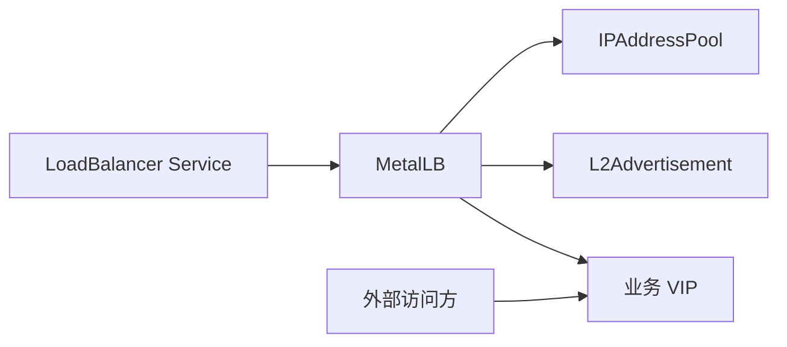

# 第 2 步：安装 MetalLB 并配置业务 VIP 地址池

## 本步目标

为裸机 Kubernetes 集群补齐 `LoadBalancer VIP` 能力。

本步完成后，应达到下面状态：

- `MetalLB` 已安装
- 业务地址池 `10.1.1.50-10.1.1.79` 已创建
- 该地址池只允许 `wk-edge01` 对外通告

## 执行标记

- **执行标记：必须执行**

说明：

- 这是第三章真正开始补齐南北向入口能力的一步
- 本步完成后，裸机集群第一次具备为 `LoadBalancer Service` 分配业务 VIP 的能力

## 问题背景

在云厂商环境里，`LoadBalancer Service` 往往会自动获得一个负载均衡地址。

但在裸机环境里，如果没有额外组件，常见结果是：

```text
EXTERNAL-IP   <pending>
```

也就是说：

- Kubernetes 知道你要对外暴露服务
- 但没有组件为你分配 VIP
- 也没有组件把这个 VIP 在网络里真正通告出去

第三章在这里引入 `MetalLB`，就是为了补齐这层能力。

## 理论说明

### `MetalLB` 在第三章中的位置



这张图说明：

- `MetalLB` 不是七层网关
- 它负责给 `LoadBalancer Service` 分配 VIP
- 并通过 `L2Advertisement` 让这个 VIP 在网络里真正可达

### `speaker` 和“谁在发布 VIP”不是一回事

这是 `MetalLB` 里最容易混淆的一层。

可以把它拆成两件事：

1. 哪些节点上运行了 `speaker`
这是 `DaemonSet` 调度问题。

2. 某个 VIP 最终允许哪些节点去对外通告
这是 `L2Advertisement` 选择问题。

也就是说：

- `speaker` 在一个节点上运行
- 不等于这个节点就一定会对某个 VIP 发 ARP 通告

真正决定第三章这组业务 VIP 由谁来发布的，是下面这段：

```yaml
spec:
  ipAddressPools:
    - edge-pool
  nodeSelectors:
    - matchLabels:
        kubernetes.io/hostname: wk-edge01
```

它的含义是：

- `edge-pool` 里的 VIP
- 只允许 `wk-edge01` 对外承担二层通告角色

所以课程里可以把它简单记成：

- `speaker` 决定“哪些节点具备通告能力”
- `L2Advertisement` 决定“这次到底轮到谁通告”

### 为什么这里先讲地址池，再讲 Gateway

第三章的设计顺序不是偶然的：

1. 先补齐裸机 VIP 能力
2. 再让 `Gateway` 这种北向入口对象去消费这个能力

如果不先装 `MetalLB`，后面的 `Gateway` 即使能生成 `LoadBalancer Service`，最终也很可能依然拿不到有效 `EXTERNAL-IP`。

### 本步关键清单

本步会使用下面两份清单：

- `manifests/01_metallb_ipaddresspool.yaml`
- `manifests/02_metallb_l2advertisement.yaml`

#### `IPAddressPool`

```yaml
kind: IPAddressPool
metadata:
  name: edge-pool
spec:
  addresses:
    - 10.1.1.50-10.1.1.79
```

关键字段说明：

- `10.1.1.50-10.1.1.79`
  - 第三章业务入口可分配的 VIP 范围

#### `L2Advertisement`

```yaml
kind: L2Advertisement
metadata:
  name: edge-pool-on-wk-edge01
spec:
  ipAddressPools:
    - edge-pool
  nodeSelectors:
    - matchLabels:
        kubernetes.io/hostname: wk-edge01
```

关键字段说明：

- `ipAddressPools: edge-pool`
  - 明确只通告这一组 VIP
- `nodeSelectors`
  - 只允许 `wk-edge01` 对外承担通告角色

### 不限制 `nodeSelectors` 会怎样

如果这里不把 `nodeSelectors` 收敛到 `wk-edge01`，结果就不会再是“固定只有 edge 节点发布 VIP”。

更准确地说，会变成：

- 运行了 `speaker`
- 且满足这组地址池条件的节点

都可能进入候选集合。

这带来的问题是：

- 北向入口角色不稳定
- 课堂上不容易把“入口角色”固定收敛到 `wk-edge01`

所以第三章故意把它钉死在：

- `wk-edge01`

这样学员更容易建立稳定认知：

- `wk-edge01` = 北向入口节点

## 对应脚本

本步对应脚本：

- `k8s/03-north-south-traffic/scripts/02_install_metallb.sh`

脚本里会直接用到下面 3 个 URL 变量：

```bash
METALLB_MANIFEST_URL="http://ops:9000/03-north-south-traffic/artifacts/metallb-native-v0.15.3.yaml"
POOL_URL="http://ops:9000/03-north-south-traffic/manifests/01_metallb_ipaddresspool.yaml"
ADV_URL="http://ops:9000/03-north-south-traffic/manifests/02_metallb_l2advertisement.yaml"
```

关键介绍：

- `METALLB_MANIFEST_URL`
  - 指向第 1 步已经固化好的 `MetalLB` 原始安装清单
- `POOL_URL`
  - 指向业务 VIP 地址池清单
- `ADV_URL`
  - 指向只允许 `wk-edge01` 对外通告的 `L2Advertisement` 清单

## 脚本关键任务

### 关键任务 1：预创建 `metallb-system` 并设置命名空间标签

脚本原始代码：

```bash
kubectl create namespace metallb-system --dry-run=client -o yaml | kubectl apply -f -
kubectl label namespace metallb-system \
  pod-security.kubernetes.io/enforce=privileged \
  pod-security.kubernetes.io/audit=privileged \
  pod-security.kubernetes.io/warn=privileged \
  --overwrite
```

关键介绍：

- `MetalLB speaker` 以 `DaemonSet` 方式运行
- 这里先把命名空间和相关安全标签准备好，保证组件能正常部署

### 关键任务 2：安装 `MetalLB` 原始组件

脚本原始代码：

```bash
kubectl apply -f "${METALLB_MANIFEST_URL}"
```

关键介绍：

- 使用的是第 1 步已经固化到本地并改写镜像地址的 `MetalLB` 安装清单
- 这里真正装进去的是 `controller` 和 `speaker`

对应 YAML 关键内容：

```yaml
image: harbor.qytk8s.com/northsouth/metallb-controller:v0.15.3
```

以及：

```yaml
image: harbor.qytk8s.com/northsouth/metallb-speaker:v0.15.3
```

### 关键任务 3：应用 VIP 地址池

脚本原始代码：

```bash
kubectl apply -f "${POOL_URL}"
```

关键介绍：

- 这一段定义第三章业务 VIP 的可分配范围
- `POOL_URL` 实际对应的是：
  - `manifests/01_metallb_ipaddresspool.yaml`

对应 YAML 关键内容：

```yaml
kind: IPAddressPool
metadata:
  name: edge-pool
  namespace: metallb-system
spec:
  addresses:
    - 10.1.1.50-10.1.1.79
  autoAssign: true
```

关键字段说明：

- `name: edge-pool`
  - 后续 `Gateway` 会引用这组地址池
- `addresses`
  - 定义第三章允许分配的业务 VIP 范围
- `autoAssign: true`
  - 允许 `MetalLB` 从地址池里自动分配 VIP

### 关键任务 4：应用 L2Advertisement

脚本原始代码：

```bash
kubectl apply -f "${ADV_URL}"
```

关键介绍：

- 这一段限制只有 `wk-edge01` 对外承担通告角色
- 更适合课堂上讲“边缘入口节点”的概念
- `ADV_URL` 实际对应的是：
  - `manifests/02_metallb_l2advertisement.yaml`

对应 YAML 关键内容：

```yaml
kind: L2Advertisement
metadata:
  name: edge-pool-on-wk-edge01
  namespace: metallb-system
spec:
  ipAddressPools:
    - edge-pool
  nodeSelectors:
    - matchLabels:
        kubernetes.io/hostname: wk-edge01
```

关键字段说明：

- `ipAddressPools: edge-pool`
  - 表示这条通告规则绑定的是 `edge-pool`
- `nodeSelectors`
  - 表示只有 `wk-edge01` 能对这组 VIP 做二层通告
- `kubernetes.io/hostname: wk-edge01`
  - 明确把业务入口角色收敛到 `wk-edge01`

### 怎么看 `speaker` 会跑到哪些节点

不用读整份 `DaemonSet` YAML，直接抓这 3 个字段就够了：

```bash
kubectl -n metallb-system get ds speaker -o jsonpath='{.spec.template.spec.nodeSelector}{"\n"}{.spec.template.spec.affinity}{"\n"}{.spec.template.spec.tolerations}{"\n"}'
```

关键看点：

- `nodeSelector`
  - 决定哪些节点有资格运行 `speaker`
- `affinity`
  - 如果有节点亲和性，也会进一步限制节点范围
- `tolerations`
  - 决定它能不能跑到带污点的节点，例如 control-plane

在当前实验里，典型结果是：

- `nodeSelector` 只要求 `kubernetes.io/os=linux`
- `tolerations` 允许它容忍 control-plane 的 `NoSchedule`

这意味着：

- `speaker` 并不是只给 `wk-edge01`
- 它通常可以在多个 Linux 节点上运行

再次强调：

- 哪些节点上“有 `speaker`”
- 和哪些节点“真的发布 `edge-pool` VIP”

不是同一个问题。

## 执行命令

先给脚本增加执行权限：

```bash
chmod +x /docker_k8s_2026/k8s/03-north-south-traffic/scripts/02_install_metallb.sh
```

然后执行：

```bash
bash /docker_k8s_2026/k8s/03-north-south-traffic/scripts/02_install_metallb.sh
```

## 验证方法

### 验证 1：查看 `MetalLB` 组件状态

```bash
kubectl get pods -n metallb-system -o wide
```

预期结果：

- `controller` 正常运行
- `speaker` 以 `DaemonSet` 方式正常运行

### 验证 2：查看地址池与通告对象

```bash
kubectl get ipaddresspool,l2advertisement -n metallb-system
```

预期结果：

- `edge-pool` 存在
- `edge-pool-on-wk-edge01` 存在

### 验证 3：查看 VIP 地址池详细内容

```bash
kubectl get ipaddresspool -n metallb-system edge-pool -o yaml
kubectl get l2advertisement -n metallb-system edge-pool-on-wk-edge01 -o yaml
```

预期结果：

- 地址池范围为 `10.1.1.50-10.1.1.79`
- `nodeSelectors` 中明确指向 `wk-edge01`

### 验证 4：只抽关键字段，判断 `speaker` 的运行范围

```bash
kubectl -n metallb-system get ds speaker -o jsonpath='{.spec.template.spec.nodeSelector}{"\n"}{.spec.template.spec.affinity}{"\n"}{.spec.template.spec.tolerations}{"\n"}'
```

关键看点：

- 如果 `nodeSelector` 只看到 `kubernetes.io/os=linux`
  - 表示所有 Linux 节点都可能运行 `speaker`
- 如果 `tolerations` 里出现 control-plane 相关项
  - 表示控制平面节点也允许运行 `speaker`

预期结果：

- 读者能区分：
  - `speaker` 的部署范围
  - `edge-pool` 的实际 VIP 发布节点

### 验证 5：怎么看当前是 `wk-edge01` 在发布 `10.1.1.60`

先看配置层：

```bash
kubectl -n metallb-system get l2advertisement edge-pool-on-wk-edge01 -o jsonpath='{.spec.ipAddressPools}{"\n"}{.spec.nodeSelectors}{"\n"}'
```

关键看点：

- 第一行应出现 `edge-pool`
- 第二行应明确出现 `wk-edge01`

这表示：

- `edge-pool` 这组 VIP
- 只允许 `wk-edge01` 进入发布候选

如果要从运行时再做一次网络确认，可以在外部主机上执行：

```bash
arping -I eth0 10.1.1.60
```

然后再去 `wk-edge01` 上查看网卡 MAC：

```bash
ssh root@wk-edge01 'ip link show'
```

关键看点：

- `10.1.1.60` 回应的 MAC
- 应与 `wk-edge01` 的网卡 MAC 对上

预期结果：

- 可以把 `10.1.1.60` 理解成“当前由 `wk-edge01` 这张网卡在二层上回应”

## 关键看点

这一页真正要确认的是：

- `MetalLB` 组件已可用
- 集群已经具备为 `LoadBalancer Service` 分配 VIP 的能力
- VIP 并不是“全网任意节点都能通告”，而是按课程设计收敛到 `wk-edge01`

## 通过标准

满足下面条件后，就可以进入下一步：

- `MetalLB` 正常运行
- 集群已经具备对 `LoadBalancer Service` 分配 VIP 的能力
- `edge-pool` 与 `edge-pool-on-wk-edge01` 已创建成功

## 下一步

进入第 3 步，为现有 `Cilium` 开启 `Gateway API`：

- `docs/04_enable_gateway_api.md`
