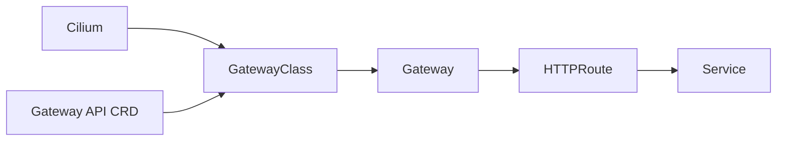

# 第 3 步：为现有 Cilium 开启 Gateway API

## 本步目标

在不重建集群的前提下，为当前已经运行的 `Cilium` 增加 `Gateway API` 能力。

本步完成后，应达到下面状态：

- `Gateway API` 标准 CRD 已安装
- `Cilium` 已启用 `gatewayAPI.enabled`
- 集群中能看到 `GatewayClass`

## 执行标记

- **执行标记：必须执行**

说明：

- 本步的核心不是“再安装一套网关产品”
- 而是在现有 `Cilium` 网络底座上，直接补齐北向入口模型

## 问题背景

到第三章第 2 步为止，集群已经具备：

- 裸机 VIP 分配能力
- `LoadBalancer Service` 可用的基础条件

但还缺少：

- 一个现代、清晰的北向入口对象模型

第三章没有单独引入另一套独立网关产品，而是继续复用第二章已经安装好的 `Cilium`。这样课程主线更连贯，也更容易过渡到后续安全与治理章节。

## 理论说明

### `Gateway API` 在第三章中的位置



这张图说明：

- `Gateway API` 先通过 CRD 进入集群
- `Cilium` 负责提供具体实现
- `GatewayClass` 表示由谁来实现入口
- `Gateway` 表示入口实例
- `HTTPRoute` 表示路由规则

### 为什么这里用 Helm 升级而不是重装 Cilium

第二章已经完成了：

- `Cilium` 安装
- `Hubble`
- `kube-proxy replacement`

第三章只是在现有基础上追加：

- `gatewayAPI.enabled: true`

因此更合理的方式是：

- 保留第二章已经稳定运行的 `Cilium`
- 基于原有 values 再叠加第三章的 gateway values

这比“重装一套网络平面”更符合实际工程。

### 本步关键配置

第三章追加的关键配置文件是：

- `manifests/03_cilium_gateway_values.yaml`

关键字段如下：

```yaml
gatewayAPI:
  enabled: true
  externalTrafficPolicy: Cluster
  gatewayClass:
    create: "auto"
```

关键字段说明：

- `enabled: true`
  - 为现有 `Cilium` 打开 `Gateway API`
- `gatewayClass.create: "auto"`
  - 让 `Cilium` 自动创建可用的 `GatewayClass`
- `externalTrafficPolicy: Cluster`
  - 定义流量进入后的转发策略

### 为什么这里的 YAML 很少，但很关键

第三章这一页追加的 values 不多，但每个字段都直接影响后面 `Gateway` 是否能工作。

可以把它们简单理解成：

- 第二章 `cilium-values.yaml`
  - 决定网络平面怎么跑
- 第三章 `03_cilium_gateway_values.yaml`
  - 决定北向入口能力是否打开

因此这一页不是“很多 YAML”，而是“少量但非常关键的开关型配置”。

## 对应脚本

本步对应脚本：

- `k8s/03-north-south-traffic/scripts/03_enable_gateway_api.sh`

本步直接依赖：

- 第二章的 Cilium chart：`/docker_k8s_2026/k8s/02-cloud-native-networking/artifacts/cilium-1.19.1.tgz`
- 第二章基础 values：`/docker_k8s_2026/k8s/02-cloud-native-networking/manifests/cilium-values.yaml`
- 第三章 gateway values：`manifests/03_cilium_gateway_values.yaml`

脚本里会直接用到下面 4 个关键路径变量：

```bash
GATEWAY_API_CRD_URL="http://ops:9000/03-north-south-traffic/artifacts/gateway-api-standard-install-v1.4.1.yaml"
CILIUM_CHART="/docker_k8s_2026/k8s/02-cloud-native-networking/artifacts/cilium-1.19.1.tgz"
CILIUM_BASE_VALUES="/docker_k8s_2026/k8s/02-cloud-native-networking/manifests/cilium-values.yaml"
CILIUM_GATEWAY_VALUES="/docker_k8s_2026/k8s/03-north-south-traffic/manifests/03_cilium_gateway_values.yaml"
```

关键介绍：

- `GATEWAY_API_CRD_URL`
  - 指向第 1 步已经固化好的 `Gateway API` 标准 CRD 清单
- `CILIUM_CHART`
  - 继续复用第二章已缓存到本地的 Cilium chart
- `CILIUM_BASE_VALUES`
  - 继续保留第二章网络平面的核心配置
- `CILIUM_GATEWAY_VALUES`
  - 只补第三章北向入口所需的 gateway 开关

## 脚本关键任务

### 关键任务 1：安装 `Gateway API` 标准 CRD

脚本原始代码：

```bash
kubectl apply -f "${GATEWAY_API_CRD_URL}"
```

关键介绍：

- 先让集群认识 `GatewayClass`、`Gateway`、`HTTPRoute` 等对象
- `GATEWAY_API_CRD_URL` 实际对应的是：
  - `artifacts/gateway-api-standard-install-v1.4.1.yaml`

对应 YAML 关键内容：

```yaml
kind: CustomResourceDefinition
metadata:
  name: gatewayclasses.gateway.networking.k8s.io
```

以及：

```yaml
kind: CustomResourceDefinition
metadata:
  name: gateways.gateway.networking.k8s.io
```

以及：

```yaml
kind: CustomResourceDefinition
metadata:
  name: httproutes.gateway.networking.k8s.io
```

关键字段说明：

- 这些 CRD 的作用不是“直接发布流量”
- 而是让集群先认识第三章真正要使用的入口对象模型

### 关键任务 2：等待核心 CRD 建立完成

脚本原始代码：

```bash
kubectl wait --for=condition=Established crd/gatewayclasses.gateway.networking.k8s.io --timeout=120s
kubectl wait --for=condition=Established crd/gateways.gateway.networking.k8s.io --timeout=120s
kubectl wait --for=condition=Established crd/httproutes.gateway.networking.k8s.io --timeout=120s
kubectl wait --for=condition=Established crd/referencegrants.gateway.networking.k8s.io --timeout=120s
```

关键介绍：

- 只有 CRD 真正建立完成后，后续 `Gateway`、`HTTPRoute` 清单才有意义

### 关键任务 3：基于第二章 values 做 Helm 升级

脚本原始代码：

```bash
helm upgrade cilium "${CILIUM_CHART}" \
  --namespace kube-system \
  -f "${CILIUM_BASE_VALUES}" \
  -f "${CILIUM_GATEWAY_VALUES}"
```

关键介绍：

- 这一段体现第三章不是重装 `Cilium`
- 而是在第二章稳定配置基础上叠加 `Gateway API` 能力
- 这里真正被叠加进去的核心配置来自：
  - `manifests/03_cilium_gateway_values.yaml`

对应 YAML 关键内容：

```yaml
gatewayAPI:
  enabled: true
  externalTrafficPolicy: Cluster
  gatewayClass:
    create: "auto"
  secretsNamespace:
    create: true
    name: cilium-secrets
    sync: true
```

关键字段说明：

- `enabled: true`
  - 打开 `Gateway API`
- `gatewayClass.create: "auto"`
  - 自动创建 `cilium` GatewayClass
- `secretsNamespace.sync: true`
  - 让证书 Secret 能被 Gateway 侧正确使用

### 关键任务 4：主动重启 Cilium 组件

脚本原始代码：

```bash
kubectl -n kube-system rollout restart ds/cilium
kubectl -n kube-system rollout restart deploy/cilium-operator
kubectl -n kube-system rollout status ds/cilium --timeout=300s
kubectl -n kube-system rollout status deploy/cilium-operator --timeout=300s
```

关键介绍：

- 让新的 gateway 配置真正加载生效
- 并在文档主线里明确等待滚动完成

## 执行命令

先给脚本增加执行权限：

```bash
chmod +x /docker_k8s_2026/k8s/03-north-south-traffic/scripts/03_enable_gateway_api.sh
```

然后执行：

```bash
bash /docker_k8s_2026/k8s/03-north-south-traffic/scripts/03_enable_gateway_api.sh
```

## 验证方法

### 验证 1：查看 `Gateway API` CRD

```bash
kubectl get crd | grep gateway.networking.k8s.io
```

预期结果：

- 能看到 `gatewayclasses`
- 能看到 `gateways`
- 能看到 `httproutes`
- 能看到 `referencegrants`

### 验证 2：查看 `GatewayClass`

```bash
kubectl get gatewayclass
```

预期结果：

- 能看到 `cilium`

### 验证 3：查看 `Cilium` 总体状态

```bash
cilium status --wait
```

预期结果：

- `Cilium: OK`

## 关键看点

这一页真正要确认的是：

- 集群已经具备 `Gateway API` 对象模型
- `Cilium` 已经成为这一套入口模型的实际实现者
- 后面已经可以开始创建 `Gateway` 和 `HTTPRoute`

## 通过标准

满足下面条件后，就可以进入下一步：

- `Gateway API` 已在当前集群中可用
- `GatewayClass` 已出现
- `Cilium` 滚动完成并恢复正常

## 下一步

进入第 4 步，为 `app.qytk8s.com` 签发 HTTPS 证书：

- `docs/05_issue_tls_certs.md`
