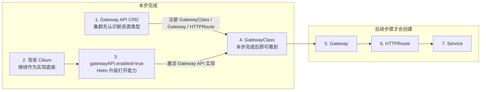

# 第 3 步：为现有 Cilium 开启 Gateway API

## 本步目标

在不重建集群的前提下，为当前已经运行的 `Cilium` 增加 `Gateway API` 能力。

本步完成后，应达到下面状态：

- `Gateway API` 标准 CRD 已安装
- `Cilium` 已启用 `gatewayAPI.enabled`
- 集群中能看到 `GatewayClass`

---

## 执行标记

- **执行标记：必须执行**
- 在现有 `Cilium` 上补齐 `Gateway API` 能力，不额外引入另一套网关产品

---

## 问题背景

到第三章第 2 步为止，集群已经具备 `VIP` 分配能力，但还缺少真正可用的北向入口对象模型。本步继续复用第二章已经安装好的 `Cilium`，直接打开 `Gateway API` 能力。

---

## 理论说明

### `Gateway API` 在第三章中的位置



图中编号说明：

1. 先安装 `Gateway API CRD`，把 `GatewayClass`、`Gateway`、`HTTPRoute` 这些资源类型注册到集群里。
2. 本步不重装网络平面，继续复用第二章已经运行的 `Cilium`。
3. 通过 `gatewayAPI.enabled=true` 打开 `Cilium` 的 `Gateway API` 实现能力。
4. 本步完成后，集群里应能看到 `GatewayClass`，这也是本页最直接的验收点。
5. `Gateway`
6. `HTTPRoute`
7. `Service`
后面几步才会真正创建并使用这些对象。

因此，这一页真正执行的核心动作只有两类：先安装 `Gateway API CRD`，再通过 `Helm` 升级打开 `Cilium` 的 `Gateway API` 能力。

### 为什么这里用 Helm 升级而不是重装 Cilium

第二章已经完成了：

- `Cilium` 安装
- `Hubble`
- `kube-proxy replacement`

第三章只是在现有基础上追加：

- `gatewayAPI.enabled: true`

因此这里的做法不是重装 `Cilium`，而是在第二章稳定配置基础上叠加第三章的 gateway values。

### 本步关键 `YAML` 一次看清

<div style="padding: 10px 14px; border: 1px solid #666; border-left: 4px solid #8ab4f8; border-radius: 6px; background: rgba(138,180,248,0.08); margin: 8px 0;">
<strong>YAML 文件：</strong><code>artifacts/gateway-api-standard-install-v1.4.1.yaml</code><br/>
<strong>本页重点对象：</strong><code>CustomResourceDefinition</code><br/>
<strong>作用：</strong>先把 <code>GatewayClass</code>、<code>Gateway</code>、<code>HTTPRoute</code>、<code>ReferenceGrant</code> 这些资源类型注册到集群里
</div>

这份文件包含多条 `CRD` 定义；下面摘出其中 3 个最关键的对象名：

说明：这里只摘对象名，后面大量 `CRD` 结构定义在这里先不展开。

```yaml
kind: CustomResourceDefinition
metadata:
  name: gatewayclasses.gateway.networking.k8s.io
---
kind: CustomResourceDefinition
metadata:
  name: gateways.gateway.networking.k8s.io
---
kind: CustomResourceDefinition
metadata:
  name: httproutes.gateway.networking.k8s.io
```

- 这些 `CRD` 不直接转发流量
- 它们的作用是先让集群认识第三章后面会创建的入口对象模型

<div style="padding: 10px 14px; border: 1px solid #666; border-left: 4px solid #7fd1b9; border-radius: 6px; background: rgba(127,209,185,0.08); margin: 8px 0;">
<strong>YAML 文件：</strong><code>manifests/03_cilium_gateway_values.yaml</code><br/>
<strong>本页重点对象：</strong><code>gatewayAPI</code> 配置块<br/>
<strong>作用：</strong>在第二章已有的 <code>Cilium</code> 基础上，打开第三章所需的 <code>Gateway API</code> 能力
</div>

```yaml
gatewayAPI:
  enabled: true
  externalTrafficPolicy: Cluster
  gatewayClass:
    create: "auto"
  secretsNamespace:
    create: true
    name: cilium-secrets
    sync: true
```

- `enabled: true`
  - 为现有 `Cilium` 打开 `Gateway API`
- `gatewayClass.create: "auto"`
  - 让 `Cilium` 自动创建可用的 `GatewayClass`
- `externalTrafficPolicy: Cluster`
  - 定义流量进入后的转发策略
- `secretsNamespace.sync: true`
  - 让后续证书 `Secret` 能被 `Gateway` 正常使用

---

## 对应脚本

本步对应脚本：

- `k8s/03-north-south-traffic/scripts/03_enable_gateway_api.sh`

本步直接依赖：

- 第二章的 Cilium chart：`/docker_k8s_2026/k8s/02-cloud-native-networking/artifacts/cilium-1.19.1.tgz`
- 第二章基础 values：`/docker_k8s_2026/k8s/02-cloud-native-networking/manifests/cilium-values.yaml`
- 第三章 gateway values：`manifests/03_cilium_gateway_values.yaml`

脚本里会直接用到下面 4 个关键路径变量：

```bash
GATEWAY_API_CRD_URL="http://ops:9000/03-north-south-traffic/artifacts/gateway-api-standard-install-v1.4.1.yaml"
CILIUM_CHART="/docker_k8s_2026/k8s/02-cloud-native-networking/artifacts/cilium-1.19.1.tgz"
CILIUM_BASE_VALUES="/docker_k8s_2026/k8s/02-cloud-native-networking/manifests/cilium-values.yaml"
CILIUM_GATEWAY_VALUES="/docker_k8s_2026/k8s/03-north-south-traffic/manifests/03_cilium_gateway_values.yaml"
```

关键介绍：

- `GATEWAY_API_CRD_URL`
  - 指向第 1 步已经固化好的 `Gateway API` 标准 CRD 清单
- `CILIUM_CHART`
  - 继续复用第二章已缓存到本地的 `Cilium chart`
- `CILIUM_BASE_VALUES`
  - 继续保留第二章网络平面的核心配置
- `CILIUM_GATEWAY_VALUES`
  - 只补第三章北向入口所需的 gateway 开关

---

## 脚本关键任务

### 关键任务 1：安装 `Gateway API` 标准 CRD

脚本原始代码：

```bash
kubectl apply -f "${GATEWAY_API_CRD_URL}"
```

关键介绍：先让集群认识 `GatewayClass`、`Gateway`、`HTTPRoute` 等对象；`GATEWAY_API_CRD_URL` 对应第 1 步已经固化好的 `artifacts/gateway-api-standard-install-v1.4.1.yaml`。这里不再重复展开完整 `CRD YAML`，直接对应上文卡片。

### 关键任务 2：等待核心 CRD 建立完成

脚本原始代码：

```bash
kubectl wait --for=condition=Established crd/gatewayclasses.gateway.networking.k8s.io --timeout=120s
kubectl wait --for=condition=Established crd/gateways.gateway.networking.k8s.io --timeout=120s
kubectl wait --for=condition=Established crd/httproutes.gateway.networking.k8s.io --timeout=120s
kubectl wait --for=condition=Established crd/referencegrants.gateway.networking.k8s.io --timeout=120s
```

关键介绍：只有 `CRD` 真正建立完成后，后续 `Gateway`、`HTTPRoute` 清单才有意义。

### 关键任务 3：基于第二章 values 做 Helm 升级

脚本原始代码：

```bash
helm upgrade cilium "${CILIUM_CHART}" \
  --namespace kube-system \
  -f "${CILIUM_BASE_VALUES}" \
  -f "${CILIUM_GATEWAY_VALUES}"
```

关键介绍：这一段体现第三章不是重装 `Cilium`，而是在第二章稳定配置基础上叠加 `Gateway API` 能力。真正被叠加进去的核心配置来自 `manifests/03_cilium_gateway_values.yaml`，详细字段已在上文卡片里统一说明。

### 关键任务 4：主动重启 Cilium 组件

脚本原始代码：

```bash
kubectl -n kube-system rollout restart ds/cilium
kubectl -n kube-system rollout restart deploy/cilium-operator
kubectl -n kube-system rollout status ds/cilium --timeout=300s
kubectl -n kube-system rollout status deploy/cilium-operator --timeout=300s
```

关键介绍：让新的 gateway 配置真正加载生效，并明确等待滚动完成。

---

## 执行命令

先给脚本增加执行权限：

```bash
chmod +x /docker_k8s_2026/k8s/03-north-south-traffic/scripts/03_enable_gateway_api.sh
```

然后执行：

```bash
bash /docker_k8s_2026/k8s/03-north-south-traffic/scripts/03_enable_gateway_api.sh
```

---

## 验证方法

### 验证 1：查看 `Gateway API` CRD

```bash
kubectl get crd | grep gateway.networking.k8s.io
```

预期结果：

- 能看到 `gatewayclasses`
- 能看到 `gateways`
- 能看到 `httproutes`
- 能看到 `referencegrants`

### 验证 2：查看 `GatewayClass`

```bash
kubectl get gatewayclass
```

预期结果：

- 能看到 `cilium`

### 验证 3：查看 `Cilium` 总体状态

```bash
cilium status --wait
```

预期结果：

- `Cilium: OK`

---

## 关键看点

这一页真正要确认的是：

- 集群已经具备 `Gateway API` 对象模型
- `Cilium` 已经成为这一套入口模型的实际实现者
- 后面已经可以开始创建 `Gateway` 和 `HTTPRoute`

---

## 通过标准

满足下面条件后，就可以进入下一步：

- `Gateway API` 已在当前集群中可用
- `GatewayClass` 已出现
- `Cilium` 滚动完成并恢复正常

---

## 下一步

进入第 4 步，为 `app.qytk8s.com` 签发 HTTPS 证书：

- `docs/05_issue_tls_certs.md`
